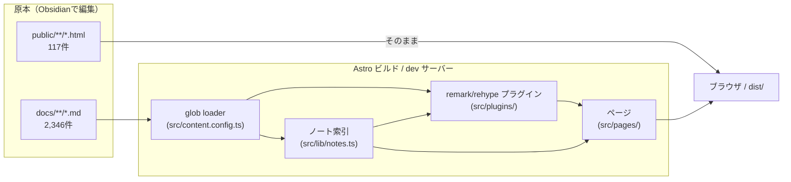
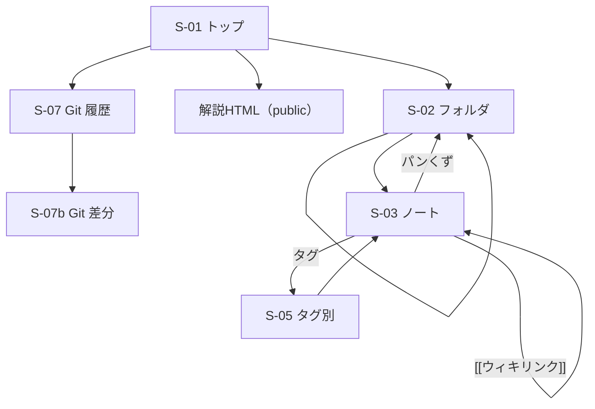
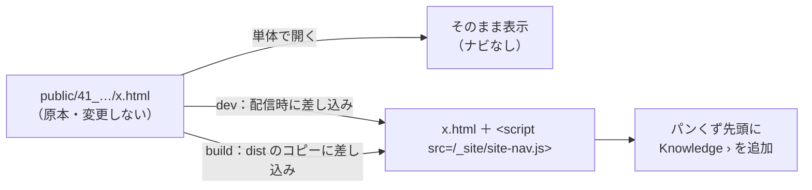

# 02 基本設計書 — knowledge-app

| 項目 | 内容 |
|---|---|
| 文書バージョン | 0.2（UI を A ワークベンチ案・ダークモードのみに決定） |
| 作成日 | 2026-10-18 |
| 前の文書 | [01_requirements.md](01_requirements.md) |
| 次の文書 | [03_detail-design.md](03_detail-design.md) |

---

## 1. 方式の概要

**Astro の静的サイト生成（SSG）＋ Content Collections** で作る。

- `docs/` を Content Collection の読み込み元にし、`src/` には「表示の仕組み」だけを置く（ノートの原本は動かさない：N-05, N-06）。
- Obsidian 独自の記法（ウィキリンク・Callout）は、**ビルド時に Markdown → HTML 変換の途中（remark/rehype プラグイン）で**通常のHTMLに変換する。
- 解説HTML（`public/`）は Astro がそのまま配信する。
- JavaScript は「必要なページだけ」で読み込む（Mermaid、検索）。本文はJS無しで読める（N-04）。

### 1.1 技術スタック

| 用途 | 採用 | 理由 |
|---|---|---|
| フレームワーク | Astro 7.3（導入済み） | Markdown中心のサイトに強く、ゼロJSのHTMLを出せる |
| コンテンツ読み込み | `astro:content` の `glob()` loader | `src/content/` 以外のフォルダ（`docs/`）を直接読める |
| スキーマ検証 | `astro/zod`（Zod 4） | frontmatter の型付け。ゆるいスキーマにする |
| コードハイライト | Shiki（Astro標準） | 追加インストール不要 |
| Markdown拡張 | 自作 remark プラグイン（`unist-util-visit` を使用、Astroに同梱） | ウィキリンク・Callout・YouTube |
| 図 | `mermaid`（npm、ブラウザで描画） | Phase 2 |
| 数式 | `remark-math` + `rehype-katex` | Phase 4 |
| 検索 | Pagefind（ビルド後に索引を作る） | サーバー不要の全文検索。`Ctrl K` パレットから使う。Phase 3 |
| 書体 | IBM Plex Sans JP / JetBrains Mono（Google Fonts） | A ワークベンチ案のエディタ風の見た目 |

---

## 2. システム構成



### 2.1 処理の流れ
1. **読み込み**：glob loader が `docs/**/*.md` を読み、frontmatter を検証してエントリにする。
2. **索引づくり**：全エントリから「ノート名 → URL」の対応表と、フォルダツリーを作る（ウィキリンク解決とナビゲーションに使う）。
3. **変換**：各ノートの Markdown を HTML にするとき、プラグインがウィキリンクを `<a>` に、Callout を `<div class="callout">` に置き換える。
4. **ページ生成**：`getStaticPaths()` で、全ノート・全フォルダのページを作る。

---

## 3. ディレクトリ構成

```text
obsidian/
├─ design/                  … 本設計書（サイトには出さない）
├─ docs/                    … ノート原本（変更しない）
├─ public/                  … 解説HTML原本（変更しない）＋ サイト用の静的ファイル
│  └─ _site/site-nav.js     … 解説HTMLのパンくず先頭に「Knowledge」を足すスクリプト（F-42）
├─ src/
│  ├─ content.config.ts     … コレクション定義（docs を読む）
│  ├─ lib/
│  │  ├─ notes.ts           … ノート索引・フォルダツリー・パス⇔URL変換
│  │  ├─ explainers.ts      … 解説HTMLの一覧（public の目次ページ）
│  │  └─ git-history.ts     … Git 履歴 JSON の読み込み（S-07）
│  ├─ integrations/
│  │  └─ explainer-nav.ts … 解説HTMLに全体ナビを「配信時だけ」差し込む（F-42）
│  ├─ plugins/
│  │  ├─ remark-wikilink.ts … [[...]] → リンク
│  │  ├─ remark-callout.ts  … > [!type] → callout
│  │  └─ remark-embed.ts    … YouTube 等の埋め込み（Phase 4）
│  ├─ layouts/
│  │  └─ BaseLayout.astro   … 共通の head・ヘッダー・サイドバー
│  ├─ components/
│  │  ├─ Header.astro       … ロゴ・検索欄（Phase 1 は見た目のみ）
│  │  ├─ FolderTree.astro   … 左のエクスプローラー
│  │  ├─ PathBar.astro      … 本文上のパス表示（パンくず）
│  │  ├─ NoteAside.astro    … 右パネル（アウトライン・リンク先・プロパティ）
│  │  ├─ StatusBar.astro    … 下のステータスバー
│  │  ├─ NoteMeta.astro     … Phase 2
│  │  └─ CommandPalette.astro … Ctrl K 検索（Phase 3）
│  ├─ pages/
│  │  ├─ index.astro        … トップ
│  │  ├─ notes/[...path].astro  … ノート／フォルダページ
│  │  ├─ history/           … S-07 一覧・差分（Could / ローカル限定）
│  │  ├─ tags/index.astro   … Phase 3
│  │  ├─ tags/[tag].astro   … Phase 3
│  │  └─ 404.astro
│  └─ styles/
│     ├─ global.css
│     └─ history.css        … S-07 用
├─ scripts/
│  ├─ extract-git-history.mjs … ビルド時に Git 履歴を抽出
│  └─ with-git-history.mjs  … INCLUDE_GIT_HISTORY=1 付きで astro 起動
├─ astro.config.mjs
└─ package.json
```

---

## 4. 画面設計

### 4.1 画面一覧

| ID | 画面 | URL | 内容 | Phase |
|---|---|---|---|---|
| S-01 | トップ | `/` | ようこそ欄、解説HTMLへのリンク、全フォルダの表（No・分類・フォルダ・ノート数） | 1 |
| S-02 | フォルダ | `/notes/<フォルダパス>/` | サブフォルダ一覧＋ノート一覧 | 1 |
| S-03 | ノート | `/notes/<ノートのパス>` | 本文、パス表示、右パネル（アウトライン・リンク先） | 1 |
| S-04 | タグ一覧 | `/tags/` | タグと件数 | 3 |
| S-05 | タグ別 | `/tags/<tag>/` | そのタグのノート一覧 | 3 |
| S-06 | 404 | — | 見つからないとき | 1 |
| S-07 | Git 履歴 | `/history/` | コミット一覧表（日付・短縮ハッシュ・件名・変更ファイル数）。`INCLUDE_GIT_HISTORY=1` 時のみ実データ。対象は `src/`・`design/` | 4 |
| S-07b | Git 差分 | `/history/<shortHash>/` | 上記コミットのファイル一覧と差分（email なし・200KB 超は省略） | 4 |
| — | 解説HTML | `/41_アーキテクチャ/00-0_目次.html` など | `public/` のまま | 1 |

### 4.2 画面遷移



### 4.3 共通レイアウト（A ワークベンチ案）

UI は「A ワークベンチ」案に決定（要件定義 §9）。モック：https://claude.ai/artifact/HJnxFYfy9QDEu71LJ5RR6F

```text
┌────────────────────────────────────────────────────────┐
│ Header：Knowledge ｜ [ノート・フォルダを検索  Ctrl K]   │
├──────────────┬──────────────────────────┬──────────────┤
│ FolderTree   │ (タブ列：Phase 4)         │ NoteAside    │
│ エクスプローラー│ PathBar docs / 10_… / x.md│ アウトライン │
│ ▾ 10 基礎概念 │ # タイトル                │ リンク先     │
│   01_…       │ 本文                      │ プロパティ   │
│   05_… ■     │                           │              │
│ ▸ 11 …       │                           │              │
├──────────────┴──────────────────────────┴──────────────┤
│ StatusBar：10_基礎概念 › 5 / 6 ｜ 見出し 3 ｜ リンク 4    │
└────────────────────────────────────────────────────────┘
 幅 280px / 可変 / 260px。スマホ幅：ツリーと右パネルは本文の上下に回り込む
```

| 部品 | Phase 1 での動き |
|---|---|
| Header の検索欄 | 見た目のみ（入力しても何も起きない）。Phase 3 で `Ctrl K` パレットにする |
| FolderTree | 今いるノートの祖先フォルダだけ開き、他は閉じる。開閉は `<details>` で JS 無し |
| NoteAside | アウトライン＝`render()` の `headings`（h2・h3）、リンク先＝ウィキリンクの解決結果 |
| StatusBar | トップ：ノート数・フォルダ数・解説HTML数・未作成リンク数。ノート：フォルダ内の位置・見出し数・リンク数 |
| タブ・最近開いたノート | Phase 4（ブラウザの `localStorage` に記録） |

### 4.4 配色・書体
- **ダークモードのみ**（ライトモードと切替ボタンは作らない）。
- 色：背景 `#14161b`、パネル `#1b1e25` / `#181b21`、枠線 `#2b2f39`、文字 `#e4e6eb` / `#a3a9b5` / `#8d94a1`、リンク `#7cb7ec`、ステータスバー `#2a5b86`、ヒント系 Callout `#7fd3a2`。
- 書体：本文 IBM Plex Sans JP、コード・パス・数値 JetBrains Mono（Google Fonts）。

---

## 5. データ設計

### 5.1 コレクション `notes`

| 項目 | 型 | 出どころ | 備考 |
|---|---|---|---|
| `id` | string | ファイルパス | `docs/` からの相対パスから `.md` を除いたもの。例：`10_基礎概念/01_変数とスコープ`。**大文字小文字・日本語をそのまま残す** |
| `data.title` | string? | frontmatter | 無ければ本文の最初の h1、それも無ければファイル名 |
| `data.tags` | string[] | frontmatter | 文字列1つの場合も配列に直す。無ければ `[]` |
| `data.created` / `published` / `updated` | Date? | frontmatter | 読めない値は無視（エラーにしない） |
| `data.description` / `source` / `author` | string? | frontmatter | |
| その他の項目 | — | frontmatter | 捨てずに残す（passthrough） |
| `body` | string | 本文 | 検索・タイトル推定に使う |

### 5.2 ノート索引（ビルド時にメモリ上で作る）

| 名前 | 中身 | 用途 |
|---|---|---|
| `byId` | id → ノート | ページ生成 |
| `byName` | ファイル名（拡張子なし、小文字化） → id の配列 | ウィキリンク解決。同名が複数あるので配列 |
| `byPath` | 小文字化した id → id | `[[フォルダ/ノート]]` 形式の解決 |
| `tree` | フォルダの木構造（子フォルダ・ノート、番号順） | フォルダページ・サイドバー・パンくず |
| `backlinks` | id → リンク元 id の配列 | Phase 3 |

### 5.3 URL の規則
- ノート：`/notes/` + id（例：`/notes/10_基礎概念/01_変数とスコープ`）
- フォルダ：`/notes/` + フォルダパス + `/`
- `/notes/` を前に付けるのは、`public/41_アーキテクチャ/` など解説HTMLのURLとぶつけないため。
- 日本語はそのまま使う（ブラウザが自動でエンコードする）。空白や `#` `?` を含むファイル名は §6 の詳細設計でエスケープする。

---

## 6. Obsidian 記法の変換方針

| 記法 | 変換後 | 方針 |
|---|---|---|
| `[[名前]]` | `<a href="/notes/...">名前</a>` | 解決順は「同じフォルダ → 近いフォルダ → パスが短いもの」。Obsidian の「最短パス」挙動に合わせる |
| `[[名前\|表示]]` | 表示テキストを差し替え | |
| `[[名前#見出し]]` | `#見出しのslug` を付ける | slug は Astro と同じ `github-slugger` で作る |
| `[[#見出し]]` | 同じページ内リンク | |
| 解決できない `[[名前]]` | `<span class="wikilink-unresolved">名前</span>` | ビルドは止めない。件数をログに出す |
| `![[名前]]`（埋め込み） | Phase 1 はリンクにする | 画像ファイルは現在 Vault に無い |
| `> [!tip] タイトル` | `<div class="callout callout-tip">` | `> [!tip]-` / `+`（折りたたみ）は `<details>` にする |
| ```` ```mermaid ```` | `<pre class="mermaid">` を残し、ブラウザで描画 | Shiki の対象から外す（`excludeLangs`） |
| `$...$` / `$$...$$` | KaTeX | Phase 4 |
| `` | `<iframe>` 埋め込み | Phase 4。それまでは普通のリンク |

---

## 7. 非機能要件への対応

| 要件 | 対応 |
|---|---|
| N-03 ビルドを止めない | スキーマは全項目を任意＋`catch` で既定値に落とす。プラグイン内の例外は捕まえて、そのノートだけ素の Markdown 表示にする |
| N-04 性能 | 索引は1回だけ作ってキャッシュする（モジュールスコープ）。重い Mermaid はブラウザ側で、そのページだけ読み込む |
| N-05 反映 | dev サーバーは `docs/` の変更を監視して自動で再読み込みする（glob loader の標準機能） |
| N-06 原本を変えない | `docs/` と `public/` には書き込まない |
| N-07 ダークモードのみ | CSS 変数で §4.4 の色を定義する。`color-scheme: dark` を指定し、OS の設定に関係なく常にダーク表示 |

---

## 7.1 解説HTMLから全体へ戻る仕組み（F-42）

解説HTMLは章ごとに独立しており、単体でも使えるようにしておく。そのため**原本には手を入れず、サイトが配信するときだけ**ナビを足す。



| 場面 | 仕組み |
|---|---|
| `npm run dev` | `explainer-nav` インテグレーションの Vite ミドルウェアが、`public/<章>/*.html` へのリクエストだけを横取りし、`</body>` の前にスクリプトを1行足して返す |
| `npm run build` | `astro:build:done` で、`dist/` にコピーされた解説HTMLだけに同じ1行を足す |
| `site-nav.js` | `.topbar .crumb` があれば先頭に `<a href="/">Knowledge</a> ›` を足す。無いページ（現在1件）は左下に小さなリンクを出す |
| 単体利用 | 差し込みが起きないので、原本どおりに動く |

## 8. 対象外・今後の検討
- 公開するときのホスティング先（GitHub Pages / Cloudflare Pages など）は未決定（要件 Q-1）。
- グラフビュー（Obsidian のノート関係図）は今回作らない。

## 9. Git 履歴ページ（S-07）

学習用に、このリポジトリのコミットを表で追えるようにする（Could / Phase 4）。

- **生成**：`astro.config.mjs` 読み込み時に `scripts/extract-git-history.mjs` が `.astro/git-history.json` を書く（`src/` 配下だと書き込みで Vite が再読込するため）。`INCLUDE_GIT_HISTORY=1` のときだけ実データを入れ、それ以外は空スタブ。
- **表示範囲**：`src/**` と `design/**` のみ。`.env*` / `*credentials*` / `*secret*` は除外。作者 email は JSON に載せない。
- **配信**：`.git` は出さない。生成 JSON は `.astro/`（既に gitignore）に置く。
- **起動**：`npm run dev:history` / `npm run build:history`。
