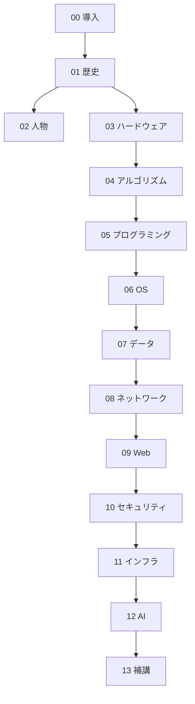

# コンピュータサイエンス学習目次

**ゆっくり情報科学ちゃんねる**（🎬）と **ゆるコンピューター科学ラジオ**（🎙️）の2ソースを、テーマ横断で初心者向けに並べ替えた**学習順の目次**です。  
フォルダ構成（分野別の置き場所）は [[MOC_コンピューターサイエンス体系]] を参照してください。

## この目次の使い方

1. **第0章 → 第13章**の順がおすすめ（歴史で全体像 → 中身 → ネット → 現代）。
2. 同じ章内は **上から順**に。🎬と🎙️は内容が重なるところもあるので、どちらか一方でも可。
3. 人物編（第2章）は、歴史（第1章）と **並行**して読んでもよい。

---

## 学習ロードマップ（全体像）

---

## 第0章：導入 — コンピュータサイエンスとは何か

| # | ソース | ノート |
|---|--------|--------|
| 0-1 | 🎙️ | [[01コンピュータ科学をやるのに、コンピュータは不要【アルゴリズム1】1\|コンピュータ科学をやるのにコンピュータは不要]] |
| 0-2 | 🎙️ | [[「コンピュータは計算だけする」ってホント？]] |
| 0-3 | 🎙️ | [[計算機史・コンピューター史まとめ\|計算機史年表（全体地図）]] ※`計算機史/` フォルダ移行予定 |

---

## 第1章：歴史 — 計算機からインターネット・AIまで

**第1章の読み方**：🎬「コンピュータの歴史①〜⑥」が **時代順の主線** です。🎙️のバベッジ・電気通信・タッチ操作は、その前後に差し込む **横断エピソード** として読めます。言語・OS・CPU など分野別の深掘りは各章にあり、末尾 **分野別歴史マップ** から飛べます。

### 1-1 計算の机械化〜理論の確立（〜1940年代）

| # | ソース | ノート |
|---|--------|--------|
| 1-1 | 🎙️ | [[01歯車でコンピュータを作った男。目的は、命を救うこと。【バベッジ1】124\|バベッジ① 歯車でコンピュータ]] |
| 1-2 | 🎙️ | [[02機械式コンピュータの挫折。その原因は、凡庸な人間ドラマだった。【バベッジ2】125\|バベッジ② 機械式の挫折]] |
| 1-3 | 🎬 | [[【コンピュータの歴史】なぜコンピュータは“何でもできる”のか──チューリングマシンからノイマン型まで80年の真実【ゆっくり解説】\|チューリングマシン→ノイマン型]] |

> **並行読み**：[[01誤解まみれのチューリング。コンピュータの父ってホント？【チューリング1】32\|チューリング①]]・[[01【ガセも多いよ】コンピュータの父・ノイマンのヤバい逸話を紹介しまくる【ノイマン1】74\|ノイマン①]]（第2章）で人物像を深掘りできます。

### 1-2 電子計算機の誕生と小型化（1940〜1970年代）

| # | ソース | ノート |
|---|--------|--------|
| 1-4 | 🎬 | [[【ゆっくり解説】コンピュータの歴史①～世界初の全電子式コンピュータ～\|歴史① ENIAC時代]] |
| 1-5 | 🎬 | [[【ゆっくり解説】コンピュータの歴史②～コンピュータの飛躍～\|歴史② トランジスタ・集積回路]] |

### 1-3 通信の系譜（計算機史と並行する系統）

| # | ソース | ノート |
|---|--------|--------|
| 1-6 | 🎙️ | [[電気通信の歴史は、神父の残酷な実験から始まる。151]] |
| 1-7 | 🎙️ | [[モールス信号は、愚かさから生まれた。152]] |
| 1-8 | 🎙️ | [[日本の通信主権を奪った、知られざる不平等条約]] |
| 1-9 | 🎙️ | [[世界中の電話を爆速にした、知られざる日本人研究者]] |

### 1-4 パソコン・GUI・日本のPC市場（1970〜1990年代）

| # | ソース | ノート |
|---|--------|--------|
| 1-10 | 🎬 | [[【ゆっくり解説】コンピュータの歴史③～パーソナルコンピューターの登場～\|歴史③ PCの登場]] |
| 1-11 | 🎬 | [[【シェア98%からの転落】国民機「PC-98」はなぜ黒船Windowsに敗北したのか？\|PC-98とWindows]] |
| 1-12 | 🎙️ | [[タッチ操作はなぜ敗北し、蘇ったのか？\|タッチ操作の興亡]] |

### 1-5 普及・Web前夜（1990〜2000年代）

| # | ソース | ノート |
|---|--------|--------|
| 1-13 | 🎬 | [[【ゆっくり解説】コンピュータの歴史④～コンピューターの普及とブラウザ戦争～\|歴史④ 普及とブラウザ戦争]] |
| 1-14 | 🎬 | [[01【なぜ】インターネットは軍事研究から生まれたのに“自由なネット”になったのか【ARPANET】\|ARPANETと自由なネット]] |

### 1-6 インターネット・SNS・AI（2000年代〜）

| # | ソース | ノート |
|---|--------|--------|
| 1-15 | 🎬 | [[【ゆっくり解説】コンピュータの歴史⑤～インターネットの普及～\|歴史⑤ インターネット普及]] |
| 1-16 | 🎬 | [[【ゆっくり解説】コンピュータの歴史⑥～SNSの発展とAIの進化～\|歴史⑥ SNSとAI]] |

### 1-7 技術史エピソード（主線の補完・任意）

歴史①②の半導体部分を深掘りしたいとき、または主線を読んだあとに **分野史** へ入る前の橋渡しとして。

| # | ソース | ノート |
|---|--------|--------|
| 1-17 | 🎙️ | [[なぜエヌビディアは世界一の企業なのか？\|NVIDIAとGPU革命]] |
| 1-18 | 🎬 | [[【天才の逆鱗】なぜ『Git』は世界を塗り替えたのか？開発をわずか2週間で終わらせたリナスの怒りと、革命的すぎる「分散管理」の正体【ゆっくり解説】\|Gitの誕生]] |

### 分野別歴史マップ（各章へ）

第1章は **全体の年表** です。以下は同じ「歴史」テーマだが **分野別の深掘り** として各章に配置しています。第1章を読んだあと、興味のある分野から辿ってください。

| 分野 | 章 | 入口ノート |
|------|-----|-----------|
| 人物・思想 | 第2章 | [[01誤解まみれのチューリング。コンピュータの父ってホント？【チューリング1】32\|チューリング①]] |
| ハードウェア（原理） | 第3章 | [[01コンピュータはなぜ動くのか、2時間で原理を理解する【半導体1】20\|半導体① 動く原理]] |
| CPU・アーキテクチャ（歴史） | 第3章 | [[02-CPUとアーキテクチャとは\|章まとめ]] / [[【CPU戦争】なぜ“弱い側”が世界を取ったのか【逆転の真相】\|CPU戦争]] |
| プログラミング言語 | 第5章 | [[00【完全解説】プログラミング言語の歴史を超わかりやすく解説！\|言語史 総論]] |
| OS | 第6章 | [[【完全解説】OSの歴史を超わかりやすく解説！\|OSの歴史（総論）]] |
| ネットワーク | 第8章 | [[【歴史的敗北】なぜ「完璧な設計」は負けたのか？ネット覇権を巡る伝説の「プロトコル戦争」\|プロトコル戦争]] |
| データ・文字 | 第7章 | [[【初心者向け】データベースの進化の全てをわかりやすく解説\|DBの進化]] / [[【文字化けの正体】なぜ日本語は壊れるのか？文字コードの歴史をゆっくり解説\|文字コードの歴史]] |
| Web・ブラウザ | 第9章 | [[02【ブラウザ戦争】なぜIEは滅んだのか？【30年の真実】\|ブラウザ戦争]] |
| 暗号 | 第10章 | [[01暗号の歴史はエモい。言語学や数学だけでなく、◯◯さえも使っている。【暗号1】79\|暗号① 歴史]] |
| アルゴリズム・索引 | 第4章 | [[03世界最速ソートは飲み会で生まれた？ソート60年史【ゆっくり解説】\|ソート60年史]] / [[索引の発明者はサイコパス。人間性を捨てることで生まれた大発明【索引の歴史】121\|索引の歴史]] |
| 検索エンジン | 第9章 | [[04Googleはなぜ一瞬で答えを出せるのか？検索60年史【ゆっくり解説】\|検索60年史]] |

---

## 第2章：人物と思想 — 科学を形づくった人びと

### 2-1 アラン・チューリング

| # | ソース | ノート |
|---|--------|--------|
| 2-1 | 🎙️ | [[01誤解まみれのチューリング。コンピュータの父ってホント？【チューリング1】32\|チューリング① 誤解と実像]] |
| 2-2 | 🎙️ | [[02チューリングはコンピュータの父ではない。コンピュータ科学の父だ【チューリング2】33\|チューリング② CSの父]] |
| 2-3 | 🎙️ | [[03コンピュータの限界は「テープを読み書きする機械」で分かる。チューリングマシンはすごい【チューリング3】34\|チューリング③ チューリングマシン]] |
| 2-4 | 🎙️ | [[04初恋の人を蘇らせたくて、チューリングは人工知能を作った（かもしれない）【チューリング4】 35\|チューリング④ AIへの道]] |

### 2-2 ジョン・フォン・ノイマン

| # | ソース | ノート |
|---|--------|--------|
| 2-5 | 🎙️ | [[01【ガセも多いよ】コンピュータの父・ノイマンのヤバい逸話を紹介しまくる【ノイマン1】74\|ノイマン① 逸話と実像]] |
| 2-6 | 🎙️ | [[02学者ノイマンを支えた最高の能力は「猥談」【ノイマン2】75\|ノイマン② 学者として]] |
| 2-7 | 🎙️ | [[03核兵器開発を肯定し続けた男は、それほど冷酷ではなかった【ノイマン3】76\|ノイマン③ 核と倫理]] |

---

## 第3章：ハードウェア — なぜコンピュータは動くのか

**第3章の読み方**：🎙️「半導体①〜④」が **電気から論理回路までの原理の主線** です。続く **3-5（浮動小数点）** で「コンピュータが数をどう扱うか」を押さえたあと、🎬「スタックと関数呼び出し」で **メモリと実行** に橋をかけ、🎬「CPU戦争 → CPU①〜⑤」が **設計と産業史の主線** です。🎙️の GPU・NVIDIA・TPU は **専用チップ** の補完として後半にまとめています。第1章 **1-5**（トランジスタの歴史）・**1-17**（NVIDIA）は、歴史の文脈で先に読んでも、ここで戻ってもよい **並行エピソード** です。

> **章まとめ**：ハードウェアの横断整理は [[分野別深掘りマップ_ハードウェア|分野別深掘りマップ]]。CPU 全7本の統合まとめは [[02-CPUとアーキテクチャとは|02-CPUとアーキテクチャ]]。

### 3-1 半導体・論理回路（電気からコンピュータへ）

| # | ソース | ノート |
|---|--------|--------|
| 3-1 | 🎙️ | [[01コンピュータはなぜ動くのか、2時間で原理を理解する【半導体1】20\|半導体① 動く原理]] |
| 3-2 | 🎙️ | [[02トランジスタを巨大プリンにたとえて説明する【半導体2】21\|半導体② トランジスタ]] |
| 3-3 | 🎙️ | [[03豆電球のつなぎ方が分かれば、コンピュータは作れる【半導体3】22\|半導体③ 論理回路]] |

> **並行読み（任意）**：[[【ゆっくり解説】コンピュータの歴史②～コンピュータの飛躍～\|歴史② トランジスタ・集積回路]]（第1章 **1-5**）——産業史の側から同じテーマを補完できます。

### 3-2 二進数と数の表現

| # | ソース | ノート |
|---|--------|--------|
| 3-4 | 🎙️ | [[04二進数の筆算、あなたはできる？機械にやらせるには？【半導体4】23\|半導体④ 二進数]] |
| 3-5 | 🎙️ | [[プログラムはなぜ小数の計算をミスるのか？\|浮動小数点の罠]] ※`半導体/` フォルダ移行予定 |

### 3-3 メモリとプログラムの実行

原理（論理回路・二進数）と CPU 史のあいだをつなぐ **橋渡し** です。関数呼び出しが「元の場所に戻れる」仕組み＝スタックメモリの話。

| # | ソース | ノート |
|---|--------|--------|
| 3-6 | 🎬 | [[【衝撃】なぜプログラムは『元の場所』に戻れるのか？関数呼び出しとスタックメモリ【ゆっくり解説】\|スタックと関数呼び出し]] |

> **発展**：第6章 **6-13** [[【OSの仕組み】プロセスとスレッドの違いとは？スタック・ヒープ・排他制御まで完全図解【ゆっくり解説】\|プロセスとスレッド]] でメモリ空間を OS 視点から深掘りできます。

### 3-4 CPUの設計・歴史・並列処理

時代順は **CPU戦争（前史）→ ①〜⑤**。横断整理は [[02-CPUとアーキテクチャとは|02-CPUとアーキテクチャ]]。

| # | ソース | ノート |
|---|--------|--------|
| 3-7 | 🎬 | [[【CPU戦争】なぜ“弱い側”が世界を取ったのか【逆転の真相】\|CPU戦争（8ビット〜IBM PC）]] |
| 3-8 | 🎬 | [[01【CPUの歴史】呪われた互換性の40年：インテル8086が現代の最強CPUを縛り続ける理由【ゆっくり解説】※訂正版\|CPU① 8086と互換性]] |
| 3-9 | 🎬 | [[02【下克上】なぜIntelはAMDの設計に従ったのか？『x86-64』がIT業界を統一した衝撃の逆転劇【ゆっくり解説】\|CPU② x86-64]] |
| 3-10 | 🎬 | [[03【爆熱の限界】なぜCPUは『速さ』を捨てて『数』を増やしたのか？クロック神話の崩壊とマルチコアの夜明け【ゆっくり解説】\|CPU③ マルチコア]] |
| 3-11 | 🎬 | [[04【同時実行の地獄】なぜマルチコアを活かすのは難しいのか？プログラムが壊れる『競合状態』の恐怖と排他制御\|CPU④ 競合状態]] |
| 3-12 | 🎬 | [[05【Intelの終焉？】なぜ『x86』は『ARM』に勝てないのか？Apple Siliconが証明した「命令セット」の呪縛と40年の確執【ゆっくり解説】\|CPU⑤ ARMと命令セット]] |

> **発展**：CPU④ の競合状態・排他制御は、第6章 **6-13**（プロセスとスレッド）でも実装側から登場します。

### 3-5 GPU・専用チップ

| # | ソース | ノート |
|---|--------|--------|
| 3-13 | 🎙️ | [[機械オンチに「GPU」を説明する動画\|GPUとは]] |
| 3-14 | 🎙️ | [[なぜエヌビディアは世界一の企業なのか？\|NVIDIAとGPU革命]] |
| 3-15 | 🎙️ | [[Googleが開発した「TPU」、中身が異端すぎる…。\|Google TPU]] |

> **並行読み（任意）**：第1章 **1-17** でも NVIDIA が登場します（AI 時代の企業史として先に読む場合）。ここ **3-14** では CUDA・コンパイラ最適化など **技術面** に重点を置いています。

---

## 第4章：理論 — 情報・計算の考え方

### 4-1 情報理論

| # | ソース | ノート |
|---|--------|--------|
| 4-1 | 🎙️ | [[01「晩ごはんはカレー」を極限まで短くすると、沈黙になる【情報理論1】9\|情報理論① 情報量]] |
| 4-2 | 🎙️ | [[02人が天気予報を見る理由は「エントロピー」で説明できる【情報理論2】10\|情報理論② エントロピー]] |
| 4-3 | 🎙️ | [[03友だちと親しくなる=情報量の期待値が減る【情報理論3】11\|情報理論③ 期待値]] |

### 4-2 アルゴリズム・データ構造

| # | ソース | ノート |
|---|--------|--------|
| 4-4 | 🎙️ | [[02あなたのマンガ並び替え方法はダサい。オーダーがダサい【アルゴリズム2】2\|アルゴリズム② ソート]] |
| 4-5 | 🎙️ | [[03デカルトみを感じたいなら、コンピュータ科学をやれ！【アルゴリズム3】3\|アルゴリズム③ 科学としてのCS]] |
| 4-6 | 🎙️ | [[01データ構造はトレードオフの芸術。最強のデータ記録法とは？【データ構造1】48\|データ構造① トレードオフ]] |
| 4-7 | 🎙️ | [[02巧妙なアイデア「ふたまたニョキニョキ」がすべてを解決する【データ構造2】49\|データ構造② 木構造]] |
| 4-8 | 🎙️ | [[Googleマップはなぜ爆速で最短経路が分かるの？]] |
| 4-9 | 🎙️ | [[索引の発明者はサイコパス。人間性を捨てることで生まれた大発明【索引の歴史】121\|索引（データベースの原点）]] |

---

## 第5章：プログラミングとソフトウェア

### 5-1 言語の歴史（低レベル → 高レベル）

| # | ソース | ノート |
|---|--------|--------|
| 5-0 | 🎬 | [[00【完全解説】プログラミング言語の歴史を超わかりやすく解説！\|言語史 総論]] |
| 5-1 | 🎬 | [[01アセンブリ言語・機械語の歴史【ゆっくり解説】\|機械語・アセンブリ]] |
| 5-2 | 🎬 | [[02コンパイラはなぜ生まれたのか【プログラミング言語の歴史】\|コンパイラ]] |
| 5-3 | 🎬 | [[03インタプリタはなぜ生まれたのか【プログラミング言語の歴史】\|インタプリタ]] |
| 5-4 | 🎬 | [[04【ゆっくり解説】たった10分でわかるＣ言語の歴史【プログラミング言語の歴史】\|C言語]] |
| 5-5 | 🎬 | [[05オブジェクト指向はなぜ生まれたのか？【プログラミング言語の歴史】\|OOPの誕生]] |
| 5-6 | 🎬 | [[06【ゆっくり解説】家電用言語が大逆転！Javaの波乱万丈な30年【IT技術】\|Java]] |
| 5-7 | 🎬 | [[07【Javaへの復讐】なぜ「パクリ」と言われたCが最強の言語になったのか？Microsoftの黒歴史と、10年かけた執念の逆転劇【ゆっくり解説】\|C#とMicrosoft]] |
| 5-8 | 🎬 | [[08【30年の歴史】なぜPythonは遅いのに世界を制したのか【ゆっくり解説】\|Pythonの台頭]] |
| 5-9 | 🎬 | [[09【ゆっくり解説】日本が生んだRuby30年の軌跡！TwitterもGitHubもこの言語から生まれた【IT技術】\|Ruby]] |
| 5-10 | 🎬 | [[10【初心者向け】JavaScriptはどうやって生まれた？たった10日の奇跡【プログラミング言語の歴史】\|JavaScript]] |
| 5-11 | 🎙️ | [[【大いなる罠】プログラミング言語の意味論を勉強したら7時間がムダになった127\|意味論の罠（上級・任意）]] |

> ※ 第1章 **分野別歴史マップ** からもこの章へリンクしています。

### 5-2 プログラミングパラダイム

| # | ソース | ノート |
|---|--------|--------|
| 5-12 | 🎙️ | [[01プログラミング言語にも歴史の転換点がある【プログラミングパラダイム・シフト1】64\|パラダイム① 転換点]] |
| 5-13 | 🎙️ | [[02構造化プログラミングが、混沌だったフローチャートに秩序を与えた【プログラミングパラダイム・シフト2】65\|パラダイム② 構造化]] |
| 5-14 | 🎙️ | [[03オブジェクト指向は、世界を写実的に描く営み。ルネサンスと同じ。【プログラミングパラダイム・シフト3】66\|パラダイム③ OOP]] |
| 5-15 | 🎙️ | [[04オブジェクト指向の強烈な武器「ポリモーフィズム」で、ペンギンと鳩を同様に扱える【プログラミングパラダイム・シフト4】67\|パラダイム④ ポリモーフィズム]] |
| 5-16 | 🎙️ | [[05オブジェクト指向は万能の薬ではなかった。関数型の流行へ。【プログラミングパラダイム・シフト5】68\|パラダイム⑤ 関数型へ]] |

### 5-3 開発ツール

| # | ソース | ノート |
|---|--------|--------|
| 5-17 | 🎬 | [[【天才の逆鱗】なぜ『Git』は世界を塗り替えたのか？開発をわずか2週間で終わらせたリナスの怒りと、革命的すぎる「分散管理」の正体【ゆっくり解説】\|Gitの誕生]] |

> ※ Git は第1章 **1-18** にも登場（歴史の文脈で先に読む場合）。

---

## 第6章：OS — コンピュータの「司令塔」

### 6-1 OSの役割と起動

| # | ソース | ノート |
|---|--------|--------|
| 6-1 | 🎙️ | [[01思考のOSはアップデートできない。OSの本懐は「資源管理者」。【OS1】114\|OS① 資源管理者]] |
| 6-2 | 🎬 | [[【初心者向け】実は知らない「OS」と「カーネル」の違い【ゆっくり解説】\|OSとカーネル]] |
| 6-3 | 🎬 | [[【BIOSUEFI】電源ONからOS起動まで、PC内部で何が起きているのか？【ゆっくり解説】\|BIOS/UEFIと起動]] |
| 6-4 | 🎬 | [[【完全解説】OSの歴史を超わかりやすく解説！\|OSの歴史（総論）]] |

### 6-2 UNIX・Linux・Windows

| # | ソース | ノート |
|---|--------|--------|
| 6-5 | 🎬 | [[【ゆっくり解説】UNIXの歴史【OSの歴史】\|UNIXの歴史]] |
| 6-6 | 🎬 | [[【ITの歴史】1969年UNIX誕生から現代まで！シェルはこうして進化した【ゆっくり解説】\|シェルの進化]] |
| 6-7 | 🎬 | [[【初心者向け】GNU's Not UnixとLinuxが世界を変えた話【ゆっくり解説】\|GNUとLinux]] |
| 6-8 | 🎬 | [[【Linuxの歴史】趣味から世界制覇へ！30年で「ITの支配者」になった衝撃の歴史【ゆっくり解説】\|Linuxの歴史]] |
| 6-9 | 🎬 | [[【初心者向け】UNIXとLinuxって何が違うの？POSIXで繋がる3つのOSファミリー【ゆっくり解説】\|UNIX/Linux/POSIX]] |
| 6-10 | 🎬 | [[【ゆっくり解説】Windowsの歴史を徹底解説【OSの歴史】\|Windowsの歴史]] |
| 6-11 | 🎬 | [[【技術革命】Windows 95はなぜ世界を変えたのか― 32bit化・TCPIP・DirectXがもたらした衝撃【ゆっくり解説】\|Windows 95]] |
| 6-12 | 🎙️ | [[【素人は帰れ】厳しすぎるOS・UNIXの哲学を紹介する【対話拒否】138\|UNIX哲学（発展）]] |

### 6-3 プロセス・システムコール・ドライバ

| # | ソース | ノート |
|---|--------|--------|
| 6-13 | 🎬 | [[【OSの仕組み】プロセスとスレッドの違いとは？スタック・ヒープ・排他制御まで完全図解【ゆっくり解説】\|プロセスとスレッド]] |
| 6-14 | 🎙️ | [[02OSに学ぶタスク管理術。300個のタスクを同時にこなすには？【OS2】115\|タスク管理]] |
| 6-15 | 🎬 | [[【初心者向け】システムコールとは？アプリとカーネルを繋ぐ仕組みを完全解説【ゆっくり解説】\|システムコール]] |
| 6-16 | 🎬 | [[【CrowdStrike事件】世界崩壊の引き金？OSの支配者「ドライバ」の歴史と技術【ゆっくり解説】\|ドライバ]] |
| 6-17 | 🎬 | [[【ゆっくり解説】知っておきたいファイルシステムの歴史【情報技術】\|ファイルシステム]] |
| 6-18 | 🎙️ | [[ド素人に「ターミナル」の必要性を熱弁する60分【黒画面に白文字のアレ】137\|ターミナル]] |

---

## 第7章：データと文字 — 情報の保存と表現

### 7-1 文字コード

| # | ソース | ノート |
|---|--------|--------|
| 7-1 | 🎙️ | [[01文字コードを深掘りする。文字化けはなぜ起こるのか？【文字コード1】92\|文字コード① 文字化け]] |
| 7-2 | 🎙️ | [[02文字コードを脳にたとえて説明する。GL領域は左脳で、GR領域は右脳。【文字コード2】93\|文字コード② 仕組み]] |
| 7-3 | 🎙️ | [[03存在しない漢字を、なぜ入力できるのか？ 世にも恐ろしい技術的負債の話。【文字コード3】94\|文字コード③ 技術的負債]] |
| 7-4 | 🎙️ | [[04我々の著書はなぜ誤植まみれに？出版業界と標準規格は相容れない世界。【文字ヶｮデ2】95\|文字コード④ 標準と現実]] |
| 7-5 | 🎬 | [[【文字化けの正体】なぜ日本語は壊れるのか？文字コードの歴史をゆっくり解説\|文字化けの歴史（総合）]] |

### 7-2 データベース

| # | ソース | ノート |
|---|--------|--------|
| 7-6 | 🎙️ | [[01コンピュータ科学の天才がたどり着いた、最強の情報整理とは？【データベース1】87\|DB① 情報整理]] |
| 7-7 | 🎙️ | [[02失敗メモはなぜ生まれるか？世界の見方をツールに歪められるから。【データベース2】88\|DB② ツールと認知]] |
| 7-8 | 🎙️ | [[03技術者に怒られないためのエクセル術。セルを結合するな。【データベース3】89\|DB③ 正しい表]] |
| 7-9 | 🎙️ | [[04「完璧な表」は扱いづらい。データ配置理論の皮肉。【データベース4】90\|DB④ 正規化の皮肉]] |
| 7-10 | 🎬 | [[【初心者向け】データベースの進化の全てをわかりやすく解説\|DBの進化（総合）]] |
| 7-11 | 🎬 | [[【70年代の遺産】なぜ『SQL』は半世紀経っても現役なのか？IBMの天才が産んだ「データの革命」と、Googleすら勝てなかった数学的完成度【ゆっくり解説】\|SQLの歴史]] |

---

## 第8章：ネットワーク — つながる世界

### 8-1 仕組みの基礎

| # | ソース | ノート |
|---|--------|--------|
| 8-1 | 🎙️ | [[01インターネットの仕組みは『水曜どうでしょう』と同じ【ネットワーク1】16\|ネット① 全体像]] |
| 8-2 | 🎙️ | [[02パケット（大泉洋）は座標を目指して移動する。店名だと迷う。【ネットワーク2】17\|ネット② パケット]] |
| 8-3 | 🎙️ | [[03インターネットの仕組みから学ぶ「死ぬことさえもかすり傷」【ネットワーク3】18\|ネット③ 冗長性]] |
| 8-4 | 🎬 | [[01【なぜ】インターネットは軍事研究から生まれたのに“自由なネット”になったのか【ARPANET】\|ARPANETと自由なネット]] |
| 8-5 | 🎬 | [[【歴史的敗北】なぜ「完璧な設計」は負けたのか？ネット覇権を巡る伝説の「プロトコル戦争」\|プロトコル戦争]] |

> ※ ARPANET は第1章 **1-14** でも登場（時代順で先に読む場合）。

### 8-2 URL・ドメイン・HTTP

| # | ソース | ノート |
|---|--------|--------|
| 8-6 | 🎙️ | [[URLを徹底解剖したら、衝撃の連続でした。]] |
| 8-7 | 🎙️ | [[たった7文字に熱狂する。心震えるドメインの世界。113\|ドメイン]] |
| 8-8 | 🎙️ | [[「451エラー」の由来がおしゃれすぎる。楽しいHTTPステータスコードの世界。【おたより回】73\|HTTPステータス]] |

---

## 第9章：Webとブラウザ

### 9-1 ブラウザ戦争・マークアップ

| # | ソース | ノート |
|---|--------|--------|
| 9-1 | 🎬 | [[02【ブラウザ戦争】なぜIEは滅んだのか？【30年の真実】\|ブラウザ戦争]] |
| 9-2 | 🎙️ | [[01ミズノの知らないマークアップ言語の世界【ブラウザは凄腕パワポ職人】【マークアップ言語1】37\|マークアップ① 世界観]] |
| 9-3 | 🎙️ | [[02HTMLの真価は「論理と見た目の分離」。みちょぱに違法建築をさせてはいけない【マークアップ言語2】38\|マークアップ② HTML]] |
| 9-4 | 🎙️ | [[03「頭が赤い魚を食べる猫」の多義性はマークアップ言語で解決【マークアップ言語3】39\|マークアップ③ 意味]] |
| 9-5 | 🎙️ | [[04TeXあるある「習ったのに結局Wordに戻る」「エラーで疲労困憊る」【マークアップ言語4】40\|マークアップ④ TeX]] |
| 9-6 | 🎙️ | [[05見た目を書く言語が進化して、見た目を書かない言語になった【マークアップ言語5】41\|マークアップ⑤ 進化]] |

### 9-2 Webの部品（用語解説）

| # | ソース | ノート |
|---|--------|--------|
| 9-7 | 🎙️ | [[機械オンチに「API」を説明する動画\|API]] |
| 9-8 | 🎙️ | [[機械オンチに「サーバー」を説明する動画136\|サーバー]] |
| 9-9 | 🎙️ | [[機械オンチに「キャッシュ」を説明する動画166\|キャッシュ]] |
| 9-10 | 🎙️ | [[04_機械オンチにCookieを説明する動画（ぴちゃ）\|Cookie]] |

### 9-3 検索エンジン・アルゴリズム史

| # | ソース | ノート |
|---|--------|--------|
| 9-11 | 🎙️ | [[01Googleの根幹になった論文を読む。検索エンジンの解剖。【Google1】42\|Google① PageRank]] |
| 9-12 | 🎙️ | [[02Google検索を支える巧妙なアイデア「ランダムサーファー」【Google2】43\|Google② ランダムサーファー]] |
| 9-13 | 🎬 | [[04Googleはなぜ一瞬で答えを出せるのか？検索60年史【ゆっくり解説】\|検索60年史]] |
| 9-14 | 🎬 | [[03世界最速ソートは飲み会で生まれた？ソート60年史【ゆっくり解説】\|ソート60年史]] |

---

## 第10章：セキュリティと暗号

### 10-1 暗号の歴史と技術

| # | ソース | ノート |
|---|--------|--------|
| 10-1 | 🎙️ | [[01暗号の歴史はエモい。言語学や数学だけでなく、◯◯さえも使っている。【暗号1】79\|暗号① 歴史]] |
| 10-2 | 🎙️ | [[02ルネサンスの発明「ヴィジュネル暗号」は、無敵の暗号だった。【暗号2】80\|暗号② ヴィジュネル]] |
| 10-3 | 🎙️ | [[03無敵の暗号を解くカギは「分割統治」。あるいはコンピュータ科学を貫く大原則について。【暗号3】81\|暗号③ 分割統治]] |
| 10-4 | 🎙️ | [[04近現代の暗号を一気に紹介する回。暗号はカイジと同じ。【暗号4】82\|暗号④ 近現代]] |
| 10-5 | 🎙️ | [[暗号技術はどう破られ、死んでいくのか？ ハッシュ関数を例に。]] |
| 10-6 | 🎬 | [[【解読不可能の真実】エニグマからRSAまで暗号戦争の全貌【ゆっくり解説】\|エニグマからRSAまで]] |
| 10-7 | 🎙️ | [[05_パスワードは死んだ_パスキーの時代（ゆるコンピュータ科学ラジオ）]] |

### 10-2 情報セキュリティ

| # | ソース | ノート |
|---|--------|--------|
| 10-8 | 🎙️ | [[01情報セキュリティの敗北史。システムはなぜ安全にならないのか？【セキュリティ1】97\|セキュリティ① 敗北史]] |
| 10-9 | 🎙️ | [[02最大の障壁は「愚かな人間」。セキュリティの発展と停滞と、希望の物語【セキュリティ2】98\|セキュリティ② 人間要因]] |
| 10-10 | 🎙️ | [[03「セキュリティ経済学」の誕生。技術でなく、人間を見つめる時代へ。【セキュリティ3】99\|セキュリティ③ 経済学]] |
| 10-11 | 🎙️ | [[ハッキングって何やってるの？？？]] |
| 10-12 | 🎙️ | [[サイバー攻撃には、犯人より悪い奴がいる。]] |

### 10-3 匿名通信（発展）

| # | ソース | ノート |
|---|--------|--------|
| 10-13 | 🎙️ | [[匿名通信「Tor」の仕組みを徹底解説！159]] |
| 10-14 | 🎙️ | [[完全匿名の「ダークウェブ」では何が起きているのか？160]] |

---

## 第11章：現代インフラ — コンテナとクラウド

| # | ソース | ノート |
|---|--------|--------|
| 11-1 | 🎬 | [[01【初心者向け】コンテナって何だ？Dockerの仕組みを徹底解説【ゆっくり解説】\|コンテナとは]] |
| 11-2 | 🎬 | [[02【Docker入門】世界を変えたコンテナ革命！なぜ動き、どう使うのか？【ゆっくり解説】\|Docker入門]] |
| 11-3 | 🎬 | [[03【初心者向け】Kubernetes（K8s）徹底解説！Google, Netflixを支える自動化の裏側【ゆっくり解説】\|Kubernetes]] |
| 11-4 | 🎬 | [[04【ゆっくり解説】コンテナシステム監視！PrometheusとEFKスタックの仕組み。【K8S】\|監視（Prometheus/EFK）]] |
| 11-5 | 🎬 | [[05【ゆっくり解説】コンテナセキュリティ解説！今日から使える3つの防御テクニック【K8S】\|コンテナセキュリティ]] |

---

## 第12章：人工知能 — 古典から大規模言語モデルへ

### 12-1 古典的AI・ゲームAI

| # | ソース | ノート |
|---|--------|--------|
| 12-1 | 🎙️ | [[01大学でAIを勉強するのはツラい。アヤメの分類をしながら絶望しがち【人工知能1】70\|AI① 機械学習の厳しさ]] |
| 12-2 | 🎙️ | [[02AIプログラミングは、一行だけでOK。技術者さえもアルゴリズムを知らない【人工知能2】71\|AI② ライブラリ時代]] |
| 12-3 | 🎙️ | [[03囲碁AIを飛躍的に強くした「モンテカルロ木探索」は、ランダムに打ちまくる手法。【人工知能3】72\|AI③ モンテカルロ木探索]] |

### 12-2 大規模言語モデル（LLM）

| # | ソース | ノート |
|---|--------|--------|
| 12-4 | 🎙️ | [[02【数えるだけ】AIが単語を理解するトリックが巧妙すぎる【大規模言語モデル2】130\|LLM② 単語の理解]] |
| 12-5 | 🎙️ | [[03現代のAIは24時間体制の「子守り」が必要？ 開発者の泥臭い努力を聞く回【大規模言語モデル3】131\|LLM③ 運用の現実]] |
| 12-6 | 🎙️ | [[【徹底討論】AIは単語の意味を理解しているのか？132\|LLM 意味理解の議論]] |

> ※ 歴史⑥（SNSとAI）を第1章で読んでいれば、ここで理論を深掘りする流れが自然です。

---

## 第13章：補講・エッセイ — いつでも読める

プログラマの考え方、雑談、セキュリティ本の話など。**本編の前後どちらでもOK**。

| テーマ | ソース | ノート |
|--------|--------|--------|
| ソフトウェア設計の哲学 | 🎙️ | [[01進研ゼミのマンガに使える気の利いた感想「人生に、銀の弾丸はないよ」【プリンシプルオブライフ1】 26\|PoL① 銀の弾丸]] |
| | 🎙️ | [[02感情がない人はAPIとして優れているし、情報隠ぺいは正義【プリンシプルオブライフ2】27\|PoL② APIと隠蔽]] |
| | 🎙️ | [[03プログラマの三大美徳に痺れる。「傲慢」が特に最高【プリンシプルオブライフ3】28\|PoL③ 三大美徳]] |
| 認知・コミュニケーション | 🎙️ | [[人のすれ違いは「スキーマ」から生まれる。【赤ちゃんミステイクアワード】　363]] |
| セキュリティ雑談 | 🎙️ | [[極上のセキュリティ本について話してたら、引用ポイントを稼ぐバトルが始まった【雑談回】100]] |

---

## ソース別インデックス（元フォルダ）

| ソース | フォルダ | ノート数（目安） |
|--------|----------|------------------|
| 🎬 ゆっくり情報科学ちゃんねる | `ゆっくり情報科学ちゃんねる/` | 46 |
| 🎙️ ゆるコンピューター科学ラジオ | `ゆるコンピューター科学ラジオ/` | 93 |

---

## おすすめの「最短コース」（時間がないとき）

1. **0-1 → 0-3 → 1-4〜1-16**（歴史の主線で地図を作る）
2. **3-1〜3-12**（ハードウェアの主線）＋ **3-13〜3-15**（専用チップ・任意）
3. **6-1〜6-15**（OS）
4. **8-1〜9-2**（ネットとWeb）
5. **12-1〜12-6**（AI）

---

## 次のステップ（任意）

- `まとめ/学習路線/XX-章名/` に **章ごとの index.md** を置き、自分用メモや要約を追加する
- 各ノートに `#学習路線/01-歴史` のようなタグを付けると、Obsidianのグラフで経路が見える

*最終更新：2026-06-06*
