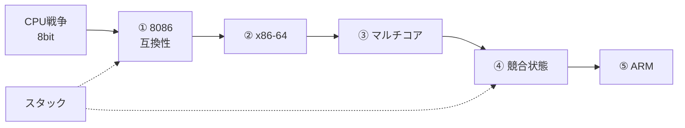

# CPU・アーキテクチャ・並列処理

> **この章を読むと分かること**
> - 8ビット時代（Z80・6502）で「弱い側」だった Intel が、なぜ世界標準になったのか
> - 最新の Core i9 も、起動時の一瞬は「1978年の Intel 8086」として動く理由
> - なぜ Intel は AMD の設計（x86-64）に従ったのか
> - なぜ CPU は「速さ」を捨てて「数（マルチコア）」を増やしたのか
> - マルチコアを活かすのが難しい理由 ＝ 競合状態（レースコンディション）
> - なぜ ARM が x86 を脅かしているのか（Apple Silicon・Intel の凋落）
> - 「関数が元の場所に戻れる」を支える、スタックメモリの仕組み

元ノートは `ゆっくり情報科学ちゃんねる/CPU/`（全7本）。移動せず、ここからリンクで辿ります。

---

## CPUフォルダの地図と読み順

```
ゆっくり情報科学ちゃんねる/CPU/
│
├── 【CPU戦争】…… 前史（8ビット二強 → IBM PC で 8088 が勝つ）
├── 01 互換性の40年 …… 8086・セグメント・パス依存性
├── 02 下克上 …… Itanium 失敗 / AMD64 勝利
├── 03 爆熱の限界 …… GHz神話の崩壊 → マルチコア
├── 04 同時実行の地獄 …… 競合状態・排他制御
├── 05 Intelの終焉？ …… ARM・Apple Silicon・製造の敗北
└── 【衝撃】スタック …… 関数呼び出しとメモリ（仕組み編）
```

| 順 | ノート | 一言で |
|----|--------|--------|
| 0 | [[【CPU戦争】なぜ“弱い側”が世界を取ったのか【逆転の真相】\|CPU戦争]] | 8ビット時代。Z80・6502 が強く、弱い 8088 が IBM PC で逆転 |
| 1 | [[01【CPUの歴史】呪われた互換性の40年：インテル8086が現代の最強CPUを縛り続ける理由【ゆっくり解説】※訂正版\|CPU①]] | 起動時リアルモード、セグメント、互換性の呪いと祝福 |
| 2 | [[02【下克上】なぜIntelはAMDの設計に従ったのか？『x86-64』がIT業界を統一した衝撃の逆転劇【ゆっくり解説】\|CPU②]] | 4GBの壁、Itanium vs AMD64 |
| 3 | [[03【爆熱の限界】なぜCPUは『速さ』を捨てて『数』を増やしたのか？クロック神話の崩壊とマルチコアの夜明け【ゆっくり解説】\|CPU③]] | パワーウォール、Core 2 Duo |
| 4 | [[04【同時実行の地獄】なぜマルチコアを活かすのは難しいのか？プログラムが壊れる『競合状態』の恐怖と排他制御\|CPU④]] | レースコンディション、ミューテックス、デッドロック |
| 5 | [[05【Intelの終焉？】なぜ『x86』は『ARM』に勝てないのか？Apple Siliconが証明した「命令セット」の呪縛と40年の確執【ゆっくり解説】\|CPU⑤]] | CISC vs RISC、M1、18A への賭け |
| ※ | [[【衝撃】なぜプログラムは『元の場所』に戻れるのか？関数呼び出しとスタックメモリ【ゆっくり解説】\|スタック]] | メモリ地図・スタックフレーム・オーバーフロー（いつ読んでも可） |

**おすすめルート**

1. **歴史主線**：CPU戦争 → ① → ② → ③ → ④ → ⑤（時代順）
2. **仕組みから**：スタック → ①（互換性）→ ③④（並列）→ ⑤（現代）
3. **最短**：このまとめだけ読んで、気になる元ノートへ飛ぶ



---

## はじめに — CPUは「現代に残る40年前の亡霊」

あなたが今使っている Core i9 や Ryzen 9。これらの最新 CPU が、**電源を入れた瞬間の一瞬だけ、1978年の Intel 8086 として動作している** ことをご存知でしょうか？

```
電源 ON
   ↓
[1978年モード]（16ビット、メモリ1MBまで）  ← なぜか最初はここから
   ↓ BIOSやブートローダーが切り替える
[本来の現代モード]（64ビット、巨大メモリ）
```

これは **後方互換性** という、x86 アーキテクチャの「呪い」であり、最大の強みでもあるものの表れです。その標準がどう生まれたかを、8ビット時代から辿ります。

---

## 0. CPU戦争 — なぜ“弱い側”が世界を取ったのか

### 0-1. 4ビットから8ビットへ

| 年 | CPU | 要点 |
|----|-----|------|
| 1971 | **4004** | 電卓向け4ビット。0〜9の1桁 |
| 1972 | **8008** | 8ビット化。アドレスは16KB、多重化バス |
| 1974 | **8080** | 64KB、バス分離、割り込み強化。**実用汎用CPU**の水準へ |
| 1975 | **Altair 8800** | 8080搭載キット。Gates & Allen の BASIC → **Microsoftの起点** |

CPU 1本がソフトウェア産業まで牽引した、という構図がここから始まる。

### 0-2. 8ビット二強：Z80 と 6502

| | **Z80**（Zilog, 1976） | **6502**（MOS, 1975） |
|---|---|---|
| 出自 | Faggin・島正利が Intel を出て設立 | Chuck Peddle（元 Motorola） |
| 強み | 8080互換＋高機能、DRAMリフレッシュ自動化 | **25ドル**（8080の約1/7）、効率・割り込み応答 |
| 土俵 | MSX、PC-8801、ZX Spectrum、CP/M | Apple I/II、C64、**ファミコン（2A03）**、Atari 2600 |

- **Z80**：裏レジスタ・インデックスレジスタ、命令数78→158。既存ソフト資産を活かせて普及。
- **6502**：レジスタは少ないが **ゼロページ** と豊富なアドレッシングで補う。C64は推定1000万台以上。ファミコンはリコー製カスタム（十進演算モードを省いてコスト削減）。

どちらが技術的に優れていたかは用途次第。それぞれ自分の土俵を持っていた。

### 0-3. Intel の16ビットと「弱い」8088

Z80・6502が市場を分け合う間、Intel は **64KBの壁**を超える16ビットへ。

- **8086**（1978）：アドレス1MB、EU/BIU分離（パイプラインの初歩）、**セグメント方式**（後年「プログラミングしにくい」と批判される苦肉の策）。
- **8088**（1979）：内部は8086と同じだが **外部バスを8ビットに絞った廉価版**。遅いが8ビット周辺チップがそのまま使える。

### 0-4. IBM PC（1981）— 性能ではなくエコシステムで勝つ

技術的には **Motorola 68000** の方が優秀だったが、IBM は **8088** を選んだ。

| 理由 | 内容 |
|------|------|
| 実績 | Intelチップ採用の信頼関係 |
| コスト | 8ビット周辺部品が揃い、安く組める（68000は周辺未整備） |
| 供給 | セカンドソースとして **AMD** にも製造を認め、量産体制が整っていた |

**オープンアーキテクチャ**（BIOS仕様・拡張スロット公開）が真の革命。Compaq がクリーンルーム開発で互換BIOSを作り、クローン機が爆発。

- OSは Seattle Computer の **86-DOS** を Microsoft が約5万ドルで買い取り → **MS-DOS**（著作権は Microsoft 側）。ビジコンがCPU権利を見逃したのと同型の構造。
- 結果：**CPUはIntel、OSはMicrosoft**（後の **Wintel**）。IBMは市場を手放し、Intelが舞台で踊り続けた（**Intel Inside**）。
- **日本だけ例外**：NEC **PC-98** が独自規格で君臨（崩れるのは Windows 95以降）。

> **教訓**：技術的優劣だけで勝敗は決まらない。**ネットワーク効果**（使う人が多いほどソフトが増え、さらに人が集まる）が標準を固定する。VHS vs ベータと同じ構造。

---

## 1. Intel 8086 と「呪われた互換性の40年」

### 1-1. 8086 は「つなぎ」のはずだった（1978年）

Intel の本命は **iAPX 432**（オブジェクト指向をハードで支援）。複雑すぎて遅く大失敗。

> 「とりあえず出せるものを」と **約3ヶ月で設計** された 8086 が、本命の代わりに採用される。

**完璧な設計より、今すぐ使える設計が勝った** 典型例。

### 1-2. なぜ「捨てられない」のか

| 場所 | 動いているソフト |
|------|---------------|
| 銀行 | 30年前のシステムが現役 |
| 工場 | 古い制御プログラムが今も稼働 |
| 行政 | 1990年代のソフトを使い続けている部署あり |

動いているものを変えるリスクは巨大。Intel は **「古いソフトが確実に動くCPU」** を選ばれる市場で生き残ってきた。互換性は呪いであり祝福。

### 1-3. 苦肉の策「セグメント方式」

```
実アドレス = セグメント × 16 + オフセット  →  20ビット＝1MB
```

同じ物理アドレスを複数の組み合わせで表現でき、プログラマには悪夢。しかし現代まで残り続ける。

### 1-4. 32ビット化と「変態的」進化

- **80386**（1985）：32ビット・プロテクトモード（最大4GB）。起動時は相変わらず **リアルモード** から。
- 1990年代、**RISC** が x86 を「時代遅れ」と評する。Intelの回答は **マイクロオペレーション（μop）**：外側はx86の振り、内部でRISC的な単純命令に分解。現代の Core i9 も同じ仕組み。

| 設計思想 | イメージ | 代表 |
|--------|------|-----|
| **CISC**（複雑命令） | 万能ナイフ：1命令で多くをこなす | x86 |
| **RISC**（単純命令） | カッター：シンプルで高速 | ARM、MIPS |

### 1-5. パス依存性

一度選んだ道の後、選択肢が経済・社会的に限られる現象。x86は1981年のIBM PC選択に今も縛られている。類例：VHS、QWERTY。**技術的に優れているものが必ず勝つわけではない**。

---

## 2. x86-64 — Intel が AMD の設計に従った日

### 2-1. 32ビットの「4GBの壁」

アドレス空間は **2^32 ≒ 4GB** が上限。2000年代、画像・動画・DBでメモリ需要が爆発し、64ビット化が急務に。

### 2-2. 真逆を選んだ Intel と AMD

| | **Intel** | **AMD** |
|---|---|---|
| 方針 | x86を捨ててゼロから新設計 | x86を拡張して64ビット化 |
| 製品 | **Itanium（IA-64）** | **AMD64（x86-64）** |
| 互換性 | エミュレーション（遅い） | **ネイティブ実行**（速い） |

### 2-3. Itanium の失敗と AMD64 の勝利

- Itanium：x86ソフトは全面書き直し、コンパイラ困難、3年遅延、高価・期待外れ。**Itanic** と揶揄され2021年生産終了。
- AMD64：レジスタ8→**16**個、32ビットソフトもネイティブ動作。2003年 **Opteron** / **Athlon 64** が大ヒット。
- 2004年、Intelは **EM64T**（後の Intel 64）で事実上追随。**今のすべてのx86 CPUには、AMDが設計した命令セットが入っている**。

> **教訓**：Itaniumの失敗もAMD64の成功も、いずれも **後方互換性** で説明できる。市場は「使えるかどうか」しか見ない。

---

## 3. マルチコア — 速さから「数」へ

### 3-1. クロック神話の崩壊

```
1978  8086        5 MHz
1993  Pentium    60 MHz
2000  Pentium 4  1.5 GHz
2004  Pentium 4  3.8 GHz
2024  最新CPU    5-6 GHz   ← 20年で1.5倍程度
```

2001年、Intel CTO **パトリック・ゲルシンガー** の警告：このままでは熱密度が原子炉→ロケットノズル→太陽表面に。実際、次世代爆熱Pentium 4（Tejas）は2004年中止。

### 3-2. なぜ熱が爆発するのか

```
P = C × V² × F
（C: 容量、V: 電圧、F: 周波数）
```

**V²** が効く。電圧2倍なら消費電力4倍。Pentium 4 3.8GHzは TDP 115W、約2cm角で **電気ストーブ並みの熱密度**。90nm以降は **リーク電流**（OFFでも発熱）も深刻化。

### 3-3. 戦略転換と Core 2 Duo

```
旧戦略：5GHz × 1コア → 物理限界
新戦略：2.5GHz × 2コア → 同じ計算量、半分の電力
```

救世主は皮肉にも **古い Pentium III 系の省電力設計** をベースにした **Core 2 Duo**（2006）。IPCを極限まで上げ、Prescottの約半分の電力で大幅に速い。**GHz神話の終焉**。

### 3-4. ハード側の新たな壁

- **キャッシュコヒーレンシ**（MESIプロトコル）：コア間でキャッシュの値が食い違わないよう同期。
- コア増 → 通信オーバーヘッド増 → **スケーラビリティの壁**。
- **メモリ帯域**の渋滞。対策としてメモリコントローラ内蔵（AMDが先行）など。

### 3-5. ソフト側 — 「フリーランチは終わった」

シングルコア時代はハードが速くなればソフトも自動で速くなった。マルチコアでは **並列処理をプログラマが明示的に設計**しないと、もう1コアは遊んでいる。→ 次章の地獄へ。

---

## 4. マルチコアの地獄 — 競合状態

### 4-1. 「コアが2倍 = 2倍速い」は嘘

ソフトを書き直さないと速くならないどころか、**バグの温床**になる。

### 4-2. 賽銭箱の比喩 — 消える1円

2人の巫女が同時にカウントすると、両者が同じ値を読んでそれぞれ+1し、結果は1回分しか増えない（**ロストアップデート**）。これが **競合状態（race condition）**。

CPUでは「足し算して書き戻す」も内部では3ステップ：

```
1. MOV EAX, [X]   … 読む（100）
2. INC EAX        … +1（101）
3. MOV [X], EAX   … 書く
```

途中でスレッドが切り替わるとデータが壊れる。この一連を **クリティカルセクション** と呼ぶ。

### 4-3. 解決策の階層

| 層 | 手段 | 要点 |
|----|------|------|
| ハード | **LOCK** 付き命令、CAS | 1命令をアトミックに。バスロック→キャッシュロックへ |
| ソフト | **ミューテックス** | 鍵1つ・所有権あり（トイレ個室） |
| ソフト | **セマフォ** | カウンターで同時利用数を制限（駐車場） |
| 言語 | Rust所有権、Goチャンネル、不変性 | 設計で競合を起きにくくする |

- **デッドロック**：循環待ちで完全停止（食事する哲学者）。順序付け・タイムアウトで回避。
- **Therac-25**：競合状態のバグで過剰放射線、少なくとも3人死亡——命に関わる問題。
- **アムダールの法則**：並列化できない部分が10%なら、コアを増やしても最大10倍まで。

> マルチコアは **「ハードが進化したぶん、ソフトがついていけない」** という新しい時代の課題を生んだ。

---

## 5. ARM の台頭 — Apple Silicon と Intel の凋落

### 5-1. CISC vs RISC、再び

| | **x86（CISC）** | **ARM（RISC）** |
|---|---|---|
| 命令 | 複雑、万能 | シンプル、軽い |
| 電力 | 大 | 小 |
| 主戦場 | デスクトップ・サーバー | スマホ・タブレット |

現代の高性能x86は内部でμopに分解するが、**翻訳回路分の電力・面積オーバーヘッド**が残る。

### 5-2. なぜ非効率なx86で長年勝てたか

Intelは **製造プロセス微細化（Tick-Tock）** で業界最前線を走り、「頭の悪さを筋力でカバー」。熱の壁以降は電力効率の時代へ移り、x86の設計非効率が不利になり始めるが、当時は製造優位で先送りできた。

### 5-3. 3つの致命傷（2020〜2024）

1. **10nm/7nmの悪夢**：移行が約4年遅延。EUV後回しの判断ミス。TSMCが先走り、同電力ではAMD・Appleの方が速い局面に。
2. **Appleの「裏切り」**：2020年 **M1（ARM）**。同等以上の性能・大幅低電力、MacBook Airはファンレス。「PCはx86じゃないとダメ」が崩れた。
3. **AIブームからの取り残し**：主役はGPU（NVIDIAの **CUDA** エコシステム）。サーバーCPUはAMD EPYCが伸長。

### 5-4. 再起の賭けと見通し

- **Lunar Lake**：主力コンピュートタイルを **TSMC N3に委託**（プライドを捨てた決断）。電力効率が劇的改善。
- **Panther Lake / 18A**（2026〜）：自社最先端製造への回帰。GAA＋PowerVia。歩留まりが本当の勝負。
- **x86S**（16/32bitレガシ廃止案）はエコシステムの反対で断念——後方互換の深さの証明。

> 動画内の見立て：Intelは **生き残るが昔の80%シェアには戻れない**。製造回復＋x86互換＋法人・政府市場でニッチな強者に。次の賭けは **エッジAI（CPU+NPU）**。

評価軸は **GHz → ワットパフォーマンス**（バッテリー・データセンター電気代・薄型ノートの熱設計）。

---

## 6. スタックメモリ — 関数が「元の場所」に戻れる仕組み

歴史編と並行して読める **仕組み編**。CPU自身は戻り先を一瞬で忘れる。記憶を支えているのがスタック。

### 6-1. メモリの4領域

| 領域 | 内容 |
|---|---|
| **コード** | プログラム本体 |
| **データ** | グローバル・静的変数 |
| **ヒープ** | `malloc`/`new` 等の動的確保（管理が面倒、GCの舞台） |
| **スタック** | 関数呼び出し用。**LIFO**（パンケーキ） |

- スタックはポインタをずらすだけで確保・解放でき **高速**。ただしサイズは小さく固定（Linuxでだいたい **8MB**）。大きなデータはヒープへ。

### 6-2. スタックフレームの中身

1. **リターンアドレス** — どこに戻るか（`CALL`がプッシュ、`RET`がポップ）
2. **引数** — 少ない数はレジスタ経由（System V ABIでは整数6つまで等）
3. **ローカル変数** — フレームごと消えるので `free` 不要
4. **保存レジスタ** — RBPやcallee-savedを退避・復元

入れ子（main→A→B）は積み上げ、終了時は逆順で巻き戻す。

### 6-3. スタックオーバーフローと最適化

- 再帰の終了条件ミスや深すぎる呼び出しで上限超過 → **セグフォルト**。Q&Aサイト名の由来。
- **末尾再帰最適化**：言語・コンパイラ依存（C/C++は保証なし、Scheme等は保証）。
- **インライン展開**：小さな関数の呼び出しオーバーヘッドを消す。コードサイズ・命令キャッシュとのトレードオフ。コンパイラが判断（`inline`はヒント）。

---

## 7. この章のまとめ

### 統合タイムライン

```
1971  4004（電卓チップ）
1974  8080 → Altair / Microsoftの起点
1975  6502（安さでApple・ファミコンへ）
1976  Z80（8080互換で高機能）
1978  8086（つなぎのはずが…）
1979  8088（外見8bitの廉価版）
1981  IBM PC → オープン戦略 → 互換機爆発 → Intel Inside
1985  80386（32bit・プロテクトモード）
1990s μopでCISC延命 / Wintel支配
2001  ゲルシンガーの熱警告 / Power4（サーバー・デュアルコア）
2003  AMD64（Opteron）
2004  Tejas中止・マルチコア宣言 / IntelがAMD64追随
2006  Core 2 Duo（GHz神話の終焉）
2016〜 10nm遅延、TSMCに製造で負ける
2020  Apple M1（ARMがPCでも最強級）
2024  Intel株価暴落、ファウンドリー巨額赤字
2026〜 18A / Panther Lake への賭け
```

### 大切なポイント

1. **完璧な設計より、互換性とエコシステムが勝つ**  
   8088、x86-64、x86 — 美しい設計（68000、Itanium）は何度も負けた。

2. **物理法則は技術を押し戻す**  
   クロック競争は熱の壁で終わった。光速や電力には逆らえない。

3. **マルチコアはハードの解決、ソフトの課題**  
   競合状態という新しい難問が生まれた。

4. **市場の覇権はネットワーク効果で決まる**  
   「みんなが使っているから勝つ」。技術的優位性は二の次のことが多い。

5. **スタックという地味な仕組みが、すべての関数呼び出しを支えている**  
   普段意識しないが、これがないとプログラムは動かない。

6. **覇権は永遠ではない**  
   8ビット二強もWintelも揺らいだ。スマホではARMが勝者。評価軸はGHzからワットパフォーマンスへ。

---

## 8. もっと深く知りたい人へ

### 元ノート（このまとめの種本）

- [[【CPU戦争】なぜ“弱い側”が世界を取ったのか【逆転の真相】|CPU戦争 — 8ビットとIBM PC]]
- [[01【CPUの歴史】呪われた互換性の40年：インテル8086が現代の最強CPUを縛り続ける理由【ゆっくり解説】※訂正版|CPU① 8086と互換性]]
- [[02【下克上】なぜIntelはAMDの設計に従ったのか？『x86-64』がIT業界を統一した衝撃の逆転劇【ゆっくり解説】|CPU② x86-64]]
- [[03【爆熱の限界】なぜCPUは『速さ』を捨てて『数』を増やしたのか？クロック神話の崩壊とマルチコアの夜明け【ゆっくり解説】|CPU③ マルチコア]]
- [[04【同時実行の地獄】なぜマルチコアを活かすのは難しいのか？プログラムが壊れる『競合状態』の恐怖と排他制御|CPU④ 競合状態]]
- [[05【Intelの終焉？】なぜ『x86』は『ARM』に勝てないのか？Apple Siliconが証明した「命令セット」の呪縛と40年の確執【ゆっくり解説】|CPU⑤ ARMと命令セット]]
- [[【衝撃】なぜプログラムは『元の場所』に戻れるのか？関数呼び出しとスタックメモリ【ゆっくり解説】|スタックと関数呼び出し]]

### 並行して読むと面白いもの

- [[04-PCとGUIとは|歴史 04-PCとGUI]] — IBM PCが世界標準になった経緯
- [[02-電子計算機とは|歴史 02-電子計算機]] — 4004・マイクロプロセッサの誕生
- [[01-半導体と論理回路とは|01-半導体と論理回路]] — 加算器がどう作られるか
- [[03-GPUと専用チップとは|03-GPUと専用チップ]] — AI時代の主役、CPU多数が勝てなかった理由
- [[03-プロセス・システムコール・ドライバとは|OS 03-プロセス]] — 競合状態・スレッドの実装側

### 前後の章

⬅ [[01-半導体と論理回路とは|01-半導体と論理回路（前章）]]
➡ [[03-GPUと専用チップとは|03-GPUと専用チップ（次章）]]
