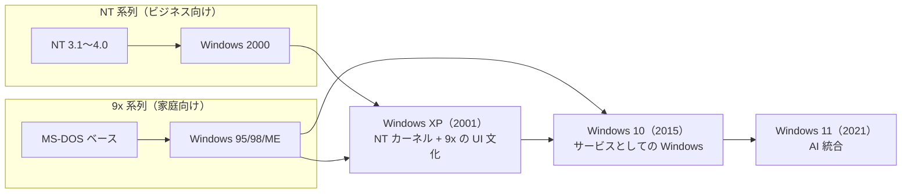

## 詳しい要約

本動画は、**1985 年** Microsoft が発売した **Windows 1.0** から最新の **Windows 11** まで、約 **40 年** にわたる Windows の歴史を技術的な視点で時系列解説する。神社のお札デジタル化という導入から、**OS（オペレーティングシステム）** とは何か、なぜ「Windows」という名前なのかを説明しつつ、**MS-DOS 時代の文字画面** から **GUI・マルチタスク・インターネット・クラウド・AI** へと進化した軌跡を描く。並行して発展した **NT 系列**（ビジネス向け高安定 OS）と **9x 系列**（家庭向け）の二系統が **Windows XP で統合** され、その後 **Windows 10 から「サービスとしての Windows」** へ転換した流れも重要なテーマとなる。

### Windows とは

- **Windows**＝Microsoft が開発する **オペレーティングシステム（OS）**。コンピューターを動かすための基本ソフトで、これがないとパソコンは何もできない。
- 名前の由来は画面上の **「ウィンドウ（窓）」** —— 複数の四角い領域にプログラムを表示し、**同時に複数の作業** ができることから命名された（物理的な窓ではない）。
- 現在は **オフィス・教育・娯楽・クリエイティブ** など現代社会のデジタル化を支える **重要なインフラ** として機能している。

---

### Windows 年表（主要マイルストーン）

| 年代 | バージョン | 意義 |
|------|-----------|------|
| **1980 年代初頭** | **MS-DOS** 全盛期 | 文字だけの黒画面。マウスなし。`del file.txt` のようにキーボードで命令 |
| **1985/11/20** | **Windows 1.0** | 初の GUI Windows。**マウス操作・マルチタスク** の始まり。ただし動作が重く普及は限定的 |
| **1987** | **Windows 2.0** | ウィンドウの重ね表示。操作性向上 |
| **1988** | **Windows 2.1 / 2.03** | **80386 プロセッサ最適化** 版。ハード進化に追随 |
| **1990/5/22** | **Windows 3.0** | **16 色カラー・プロテクトモード** で本格普及の始まり。白黒から一気に華やかに |
| **1992** | **Windows 3.1** | **TrueType フォント**（WYSIWYG）、**レジストリ** 導入 |
| **1993** | **Windows for Workgroups 3.11** | ネットワーク共有・**32 ビットファイルアクセス** 強化 |
| **1993/7/27** | **Windows NT 3.1** | **NT 系列** 始動。MS-DOS 非依存の **ビジネス向け高安定 OS** |
| **1995/8/24** | **Windows 95** | **スタートボタン・タスクバー** 初登場。完全 **32 ビット OS**。**Plug and Play**。3 億ドル規模の宣伝 |
| **1996/7/29** | **Windows NT 4.0** | NT に **Windows 95 と同じ UI**。安定性と使いやすさの両立 |
| **1998/6/25** | **Windows 98** | **IE 4.0・アクティブデスクトップ**。**USB 本格対応**。**FAT32** 標準 |
| **1999/2** | **Windows 98 SE** | 安定性向上・**インターネット接続共有** |
| **2000/2/17** | **Windows 2000**（NT 5.0） | **Active Directory**、NTFS 改良。企業ネットワーク管理の基盤 |
| **2000/9/14** | **Windows ME** | 家庭向けだが **不安定で評判悪化**。9x 系列の終焉 |
| **2001/10/25** | **Windows XP** | **9x と NT の統合**。Luna UI。**13 年サポート** の長寿版。ファイアウォール標準 |
| **2006/11/30** | **Windows Vista** | **Aero** ビジュアル。**UAC** 導入。重さ・互換性問題で不評 |
| **2009/10/22** | **Windows 7** | Vista の問題を改善。**Aero Peek・Snap**。**2020 年まで 11 年サポート** |
| **2012/10/26** | **Windows 8** | **Modern UI（Metro UI）**。**スタートボタン廃止**。タブレット志向で PC ユーザー混乱 |
| **2013/10/17** | **Windows 8.1** | スタートボタン復活（ただしメニューではなくタイル画面へ） |
| **2015/7/29** | **Windows 10** | スタートメニュー完全復活。**Windows as a Service**。**WSL・Edge・Cortana** |
| **2021/10/5** | **Windows 11** | デザイン刷新。**Teams 統合・Snap Layouts**。**TPM 2.0 必須**。**Copilot** 統合 |

---

### 第 0 期：MS-DOS 時代——Windows 誕生の背景（1980 年代初頭）

#### MS-DOS の限界

- **MS-DOS**（Microsoft Disk Operating System）＝**文字だけ** でコンピューターを操作する OS。画面は真っ黒に白文字が並ぶだけ。
- ファイル削除なども `del file.txt` のように **キーボードでコマンド入力** が必要。**マウスは存在しない**。
- 1 度に 1 つの作業しかできない——**マルチタスク不可**。

#### Windows が解決したこと

- **1985 年 11 月 20 日**、Microsoft が **Windows 1.0** を発売。
- **マウスでクリック操作** が可能に。**複数プログラムの同時実行（マルチタスク）** を実現——文章を書きながら音楽を聞く、計算しながらゲームをする、といった使い方が可能に。
- ただし当時の PC には **メモリ・性能が不足** し、動作が重く **すぐには普及しなかった**。

---

### 第 1 期：Windows 1.x〜3.x——GUI の確立（1985〜1993）

#### Windows 1.0〜2.x：試行錯誤の時代

- **Windows 2.0（1987）**：ウィンドウを **重ねて表示** でき、操作性が向上。
- **Windows 2.03（1988）**：**Intel 80386** プロセッサに最適化された最初の Windows。CPU の進化（8086→80386）に合わせて OS も進化。

#### Windows 3.0——普及の転換点

- **1990 年 5 月 22 日** 発売。これまでの Windows とは全く違う **飛躍的バージョン**。
- **16 色カラー表示**：1.0/2.0 の白黒から一気に華やかに（当時としては革命的）。
- **プロテクトモード** 採用：プログラム同士の干渉を防ぎ、**1 つがクラッシュしても他に影響しにくい** メモリ管理。

#### Windows 3.1〜3.11：実用 OS への成熟

- **Windows 3.1（1992）**：
  - **TrueType フォント** 標準サポート → **WYSIWYG**（What You See Is What You Get：見た通りに印刷）が普及。文書作成・デザインの精度が飛躍的に向上。
  - **レジストリ** 導入：これまでの INI ファイル（テキスト）から、プログラム設定・システム情報を一元管理する **データベース的仕組み** へ。
- **Windows for Workgroups 3.11（1993）**：
  - **ネットワーク機能** 強化（ファイル・プリンター共有）。
  - **32 ビットファイルアクセス** でハードディスク読み書き高速化。
- **わずか 3 年** で実験的ソフトから **実用的 OS** へ劇的進化。この成功が **Windows 95** への道を開いた。

---

### 第 2 期：Windows 95〜ME——家庭普及とインターネット時代（1995〜2000）

#### Windows 95——黄金時代の幕開け

- **1995 年 8 月 24 日** 発売。**革命的リリース**。
- **スタートボタン・タスクバー** 初登場——現在の Windows でも基本構造は変わらない。
- **完全 32 ビット OS** で処理速度大幅向上。
- **Plug and Play（PnP）**：周辺機器を接続すると **自動認識**。USB ポートに挿すだけで使える時代の始まり。
- ローリング・ストーンズの「Start Me Up」を CM に使用、**総額 3 億ドル** の宣伝費——発売日に世界中で長蛇の列。

#### Windows 98〜ME：インターネットとその限界

- **Windows 98（1998/6/25）**：
  - **Internet Explorer 4.0** 標準搭載。Web ブラウザが OS の中核に。
  - **アクティブデスクトップ**：デスクトップ上に Web ページ表示（現代のウィジェットの先駆け）。
  - **USB 本格サポート**、**FAT32** 標準（大容量 HDD 対応）。
- **Windows 98 SE（1999）**：バグ修正・安定性向上・**インターネット接続共有**（1 回線を複数 PC で共有）。
- **Windows ME（2000/9/14）**：
  - 家庭向け特化だが **頻繁なクラッシュ** で **評判悪化**。
  - 原因は **MS-DOS ベースの古いアーキテクチャ** を引きずっていたこと。システム復元など良い機能もあったが、**次世代への橋渡し** に終わった。
- この時代、パソコンが **一般家庭に普及** しインターネットが身近になったが、**安定性の課題** が残った。

---

### 第 3 期：NT 系列——ビジネス向け高安定 OS（1993〜2000）

#### Windows NT の設計思想

- **1993 年 7 月 27 日**、**Windows NT 3.1** 発売。NT＝**New Technology**。
- **MS-DOS に依存しない完全新設計** のビジネス向け高安定 OS。
- **32 ビット**（後に 64 ビット）からスタート。**強力なメモリ保護** —— 1 アプリのクラッシュでシステム全体が止まりにくい。

#### NT 系列の進化

| バージョン | 発売年 | 特徴 |
|-----------|--------|------|
| **NT 3.1** | 1993 | NT 系列の始まり |
| **NT 3.5 / 3.51** | 1994〜1995 | 段階的改良 |
| **NT 4.0** | 1996/7/29 | **Windows 95 と同じ UI** を採用。見た目は 95、中身は NT |
| **Windows 2000**（NT 5.0） | 2000/2/17 | **Active Directory**、NTFS 改良（圧縮・暗号化）。4 エディションで小規模オフィス〜大企業に対応 |

#### Active Directory・NTFS

- **Active Directory**：企業ネットワークで **ユーザー・PC・ファイルのアクセス権** を一元管理。人事異動・退職時の管理が容易に。
- **NTFS**（New Technology File System）：FAT より高度。**ファイルごとにアクセス権限** を細かく設定可能。セキュリティ強化。

---

### 第 4 期：Windows XP——二系統の統合と黄金期（2001〜2014）

#### 歴史的統合

- **2001 年 10 月 25 日**、**Windows XP** 発売。
- **家庭用（ME）と業務用（2000）の流れを統合**。Home / Professional エディションともに **NT カーネルの安定アーキテクチャ** を採用。
- XP＝**eXPerience**（体験）。ユーザー体験の向上を重視。

#### Luna と長寿サポート

- **Luna** ビジュアルスタイル：丸みを帯びたボタン・カラフルなアイコン。青空をイメージしたブルーテーマがデフォルト。
- **2001 年から 2014 年まで実に 13 年間** サポート——企業・学校で特に愛用された **長寿バージョン**。
- **システムリストア** 大幅改良、**Windows ファイアウォール** 標準搭載（インターネット普及時代のセキュリティ）。
- **SP1（2002）→ SP2（2004・大幅セキュリティ強化）→ SP3（2008）** と長期改良。
- NT の技術とユーザビリティが融合した **Windows 史の頂点**。多くの人の「理想的な Windows」イメージは XP で決まった。

---

### 第 5 期：Vista〜8.1——美しさと失敗の教訓（2006〜2015）

#### Windows Vista——高望みの代償

- **2006 年 11 月 30 日** 発売。「美しい景色のような新体験」をコンセプトに。
- **Aero**：透明ウィンドウ、3D フリップでプログラム切り替え——**見た目は美しい**。
- 問題点：
  - **動作が非常に重い**（Aero に大量のメモリ・GPU が必要）。
  - **UAC**（User Account Control）が頻繁に警告 → ユーザーは慣れて **何も考えず「はい」** → 本末転倒。
  - **古いソフト・周辺機器の非対応**、ドライバ不足。
- 良い面も：**ReadyBoost**（USB メモリでキャッシュ）、**Windows Defender**（スパイウェア対策）標準搭載。

#### Windows 7——Vista の成功した後継

- **2009 年 10 月 22 日** 発売。Vista の問題を徹底改善。
- **XP 並みの軽さ** でスムーズ動作。
- **Aero Peek**（タスクバーにマウスでプレビュー）、**Aero Snap**（画面端ドラッグで半分表示・最大化）——**現在の Windows でも定着** した操作。
- **ライブラリ**（ファイル種別の自動整理）、**ホームグループ**（家庭内ネットワーク共有）。
- **2020 年 1 月まで 11 年サポート**。XP に匹敵する長寿・高評価。

#### Windows 8〜8.1——タブレット志向の挫折

- **Windows 8（2012/10/26）**：
  - **Modern UI（Metro UI）**：タイル型スタート画面。**スタートボタン廃止**。
  - タブレットでは直感的だが、**マウス＋キーボードのデスクトップ PC では戸惑い**。
  - デスクトップ環境と Modern UI の **二重構造** が分かりにくい。
  - 良い点：**ハイブリッドブート** で起動 **約 10 秒** に短縮。
- **Windows 8.1（2013/10/17）**：不満を受け **スタートボタン復活**——ただし従来のスタートメニューではなく **タイル画面への切り替えのみ**。中途半端な対応。
- **タブレット対応を急ぎすぎて PC ユーザーを置き去り** にした教訓が、次の **Windows 10** の方針につながった。

---

### 第 6 期：Windows 10〜11——サービス化と AI 時代（2015〜現在）

#### Windows 10——原点回帰と新しいビジネスモデル

- **2015 年 7 月 29 日** 発売。**Windows 9 を飛ばし 10 へ** ——「新たなスタート」の意味。
- **スタートメニューの完全復活**：Windows 7 型メニュー ＋ Windows 8 のライブタイルの **良いとこ取り**。
- **Windows as a Service（WaaS）**：
  - 新 OS を買い直すのではなく、**無料で定期的に大型アップデート**（年 2 回程度）。
  - OS が **継続的に進化するサービス** へ転換。
- 主要新機能：
  - **Cortana**（音声アシスタント、Halo のキャラ名）
  - **Microsoft Edge**（IE 後継ブラウザ）
  - **仮想デスクトップ**（仕事用・プライベート用の画面切り替え）
  - **WSL**（2016 Anniversary Update）：**Linux コマンドを Windows 上で実行**——開発者に大きな福音
  - **3D 作成・Mixed Reality**（2017 Creators Update）

#### Windows 11——現代の Windows

- **2021 年 10 月 5 日** 発表。約 **6 年ぶり** の新メジャーバージョン。
- **デザイン刷新**：角丸・洗練された外観。**スタートボタン・タスクバーが中央配置**（左寄せも可能）。
- **Microsoft Teams 統合**：リモートワーク時代を反映したビデオ通話・チャット標準機能。
- **Snap Layouts**：複数ウィンドウを効率的に配置するテンプレート。マルチタスクがより簡単に。
- **セキュリティ要件厳格化**：**TPM 2.0**（暗号化専用チップ）、**セキュアブート** が必須 → 古い PC では動作しない場合あり。
- **Microsoft Store 刷新**：**Android アプリ** も Windows で動作（Amazon Appstore 連携）。
- **Copilot**（AI アシスタント）統合：文書作成からプログラミングまで幅広くサポート——**AI 時代の第 1 歩**。

---

### 二系統の統合——Windows 史の構造

- **9x 系列**：MS-DOS 上に GUI を載せた路線。一般家庭への普及に貢献したが **安定性に限界**（ME で頂点）。
- **NT 系列**：ゼロから設計した **高安定・高セキュリティ** 路線。企業・サーバー向け。
- **Windows XP** で両者が統合し、以降は **NT カーネル一本** で発展。
- **Windows 10** からは **買い切り OS → 継続アップデートのサービス** へビジネスモデルも変化。

---

### 動画が強調する 3 つの転換点

1. **Windows 95（1995）** —— **GUI の一般普及**。スタートボタン・タスクバー・PnP が現代 PC 操作の原型を確立。
2. **Windows XP（2001）** —— **安定性の確立**。9x と NT の統合で「使いやすくて壊れにくい Windows」が実現。
3. **Windows 10（2015）** —— **継続アップデート体制への転換**。WaaS・WSL で開発者・一般ユーザー双方の期待に応える新時代。

---

### 評判の悪かったバージョンとその教訓

| バージョン | 主な問題 | 次版での改善 |
|-----------|---------|-------------|
| **Windows 1.0** | 重い・普及せず | 2.0〜3.0 で段階的改善 |
| **Windows ME** | 不安定・頻繁クラッシュ | **XP** で NT カーネルに刷新 |
| **Windows Vista** | 重い・UAC 煩わしい・互換性 | **Windows 7** で軽量化・UX 改善 |
| **Windows 8** | スタートボタン廃止・UI 混乱 | **8.1** で部分復活 → **10** で完全復活 |

- 失敗も **次バージョン改善の貴重な学習** となった——ME→XP、Vista→7、8→10 の流れが典型例。

---

### まとめ

- Windows の **40 年** は、**技術革新とユーザビリティ向上の連続** であると同時に、**人間とコンピューターの関係の変化史** でもある。
- 専門家だけの道具だったコンピューターが、GUI・マウス・タッチ・音声・AI により **誰でも日常的に使える** ものへ進化した。
- 現在の Windows 11 なら、動画冒頭の **お札のスキャン・デジタル管理** もカメラアプリや Microsoft 365 で容易に実現可能——ただし **使い手の習熟** は別問題（霊夢の場合）。
- **Copilot 統合** を始めとする AI 機能は、Windows が **次の進化段階** に入ったことを示す。40 年の歴史が証明するように、Windows は **ユーザーのニーズに応えて進化し続ける** OS である。

## Transcript

**0:00** · ゆっくり情報科学チャンネル よ。霊夢、今日も神社で昼寝かうるさいわね、魔理沙。別にいいじゃない。のんびりするのも仕事のうちよ。

**0:09** · \[音楽\] 仕事?神社の維持管理とか。

**0:16** · そうよ。でも最近困ったことがあるのよね。

**0:19** · なんだ?賽銭箱が空っぽとか?

**0:23** · それもあるけど違うのよ。

**0:25** · 実は最近参拝者から神社のお札をデジタル化できませんか?って相談されるの?

**0:26** · \[音楽\] デジタルか?

**0:33** · お札をパソコンで管理するってことか?

**0:35** · そうそう。でも私のことなんて全然わからないのよ。

**0:40** · Windowsのを使えばいいって言われたんだけど。

**0:44** · Windows か。確かにそれがあればできそうだな。でも霊夢、お前 \[音楽\] Windowsが何なのか知ってるか?

**0:51** · えっと、窓はあ。

**0:54** · まあ、間違いじゃないが。

**0:56** · だって windowウって窓でしょ。神社の窓を開けておけばデジタル化できるの?

**0:58** · \[音楽\] 違うだろ。

**1:03** · Windowsのはコンピューターのオペレーティングシステムのことだぜ。

**1:07** · オペレーティング何?

**1:10** · つまりコンピューターを動かすための基本ソフトだ。これがないとパソコンは何もできない。

**1:16** · へえ。それって昔からあったの?

**1:20** · いい質問だな。実は Windows には長い歴史があるんだぜ。

**1:24** · 今日はその歴史を詳しく解説してやろう。

**1:27** · うん。でも難しそう。

**1:30** · 大丈夫だ。分かりやすく説明してやるから最後まで付き合えよ。まずは \[音楽\] Windows が生まれる前の時代から話そう。

**1:45** · 1980年代初島パソコンといえば MS ドスというシステムが主流だったんだ。

**1:50** · MSドス。それもよくわからないわね。

**1:53** · MSドスはMicクソフtディスク オペレーティングシステムの役で文字だけでコンピューターを操作するシステムだった。画面は真っ黒で白い文字がずらずらと並んでるだけだったんだぜ。

**2:05** · え、それって使いにくそう。

**2:08** · その通りだ。例えばファイルを削除したい時は出るファイル Iネ.テキストみたいにキーボードで命令を打ち込まなきゃいけなかった。マウスなんて便利なものもなかったしな。

**2:16** · \[音楽\] 大変そうね。

**2:22** · 今のパソコンみたいにクリックじゃダメなの?

**2:25** · それがまさにWindows が解決した問題なんだ。

**2:28** · 1985年11月20日、 MicrosoftがWindows 1.0 を発売した。これが全ての始まりだぜ。

**2:36** · へえ。1985 年か。私がまだ生まれる前ね。

**2:41** · Windows1.0は革命的だった。

**2:44** · 初めてマウスを使って操作できるようになったし、複数のプログラムを同時に動かせるマルチタスキングも可能になった。マルチタスキング?

**2:51** · \[音楽\] 例えば文章を書きながら音楽を聞いたり計算しながらゲームをしたりできることだ。

**2:56** · \[音楽\] MSドスでは1度に1 つのことしかできなかったからな。

**3:03** · それは便利そうね。でもそんなに画期的ならすぐに人気になったでしょ。

**3:09** · ところがそうでもなかったんだ。

**3:11** · Windows1.0 は動作が重くて必要なメモリも多かった。当時のパソコンには荷重すぎたんだぜ。

**3:15** · \[音楽\] あら、でも Microsoftは諦めなかった。

**3:22** · 1987年にWindows2.0を 1988年にWindows2.1 を発売してどんどん改良していったんだ。

**3:31** · Windows2.0ではWindows を重ねて表示できるようになってより使いやすくなった。

**3:37** · Windowウを重ねるって窓を重ねるの?

**3:40** · また窓の話か。コンピューターの windowウは画面上の四角のことだ。その中にプログラムの内容が表示されるんだぜ。

**3:49** · なるほど。それで \[音楽\] Windows名前なのね。

**3:54** · その通りだ。複数の Windowsを同時に開いて作業できるから Windowsという名前になったんだ。

**4:01** · やっと理解できたわ。

**4:03** · この時期の重要な出来事として1988年 にWindows2.03がリリースされ たこともおこう。これは386 プロセッサーに最適化された最初の Windowsバージョンだった。

**4:15** · プロセッサー何?

**4:17** · コンピューターの頭脳部分だ。計算処理を 行う重要な部品だぜ。当時はINTル 8086から80386へとどんどん 高性能になっていった時代だったんだ。

**4:29** · へえ。コンピューターも進化してたのね。

**4:31** · そうだ。そして1990年、大きな天気が 訪れるWindows3.0の登場だ。

**4:38** · これがWindowsの本格的な普及の 始まりだったんだぜ。

**4:45** · \[音楽\] Windows3.0は1990年5月 22日に発売された。これまでの Windowsとは全く違う 活期的バージョンだったんだ。

**4:58** · 何がそんなに違ったの?

**5:00** · まず見た目が大幅に改良された。カラフルなアイコンや美しいフォントが使えるようになって操作性も拡段に向上したんだ。

**5:08** · へえ。カラフルか。それまでは地味だったの?

**5:12** · そうだな。Windows1.0や2.0 は基本的に白黒で今見ると非常に失目だった。でも Windows3.0では16 色のカラー表示が可能になって一気に華やかになったんだぜ。

**5:26** · 16色って少なくない?

**5:28** · 当時としては革命的だったんだ。現在の Windows は何百万色も表示できるが、 1990年の技術レベルでは16 色でも脅異的だったんだぜ。

**5:39** · そうなのね。他に何が変わったの?

**5:42** · メモリ管理が大幅に改善されたのも大きなポイントだ。

**5:46** · Windows3.0 ではプロテクトモードという新しい動作モードを採用してより多くのメモリを効率的に使えるようになった。

**5:54** · プロテクトモード。

**5:55** · 簡単に言うとプログラム同士が干渉しないように保護する仕組みだ。

**6:00** · 1 つのプログラムがクラッシュしても他のプログラムに影響が出にくくなったんだぜ。

**6:05** · それは安心ね。

**6:07** · そして1992年、Windows3.1 が登場する。

**6:11** · なんで重要なの?

**6:13** · Windows3.1 ではプルータイプフォントが標準サポートされた。これによって画面に表示される文字と印刷される文字が同じになったんだ。

**6:17** · \[音楽\] それって当たり前じゃないの?

**6:24** · 今では当たり前だが、当時は画面で見る文字と実際に印刷される文字が全然違うことがよくあったんだぜ。ウイズグホワット UC isユという概念が普及したのもこの頃だ。

**6:37** · with 見た通りに印刷されるという意味だ。これによって文書作成やデザイン作業の制度が拡段に向上したんだぜ。

**6:46** · なるほどね。他にも改良点はあったの?

**6:49** · たくさんあるぞ。Windows3.1 ではレジストリという新しい設定管理システムが導入された。これまで Y2 ファイルという単純なテキストファイルで設定を管理していたが、レジストリはよりコードで柔軟な管理が可能になった。

**7:05** · レジストリって何?

**7:06** · Windows の設定情報を一管理するデータベースのようなものだ。プログラムの設定やシステムの情報などあらゆる設定がここに保存されるんだぜ。

**7:16** · へえ、複雑そうね。

**7:18** · 確かに複雑だが、その分柔軟性と拡張が大幅に向上した。そして 1993年にはWindows3.11、 Windows4ワクルース3.11 がリースされた。

**7:31** · ワークグループ 職場のチームって意味だ。このバージョンではネットワーク機能が大幅に強化された。複数のコンピューター勘でファイルを共有したり、プリンターを共有したりできるようになったんだ。

**7:34** · \[音楽\] それって便利そう。

**7:46** · そうだ。

**7:47** · これによってオフィスでの業務効率が大幅に向上した。また 32 ビットファイルアクセスも導入されてハードディスクの読みかき速度も早くなった。

**7:57** · 32ビット データを処理する単位のことだ。それまでの 16ビットと比べて1 度により多くの情報を処理できるようになったんだぜ。

**8:07** · Windowsさん、X の時代ってすごく進歩した時期だったのね。

**8:11** · その通りだ。Windows3.0から 3.11までわずか3年ほどの間に Windowsは単なる実験的なソフト から実用的なオペレーティングシステムへ と劇的に進化したんだ。この成功が次の 大きな革命であるWindows95への 道筋を作ったんだぜ。

**8:33** · \[音楽\] さあ、いよいよWindowsの黄金時代 の始まりだ。1995年8月24日、 Windows95 が発売された。これは本当に革命的なリリースだったんだぜ。なんでそんなに革命的だったの?

**8:50** · まず見た目が完全に変わった。スタートボタンとタスクバーが初めて導入されたんだ。これは現在の \[音楽\] Windows でも基本的な構造は変わっていない。

**9:00** · スタートボタン。それって左下の窓のマークのボタン?

**9:04** · そうだ。

**9:05** · あのボタンを押すことでインストールされているプログラムにアクセスできるようになった。それまではプログラムを起動するのが結構面倒だったんだぜ。

**9:14** · へえ。今では当たり前すぎてないなんて想像できないわね。

**9:19** · Windows95 のマーケティングキャンペーンも市場最大級だった。発売日には世界中で長の列ができてまるでゲームやコンサートチケットの発売日みたいだったんだ。

**9:30** · そんなに人気だったの?

**9:31** · ロリングストーンズのスタートミーアップ OCMソングに使って総額 3 億ドルの宣伝費をかけたんだぜ。当時としては前例のない規模だった。

**9:38** · \[音楽\] 3 億ドルすごい金額ね。

**9:44** · 技術的な確信もすごかった。

**9:46** · Windows95では完全な32 ビットオペレーティングシステムになって処理速度が大幅に向上した。

**9:53** · プラグアプレイ機能も導入されて新しい危機器を接続すると自動的に認識してくれるようになったんだ。

**10:00** · プラグアプレイ さすだけで使えるという意味だ。それまでは新しいプリンターやマウスを接続する時に複雑な設定作業が必要だった。でも \[音楽\] Windows95からはUSB ポートに挿すだけで自動的に使えるようになったんだぜ。

**10:17** · それは便利ね。そして1998年6月25 日、Windows98 が登場した。これはインターネット時代の幕明けを告げるバージョンだったんだ。

**10:28** · インターネット時代?

**10:30** · 1990 年代後半は一般家庭にもインターネットが普及し始めた時期だった。

**10:35** · Windows98にはインターネット Pro4.0が標準搭載されて Webブラウザーが身な存在になったんだぜ。

**10:44** · インターネットエクスプロアラー。

**10:46** · 今はもう使われてないわよね。

**10:49** · そうだな。でも当時は確信的だった。

**10:52** · Windows98 ではアクティブデスクトップという機能も導入されてデスクトップ上に直接ウェブページを表示できるようになったんだ。

**10:56** · \[音楽\] デスクトップにウェブページ?

**11:02** · そうだ。壁紙の代わりにお気に入りのウェブサイトを表示したり、株価やるタイムで確認したりできたんだぜ。今のビジェット機能の先がけだな。

**11:13** · なるほどね。他にも新機能はあったの?

**11:16** · USB ユニバーサルシリアルバスの本格サポートも重要な進歩だった。これによって様々な周辺機の接続が拡段に簡単になった。またファット \[音楽\] 32 ファイルシステムが標準になってより大きなハードディスクを効率的に使えるようになったんだ。

**11:35** · ファット32 ファイルをハードディスクに保存する方式の 1つだ。それまでのファット16 と比べてより大きなファイルやより大きなドライブに対応できるようになったんだぜ。

**11:46** · 技術的なことはよくわからないけどどんどん便利になってたのね。

**11:51** · 1999年2月にはWindows98 セカンドエedSE もリースされた。これはバグ修正や安定性の向に加えてインターネット接続共有機能なども加されたんだ。

**11:57** · \[音楽\] セカンドエディション 改良版のことだ。

**12:07** · 当時はまだインターネット回線が効果で 1 つの回線を複数のパソコンで共有したいニーズがあったんだぜ。

**12:14** · へえ。昔は大変だったのね。

**12:16** · そして2000年9月14日 Windows ミレニアムエディション通称 WindowsME が発売された。これは正直言って評判があまり良くなかったバージョンだ。

**12:23** · \[音楽\] え、なんで WindowsME は家庭用に特化したバージョンとして開発されたが、システムが不安定で頻繁にクラッシュすることで有名になってしまった。システムの復現機能や Windowsメーカーなど良い機能もあったんだがな。

**12:43** · クラッシュって システムが突然止まってしまうことだ。作業中のデータが失われたりしてユーザーには非常に迷惑だった。

**12:52** · それは困るわね。

**12:54** · WindowsMEの問題はMS ドスベースの古いアーキテクチャを引きずっていたことだった。安定性を重視するなら全く新しい設計が必要だったんだが、それが次の \[音楽\] WindowsXP で実現されることになる。

**13:08** · なるほど。次の時代への橋渡し的な役割だったのね。

**13:12** · そうだ。Windows95からME までの時代はパソコンが一般家庭に普及し、インターネットが身近になった重要な時期だった。

**13:21** · 技術的な課題もあったが、コンピューター 文化を一般に広めた鉱石は大きいんだぜ。

**13:30** · \[音楽\] さあ、ここからはWindowsのもう1 つの重要な流れNT系列の話をしよう。

**13:39** · 1993年7月27日、Windows NT3.1が発売されたんだ。NT何の 役?

**13:47** · ニューテクノロジーの役だ。これまでの Windows9598ME とは全く異なる設計思想で作られたビジネス向けの高安定性オペレーティングシステムだったんだぜ。

**13:58** · 何が違ったの?

**14:00** · 最大の違いはMS ドスに依存しない完全に新しい設計だったことだ。

**14:05** · WindowsNTは32 ビット版からスタートして後に 64 ビット版も開発された。メモリ保護機能も強力で \[音楽\] 1 つのアプリケーションがクラッシュしてもシステム全体が止まることは少なかった。

**14:18** · それは安心ね。WindowsME は不安定だったって言ってたもんね。

**14:23** · そうだ。WindowsNT3.1の後、 1994年にNT3.5、1995年に NT3.51、そして1996年7月29 日にWindowsNT4.0 がリースされた。NT4.0では Windows95 と同じユーザーインターフェイスが採用されて使いやすさと安定性の両率が測られたんだ。

**14:46** · へえ。見た目は95 と同じなのに中身は全然違うのね。

**14:51** · その通りだ。そして 2000年2月17日Windows 2000が発売された。これは WindowsNT5.0 として開発されたバージョンだぜ。

**15:01** · 2000年に発売されたから Windows2000なの?

**15:04** · そうだ。Windows2000 はプロフェッショナル サーバーアドバンスドサーバーデータセンターサーバーの 4 エディションが用意されて小規模なオフィスから大企業まであらゆる用途に対応できるラインナップだった。

**15:12** · \[音楽\] 色々あるのね。

**15:19** · Windows2000の重要な確信の1 つはアクティブディレクトリーという企業向けディレクトリーサービスの導入だった。これによって大規模なネットワーク環境でのユーザー管理やセキュリティ管理が拡段に簡単になったんだぜ。

**15:33** · アクティブディレクトリー 企業のコンピューターネットワークで誰がどのコンピューターやファイルにアクセスできるかを一管理するシステムだ。従業員が転付したり退職したりした時の管理が楽になったんだ。

**15:41** · \[音楽\] なるほど。企業には便利そうね。

**15:48** · またプラグ&amp; Play機昨日も大幅に改良されて新しいハードウェアの対応も向上した。

**15:54** · NTFS ニューテクノロジーファイルシステムも改良されてファイル圧縮や暗号化機能も追加されたんだぜ。

**16:02** · NTFS より高度なファイルシステムだ。セキュリティ機能が強化されてファイルごとにアクセス権限を細かく設定できるようになったんだ。

**16:05** · \[音楽\] セキュリティも向上してたのね。

**16:14** · そして2001年10月25日、ついに WindowsXP が登場した。これは家庭用の WindowsMEと業務用の Windows2000 の流れを統合した歴史的なバージョンだったんだぜ。

**16:26** · 統合?

**16:27** · そうだ。WindowsXP では家庭用のホームエディションとビジネス用のプロフェッショナルエディションが用意されたが、どちらも NTK の安定したアーキテクチャを採用したんだ。

**16:38** · それまでバラバラだったのが1 つになったのね。

**16:41** · WindowsXPのXP はエクスペリエンスの意味だ。ユーザー体験の向を重視したバージョンで見た目も大幅に殺信された。ルナと呼ばれる新しいビジュアルスタイルは丸みを帯びたボタンやカラフルなアイコンが特徴的だった。

**16:57** · ルナ月のこと?

**16:59** · そうだ。青空をイメージしたブルーのテーマがデフォルトでとても親しみやすいデザインだった。クラシックスタイルに切り替えることも可能だったがな。

**17:05** · \[音楽\] WindowsXP って長く使われてたイメージがあるわ。

**17:13** · その通りだ。WindowsXPは 2001年から2014年まで実に13 年間もサポートされた長寿樹バージョンだった。特に企業や学校では安定性の高さから非常に愛用されたんだぜ。

**17:21** · \[音楽\] 13年すごい長いのね。

**17:29** · WindowsXP ではシステムリストアシステムの復現昨日も大幅に改良された。何か問題が起きた時に以前の正常な状態に簡単に戻せるようになったんだ。

**17:41** · それは安心ね。

**17:42** · また Windowsも標準搭載されてセキュリティ面でも大きく向上した。インターネットが普及した時代にウイルスやハッカーからコンピューターを守る重要な機能だったんだぜ。

**17:54** · セキュリティって大事よね。

**17:56** · 2002年にはWindowsXP サービスパック1、2004 年にサービスパック2、2008 年にサービスパック3 がリースされて、長期間にわって改良が続けられた。特に SP2 では大幅なセキュリティ強化が行われたんだ。

**18:11** · サービスパック バグ修正や機能追加をまとめたアップデートパッケージのことだ。定期的にリースされて \[音楽\] Windowsより安全で使いやすくしてくれるんだぜ。

**18:22** · WindowsXP の時代は本当に安定した時代だったのね。

**18:26** · そうだ。NTK の技術とユーザビリティの向が見事に融合した Windows の歴史における索だった。多くの人にとって理想的な \[音楽\] WindowsのイメージはこのXP で決まったと言っても過言じゃないぜ。

**18:43** · \[音楽\] WindowsXPの大成功の後、 Microsoftは次世代 Windowsの開発に着手した。そして 11月30日、Windows ビスタが発売されたんだ。

**18:58** · ビスタって意味?

**19:00** · そうだ。美しい景色のような新しい体験を提供するという意味が込められていた。実際ビスタでは見た目が劇的に変わったんだぜ。

**19:06** · \[音楽\] どう変わったの?

**19:11** · エアロという新しいビジュアル効果が導入された。

**19:15** · windowウが透明になったり 3D 効果のあるフリップ機能で開いているプログラムを切り替えたりできるようになったんだ。

**19:23** · 透明なウィンドウそうね。

**19:25** · 見た目は確かに美しかった。でもビスタは多くの問題を抱えていたんだ。

**19:32** · え、どんな問題?

**19:34** · まず動作が非常に重かった。

**19:36** · 美しいビジュアル効果を実現するために大量のメモリとグラフィック性能が必要だったんだが、当時の一般的なパソコンには荷が重すぎたんだぜ。

**19:46** · 重いのは困るわね。

**19:48** · それにユーザーアカウントコントロール UAC という新しいセキュリティ機能があまりにも頻繁に警告を出すのでユーザーからうざいと不評だった。

**19:58** · UAC システムに重要な変更を加える時に本当に実行しますかという確認画面を出す機能だ。

**20:06** · セキュリティ向が目的だったが、あまりにも頻繁に出るのでユーザーは慣れてしまって何も考えずにはいを押すようになってしまった。

**20:15** · 本末点灯ね。

**20:17** · さらに多くの古いソフトウェアや周辺機がビスタに対応していなかった。ドライバーの不足も深刻で XP では動いていたのにビスタでは使えないという問題が続したんだ。

**20:29** · それは困るわね。せっかく新しい Windowsにしたのに。

**20:33** · でもビスタにも良い面はあった。

**20:36** · レティブーストという機能では USB メモリを使ってシステムを高速化できたし、 Windows デンダーによるスパイウェア対策も標準搭載された。

**20:45** · レディブースト USB メモリをキャッシュとして使ってシステムの応答速度を改善する機能だ。メモリが不足しがちだった当時のパソコンには有効だったんだぜ。

**20:51** · \[音楽\] へえ。工夫してたのね。

**20:58** · そしてMIC rosoftはビスタの失敗を教訓に次のバージョンの開発に取り組んだ。

**21:03** · 2009年10月22日Windows7 が発売されたんだ。

**21:08** · Windows7?

**21:09** · これは聞いたことがあるわ。

**21:11** · Windows7 はビスタの問題点を徹底的に改善したバージョンだった。まず動作が大幅に軽くなって \[音楽\] XP と同程度のハードウェアでもスムーズに動作するようになったんだ。

**21:24** · それは良かったわね。

**21:25** · タスクバーも大幅に改良された。

**21:28** · プログラムのアイコンが大きくなってマウスを載せるだけでプレビューが表示されるエアロピークという機能も追加されたんだぜ。

**21:35** · エアロピーク windowウの内容を小さなプレビューで確認できる機能だ。複数のファイルや文書を開いている時にどれがどれだかすぐに分かるようになったんだ。

**21:42** · \[音楽\] 便利そうね。

**21:47** · エアロスナップという機能も活期的だった。

**21:50** · Windowsウを画面の端にドラッグすると自動的に画面の半分サイズになったり最大化されたりするんだ。

**21:57** · あ、それ今でも使ってる機能ね。

**22:00** · そうだ。Windows7 で導入された機能のオークは現在の Windows でも基本的な操作方法として定着している。

**22:07** · Windows7 も長く使われてたイメージがあるわ。

**22:11** · その通りだ。Windows7 は企業や個人ユーザーの両方から高く評価されて XPに筆敵する長寿になった。

**22:19** · 2020年1 月までサポートされたんだぜ。

**22:22** · 11 年間もサポートされてたのね。

**22:25** · Windows7 ではライブラリー機能も導入された。文書、音楽、写真、動画などのファイルを種類別に自動整理してくれる便利な機能だったんだ。

**22:28** · \[音楽\] 自動整理楽そうね。

**22:38** · ホームグループという家庭ないネットワーク機能も追加されて、家の中の複数のパソコン間でファイルやプリンターを簡単に共有できるようになった。

**22:47** · ホームグループか。家族で使うには便利そうね。

**22:50** · そして2012年10月26日 Windows8 が発売された。これはまた大きな掛けに出たバージョンだったんだ。

**22:55** · \[音楽\] 今度は何をしたの?

**23:02** · Windows8ではタブレットとPC の両方で使えるように全く新しいユーザーインターフェイスが導入された。モダン UI後にMetroUI と呼ばれるタイル上のインターフェイスだったんだぜ。

**23:14** · タイル スマートフォンのアプリアイコンのような四角いタイルが並んだスタート画面だ。従来のスタートボタンは廃止されて画面の稼働マウスでポイントしてメニューを出すチャームズチャームという操作方法になった。

**23:20** · \[音楽\] スタートボタンがなくなった。それは使いにくそう。

**23:32** · そうなんだ。タブレットでは直感的で使いやすかったが従来のマウスとキーボードで使うデスクトップ \[音楽\] PCでは戸惑うユーザーが多かった。

**23:41** · タッチパネル前提だったのね。

**23:43** · Windows8 では従来のデスクトップ環境とモダン UI アプリが共存していたが、この切り替えが分かりにくくて多くのユーザーが混乱したんだ。

**23:53** · 2 つの環境があるって複雑ね。

**23:56** · でもWindows8 にも確信的な機能があった。起動速度が大幅に改善されてシャットダウンから起動まで 10秒程度まで短縮されたんだぜ。

**24:06** · 10 秒早いわね。

**24:08** · これはハイブリッドブートという技術のおかげだった。

**24:11** · 完全にシャットダウンするのではなくシステムの一部を休止状態にして次回起動を高速化する仕組みだったんだ。

**24:19** · なるほど。工夫されてたのね。

**24:21** · 2013年10月17日には Windows8.1 がリースされた。これはユーザーからの不満を受けてスタートボタンが復活したバージョンだったんだ。

**24:31** · スタートボタンが戻ってきたのね。

**24:33** · ただしWindows8.1 のスタートボタンは従来のスタートメニューではなくスタート画面に切り替わるだけだった。完全な復活ではなかったんだぜ。

**24:44** · 中途半端だったのね。

**24:46** · Windows8.1の時代は Microsoft がタブレットへの対応を急ぎすぎて従来の PC ユーザーを置き去りにしてしまった時期だった。技術的な確信はあったがユーザビリティで課題を残したバージョンだったんだ。

**25:00** · 新しいことに挑戦するのは大事だけど、ユーザーのことも考えないとダメなのね。

**25:05** · その通りだ。この経験が次の Windows10 点での大きな方針につがることになるんだぜ。

**25:16** · \[音楽\] Windows8.1 の混乱を受けてicrosoftは原点会機を決意した。そして 2015年7月29日、Windows 10が発売されたんだ。Windows9 はどうしたの?

**25:32** · 良い質問だ。Microsoftは Windows9を飛ばしていきなり1 点にした。これは新たなスタートという意味を込めて区切りの良い数字を選んだんだとされている。

**25:44** · へえ。9を飛ばしたのね。

**25:46** · Windows10 の最大の特徴はスタートメニューの完全復活だった。

**25:51** · Windows7 のような従来のスタートメニューと Windows8 のライブタイルを組み合わせた新しいデザインになったんだぜ。

**25:58** · 良いとこ取りしたのね。

**26:00** · そうだ。さらに重要なのは Windows10から Windows新しい概念が導入されたことだ。これは定期的に大きなアップデートを配信して常に最新の状態を保つという考え方だった。

**26:07** · \[音楽\] サービスとしてのWindows。

**26:16** · 従来は新しいWindows を買い直す必要があったが、 Windows10 では無料でアップデートが提供されるようになったんだ。

**26:24** · 年2 回の大型アップデートで新機能が継続的に追加されるようになったんだぜ。

**26:29** · それは嬉しいわね。

**26:31** · Windows10 ではコルタナという音声アシスタントも導入された。へ、コルタナと話しかけることで音声でパソコンを操作できるようになったんだ。

**26:33** · \[音楽\] コルタナどこかで聞いたことがあるような。

**26:45** · Microsoftのゲームハロシリーズのキャラクターの名前だ。

**26:49** · AIアシスタントとしてはApple の知りやGoogle アシスタントと競合する存在だったんだぜ。

**26:55** · なるほどね。他に新機能はあったの?

**26:58** · Microsoftedッジという新しい Webブラウザーも登場した。インターネットエクスプロアラーに変わる次世代ブラウザーとして開発されて高速化とセキュリティ強化が測られたんだ。

**27:09** · エッジね。これは今でも使われてるわよね。

**27:13** · そうだ。また仮想機能も追加されて 1 台のパソコンで複数のデスクトップ環境を切り替えて使えるようになった。仕事用とプライベート用で画面を分けたりできるんだぜ。

**27:25** · 便利そうね。

**27:26** · Windows10では2016 年のアニバーサリーアップデート 1周年記念アップデートで Windowsサブシステム4LWSL も導入された。これによって \[音楽\] Windows 上でコマンドが使えるようになったんだ。

**27:41** · L Windows とは全く別のオペレーティングシステムだ。主にサーバーや開発者が使っているんだが、それを Windows内で動かせるようになったのは大きな確信だったんだぜ。

**27:53** · 開発者には嬉しい機能ね。

**27:56** · 2017 年のクリエイターズアップデートでは 3D 作成機能やミックスドリア今後現実サポートも追加された。

**28:03** · Windows10 は単なるオペレーティングシステムからクリエイティブ作業のプラットフォームへと進化したんだ。

**28:10** · 3D作成。

**28:11** · ペイント3Dというアプリで誰でも簡単に 3D オブジェクトを作成できるようになったんだ。またホロレンズという拡張現実デバイスとも連携できるようになった。

**28:17** · \[音楽\] すごい時代になったのね。

**28:25** · そして2021年10月5日 Windows11 が発表された。これは約 6年ぶりの新しい Windowsだったんだぜ。

**28:34** · Windows11。

**28:35** · これが最新のやつね。

**28:37** · Windows7 ではデザインが大幅に殺進された。角が丸くなってより現代的で洗された外観になったんだ。スタートボタンもタスクバーの中央に配置されるようになった。

**28:40** · \[音楽\] 中央左下じゃなくて デフォルトでは中央だが従来通り左に配置することも可能だ。またスタートメニューも観測化されてよく使うアプリやファイルが分かりやすく表示されるようになったんだぜ。

**28:59** · \[音楽\] シンプルになったのね。

**29:05** · Windows11では Microsoftチームズが統合されて ビビデオ通話やチャット が標準機能として使えるようになった。例の病でリモートワークが普及した時代背景を反映した機能だな。

**29:12** · \[音楽\] チームズカー聞くわね。

**29:20** · スナップレイアウトという新機能も便利だ。複数の windowウを効率的に配置するためのテンプレートが用意されてマルチタスクがより簡単になったんだぜ。

**29:30** · スナップレイアウト。

**29:32** · Windowsウ の最大ボタンにマウスを合わせると様々な画面分割が表示されて好きなレイアウトを選択できるんだ。それは便利そうね。

**29:41** · またWindows11 ではセキュリティ要件が大幅に幻格化された。

**29:46** · TPM2.0 チップやセキュアーブートなどハードウェアレベルでのセキュリティ機能が必須になったんだ。

**29:52** · TPM トラップラットフォームMOD ユールの役で暗号化処理を専用に行うセキュリティチップのことだ。

**30:00** · これによってよりセキュアなシステムが実現されたが古いパソコンでは動作しない場合があるという課題もあったんだぜ。

**30:08** · セキュリティは大事だけど、古いパソコンが使えなくなるのは困るわね。

**30:12** · Windows11では Microsoftストアも殺信されて AndroidアプリもWindows で動作するようになった。これは AmazonappStore との定携によって実現されたんだ。

**30:23** · スマホのアプリがパソコンで使えるの?

**30:26** · そうだ。ただし全てのAndroid アプリが対応しているわけではないがな。それでもモバイルとデスクトップのかき値がさらに低くなったのは間違いないぜ。

**30:36** · すごい進歩ね。

**30:38** · 現在もWindows11 は継続的にアップデートされていて、 AI 機能の統合や新しいセキュリティ機能の追加などに進化を続けているんだ。

**30:47** · AI も入ってるのね。本当に未来的になったわ。

**30:51** · そうだな。Windows7 ではコパイロットというAI アシスタントも統合されて様々な作業を AI がサポートしてくれるようになった。文書作成からプログラミングまで幅広い場面で活用できるんだぜ。

**30:59** · \[音楽\] コパイロット服操縦士みたいな意味ね。

**31:08** · その通りだ。ユーザーの作業を横でサポートしてくれる頼れる相棒という意味が込められているんだ。

**31:18** · さあ、霊夢旅だったが、これで Windows の歴史を一通り見てきたぞ。

**31:23** · 本当に長い歴史だったのね。

**31:26** · 1985年から現在まで約 40年間も続いてるのね。

**31:31** · そうだ。振り返ってみると Windows の歴史は技術確信とユーザビリティの向上の連続だったと言えるな。

**31:38** · 最初の方は文字だけの画面だったのに、今では音声で操作したり 3Dを作ったりできるもんね。

**31:45** · Windows1.0からWindows 11までそれぞれの時代の技術的制約の中 でMICrosoフtは常にユーザーの リ便性向上を目指してきた時には失敗策も あったがそれも含めて貴重な学習だったん だぜ。WindowsMEミやビスタ みたいに評判が良くないバージョンもあっ たけどそれも次のバージョンで改善されて たものね。その通りだ。

**32:07** · 特に重要だったのは Windows95でのGUIの普及、 WindowsXP での安定性の確率、そして Windows10 からの継続的アップデート体制への転換だった。

**32:19** · GUI グラフィカルユーザーインターフェイスの略でマウスで操作できる資格的な画面のことだ。これがなかったら今のパソコンの普及はなかっただろうな。

**32:29** · 確かに文字だけの画面だったら私みたいな人には使えないわ。

**32:34** · Windows は単なるソフトウェアではなく現代社会のデジタル化を支える重要なインフラとなった。オフスワーク、教育、娯楽、クリエイティブ作業などあらゆる分野で活用されているんだぜ。

**32:41** · \[音楽\] そういえば神社のお札をデジタル化するって話はどうなったの?

**32:51** · ああ、それだったら現在の Windowsなら簡単にできるぞ。

**32:55** · Windows11にはカメラアプリや Microsoft365 も登合されているから、お札をスキャンしてデジタル化してデータベースで管理することも可能だ。

**33:05** · へえ、本当に便利になったのね。

**33:08** · ただし霊夢がパソコンを使えるようになるかどうかは別問題だがな。

**33:12** · 失礼ね。私だって頑張れば使えるようになるわよ、きっと。

**33:17** · まあ、今のWindows は昔と比べて拡段に使いやすくなっているからな。音声操作やタッチ操作にも対応しているし。

**33:24** · 霊夢でもなんとかなるかもしれないぜ。

**33:27** · なんとかなるかも。て、まあいいわ。でも今日の話を聞いて \[音楽\] Windows がどんな風に発展してきたかよく分かったわ。

**33:37** · そうだな。Windows の歴史は人間とコンピューターの関係がどのように変わってきたかの歴史でもある。最初は専門家だけが使える道具だったコンピューターが今では誰でも日常的に使えるものになったんだ。

**33:43** · \[音楽\] 確かに今では小学生でもパソコンを使ってるものね。

**33:54** · そして今AI時代の到来ともに Windowsまた新たな進化を遂げようとしている。

**34:00** · Windows11 に統合された子パイロットはその第 1歩に過ぎないかもしれないぜ。

**34:06** · 未来はどうなるのかしら?

**34:08** · それは誰にも分からないが、 1つだけ確実なのは Windows は常にユーザーのニーズに答えるために進化し続けるということだ。

**34:17** · 40年間の歴史が証明している。

**34:19** · なるほどね。

**34:21** · それじゃあ、私も時代に取り残されないように少しずつパソコンの勉強をしてみようかしら。

**34:27** · その調子だ。それじゃあ今度パソコンの基本操作から教えてやろう。

**34:32** · Windows11 の使い方から始めるのが良さそうだな。

**34:36** · ありがとう魔理沙。今日は勉強になったわ。

**34:39** · Windows の歴史について詳しく知れてよかった。

**34:42** · どういたしましてこういう技術師を知っておくとなぜ今のパソコンがこういう操作方法になっているのかも理解しやすくなるからな。

**34:50** · そうね。それじゃあ、視聴者の皆さん、今日は Windows の長い歴史にお付き合いただきありがとうございました。

**34:57** · 今度は実際にWindows11 を使ってみる動画でも作ってみるか。霊夢の初心者っぷりが面白そうだぜ。

**35:05** · え、私をネタにするつもり?ま、それも面白そうね。

**35:10** · それじゃあまた次回の動画でお会いしましょう。

**35:14** · それでは次回もお楽しみに。

**35:16** · チャンネル登録と高評価よろしく頼むぜ。

**35:19** · コメントもどんどん書いてね。