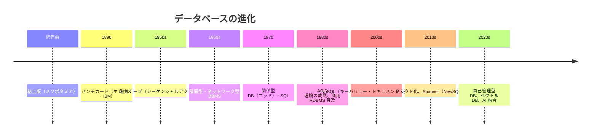

ご視聴ありがとうございます。  
  
Windowsの歴史を技術的な視点で解説をしています。  
ぜひ最後までご覧ください。  
  
ゆっくりしていってね！  
  
このチャンネルが面白かったらぜひチャンネル登録お願いします。  
@ゆっくり情報科学  
  
ゆっくりしていってね！  
  
※この動画は【東方project】を基にした二次創作です。  
東方Projectの二次創作ガイドライン  
https://touhou-project.news/guideline/  
  
※ゆっくり魔理沙、ゆっくり霊夢はきつね様の画像を使用しています。  
https://kitsunekakko.fanbox.cc/posts/2718822  
  
#ゆっくり解説  
#コンピュータ

## 詳しい要約

本動画は、**データベース（DB）** が紀元前の記録から現代の AI 時代まで、どのように生まれ・進化してきたかを初心者向けに解説する。霊夢の「紙の賽銭箱記録帳」が検索・集計に向かない問題から出発し、人類のデータ管理の課題と、それを解いてきた技術の歴史を一気通貫で辿る。

### データ管理の原点——紙から粘土版へ

| 時代 | 方式 | 特徴 |
|------|------|------|
| **古代（紀元前）** | メソポタミアの粘土版 | くさび型文字で取引記録。焼けば半永久的に保存可能——人類最古の「データベース」とも言える |
| **19 世紀後半** | パンチカード | 1890 年アメリカ国勢調査でハーマン・ホレリスが開発。穴の有無で 0/1 を表現し、後のコンピュータの基礎に。ホレリスの会社は後に **IBM** へ |
| **1950 年代** | 磁気テープ | 電子計算機登場。データを順番に記録する **シーケンシャルアクセス** のみで、1 万件から 1 件探すのに最悪 1 万件すべて読む必要があった |

---

### 第 1 世代 DBMS——階層型・ネットワーク型（1960 年代）

#### 階層型データベース

- **1966 年** IBM が **IMS（Information Management System）** を開発。
- データを **木構造（ツリー）** で整理。神社の組織図のように、トップ → 賽銭箱 → 月別記録、という階層。
- **問題点**：1 つのデータが **複数の親を持てない**（お守りが霊夢と売店の両方に所属できない）。

#### ネットワーク型データベース

- **1971 年** CODASYL が標準化。複数の親子関係を持てる。
- **問題点**：構造が複雑化し、**ポインタ（データの住所）** を辿るプログラミングが極めて困難（スパゲッティコード）。後から構造を変更するのも大変。

---

### 第 2 世代——関係型データベースの革命（1970 年代〜）

**1970 年** IBM 研究者 **エドガー・F・コッド** が提唱した **関係データベース（RDB）** が歴史を変えた。

| 概念 | 内容 |
|------|------|
| **基本構造** | 全データを **表（テーブル）** で管理。行 = 1 レコード、列 = 属性（日付・金額・参拝者名など） |
| **データ独立性** | **物理的な格納場所** と **論理的な見え方** を分離。プログラマーは「何が欲しいか」だけ指定すればよい |
| **SQL** | **Structured Query Language**。1974 年 IBM が SEQUEL を開発。例：`SELECT SUM(金額) FROM 賽銭記録 WHERE 月 = 3` |

#### 主要な商用 RDBMS

| 年 | 製品 | 開発元 |
|----|------|--------|
| **1977** | 世界初の商用 RDBMS | オラクル（当時 Relational Software Inc.） |
| **1982** | SQL/DS | IBM |
| **1984** | Sybase | Sybase |

- オラクル創業者 **ラリー・エリソン** はコッドの論文を読んで起業。現在も企業向け DB のトップシェア。

#### ACID 特性——信頼性の 4 本柱

| 特性 | 英語 | 意味 | 例（賽銭箱） |
|------|------|------|-------------|
| **原子性** | Atomicity | 処理は **全部成功** か **全部失敗** のどちらか | 箱 A から 100 円減らす + 箱 B に 100 円増やすが、片方だけ成功しない |
| **一貫性** | Consistency | データベースの **ルールが常に守られる** | 賽銭額は 0 以上——マイナスの記録は不可 |
| **独立性** | Isolation | 複数ユーザーが **同時利用しても干渉しない** | — |
| **永続性** | Durability | 一度記録したデータは **障害でも消えない** | — |

---

### 第 3 世代——NoSQL とビッグデータ（2000 年代）

1990 年代のインターネット普及、2000 年代の Google・Facebook・Amazon など巨大サービスの登場で、従来の RDB では処理しきれないケースが増加。**NoSQL（Non-Relational SQL）** = 関係型以外の DB の総称が登場。

#### NoSQL の 4 タイプ

| タイプ | 仕組み | 代表例 | 向いている用途 |
|--------|--------|--------|---------------|
| **キーバリュー型** | キー（鍵）と値のペアで保存 | Redis、Amazon DynamoDB | 超高速だが複雑な検索は不可 |
| **ドキュメント型** | JSON / XML など構造化文書をそのまま保存 | MongoDB、CouchDB | 柔軟なスキーマ |
| **列指向型** | 行ではなく **列単位** で保存 | Cassandra、HBase | 特定列の集計が超高速（100 万人の平均賽銭額など） |
| **グラフ型** | データ間の **関係性** を効率的に扱う | Neo4j | SNS の友達関係、路線図など |

- **2006 年** Google **BigTable**、Amazon **Dynamo** の論文が業界に衝撃。2008 年 Facebook **Cassandra** がオープンソース化。
- **オープンソース** = ソースコードを無料公開し誰でも利用可能。

#### ACID vs BASE——トレードオフ

多くの NoSQL は ACID を完全には保証せず、緩い一貫性モデル **BASE** を採用する。

| BASE | 意味 |
|------|------|
| **B**asically **A**vailable | 基本的に利用可能 |
| **S**oft state | 厳密でない状態 |
| **E**ventually consistent | 結果的に一貫性が取れる |

→ **銀行の口座は RDBMS**、**SNS のいいね数は NoSQL** のように **用途で使い分ける**。

---

### クラウド時代（2010 年代〜）

**クラウド** = インターネット上のサービスとして DB を利用。自前サーバー不要。

| 3 大クラウド | 提供元 |
|-------------|--------|
| **AWS** | Amazon |
| **GCP** | Google |
| **Azure** | Microsoft |

#### Google Spanner（2012 年）——NewSQL

- 世界中のデータセンターに **分散** しながら **ACID 特性を保証** する **NewSQL**。
- 東京・ニューヨーク・ロンドンなどにデータのコピーを置き、災害時もサービス継続。
- **GPS と原子時計** で世界中の DB 時刻を同期——「どちらの更新が先か」を正確に判断（分散システムの最重要課題）。

---

### AI 時代（2020 年代〜）

| 技術 | 内容 | 代表例 |
|------|------|--------|
| **自己チューニング DB** | AI がパフォーマンス最適化・セキュリティパッチ・故障予測を自動実行 | Oracle Autonomous Database |
| **ベクトル DB** | 画像・文章を **ベクトル（数値配列）** に変換して保存。類似検索・関連文書検索が可能 | Pinecone、Milvus |

- ChatGPT など AI サービスの裏側でもベクトル DB が使われる。
- AI 学習には大量データが必要で、**DB の重要性は AI 時代だからこそ増している**。

---

### 歴史の流れ——まとめ

| 時代 | 特徴 | キーワード |
|------|------|-----------|
| **1960 年代** | 階層型・ネットワーク型 | 木構造・網構造、構造変更が困難 |
| **1970 年代** | 関係型 DB 登場 | 表形式、SQL、データ独立性 |
| **1980 年代** | 理論成熟 | ACID、銀行等で信頼性重視 |
| **2000 年代** | インターネット爆発 | NoSQL、速度・柔軟性優先 |
| **2010 年代** | クラウド化 | 世界分散、NewSQL |
| **2020 年代** | AI 融合 | 自己チューニング、ベクトル DB |

- 2020 年代、全世界の年間データ生成量は **100 ZB（ゼットバイト）超** と言われる（1 ZB = 10²¹ バイト ≒ DVD 約 2000 億枚分）。

---

### 霊夢への実践アドバイス

| 規模 | おすすめ |
|------|---------|
| 神社規模 | **PostgreSQL** または **MySQL**（無料 RDBMS） |
| クラウド | **Google Firebase** または **AWS DynamoDB** の無料枠 |

→ ただし **DB がどれだけ進化しても、中に入れるデータ（参拝者）がゼロなら意味がない**——というオチで締める。

## Transcript

**0:00** · ゆっくり情報科学チャンネル ねえ、魔理沙、私の再銭箱の記録長がどっか行っちゃったんだけど、見なかった?

**0:10** · ああ、それなら借りてるぜ。いや、霊夢の再戦管理方法が原始的すぎて笑っちまったよ。

**0:12** · \[音楽\] は、どういう意味よ。ちゃんと日付と金額を紙に書いてるじゃない。

**0:20** · \[音楽\] 紙に書くだけじゃダめなんだぜ。

**0:24** · 例えば3月10日100円7市の 参拝者って書いてあるけど去年なのか今年なのかも分からないし同じ日に複数の再戦があったらどうするんだ?

**0:30** · \[音楽\] う、確かに去年の 3月だったか今年の3 月だったか覚えてないわね。

**0:42** · それに月別の集計を出したい時はどうする?全部の紙をめくって電卓で計算するのか?そ、それはめんどくさいから年 \[音楽\] 1回しかやらないわ。

**0:54** · だろ?実はな、人類も昔は霊夢みたいにデータ管理で苦労してたんだ。でも今ではデータベースっていう便利な仕組みがあってな、瞬時に検索したり集計したりできるんだぜ。

**0:59** · \[音楽\] へえ、そんな便利なものがあるの?でもどうやってそんなものが生まれたのよ。

**1:08** · \[音楽\] よし、今日は特別にデータベースがどうやって生まれて進化してきたか、その壮大な歴史を教えてやるぜ。

**1:19** · また魔理沙の長話が始まった。

**1:22** · でも再戦管理が楽になるなら聞いてみようかな。まずはコンピューターが登場する前の話からだ。人類がデータを管理し始めたのは実は紀元前からなんだぜ。

**1:29** · \[音楽\] 紀元前?石とか使ってた時代じゃない?

**1:42** · その通り。古代メソポタミアでは粘土版に楔び型文字で取引記録を残してたんだ。これが人類最古のデータベースと言えるかもしれないな。

**1:51** · 粘土番って私の紙の記録長の方がまだマしじゃない?

**1:53** · \[音楽\] いや、粘土版は焼けば反影的に保存できるから、ある意味では神より優秀だぜ。実際現代でも当時の取引記録が解読できてるんだから。

**2:07** · へえ。意外と賢いのね。

**2:09** · 時代が進んで19 世紀後半になるとパンチカードっていうものが登場する。

**2:15** · 1890 年のアメリカ国調査でハーマンホレリスって人が開発したパンチカードシステムが使われたんだ。パンチカードって何?お菓子?

**2:25** · 違うぜ。紙のカードに穴を開けてその穴の位置で情報を表現するんだ。例えば 1列目に穴があったら男性、 2列目なら女性みたいにな。

**2:36** · なんかに2 みたいね。穴があるかないかで例と 1を表してる感じ。

**2:41** · お、鋭いな、霊夢。

**2:42** · まさにその通りでこれが後のコンピューターの基礎になっていくんだぜ。ホレリスの会社は後に \[音楽\] IBMになるし、パンチカードは 1970年代まで現役で使われてたんだ。

**2:54** · IBM って今でも有名な会社じゃない。そんな昔からあったのね。

**2:56** · \[音楽\] そして1950 年代、ついに電子計算機、つまりコンピュータが登場する。

**3:04** · でも初期のコンピューターはデータを時期テープに順番に記録するだけで特定のデータを探すには最初から順番に読んでいく必要があったんだ。

**3:05** · \[音楽\] それって私が紙をめくって探すのと変わらないじゃない?

**3:17** · その通りこれをC けシャルアクセスって言うんだけど効率が悪すぎたんだ。例えば 1万のデータから特定の 1件を探すのに最悪 1万件全部チェックしないといけない。

**3:30** · それは確かに面倒みたいにグって 1発で出てこないの?

**3:35** · それができるようになるにはもう少し時間が必要だったんだぜ。

**3:39** · \[音楽\] 1960 年代に入るとついに本格的なデータベース管理システム DBMS が登場する。最初に生まれたのが海層型データベースだ。

**3:56** · 回送型。なんか偉そうな名前ね。

**4:00** · 名前の通りデータを聞構造つまり釣り上に整理する方式だぜ。

**4:05** · 1966年にIBMが開発したIMS インフォメーションマネージメントシステムが代表例だな。

**4:12** · 気構造って家計図みたいな感じ?

**4:15** · まさにその通り。

**4:17** · 例えば神社の組織傷で言えばトップに白れ神社があって、その下に霊夢再銭箱お守り売り場があって、さらに再銭箱の下に 1月の記録、2 月の記録があるみたいな構造だ。

**4:33** · なるほど。分かりやすいわね。でも何か問題があったの?

**4:37** · 良い質問だぜ。海装型の問題は \[音楽\] 1 つのデータが複数の親を持てないことなんだ。

**4:44** · 例えばお守りが霊夢からも売店からも販売されてる場合っちかにしか所属できない。

**4:51** · ああ、それは不便ね。現実はもっと複雑な関係があるもの。

**4:53** · \[音楽\] そこで登場したのがネットワーク型データベースだ。

**5:00** · 1971 年に出しるっていう団体が標準化したんだけど、これなら複数の親子関係を持てるんだぜ。

**5:08** · へえ。じゃあそれで解決じゃない?

**5:10** · ところがどっこい。

**5:11** · ネットワーク型は構造が複雑になりすぎてプログラミングが超難しくなったんだ。データを取り出すのにまるで迷路を進むようにポインタを辿どっていく必要があってな。

**5:17** · \[音楽\] ポインター?

**5:24** · データの住所みたいなものだぜ。次のデータは記憶装置の 1234 番地にありますみたいに場所を直接指定するんだ。でもこれが複雑に絡み合うとプログラマーが迷子になっちまう。

**5:37** · なんか糸が絡まった糸玉みたいね。

**5:40** · うまい例えだな。

**5:42** · 実際当時のプログラマーはスパゲッコードなんて呼んで苦労してたんだぜ。

**5:47** · 食べ物で例えるなんてお腹空いてたのかしら。

**5:50** · それに回送型もネットワーク型も後からデータ構造を変更するのがめちゃくちゃ大変だった。新しい関係性を追加しようとするとプログラムを大幅に書き直さないといけなかったんだ。

**6:04** · それじゃあ神社に新しいサービスを追加するたびに全部作り直しってこと?

**6:09** · その通り。だからもっと柔軟で使いやすい データベースが求められるようになったん だぜ。

**6:18** · \[音楽\] そして1970年データベースの歴史を 変える論文が発表されるIBMの研究者 エドガーFODが提唱した 関係データベースリレーショナルデータベース だ。関係型人間 関係みたいなものは違うぜ。

**6:39** · 数学の関係、リレーション、理論を元にしたデータベースなんだ。簡単に言えば全てのデータを表テーブルで管理する方式だな。

**6:49** · 表elみたいな。

**6:51** · まさにそんな感じ。例えば霊夢の再戦記録も日付金額参拝者名っていう列絡むを持つ表にするんだ。そして閣僚が一件の再戦を表す。

**7:00** · \[音楽\] なるほど。それなら分かりやすいわね。

**7:07** · 関係型 データベースの革命的なところはデータの物理的な格能方法と論理的な見え方を分離したことなんだぜ。プログラマーはどこに保存されてるかを気にせず何が欲しいかだけを指定すればいい。ちょっと何言ってるかわからないわ。

**7:18** · \[音楽\] 例えばな霊夢が3 月の再戦の合計を知りたいと思ったとする。

**7:30** · 回層型やネットワーク型だとまず 3月のフォルダーを開いて 1 件目を読んで次のデータのアドレスを取得して手順を全部プログラムする必要があった。

**7:38** · \[音楽\] めんどくさそう。

**7:44** · でも関係型ならセレクトサム金額フロム再戦記録アー付き 3って書くだけで済むんだぜ。これが \[音楽\] SQL ストラクチャードクエリーランゲージっていう言語だ。

**7:56** · おお。英語っぽくて分かりやすい。

**7:59** · 3 月の再戦記録から金額の合計を選べって意味よね。

**8:01** · \[音楽\] 正解だぜ。1974年にIBMがSQL の原型となるSEQを開発して1970 年代後半から1980 年代にかけて様々な関係型データベース製品が登場した。

**8:18** · どんな製品があるの?

**8:20** · 1977 年にオラクル当時はリレーショナルソフトウェアインクが世界初の商用 \[音楽\] RDBMSをリース。1982年にIBM がSQLDS。1984 年にシベイズが登場。この辺が 5家って感じだな。

**8:37** · オラクルって今でも聞く名前ね。

**8:39** · そうだぜ。実は現在でも企業向けデータベースのトップシェアを誇ってる。

**8:44** · 創業者のラリーエリソンはコの論文を読んでこれだと思って起了したんだ。

**8:50** · 論文読んで起ってすごい行動力ね。

**8:54** · 1980 年代には関係型データベースの理論も成熟してきた。特に重要なのが \[音楽\] Aッド特性だ。

**9:02** · 3 なんか科学の話?

**9:04** · 違う違う。

**9:06** · アトミシティ原子性コンシステンシー一貫性アイソレーション独立性ダラビリティ永続性の頭文字だぜ。

**9:07** · \[音楽\] また難しそうな言葉が 簡単に説明するとな霊夢が再戦を別の箱に移す時箱 Aから100円減らすと箱B200 円増やすの2つの操作が必要だろ。

**9:28** · そうね。原子性はこの2 つの操作が全部成功か全部失敗のどちらかしかないことを保証する。片方だけ成功して 100円が消えることはない。

**9:39** · ああ、それは大事。お金が消えたら大変だもの。

**9:43** · 一貫性はデータベースのルールが常に守られること。例えば再銭の金額は例以上っていうルールがあればマイナスの再戦は絶対に記録されない。

**9:49** · \[音楽\] マイナスの再戦って逆に私がお金あげることになっちゃうじゃない。

**9:58** · 独立性は複数の人が同時にデータベースを使ってもお互いの作業が干渉しないこと。

**10:04** · A属性は1 度記録したデータはシステムが故障しても消えないことだ。

**10:09** · なるほど。これなら安心してお金の管理ができそうね。

**10:16** · \[音楽\] 1990 年代になるとインターネットが普及してデータベースに新たな課題が生まれた。

**10:26** · インターネットやっと現代っぽくなってきたわね。

**10:29** · ウェブサイトのアクセス数が爆発的に増えて従来の関係型データベースでは処理しきれないケースが出てきたんだ。特に 2000年代に入るとGoogleや Facebook、Amazon みたいな巨大サービスが登場してな。

**10:43** · ああ、確かにGoogle とか世界中の人が使ってるものね。

**10:47** · そこで登場したのがノ SQLだ。ノンリーSQL の略で関係型以外のデータベースの総称なんだぜ。

**10:55** · 関係型じゃないって昔の階層型に戻るの?

**10:59** · いや、全く新しいアプローチだ。ノ SQLには大きく4 つのタイプがある。まずキー VAL リュー型。これは超シンプルでキー、鍵と値のペアでデータを保存する。

**11:11** · 鍵とね、 例えば霊夢の好物っていうキーに対してお茶っていう値を保存する感じだ。リディズや \[音楽\] amazAmazonダイナモDB が有名だな。めちゃくちゃ高速だけど複雑な検索はできない。

**11:25** · シンプルな分早いのね。

**11:27** · 次にドキュメント型。

**11:29** · JonやXML みたいな構造化された文章をそのまま保存できるモンゴデイビーやカウチデイビーが代表例だぜ。

**11:37** · ジェイソン Javオブジェクトノテーションの役でデータを表現する形式の 1 つだ。例えば霊夢のデータならこんな感じに表現できる。

**11:47** · おお。人間が読んでも分かりやすいわね。

**11:50** · 3 つ目は絡む思考型。

**11:52** · 通常の関係型が業位でデータを保存するのに対して列単位で保存するんだ。カサンドラや Hベースが有名だな。

**12:00** · 列単位何が嬉しいの?

**12:03** · 例えば100 万人の参拝者データから再戦額の平均を計算したいとする。業思考だと 100 万量全部読む必要があるけど列思考なら再戦額の列だけ読めばいいから超高速なんだぜ。

**12:17** · なるほど。用途によって使い分けるのね。

**12:20** · 最後がグラフ型。

**12:21** · ネオ4J とかが有名でデータの関係性を効率的に扱える SNS の友達関係とか駅の路線図みたいな複雑なネットワークを表現するのに向いてる。

**12:33** · へえ。データベースも適在適的書なのね。

**12:36** · 2006年にはGoogle がビッグテル、 Amazonがダイナモっていう独自の SQL システムの論文を発表して業界に衝撃を与えた。

**12:47** · これらの技術が後のオープンソースプロジェクトに大きな影響を与えたんだぜ。

**12:52** · オープンソース ソースコードを無料で公開して誰でも使えるようにすることだ。

**12:57** · 2008年にFacebook が開発したカサンドラもオープンソース化されて、今では多くの企業が使ってる。

**13:04** · 太っぱらね、ただで使えるなんて。

**13:07** · ただしノSQLには欠点もある。

**13:10** · 多くのSQL はさっき説明した特性を完全には保証しないんだ。代わりにベースっていう緩い一貫性モデルを採用してる。

**13:15** · \[音楽\] 3 の次は延期本当に科学みたい。

**13:23** · ベーシカリーブAI ラブル基本的に利用可能。ソフトステート厳密でない状態。イベントアルコンシステンシー結果的に一貫性が取れるの役だぜ。つまり完璧じゃないけど大体大丈夫って感じだ。

**13:33** · \[音楽\] え、お金の管理でそれは困るわ。

**13:41** · だから用途によって使い分けるんだ。銀行のお金は RDBMSで厳密に管理して SNSのいいね。数とかはノ SQL で高速に処理するみたいにな。そして \[音楽\] 2010 年代以降データベースはクラウド時代に突入した。

**14:03** · クラウド雲 インターネット上のサービスとしてデータベースを使うことだぜ。自分でサーバーを買って管理する必要がなくなったんだ。

**14:12** · へえ、便利そうね。でも他人に預けて大丈夫なの?

**14:13** · \[音楽\] 良い質問だ。実は今のクラウドサービスは個人や中小企業が自分で管理するより安全で信頼性が高いことが多いんだぜ。

**14:25** · AmazonWebsAWSGoogle クラットフォームGCP Microsoftアジールが3 大クラウドプロバイダーだ。あ、 また有名企業ばっかり。2012年に Googleが発表したスパナーは特に 革命的だった。これは世界中のデータ センターに分散したデータベースであり ながらAシッド特性を保証するニュー SQLと呼ばれる新世代のデータベースな んだ。世界中12分3どう?

**14:54** · 例えば東京、ニューヨーク、ロンドンにそれぞれデータのコピーを置いてどこかのデータセンターが災害で壊れてもサービスを継続できるようにするんだ。

**15:04** · おお、災害対策もばっちりなのね。

**15:07** · しかもGPS と原子時計を使って世界中のデータベースの時刻を完璧に同期させてる。これによって地球の裏側のデータベースとも矛盾なくデータをやり取りできるんだぜ。

**15:19** · GPS使うのデータベースなのに 時刻の同期は分散システムの最重要課題の 1 つなんだ。どっちの更新が先だったかを正確に判断するためにな。

**15:31** · なるほど。でも大げさすぎない?

**15:32** · \[音楽\] Googleみたいな規模になると1 秒の遅延がオク単位の損失になることもあるからくらいやる価値があるんだぜ。

**15:41** · オタ位?私の再戦とはスケールが違うわね。

**15:43** · \[音楽\] 最近では機械学習や AIとデータベースの融合も進んでる。

**15:51** · 2017 年頃から自己チューニングデータベースっていうのが登場してきた。

**15:56** · 自己チューニング自分で調整するの?

**15:59** · そう。オラクルオートノーマスデータベースとかは AI が自動的にパフォーマンスを最適化したりセキュリティパッチを適用したり故障を予測して対策したりするんだ。

**16:10** · すごい。もう人間いらないじゃない?

**16:13** · いやいや、AI が判断できない部分はまだまだ人間が必要だぜ。それに 2020 年代に入ってからはベクトルデータベースっていう新しいタイプも注目されてる。

**16:24** · ベクトル数学の そう画像や文章をベクトル数値の配列に変換して保存するんだ。これによって似ている画像を探すとか関連する文章書を見つけるみたいな曖昧な検索ができるようになる。

**16:40** · へえ。

**16:40** · 霊夢っぽい巫女さんの画像とか探せるの?

**16:43** · まさにそういうことができるんだぜ。パインコーンとかミルバスとかが有名だな。チャット GPTみたいなAI サービスの裏側でもこういうベクトルデータベースが使われてるんだ。

**16:55** · AI の時代になってもデータベースは重要なのね。

**16:58** · むしろAI 時代だからこそもっと重要になってる。

**17:02** · AI の学習には大量のデータが必要だし、その管理にはデータベースが不可欠だからな。

**17:08** · なるほど。

**17:10** · て結局私の再戦管理はどうすればいいのよ。

**17:14** · 霊夢の規模ならポストグレス SQLかマSQLあたりの無料の RDBMSで十分だぜ。クラウドなら GoogleFireベースとかAWS ダイナモDBの無料枠でもいける。

**17:25** · 無料?それは素晴らしいわ。

**17:32** · さて長い旅だったけどデータベースの歴史をまとめるとこんな感じだぜ。

**17:37** · ちょっと待って整理させて。

**17:39** · まず1960 年代に回送型とネットワーク型データベースが生まれた。でも構造が硬すぎて使いにくかった。構造とか網構造でデータを管理してたのよね。

**17:51** · 1970 年代に関係型データベースが登場してデータを表形式で管理するようになった。

**17:57** · SQL っていう分かりやすい言語も生まれてこれが大成功した。

**18:02** · 今でも銀行とかで使われてる信頼性の高いやつね。

**18:06** · 2000 年代になるとインターネットの爆発的な成長に対応するためノ SQL が登場。速度重視で完璧より火用性を優先した。

**18:17** · 用途によってキーバリュー型とかドキュメント型とか選べるのよね。

**18:21** · 2010 年代以降はクラウド化が進んで世界規模で分散したデータベースが当たり前になった。ミュ SQLは分散していてもA シ特性を保証できる。

**18:32** · GPS まで使って時刻同機してるなんてすごい時代ね。

**18:36** · そして今はAI と融合した自己管理型データベースやベクトルデータベースみたいな新しい形も生まれてる。

**18:43** · データベースって時代と共に進化し続けてるのね。

**18:47** · そうだぜ。人類が扱うデータ量は指数関数的に増え続けてる。

**18:52** · 2020 年代には全世界で生成されるデータ量が年間 100バを超えるって言われてる。

**18:59** · ZBどのくらい?

**19:01** · 1 ZBは10の21乗。DVD に換算すると約2000億枚分だ。

**19:07** · もう想像もつかない だろ。だからこそデータベースは今後もなくてはならない存在なんだ。

**19:13** · うん。最初は再銭箱の話だったのにすごく壮大なスケールに広がったわね。

**19:19** · まあ身近な管理から宇宙規模の管理まで全部繋がってるってことだな。

**19:24** · データベースの進化がなかったら今のインターネットや AIもなかったのね。

**19:29** · その通りこれからも新しい技術と共に進化し続けていくはずだぜ。

**19:34** · なるほど。よし、私も最新のデータベースで再戦をがっちり管理して神社の経営を安定させるわ。

**19:40** · \[音楽\] でもな、霊夢、データベースがどんなに進化しても中に入れるデータがゼロなら意味ないぜ。

**19:48** · う、結局は参拝に来てもらわないとね。

**19:53** · ははは。

**19:53** · ってことで今回の解説はここまでだ。

**19:57** · この動画が面白いと思ったら高評価とチャンネル登録をよろしくね。コメントで次に解説して欲しいテーマも是非教えてくれよな。

**20:06** · それじゃあ次回のゆっくり解説でまた会いましょう。

**20:10** · ご視聴ありがとうございました。

**20:15** · レ