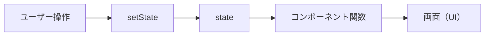

# 1-1. Reactとは何か（UIを状態から描く）

## 🎯 この章で学ぶこと

- Reactは「UIライブラリ」であって、フレームワークではないこと
- 「UIを状態から描く」という考え方の本質
- 従来のjQuery的な書き方との違い

---

## 📖 概念の説明

### Reactは「UIを作るための部品箱」

ReactはMeta（旧Facebook）が作った**UIライブラリ**です。Webサイトの「画面（ユーザーインターフェース）」を効率よく作るための道具箱だと思ってください。

> **ライブラリとフレームワークの違い**
> - ライブラリ：必要な部品を選んで使う（自由度が高い）
> - フレームワーク：決められた仕組みに沿って使う（指示が多い）
>
> Reactはライブラリ寄り。ルーティングや状態管理は別ライブラリと組み合わせます。

### 一番大事な考え方：「UI = f(状態)」

Reactを支える1行を覚えてください。

```text
UI = f(state)
```

つまり、**画面（UI）は「状態（state）」を入れたら出てくる関数の戻り値**だ、という考え方です。

例えるなら、**自動販売機**です。

- ボタン（state）を押すと → ジュース（UI）が出る
- 別のボタン（別のstate）を押すと → 別のジュース（別のUI）が出る

開発者がやることは「**stateが変わったら画面はどう見えるべきか**」を一度書くだけ。あとはReactが自動で画面を描き直してくれます。

### 従来のJavaScript（jQuery的）との違い

#### Before（命令的）：手で1つずつ画面を書き換える

```javascript
// クリックされたら、テキストを書き換える
document.getElementById('count').innerText = '1';
document.getElementById('count').innerText = '2';
// ...
```

「**どう変えるか**」を書きます。命令的（imperative）と呼びます。

#### After（宣言的、React）：状態と見た目の関係を書く

```jsx
function Counter() {
  const [count, setCount] = useState(0);
  return <p>{count}</p>; // countが変わるたび自動で画面が更新
}
```

「**どう見えるか**」を書きます。宣言的（declarative）と呼びます。

---

## 💻 コード例

### 例1：もっともシンプルなReactコンポーネント

```jsx
// 関数の戻り値が画面に表示される
function Hello() {
  return <h1>こんにちは、世界！</h1>;
}
```

ブラウザで表示すると `こんにちは、世界！` という見出しが出ます。

### 例2：状態（state）と画面の対応

```jsx
import { useState } from 'react';

function Counter() {
  // count: 状態（数字を覚えておく）
  // setCount: 状態を変える関数
  const [count, setCount] = useState(0);

  return (
    <div>
      <p>現在のカウント: {count}</p>
      <button onClick={() => setCount(count + 1)}>+1</button>
    </div>
  );
}
```

- ボタンを押す → `setCount` で count が `1` になる
- React が `Counter` 関数をもう1回実行して、新しい画面を作る
- 画面の `現在のカウント: 0` → `現在のカウント: 1` に変わる

### 例3：状態によって表示が切り替わる

```jsx
function Greeting() {
  const [isLoggedIn, setIsLoggedIn] = useState(false);

  // stateの値で見た目が決まる
  if (isLoggedIn) {
    return <h1>おかえりなさい！</h1>;
  }
  return <h1>ログインしてください</h1>;
}
```

---

## 🔄 仕組みのイメージ図



ユーザーが操作 → stateが変わる → 関数が再実行 → 新しい画面が出る、というループです。

---

## ❌ よくある間違い

### 直接DOMを書き換えようとする

```jsx
// ❌ React的にはNG
function Counter() {
  return (
    <div>
      <p id="count">0</p>
      <button onClick={() => {
        document.getElementById('count').innerText = '1';
      }}>+1</button>
    </div>
  );
}
```

→ Reactは「stateを変えれば画面が更新される」のが大原則。手でDOMを触らない。

### stateを使わずに普通の変数で値を変える

```jsx
function Counter() {
  let count = 0;
  return <button onClick={() => count++}>{count}</button>;
  // ❌ クリックしても画面は更新されない
}
```

→ 普通の変数を変えてもReactは何も検知しない。`useState`を使う。

---

## ✅ ベストプラクティス

1. **「stateが変わると画面が変わる」**ことを常に意識する
2. **DOMを直接触らない**（input.value = ... などしない）
3. **見た目の条件は、stateで表現**する
4. ライブラリだと知り、不足機能は別ライブラリで補う
5. 公式ドキュメント [react.dev](https://react.dev) を一次情報として活用

---

## 📝 まとめ

- Reactは「UIを作るためのライブラリ」
- 中心的な考え方は `UI = f(state)`
- 命令的（手で書き換える）から、宣言的（状態と見た目の関係を書く）へ
- stateを変える → Reactが自動で画面を更新する

---

## 🔗 関連ページ

- [[1-2-SPA-MPA-CSR-SSR-SSG]]
- [[1-3-Reactのレンダーとは]]
- [[1-4-宣言的UI・一方向データフロー]]
- [[4-1-useStateの基本]]
