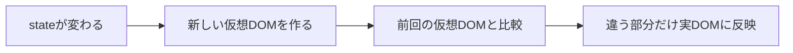

# 1-3. Reactの「レンダー」とは（再レンダーの直感）

## 🎯 この章で学ぶこと

- 「レンダー（render）」と「再レンダー（re-render）」の意味
- 何がきっかけで再レンダーが起きるか
- 仮想DOM（Virtual DOM）の役割

---

## 📖 概念の説明

### レンダー = 「画面を描く」こと

「render（レンダー）」は英語で「描画する／表現する」という意味。Reactでは**「コンポーネント関数を実行して、画面に出すための情報を作ること」**を指します。

> 例えるなら、料理人がレシピ（コンポーネント）を見て、注文（state/props）に応じて料理（画面）を作るイメージ。

### 「再レンダー」 = もう一度関数を呼ぶ

state や props が変わると、Reactはコンポーネント関数を**もう一度呼びます**。これが「再レンダー」。

### 何がきっかけで再レンダーが起きる？

主に4つです。

1. **stateが更新されたとき**（`setState`を呼んだ）
2. **propsが変わったとき**（親から渡される値が変わった）
3. **親が再レンダーされたとき**（連鎖して子も再レンダー）
4. **Contextの値が変わったとき**

### 仮想DOM（Virtual DOM）：差分だけ更新する仕組み

「再レンダーって、毎回画面ぜんぶ作り直すの？重くない？」と心配になりますよね。実はReactは賢く、**仮想DOM**という仕組みを使います。



**ポイント**：

- 仮想DOMはJSのオブジェクト。軽い
- 実際のブラウザ表示（実DOM）の更新は重い
- だから「**差分だけ**」更新することで高速化

---

## 💻 コード例

### 例1：再レンダーが起きるタイミングを見る

```jsx
import { useState } from 'react';

function Counter() {
  const [count, setCount] = useState(0);

  // この console.log は再レンダーのたびに実行される
  console.log('Counter がレンダーされた');

  return (
    <div>
      <p>{count}</p>
      <button onClick={() => setCount(count + 1)}>+1</button>
    </div>
  );
}
```

ブラウザのコンソールを見ながらボタンを押すと、押すたびに「Counter がレンダーされた」がログに出ます。

### 例2：親が再レンダーすると子も再レンダーする

```jsx
function Parent() {
  const [count, setCount] = useState(0);
  return (
    <div>
      <button onClick={() => setCount(count + 1)}>+1</button>
      <Child /> {/* propsを渡していなくても再レンダーされる */}
    </div>
  );
}

function Child() {
  console.log('Child がレンダーされた');
  return <p>子コンポーネント</p>;
}
```

`count`は`Child`と関係ないのに、親が再レンダーされるたび子も再レンダーされます（特別な対策をしない限り）。

### 例3：state を変えても値が同じなら再レンダーされない

```jsx
const [name, setName] = useState('太郎');
setName('太郎'); // 同じ値 → 再レンダーされない
```

Reactは前回の値と比較して、同じなら再レンダーをスキップします。

---

## ⚡ 「重い再レンダー」の対策

無駄な再レンダーが多いと画面がもたつきます。対策は **9章 パフォーマンス** で詳しく扱いますが、簡単には：

- `React.memo`：propsが変わらない限り再レンダーしないようにする
- `useMemo`/`useCallback`：重い計算や関数を再生成しない

ただし、**最初から使う必要はありません**。「重くなってから測って対策」が原則です。

→ [[9-1-体感が重い原因を切り分ける]]

---

## ❌ よくある間違い

### 「再レンダー = 画面が全部書き換わる」と思う

→ 違います。仮想DOMで差分計算され、実DOMは差分だけ更新されます。

### console.logだけ見て「無限ループ！」と慌てる

```jsx
useEffect(() => {
  setCount(count + 1); // ❌ 無限ループ
});
```

→ これは依存配列の問題。詳しくは [[5-5-よくあるバグ集]]。

### memoを最初から付けまくる

→ かえって遅くなることがあります。9章で測ってから判断。

---

## ✅ ベストプラクティス

1. **再レンダーは普通のこと**と知る。怖がらない
2. console.logでレンダー回数を観察する習慣
3. 不必要な再レンダーは「重くなったら」対策する
4. 仮想DOMがあるから「差分のみ」と覚える
5. **React DevToolsのProfiler**で実測する

---

## 📝 まとめ

- レンダー = コンポーネント関数を実行して画面を作る
- 再レンダー = state/propsが変わったときにもう一度関数を実行
- 仮想DOMで差分計算するので意外と速い
- 親が再レンダーされると子も連鎖して再レンダー（対策は memo）

---

## 🔗 関連ページ

- [[1-1-Reactとは何か]]
- [[1-4-宣言的UI・一方向データフロー]]
- [[4-1-useStateの基本]]
- [[5-4-StrictModeで2回動く理由]]
- [[9-2-React-memo-useMemo-useCallback]]
