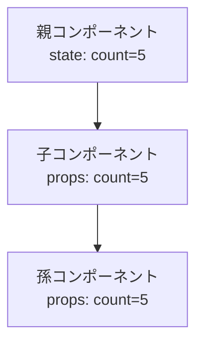

# 1-4. 宣言的UI・一方向データフロー

## 🎯 この章で学ぶこと

- 「宣言的UI」と「命令的UI」の違い
- データが「一方向」に流れるとは何か、なぜ嬉しいのか
- props（親→子）と state（自分の中）の役割分担

---

## 📖 概念の説明

### 宣言的（declarative）UI とは

**「こういう状態のときは、こう見える」**を一度書くだけのスタイル。

例えるなら**冷蔵庫の温度設定**です。

- 命令的：「もう少し冷やす」「もうちょっと温める」と細かく操作
- 宣言的：「3℃にして」と目標を伝えるだけ。冷蔵庫が自動で調整

### 命令的（imperative）UI（jQuery的）

```javascript
// ボタンを取得
const btn = document.getElementById('btn');
// テキストを取得
const text = document.getElementById('text');
// クリック時：色を変えて、文字も変える
btn.addEventListener('click', () => {
  btn.style.backgroundColor = 'red';
  text.innerText = 'クリックされた';
});
```

「**何を、どの順で、どう変えるか**」を細かく書きます。

### 宣言的UI（React）

```jsx
function Button() {
  const [clicked, setClicked] = useState(false);
  return (
    <button
      style={{ backgroundColor: clicked ? 'red' : 'gray' }}
      onClick={() => setClicked(true)}
    >
      {clicked ? 'クリックされた' : 'クリック'}
    </button>
  );
}
```

「**stateがtrueのときは赤、falseのときは灰色**」と関係を書くだけ。

---

### 一方向データフロー（One-way data flow）

Reactでは、**データは親から子へ一方向にしか流れません**。



子が親のstateを直接書き換えることは**できません**。子は「親の値を表示する」「親が渡してくれた関数を呼ぶ」だけです。

#### 子から親に伝えるには：関数を渡す

```jsx
// 親
function Parent() {
  const [count, setCount] = useState(0);
  return <Child onIncrement={() => setCount(count + 1)} />;
  //          ↑ 関数をpropsで渡す
}

// 子
function Child({ onIncrement }) {
  return <button onClick={onIncrement}>+1</button>;
}
```

**子はボタン押下を「合図」するだけ**。実際にcountを変えるのは親です。

### 一方向データフローの利点

1. **流れが追いやすい**：「データはどこから来た？」を探すとき、親を遡るだけ
2. **バグの原因が見つけやすい**：データを変えられる場所が決まっている
3. **テストしやすい**：propsを与えれば挙動が決まる

---

## 💻 コード例

### 例1：親→子の流れ

```jsx
function Parent() {
  const [user, setUser] = useState({ name: '太郎', age: 20 });

  return (
    <div>
      <UserCard user={user} />        {/* 表示用 */}
      <UserForm
        user={user}
        onChange={setUser}            {/* 子が変更を通知できる */}
      />
    </div>
  );
}

function UserCard({ user }) {
  return <p>{user.name}（{user.age}歳）</p>;
}

function UserForm({ user, onChange }) {
  return (
    <input
      value={user.name}
      onChange={(e) => onChange({ ...user, name: e.target.value })}
    />
  );
}
```

- データの**真実の源（source of truth）**は `Parent` の `user`
- 子はそれを表示・編集の合図を送るだけ

### 例2：兄弟コンポーネント間の通信は親経由

```jsx
function App() {
  const [searchText, setSearchText] = useState('');
  return (
    <div>
      <SearchInput value={searchText} onChange={setSearchText} />
      <SearchResult keyword={searchText} />
    </div>
  );
}
```

`SearchInput` と `SearchResult` は直接やり取りできません。**共通の親（App）に持ち上げる**のが原則。

---

## ❌ よくある間違い

### 子で親のpropsを直接書き換えようとする

```jsx
function Child({ user }) {
  user.name = '新しい名前'; // ❌ 親には伝わらない
  return <p>{user.name}</p>;
}
```

→ 親から関数をもらって、それを呼ぶ：

```jsx
function Child({ user, onChangeName }) {
  return <button onClick={() => onChangeName('新しい名前')}>変更</button>;
}
```

### 兄弟コンポーネントで直接やりとり

```jsx
// ❌ 兄から弟にpropsを渡す方法はない
<Brother />
<Sister /> {/* 兄の値を見たい */}
```

→ 共通の親にstateを持ち上げる（state lifting）。詳しくは [[8-1-まずはReactだけで]]。

---

## ✅ ベストプラクティス

1. **「データはどこにある？」を最初に決める**（真実の源を1箇所に）
2. 子で値が必要なら **propsで渡す**
3. 子で値を変えたいなら **関数を渡して呼ばせる**
4. 兄弟間でやりとりするなら **親に上げる**
5. グローバルなものは **Context** か状態管理ライブラリ（8章）

---

## 📝 まとめ

- 宣言的UI = 「こういう状態だとこう見える」を書くだけ
- データは親→子へ一方向に流れる
- 子は親に関数を呼ぶことで「合図」を送る
- 真実の源（state）は1箇所に置く

---

## 🔗 関連ページ

- [[1-1-Reactとは何か]]
- [[3-2-関数コンポーネント]]
- [[4-5-props-drillingの正体]]
- [[8-1-まずはReactだけで]]
