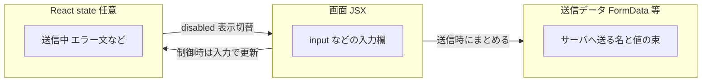
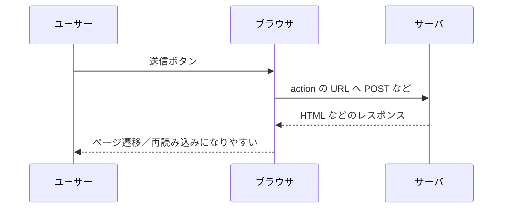
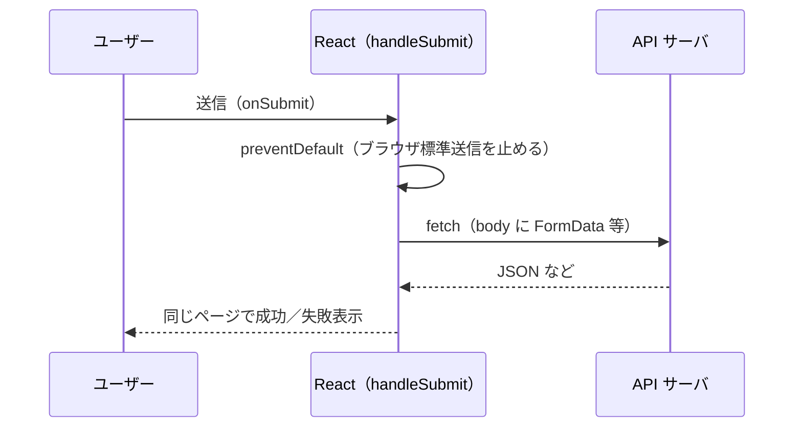
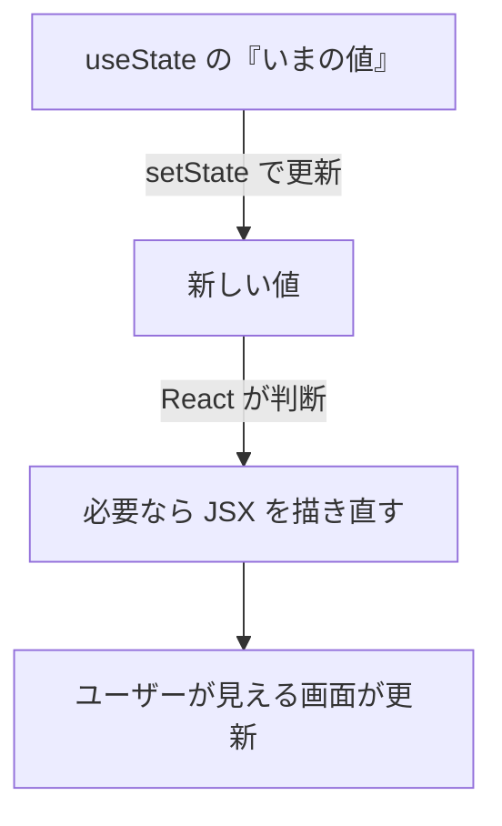
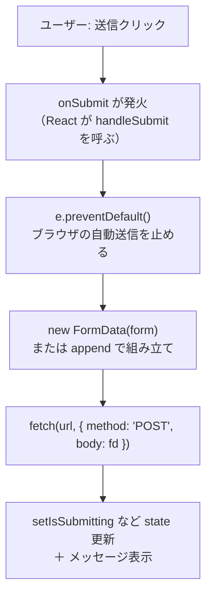
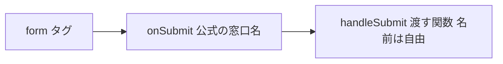
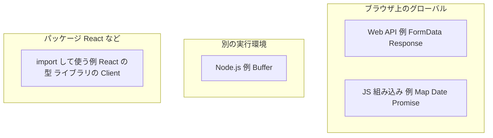

# React のフォーム入門（HTML との違い・state・FormData）

**想定読者:** HTML の `<form>` は触ったことがあるが、React での書き方や `FormData` / `append` / `state` がまだ腹落ちしていない人向けです。  
**このノートのゴール:** 「古典的な HTML 送信」と「React でよく書く送信」の違いを図で掴み、用語がコードのどこに対応するかをつなげます。

---

## 1. まず全体像（3 つの箱）

フォーム周りは、だいたい次の 3 つに分けると迷子になりにくいです。



| 箱 | 役割の一言 |
|----|------------|
| **画面（JSX）** | ユーザーが見て触る部分。`<form>`・`<input>`・ボタンなど。 |
| **state** | 「いまアプリが覚えていること」。送信中か、エラー文など。**必須ではないが、体験を良くするために使うことが多い**。 |
| **FormData** | 送信するときに「名前と値のペア」をまとめるためのオブジェクト。**HTTP の body に載せやすい形**。 |

---

## 2. 「HTML のフォーム」と「React のフォーム」の違い

### 2-1. 古典的な HTML だけの送信（ページが替わりやすい）

ユーザーが送信ボタンを押すと、ブラウザが **`<form action="...">` に書かれた URL** へ、フォームの内容を載せて飛びます。**別ページに遷移したり、画面が丸ごと再読み込み**しやすいのが特徴です。



**覚え方:** 「ブラウザが運転手で、行き先は `<form action>` が決める」。

---

### 2-2. React でよく書くパターン（`fetch` ＋ 画面はそのまま）

React アプリでは、送信ボタンを押したときに **まず自分の JavaScript（例: `handleSubmit`）を通す**ことが多いです。そこで **`e.preventDefault()`** を呼ぶと、ブラウザの「古典的な一発送信」を止められます。そのうえで **`fetch`** で API に送り、返ってきた結果を見て **同じページのまま** メッセージを出したり state を更新したりします。



**覚え方:** 「行き先や送り方は **React 側のコードが決める**。ブラウザの自動運転はオフにする」。

---

### 2-3. 並べて比較（ASCII）

```
【HTML 古典】  <form action="/api" method="POST">  …  </form>
              → ブラウザが /api に POST、ページが替わりやすい

【React よくある】 <form onSubmit={handleSubmit}>
              → handleSubmit で preventDefault
              → fetch('/api', { method: 'POST', body: ... })
              → 同じ SPA 内で UI 更新
```

`<form>` という**タグ自体は React でも使えます**。違うのは「**誰が送信の主導権を持つか**」です（ブラウザ標準か、あなたの関数か）。

---

## 3. `state（ステート）` とは何か

**state** は、コンポーネントが「**いまの値を覚えておくためのメモ**」です。`useState` を使うと、**メモを書き換えるたびに画面が必要なら描き直される（再レンダー）**、というのが React の基本です。



フォームで state を使う典型例:

| state に入れる例 | 画面での効果 |
|-------------------|--------------|
| `isSubmitting`（送信中か） | 送信中はボタンを `disabled` にする |
| `errorMessage` | 失敗したときだけ赤文字を出す |
| `email`（入力と紐づける場合） | 1 文字打つたびに入力欄の表示が追従（**制御コンポーネント**） |

**誤解しやすい点:** 「React のフォーム＝全部 state」ではありません。入力は DOM に任せ、送信時だけ `FormData` を取る**非制御**の書き方もあります（詳しくは下の「つなぐ」と関連ノート参照）。

---

## 4. `FormData` とは何か

**FormData** は、ブラウザが用意している **「フォームのフィールドを、名前（キー）と値のペアで抱え込む入れ物」** です。`fetch` の **`body`** に渡すと、`multipart/form-data` 形式などで送りやすくなります。

### 4-1. イメージ図（表になったデータ）

画面上の `<input name="email" />` が「`email` という列名」「ユーザーが打った文字」という **1 行**に相当します。`FormData` はその行を複数まとめた表のようなものです。

```text
┌─────────────┬──────────────────┐
│ name（キー） │ value（値）       │
├─────────────┼──────────────────┤
│ email       │ user@example.com │
│ message     │ お問い合わせ内容   │
└─────────────┴──────────────────┘
        ↑ これを HTTP で送るイメージ
```

### 4-2. よくある作り方（2 パターン）

1. **フォームから自動で集める:** `new FormData(formElement)`  
   → フォーム内の `name` 付きフィールドが入る  
2. **空の入れ物から手で足す:** `const fd = new FormData(); fd.append(...)`  
   → 画面上に無い値（トークンや固定の subject など）を足したいときに便利  

---

## 5. `append` とは何か

**`formData.append(キー, 値)`** は、入れ物に **「もう一行、追加する」** メソッドです。

```text
append の前:
  email = user@example.com

append('subject', 'お問い合わせ') のあと:
  email   = user@example.com
  subject = お問い合わせ
```

- **第 1 引数:** サーバ側が見る「フィールド名」（HTML なら `name` に相当）  
- **第 2 引数:** その値（文字列やファイルなど）  

同じキーを何度か `append` すると **同名の行が複数** になることがあります（配列的な送り方）。1 行だけにしたいときは `set` もありますが、入門では **`append` で「足していく」** と覚えれば十分です。

---

## 6. ひと続きの流れ（用語のつながり）

送信ボタンが押されてから、用語がどうつながるかを一本の流れにします。



ここで初めて揃うとよい対応関係:

| コードに出てくるもの | 一言 |
|---------------------|------|
| `onSubmit={handleSubmit}` | 送信の瞬間に呼ぶ関数を登録 |
| `e.preventDefault()` | 古典的なフォーム遷移を止める |
| `FormData` | 送る中身の「表」 |
| `append` | 表に行を追加 |
| `useState` / `set...` | 送信中・結果を画面に反映 |

---

## 7. 読むだけの超ミニ例（意味の索引）

```tsx
import { useState, type FormEvent } from "react";

export function ContactForm() {
  const [isSubmitting, setIsSubmitting] = useState(false);
  const [message, setMessage] = useState("");

  async function handleSubmit(e: FormEvent<HTMLFormElement>) {
    e.preventDefault(); // ブラウザのデフォルト送信を止める

    const form = e.currentTarget;
    const fd = new FormData(form); // フォーム内の name 付き入力を集める

    fd.append("source", "my-react-app"); // 足したい行を手で追加

    setIsSubmitting(true);
    try {
      const res = await fetch("/api/contact", { method: "POST", body: fd });
      if (!res.ok) throw new Error("送信に失敗しました");
      setMessage("送信しました");
    } catch {
      setMessage("エラーが発生しました");
    } finally {
      setIsSubmitting(false);
    }
  }

  return (
    <form onSubmit={handleSubmit}>
      <input name="email" type="email" required />
      <button type="submit" disabled={isSubmitting}>
        {isSubmitting ? "送信中…" : "送信"}
      </button>
      {message && <p>{message}</p>}
    </form>
  );
}
```

- **`name` 属性:** `FormData` が「表の列名」を知るためのラベル。  
- **`disabled={isSubmitting}`:** state が「いま送信中か」を覚え、ボタンに反映。  

---

## 8. `onSubmit` と `handleSubmit` の違い

**種類が違います。** `onSubmit` は React が決めた **属性名**、`handleSubmit` はよく使う **関数名の例** です。



| 名前 | 正体 |
|------|------|
| **`onSubmit`** | `<form onSubmit={...}>` の **左側**。フォーム送信時に呼ぶ関数を渡すための **公式のプロパティ名**（HTML では `onsubmit`）。意味は「**いつ** 呼ぶか」＝送信時。 |
| **`handleSubmit`** | **右側に渡す関数**につけている名前の一例。`submitForm` や `onContactSubmit` など **何でもよい**。慣習で「`handle` + イベント名」とすることが多い。 |

よくある一行:

```tsx
<form onSubmit={handleSubmit}>
```

- **左 `onSubmit`:** 変えられない（React / DOM の約束事）。  
- **右 `handleSubmit`:** 自分のコードで定義した関数。`function handleSubmit(e) { ... }` や `const handleSubmit = (e) => { ... }` と対になる。

---

## 9. `append` 以外でフォーム周りでよく使うメソッド

「フォーム」が **`FormData` インスタンス** なのか、**`<form>` 要素（DOM）** なのかで分けます。

### 9-1. `FormData` オブジェクトでよく使うもの

| メソッド | 一言 |
|----------|------|
| **`set(name, value)`** | その `name` の値を **置き換え**。同名はだいたい 1 つにしたいとき。`append` は **行を追加** するので、同名が複数になり得る。 |
| **`get(name)`** | その名前の **最初の 1 つ** の値を取る。 |
| **`getAll(name)`** | 同名が複数あるとき **全部**（チェックボックスの複数選択など）。 |
| **`has(name)`** | その名前の項目があるか。 |
| **`delete(name)`** | その名前のエントリを消す。 |
| **`entries` / `keys` / `values` / `forEach`** | 中身をループするとき。 |

### 9-2. `<form>` 要素（DOM）でよく使うもの

| メソッド | 一言 |
|----------|------|
| **`requestSubmit()`** | 送信ボタンを押したのと近い流れで送信し、**制約チェック（`required` など）も走る**。プログラムから送りたいときはこちらが推奨されがち。 |
| **`submit()`** | 検証を経由せず送信しがち。**通常 UI から送る用途では `requestSubmit()` の方が安全**、という説明が多い。 |
| **`reset()`** | フォームを初期状態に戻す。 |
| **`checkValidity()`** | 制約を満たすかだけを boolean で返す。 |
| **`reportValidity()`** | ダメならブラウザ標準のエラー表示を出す。 |

---

## 10. 「`FormData`」と「`formData`」の違い（大文字・小文字）

JavaScript では **大文字始まり** と **小文字始まり** で、だいたい次のように意味が分かれます。

| 書き方 | 多くの場合の意味 |
|--------|------------------|
| **`FormData`（先頭が大文字）** | ブラウザが用意している **クラス（型）の名前** そのもの。`new FormData(...)` の **右の `FormData`** は「この型の入れ物を新しく作る」という **工場の名前**。 |
| **`formData`（先頭が小文字）** | 開発者が付けた **変数名** の例。`const formData = new FormData(form)` のように、**作った 1 個の入れ物** にラベルを貼っているだけ。 |

```text
new FormData(form)
  │      │
  │      └── クラス名（型）。固定の綴り。
  └───────── 「新しく作る」演算子

const formData = ...
      │
      └── 変数名。fd、data、payload など何でもよい。
```

**覚え方:** **`FormData`＝型（設計図・工場名）**、**`formData`＝その型で作った値を入れた箱のラベル**（変数名はチームの好みで変わる）。

同じ理由で、`fetch` は小文字の関数、`Response` は型、`const res = await fetch(...)` の `res` は変数、といった区別がコード全体であります。

### 10-1. `FormData` 以外にもブラウザが用意しているクラス（例）

`FormData` だけが特別、というわけではありません。**ブラウザが Web の仕様に沿って実装している API** のなかに、**`new 名前()` で作る型** がたくさんあります（厳密には「すべてがクラス構文とは限らない」ものもありますが、入門では **大文字始まりのコンストラクタ** と捉えて差し支えありません）。

フォーム・通信まわりで顔を出しやすい例:

| 名前 | ざっくりした役割 |
|------|------------------|
| **`URL`** | 文字列の URL を解析したり、クエリを組み立てたりする。 |
| **`URLSearchParams`** | `?a=1&b=2` のような **クエリ文字列** を表で扱う。 |
| **`Headers`** | HTTP のヘッダを **`get` / `set` など** で扱う。 |
| **`Request` / `Response`** | `fetch` が使う **リクエスト／レスポンス** の入れ物。 |
| **`Blob` / `File`** | バイナリやファイル。`input type="file"` と組み合わせることがある。 |
| **`AbortController`** | `fetch` を **途中でキャンセル** するときなどに使う。 |

DOM（画面の部品）にも **`HTMLElement`** や **`MouseEvent`** など、**大文字始まりの「型」** が並びます。いずれも **あなたが `import` しなくても**（通常は）グローバルに置いてある、というのがブラウザ上の JavaScript の特徴です。

### 10-2. 「ブラウザ以外」が用意しているクラス名もあるか

**あります。** 大文字始まりの名前は「**どこから来た定義か**」で次のように分かれます。



| 出どころ | 説明 | 例 |
|----------|------|-----|
| **JavaScript 言語の組み込み** | ブラウザでも Node でも **エンジンが提供**。仕様は ECMAScript。 | `Map`, `Set`, `Date`, `RegExp`, `Promise`, `Error` など。 |
| **ブラウザ（Web API）** | タブの中のページ用。**仕様は WHATWG / W3C など**。 | 上の表の `FormData`, `URL`, `fetch` の戻りの `Response` など。 |
| **Node.js などサーバ用ランタイム** | ファイルやプロセス向け。**ブラウザのフロント用コードでは出番が少ない**名前も多い。 | `Buffer`（バイナリの塊）、`process`（実行環境の情報。オブジェクト）など。 |
| **npm パッケージ・フレームワーク** | **誰かが書いたコード**を `import` / `require` する。 | React 関連のコンポーネント型、HTTP クライアントが export する `AxiosError` のような名前、ORM の `User` モデル、など **プロジェクトやライブラリ次第**。 |

**読み分けのコツ:** ファイルの先頭に **`import { Something } from '...'`** があるなら、その `Something` は **そのモジュールが用意した名前** です。無いのに `new FormData()` とだけ書けているなら、だいたい **ブラウザの Web API** です。`new Map()` は **言語組み込み** です。

---

## 11. このあと読むと理解が深まるノート（同じ保管庫内）

- [[01Programming/06_Frameworks/02_React/08_状態管理_目次/01-フォーム送信とReact]] … `action` / `method` と `fetch` の整理  
- [[../../修正内容/レビュー解説/02-FormDataと入力の扱い]] … `append` と hidden の整理（レビュー文脈）  
- [[状態管理_00_フォーム]] … フォームで持つ state の種類と状態遷移図  

---

## 12. 一行まとめ

- **HTML 古典フォーム:** ブラウザが `action` 先へ運び、**ページが替わりやすい**。  
- **React での定番:** `preventDefault` で止めて **`fetch` で送る**。そのときの「名と値の束」が **`FormData`**、行追加が **`append`**。  
- **state:** 「送信中」「メッセージ」など **画面を賢くするためのメモ**。フォームとセットで覚えるとコードが読めるようになります。
