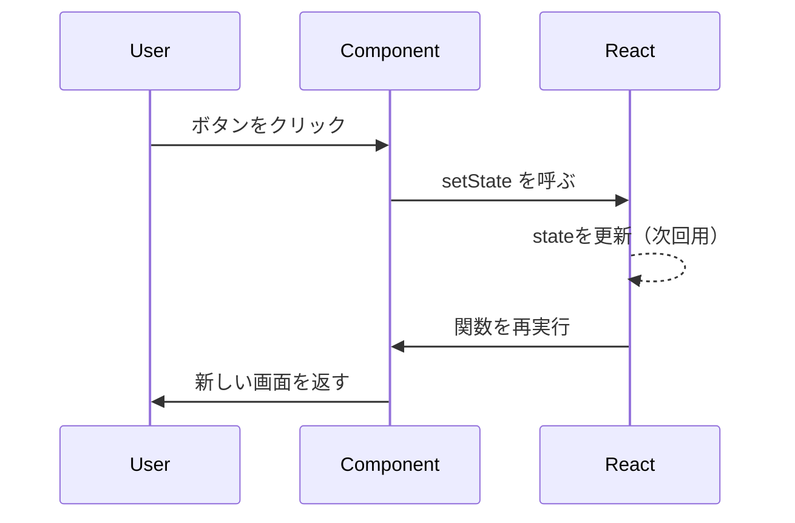

# 4-1. useStateの基本（更新と再レンダー）

## 🪝 Hooks（フック）との関係

関数コンポーネントはもともと「UI を返すだけ」でした。**Hooks** は、その関数の中で **state・副作用・コンテキスト**などを使えるようにする仕組みです（React 16.8〜）。

- **useState** … このノートの主題（状態と再レンダー）
- **useEffect** … 副作用（タイマー、購読、DOM 同期など）→ [[5-1-useEffectの役割]]
- 全体の地図 … [[02_コンポーネント・フックス・サービスとは]]、[[1-5React組み込みAPI関数一覧]]

「トップレベルでのみ呼ぶ」「条件分岐の中で呼ばない」など Hooks 共通のルールは、上記の全体像ノートや [[09-hooks]]（リダイレクト）から各章へ整理済みです。

---

## 🎯 この章で学ぶこと

- useState の基本構文と使い方
- state を変えると画面が更新される仕組み
- 「state は変えたら次のレンダーで反映」の感覚

---

## 📖 概念の説明

### state（状態）とは

コンポーネントが**覚えておきたい値**。例えば：

- カウンターの数字
- 入力フォームの値
- モーダルの開閉
- ログイン済みかどうか

これらを「state」として持つと、Reactが自動で画面を更新してくれます。

### useState の基本構文

```jsx
import { useState } from 'react';

const [state, setState] = useState(初期値);
```

- `state`：現在の値
- `setState`：値を更新する関数
- `初期値`：最初の値

### イメージ：箱と通知ベル

`useState` は「**値を入れる箱と、変更を通知するベル**」のセット。

- 箱に値を入れる（state）
- 値を変えるときはベル（setState）を鳴らす
- ベルが鳴るとReactが「画面を作り直そう」と動く

---

## 💻 コード例

### 例1：カウンター

```jsx
import { useState } from 'react';

function Counter() {
  const [count, setCount] = useState(0); // 初期値0

  return (
    <div>
      <p>カウント: {count}</p>
      <button onClick={() => setCount(count + 1)}>+1</button>
      <button onClick={() => setCount(count - 1)}>-1</button>
      <button onClick={() => setCount(0)}>リセット</button>
    </div>
  );
}
```

ボタンクリック → `setCount` が呼ばれる → Reactが画面を更新 → `count` の表示が変わる。

### 例2：入力フォーム

```jsx
function NameInput() {
  const [name, setName] = useState('');

  return (
    <div>
      <input
        value={name}
        onChange={(e) => setName(e.target.value)}
      />
      <p>こんにちは、{name || 'ゲスト'}さん</p>
    </div>
  );
}
```

### 例3：トグル（オンオフ）

```jsx
function Toggle() {
  const [isOn, setIsOn] = useState(false);

  return (
    <button onClick={() => setIsOn(!isOn)}>
      {isOn ? 'オン' : 'オフ'}
    </button>
  );
}
```

### 例4：オブジェクト

```jsx
function UserForm() {
  const [user, setUser] = useState({ name: '', email: '' });

  return (
    <div>
      <input
        value={user.name}
        onChange={(e) => setUser({ ...user, name: e.target.value })}
      />
      <input
        value={user.email}
        onChange={(e) => setUser({ ...user, email: e.target.value })}
      />
    </div>
  );
}
```

`{ ...user, name: ... }` は「**残りの値を保ちつつ name だけ更新**」という書き方（後の章 [[4-4-Immutable更新]]）。

### 例5：配列

```jsx
function TodoList() {
  const [todos, setTodos] = useState([]);

  function addTodo(text) {
    setTodos([...todos, { id: Date.now(), text }]);
  }

  return (
    <ul>
      {todos.map((todo) => <li key={todo.id}>{todo.text}</li>)}
    </ul>
  );
}
```

---

## 🔄 setState の動きの感覚

### setStateは「予約」

```jsx
function handleClick() {
  console.log('1.', count);    // 例：0
  setCount(count + 1);
  console.log('2.', count);    // まだ 0！
}
```

→ `setCount(1)` を呼んでも、**この関数の中の `count` は0のまま**。Reactが「次に再レンダーしたとき1にする」と予約するだけ。

詳しくは [[4-3-setStateの落とし穴]]。

---

## 💡 イベントごとの流れ



---

## ❌ よくある間違い

### 普通の変数を使う

```jsx
function Counter() {
  let count = 0;
  return <button onClick={() => count++}>{count}</button>;
}
// ❌ クリックしても画面は変わらない
```

→ ✅ `useState` を使う。

### setState のあとに値を読む

```jsx
setCount(count + 1);
console.log(count); // 古いまま
```

→ ✅ 計算結果を変数に入れて使う：

```jsx
const next = count + 1;
setCount(next);
console.log(next);
```

### 同じ値で setState

```jsx
setCount(0);
setCount(0); // 値が同じなら再レンダーされない
```

→ Reactは前回値と比較して同じならスキップ。これは仕様。

### 連続で setCount

```jsx
setCount(count + 1);
setCount(count + 1);
setCount(count + 1);
// 3にしたいが…結果は1
```

→ count は古い値のままだから、すべて「0+1=1」になる。**関数更新**を使う：

```jsx
setCount((c) => c + 1);
setCount((c) => c + 1);
setCount((c) => c + 1);
// → 3 になる
```

---

## ✅ ベストプラクティス

1. **必要最小限のstate**だけ持つ
2. **初期値は必ずセット**（空文字、`[]`、`{}` など）
3. オブジェクト・配列は **immutable に更新**
4. **画面と直接関係ない値**はstateにしない（refなどに）
5. **連続更新は関数更新**を使う

---

## 🔬 実践演習

「+1ボタンを5連打すると count が 5 増える」カウンターを作る。

ヒント：

- `setCount(count + 1)` を5回連続で呼んでも増えない
- `setCount((c) => c + 1)` なら増える

---

## 📝 まとめ

- useState = 値の箱 + 変更通知のセット
- 値が変わると Reactが画面を作り直す
- setStateは「予約」で、すぐには反映されない
- 連続更新には関数更新（c => c+1）

---

## 🔬 深堀り（旧 `13-useState詳細解説` を統合）

### 遅延初期化（Lazy initialization）

`useState(重い計算())` では、**渡した式はレンダーごとに評価**されます。計算を **初回だけ** 走らせたいときは、初期値の代わりに **関数** を渡します。

```jsx
// 毎回 calculateExpensiveValue() が評価されうる
const [data, setData] = useState(calculateExpensiveValue());

// 初回マウント時だけ calculateExpensiveValue() を実行
const [data, setData] = useState(() => calculateExpensiveValue());

// localStorage から復元する例
const [items, setItems] = useState(() => {
  const raw = localStorage.getItem('items');
  return raw ? JSON.parse(raw) : [];
});
```

### 動的フィールド名でオブジェクトを更新

フォームでフィールドをまとめて持つとき、`[field]: value` で **immutable にマージ**します（前提は [[4-4-Immutable更新]]）。

```jsx
const [user, setUser] = useState({ name: '', email: '', age: 0 });

function handleChange(field, value) {
  setUser((prev) => ({ ...prev, [field]: value }));
}
```

リスト更新では `setTodos((prev) => prev.map(...))` のように **関数型更新**にすると、連続操作でも取りこぼしにくいです（[[4-3-setStateの落とし穴]]）。

### 更新直後に最新の state が欲しいとき

`setState` の直後に `state` を読んでも **まだ古い値**です。次のレンダー後に反映された値で処理したい場合は、[[5-1-useEffectの役割]] で `state` を依存配列に含める、などのパターンを使います。

---

## 🔗 関連ページ

- [[4-2-state設計のコツ]]
- [[4-3-setStateの落とし穴]]
- [[4-4-Immutable更新]]
- [[1-3-Reactのレンダーとは]]
- [[02_コンポーネント・フックス・サービスとは]]
- [[5-1-useEffectの役割]]
