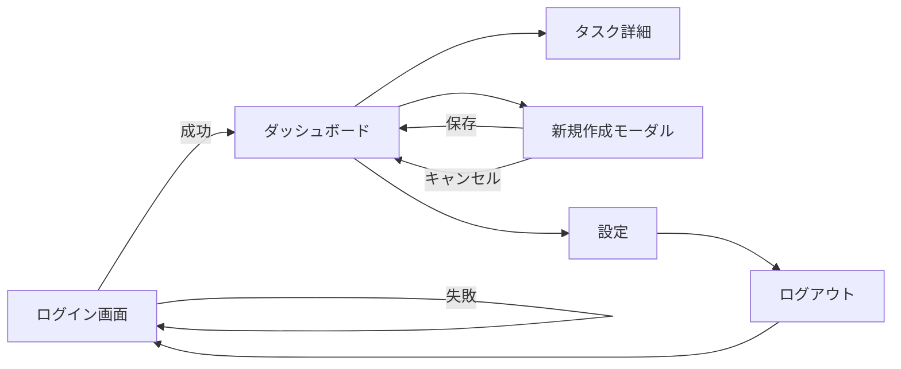

# 16-2 画面設計（状態・遷移・API）

## 🎯 この章で学ぶこと

- 画面設計が「ワイヤーフレーム」「状態」「API 契約」の 3 つに分解できることを理解する
- 状態（state）と画面の関係を「画面ごとに必要な情報」として整理できる
- 画面遷移図（Screen Flow）の書き方を学ぶ
- フロント / バックエンドが守るべき「API 契約」を OpenAPI 風に書ける
- TaskMate の画面・状態・API を実際に設計してみる

## 📖 概念の説明

### 画面設計は 3 層に分けて考える

画面設計というと「Figma で絵を描くこと」と思われがちですが、実は次の 3 つを揃える作業です。

1. **ワイヤーフレーム（見た目）**: 何がどこに置かれるか
2. **状態（State）**: その画面が表示するために必要な情報
3. **API 契約（Contract）**: その情報をどこから取ってくるか

この 3 つが揃って初めて、実装に進めます。逆に言うと、絵だけ描いても実装はできません。

### 状態を考える 3 つの問い

各画面に対して次の 3 問を自問します。

1. この画面で「ユーザーに見せる情報」は何か？
2. この画面で「ユーザーが入力する情報」は何か？
3. この画面で「裏側で持っておく情報」は何か？（ローディング、エラー、フォーカス位置など）

これに答えると、自然と必要な `useState` / サーバ状態の一覧が出てきます。

### 画面遷移図（Screen Flow）

「画面 A から B、B から C」と矢印でつなぐ図です。手書きでもよいので、最初に作ると頭がスッキリします。

```
[ログイン] → [ダッシュボード] → [タスク詳細]
              ↘ [新規作成モーダル]
              ↘ [設定]
```

ポイントは、戻るパスや「キャンセルしたら？」「エラーになったら？」も書くこと。後でユーザーが離脱する原因の多くは、この「戻るパス」が雑なことです。

### API 契約とは

フロント開発者とバックエンド開発者の「約束事」です。次のような項目を決めます。

- HTTP メソッド（GET/POST/PUT/PATCH/DELETE）
- パス（`/api/tasks/:id`）
- リクエストボディ / クエリパラメータ
- レスポンスの JSON 形（成功時・失敗時）
- 認証方法（Bearer token など）

OpenAPI（Swagger）形式で書くのがプロのやり方ですが、最初は素の Markdown でも十分です。

## 💻 コード例

### TaskMate のワイヤーフレーム（テキスト版）

```
┌────────────────────────────────────────┐
│  TaskMate          [検索バー] [+新規] │
├────────────────────────────────────────┤
│  サイドバー   │  メイン                │
│  □ 全タスク   │  ┌──────────────────┐ │
│  □ 今日       │  │ タスクA           │ │
│  □ 期限切れ   │  │ タスクB           │ │
│  □ タグ       │  │ タスクC           │ │
│               │  └──────────────────┘ │
│               │  [前へ] 1/5 [次へ]    │
└────────────────────────────────────────┘
```

### 画面ごとの状態定義（TypeScript で）

```ts
// types.ts
type Task = {
  id: string;
  title: string;
  done: boolean;
  dueDate: string | null;
  priority: "low" | "medium" | "high";
  tags: string[];
  createdAt: string;
};

type TaskListPageState = {
  // サーバから来るデータ
  tasks: Task[];
  totalCount: number;
  // ユーザー入力
  searchKeyword: string;
  filterTag: string | null;
  sortBy: "createdAt" | "dueDate" | "priority";
  page: number;
  // UI 状態
  isLoading: boolean;
  errorMessage: string | null;
  selectedIds: Set<string>;
};
```

このように「サーバ由来 / ユーザー入力 / UI 状態」の 3 つに分類して書くと、後で `useState` と `useQuery` のどちらを使うかが自然と決まります。

### 画面遷移図を Mermaid で書く



Obsidian は Mermaid をプレビューできるので、ぜひこの形で書いてみてください。

### API 契約の書き方（Markdown 版）

```markdown
## POST /api/tasks
新しいタスクを作成する。

### 認証
Bearer Token 必須

### リクエスト
\`\`\`json
{
  "title": "牛乳を買う",
  "dueDate": "2026-05-01",
  "priority": "medium",
  "tags": ["買い物"]
}
\`\`\`

### バリデーション
- title: 1〜100 文字（必須）
- dueDate: ISO 8601 形式 or null
- priority: low | medium | high（デフォルト medium）
- tags: 文字列配列、最大 5 個

### レスポンス（201 Created）
\`\`\`json
{
  "id": "tsk_abc123",
  "title": "牛乳を買う",
  "done": false,
  "dueDate": "2026-05-01",
  "priority": "medium",
  "tags": ["買い物"],
  "createdAt": "2026-04-27T09:00:00Z"
}
\`\`\`

### エラー
- 400: バリデーションエラー
- 401: 未認証
- 500: サーバエラー
```

### TypeScript の型として API 契約を共有する

```ts
// shared/api.ts
export type CreateTaskRequest = {
  title: string;
  dueDate?: string | null;
  priority?: "low" | "medium" | "high";
  tags?: string[];
};

export type CreateTaskResponse = Task; // 上で定義した Task

export type ErrorResponse = {
  code: string;
  message: string;
  details?: Record<string, string>;
};
```

フロントとバックエンドで同じ型ファイルを参照すれば、契約違反がコンパイル時に検出できます。

## ❌ よくある間違い

### 1. 絵だけ描いて状態を考えない

「ログインボタンがある」までは描けても、「ログインボタンを押したらどんな状態になるか（ローディング中、無効化）」を設計しないと、実装で詰まります。

### 2. ハッピーパスしか考えない

「成功したら次の画面へ」しか書いていない設計は要注意。「ネットが切れたら」「サーバが 500 を返したら」「ログインセッションが切れていたら」の分岐を必ず描きましょう。

### 3. API 契約を口頭で済ます

「あ、その項目は配列で返しますね〜」が後で「いや、オブジェクトの配列だと思ってた」になる事故、本当によく起きます。文字に残しましょう。

### 4. 状態をコンポーネントごとに重複定義

`Header` と `Sidebar` の両方で「現在のユーザー名」を持っていると、片方だけ更新されてバグになります。共有すべき状態は最初に決めます（後の章「状態管理」で詳しく扱います）。

## ✅ ベストプラクティス

1. **状態は「サーバ / 入力 / UI」の 3 種に分類する**: どれに属するかで管理方法が変わります（後述: React Query で扱うのは「サーバ状態」）。
2. **エラー画面・空状態・ローディング状態のワイヤーも描く**: 「データが 0 件のときの画面」を忘れる人が 9 割います。
3. **API 契約は型で表現する**: ドキュメントは古くなりますが、型はコンパイラが守ってくれます。
4. **画面遷移図に「失敗パス」を書く**: 戻る・キャンセル・タイムアウト時の動きを明示。
5. **モバイル幅も考慮する**: TaskMate ではサイドバーをハンバーガーメニューに畳むことを設計に入れます。

## 📝 まとめ

- 画面設計は「ワイヤー / 状態 / API」の 3 セットで揃える
- 状態は「サーバ / 入力 / UI」に分類すると整理しやすい
- 画面遷移図は失敗パスも含めて描く
- API 契約は Markdown でも型ファイルでも残す。口頭は厳禁
- 設計が薄いまま実装に入ると、後で 3 倍の工数になる

## 🔗 関連ページ

- [[16-1-要件定義]]
- [[16-3-実装]]
- [[16-6-検索-絞込-ソート-ページネーション]]
- [[A-2-用語集]]
