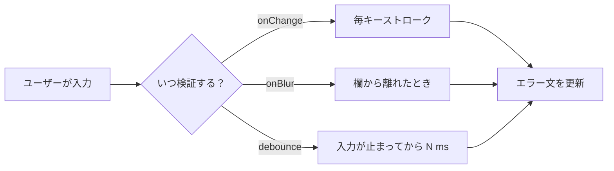
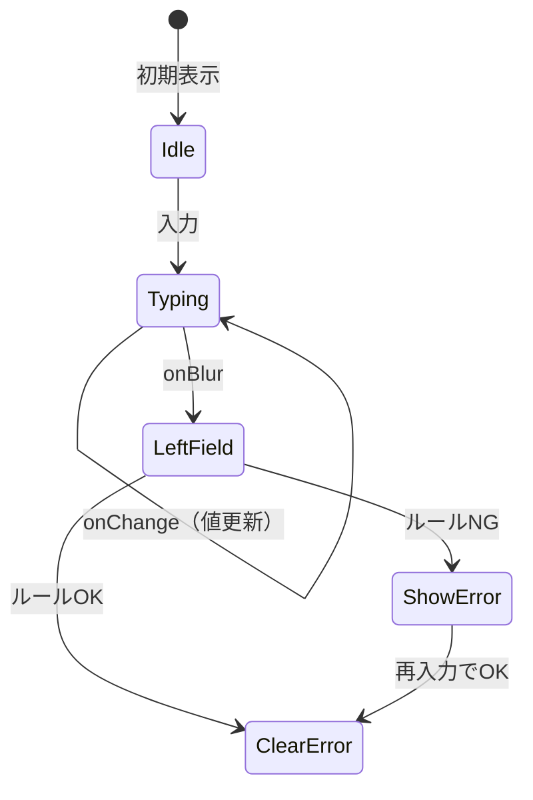

# リアルタイムバリデーション（入力しながら検証）詳細解説

**想定読者:** React でフォームを書いたことがあるが、「いつエラーを出すか」「state をどう持つか」がまだ曖昧な人向けです。  
**このノートのゴール:** 「リアルタイム」とは何かを言語化し、**タイミング設計 → state 設計 → 実装 → UX / アクセシビリティ**まで一気通貫で理解できるようにします。

関連: [[00-Reactフォーム入門-HTMLとの違いと用語（図解）]] / [[01Programming/06_Frameworks/02_React/08_状態管理_目次/01-フォーム送信とReact]] / [[4-1-useStateの基本]]

---

## 1. まず用語：バリデーションと「リアルタイム」

| 用語 | 意味 |
|------|------|
| **バリデーション（検証）** | 入力値がルールを満たすかをチェックすること（例: メール形式、8文字以上、必須）。 |
| **送信時バリデーション** | 「送信ボタンを押した瞬間」にまとめてチェックする方式。実装は簡単だが、**最後まで気づけない**ことがある。 |
| **リアルタイムバリデーション** | 送信を待たず、**入力の途中や入力直後**に随時チェックし、フィードバックを返す方式。 |

「リアルタイム」は厳密な定義より **UX の設計語**として使われます。実装ではだいたい次のどれか（または組み合わせ）です。

- **入力のたび（`onChange`）** … 一番リアルタイム寄り。強いが、うるさくなりやすい。
- **フォーカスが外れたとき（`onBlur`）** … 「一区切りついた」とみなして表示。バランスが取りやすい。
- **少し待ってから（デバウンス）** … 連打や IME 入力中の揺れを抑える。検索や重いチェック向き。



---

## 2. なぜ「いつ出すか」を決めるのが大事か

リアルタイムは **便利にもストレスにも** なり得ます。

| パターン | メリット | デメリット |
|----------|----------|------------|
| 送信時だけ | 実装が簡単 | 最後まで誤りに気づきにくい |
| 初手から毎回 `onChange` でエラー表示 | 早いフィードバック | **まだ打ち途中**なのに赤くなる（例: メールの `@` の前） |
| **`touched`（触ったか）と組み合わせ** | 初回は静か、触った後は丁寧 | state が少し増える |

初心者がつまずきやすいのは **「検証ロジックは書けたが、表示タイミングが雑で UX が悪い」** パターンです。ロジックと表示条件は分けて考えると安定します。

---

## 3. state の持ち方（おすすめの最小セット）

よく使う概念だけに絞ると、次の 3 つでほとんど足ります。

| state | 役割の一言 |
|-------|------------|
| **値（value）** | いま入力欄に入っている文字列など。 |
| **エラー（error）** | ルール違反のメッセージ。問題なければ空文字 `""` や `null`。 |
| **触れたか（touched）** | その欄に一度でもフォーカスが当たり、外れたか。`onBlur` で `true` にするのが定番。 |



**覚え方:** `error` は「計算結果」に近いので、理想は **表示用に派生（derive）** します。ただし初心者向けには **「`onBlur` のときだけ `error` を確定更新」** でも十分読みやすいです。

---

## 4. 実装例 A: `onBlur` ＋ `touched`（おすすめの土台）

メールアドレスを例にします。**初回は黙る**、`欄から離れたら` 検証してメッセージを出します。

```tsx
import { useState } from "react";

function isValidEmail(value: string) {
  // 学習用の簡易例（本番は要件に合わせて厳密化）
  return /^[^\s@]+@[^\s@]+\.[^\s@]+$/.test(value.trim());
}

export function EmailField() {
  const [email, setEmail] = useState("");
  const [touched, setTouched] = useState(false);

  const error =
    touched && email.trim() === ""
      ? "必須です"
      : touched && !isValidEmail(email)
        ? "メールアドレスの形式が正しくありません"
        : "";

  return (
    <div>
      <label htmlFor="email">メール</label>
      <input
        id="email"
        name="email"
        type="email"
        value={email}
        onChange={(e) => setEmail(e.target.value)}
        onBlur={() => setTouched(true)}
        aria-invalid={error ? true : false}
        aria-describedby={error ? "email-error" : undefined}
      />
      {error ? (
        <p id="email-error" role="alert">
          {error}
        </p>
      ) : null}
    </div>
  );
}
```

### 読み解きのポイント

1. **`touched` が `false` の間は `error` を空にする**  
   これだけで「打ち始めてすぐ怒られる」体験を避けられます。

2. **`error` は `email` と `touched` から毎回計算**（派生）  
   `setError` を増やさずに済み、状態の更新経路が減ってバグりにくいです。

3. **`aria-invalid` と `aria-describedby`**  
   スクリーンリーダー利用者にも「この入力は不正」「説明文はここ」と伝わります。

---

## 5. 実装例 B: `onChange` で毎回検証するが、表示は `touched` 後だけ

「裏では常に計算しておき、見せ方だけ控えめ」にするパターンです。パスワード強度のような **途中経過が意味を持つ** UI で使われます。

考え方はシンプルで、**検証の実行タイミング**と**ユーザーへの見せ方**を分離します。

```tsx
import { useMemo, useState } from "react";

function passwordScore(pw: string) {
  if (pw.length === 0) return { level: 0, hint: "" };
  if (pw.length < 8) return { level: 1, hint: "8文字以上にしてください" };
  if (!/[0-9]/.test(pw)) return { level: 2, hint: "数字を含めてください" };
  return { level: 3, hint: "OK です" };
}

export function PasswordField() {
  const [pw, setPw] = useState("");
  const [touched, setTouched] = useState(false);

  const score = useMemo(() => passwordScore(pw), [pw]);

  return (
    <div>
      <label htmlFor="pw">パスワード</label>
      <input
        id="pw"
        type="password"
        value={pw}
        onChange={(e) => setPw(e.target.value)}
        onBlur={() => setTouched(true)}
      />
      {touched ? <p>{score.hint}</p> : <p>入力後、欄から離れるとヒントが出ます</p>}
    </div>
  );
}
```

---

## 6. デバウンス（入力が止まってから検証）

API でユーザー名の重複チェックなど **重い処理** をするときは、`onChange` のたびに叩かないのがマナーです。要点は次のとおりです。

- **目的:** 連続入力の最中にリクエストが雪崩を打たないようにする。
- **典型:** 入力が止まってから 300〜500ms 後に実行（プロダクトにより調整）。

React では `useEffect` ＋ `setTimeout` ＋ クリーンアップ、または専用ライブラリ（例: `use-debounce`）を使います。ここでは考え方だけ押さえれば十分です。

---

## 7. 送信ボタンとの関係（二重に守る）

フロントのバリデーションは **UX のため**であり、**セキュリティの最終防衛線ではありません**。そのため実務では次の二段構えが普通です。

1. **リアルタイム / `onBlur`:** 早めに直してもらう（離脱防止）。
2. **送信時:** まとめて最終チェックし、**不正なら送信しない**（抜け道対策）。

```tsx
function canSubmit(email: string) {
  return email.trim() !== "" && isValidEmail(email);
}

// 例: 送信ハンドラの冒頭
// if (!canSubmit(email)) { ...return; }
```

---

## 8. よくあるつまずき（チェックリスト）

| 症状 | ありがちな原因 |
|------|----------------|
| 1文字目からエラーが出る | `touched` や表示条件がなく、常時 `error` を描画している |
| 直したのにエラーが残る | 古い `error` を state に抱えたまま、入力値と同期していない |
| IME（日本語入力）で変換中に判定が走る | `compositionStart` / `compositionEnd` で抑止する、または `onBlur` 中心にする |
| 画面は正しいのに支援技術に伝わらない | `aria-invalid` / `aria-describedby` / `role="alert"` が未設定 |

---

## 9. まとめ（実装の型を一文で）

- **まずは `onBlur` ＋ `touched` ＋ 派生 `error`** が、初心者でも UX を壊しにくい土台です。  
- **重い処理はデバウンス**、**送信時にもう一度検証**、**アクセシビリティ属性を添える**、の 3 点を足すと「それっぽい完成度」に近づきます。

---

## 10. 次に読むと伸びる話題

- 複数フィールドの横断ルール（例: 「確認用パスワード一致」）は **どの欄の `touched` を見るか**が設計の中心になります。
- ライブラリ（React Hook Form、Zod など）は **状態管理と検証を型安全にまとめる**方向の選択肢です。土台の考え方はこのノートと同じです。
