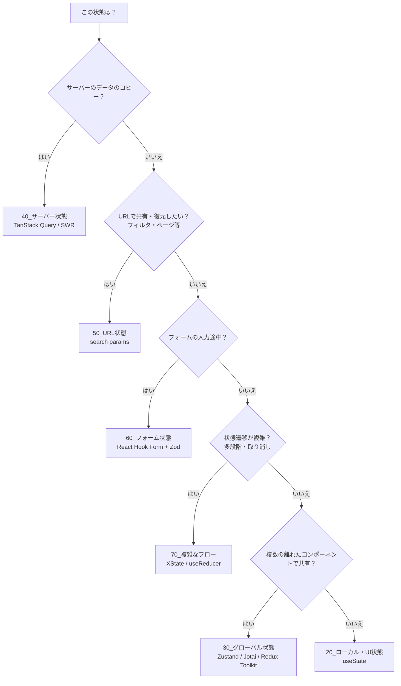

# MOC_状態管理体系

36_状態管理 の入口ノート。**状態を種類ごとに分け、種類ごとに最適な置き場所と道具を選ぶ**という考え方で整理している（2026年時点の主流：サーバー状態は TanStack Query、クライアント状態は Zustand / Jotai などの軽量ストア）。

## フォルダ構成と運用ルール

| フォルダ | 役割 |
|---|---|
| 00_全体像 | 本MOC・状態の置き場所の判断フロー |
| 10_基礎概念 | 状態とは・単方向データフロー・イミュータブル・派生状態・正規化・単一の情報源 |
| 20_ローカル・UI状態 | コンポーネント内で閉じる状態（開閉・選択・入力中の値）の設計 |
| 30_グローバル状態 | 共有状態のスコープ・ストア設計・セレクタ・再レンダー対策 |
| 40_サーバー状態 | キャッシュ・再取得・楽観的更新・無効化・ページング |
| 50_URL状態 | 検索パラメータ・フィルタ・並び替え・ページネーション・共有可能な状態 |
| 60_フォーム状態 | 入力・controlled/uncontrolled・バリデーション・送信フロー |
| 70_複雑なフロー | ステートマシン・ウィザード・Undo/Redo |
| 80_永続化・同期 | localStorage・セッション・オフライン・タブ間/リアルタイム同期 |
| 90_ライブラリ別リファレンス | ライブラリごとの使い方と比較（[[ライブラリ比較]]） |

- 10〜80 は **ライブラリに依存しない設計の考え方**を書く。特定ライブラリの書き方は 90 に置き、ここから相互にリンクする
- 1つのライブラリが複数の種類にまたがる場合（例：Jotai でフォーム状態）も、ノートは 90 に置き、該当する種類のフォルダの節からリンクする
- React 本体の機能（useState・useReducer・Context）は 32_React が本拠地。36 は React 以外でも通用する設計と外部ライブラリを扱う

## 状態の置き場所の判断フロー

リロード後も残したいなら 80_永続化・同期 を組み合わせる。

## ライブラリの設計モデル

| モデル | 代表 | 特徴 | 向いている場面 |
|---|---|---|---|
| Flux・単一ストア | Redux Toolkit | 単一ストア＋アクションで変更を追跡できる | 大規模・変更履歴の監査が必要 |
| 軽量ストア | Zustand | ボイラープレートが少なく、フックで購読する | 新規アプリのデフォルト |
| アトミック | Jotai | 小さな atom を組み合わせ、再レンダーを最小化する | 細かい依存関係が多いUI |
| リアクティブ・プロキシ | MobX・Valtio | 変更を自動追跡する | オブジェクト指向的なドメインモデル |
| Signals | Preact Signals など | 値単位で細かく更新する | 高頻度更新・性能重視 |
| ステートマシン | XState | 状態と遷移を明示的に定義する | 多段階フロー・プロトコル |
| サーバーキャッシュ | TanStack Query・SWR | 取得・キャッシュ・再検証を自動化する | APIデータ全般 |

## おすすめの読む順番
1. [[01_状態とは何か]] で全体像をつかむ
2. 10_基礎概念 → 20_ローカル → 30_グローバル（アプリ内の状態）
3. 40_サーバー状態 → 50_URL状態 → 60_フォーム状態（外から来る状態・入力）
4. 70_複雑なフロー → 80_永続化・同期（応用）
5. 使うライブラリが決まったら 90 の該当ノート

## 10_基礎概念
- [[01_状態とは何か]] — 状態（state）とは「時間とともに変わり、画面の見た目に影響するデータ」のこと。
- [[02_単方向データフロー]] — データは「親 → 子」へ props で流れ、変更の依頼は「子 → 親」へイベント（関数呼び出し）で伝える。
- [[03_イミュータブルな更新]] — 状態のオブジェクトや配列は「直接書き換えず、変更後の新しいコピーを作って置き換える」。
- [[04_派生状態と単一の情報源]] — 他の値から計算できるもの（派生状態）は状態として持たず、描画のたびに計算する。
- [[05_状態の正規化]] — 入れ子（ネスト）になったデータを、「種類ごとの表（ID → データ）」に分けて平らに持つこと。

## 20_ローカル・UI状態
- [[01_ローカル状態とは]] — ローカル状態とは、1つのコンポーネント（とその子）だけが使う状態のこと。
- [[02_状態の持ち上げ]] — 複数のコンポーネントが同じ状態を使いたいときは、それらの「いちばん近い共通の親」に状態を移し、props で配る。
- [[03_状態は使う場所の近くに置く]] — 状態は「それを使うコンポーネントにできるだけ近い場所」に置く（コロケーション＝colocation）。
- [[04_複雑なローカル状態をreducerで整理する]] — 関連する状態がいくつもあり、更新ロジックがあちこちに散らばってきたら、`useReducer` で「何が起きたか（アクション）」と「どう変わるか（reducer）」を1か所にまとめる。

React本体の useState・useReducer の詳細は 32_React を参照

## 30_グローバル状態
- [[01_グローバル状態とは]] — アプリの離れた場所にある複数のコンポーネントが、同じデータを読んだり書き換えたりする必要があるときに、それらの外側（アプリ全体から見える場所）に置く状態のこと。
- [[02_propsバケツリレーとContextの限界]] — props を何階層も手渡しする「バケツリレー」は Context で解消できるが、Context は値が変わると使っている全員を再描画するため、頻繁に変わる状態の置き場所には向かない。
- [[03_ストア設計の基本]] — ストアとは「状態」と「その状態を変える関数（アクション）」をひとまとまりにした入れ物。
- [[04_セレクタと再レンダー対策]] — セレクタは「ストア全体から自分が使う部分だけを取り出す関数」。
- [[05_状態管理ライブラリの選び方]] — まず「その状態は本当にグローバルか、サーバー状態や URL 状態ではないか」を確かめ、残ったクライアントの共有状態だけをライブラリで扱う。

実装例：[[01_Redux|Redux]]・[[02_Zustand|Zustand]]・[[04_Jotai|Jotai]]・[[03_MobX|MobX]]

## 40_サーバー状態
- [[01_サーバー状態とは]] — サーバー状態は「本物はサーバーにあり、手元にあるのはその写し」というデータのこと。
- [[02_キャッシュと再取得]] — 一度取ったデータは「キャッシュ」に取っておいてすぐ見せ、古くなったら裏でこっそり取り直す（再検証する）。
- [[03_ローディング・エラー・空状態]] — サーバーからデータを取る画面には「読み込み中」「失敗」「0件」「データあり」の4つの顔がある。
- [[04_ミューテーションとキャッシュの無効化]] — データを変更（ミューテーション）したら、関係するキャッシュに「もう古いよ」と印を付けて（無効化）取り直させる。
- [[05_楽観的更新]] — 「たぶん成功する」と見込んで、サーバーの返事を待たずに先に画面を変えてしまう手法。
- [[06_ページングと無限スクロール]] — 大量のデータは少しずつ（ページ単位で）取る。

実装例：[[05_TanStack Query|TanStack Query]]・[[06_SWR|SWR]]

## 50_URL状態
- [[01_URL状態とは]] — 画面の状態のうち「URLに書いておく」ものを URL状態と呼ぶ。
- [[02_検索パラメータの読み書き]] — `URLSearchParams` で `?キー=値` を読み書きし、`history.pushState` / `replaceState` で URL を書き換え、`popstate` で戻る・進むを検知する。
- [[03_フィルタ・並び替え・ページネーション]] — 一覧画面の「絞り込み・並び順・ページ番号」は URL状態の代表例。
- [[04_URLに入れるもの入れないもの]] — 「そのURLを他人に送ったとき、同じ画面が見えてほしいか？」で判断する。

## 60_フォーム状態
- [[01_フォーム状態とは]] — フォームには「入力値」だけでなく、「触ったか」「変更したか」「エラー」「送信中か」といった複数の状態がある。
- [[02_controlledとuncontrolled]] — 入力値を React の state が持つのが controlled（制御）、ブラウザの入力欄（DOM）自身が持つのが uncontrolled（非制御）。
- [[03_バリデーション]] — バリデーション（入力チェック）は「ルールを1か所（スキーマ）に書き、値から errors を計算する」のが基本。
- [[04_送信フローの状態]] — フォーム送信は「待機 → 送信中 → 成功 / 失敗」と段階が進むフロー。

実装例：[[08_React Hook Form|React Hook Form]]

## 70_複雑なフロー
- [[01_ステートマシンとは]] — 「今どの状態か」を1つだけ持ち、「その状態で受け付けるイベント」と「次に進む状態」をあらかじめ決めておく設計のこと。
- [[02_ウィザード（多段階フォーム）]] — 入力を「ステップ」に分けて1画面ずつ進めるフォーム。
- [[03_Undo・Redo]] — 状態を「過去（past）・現在（present）・未来（future）」の3つに分けて持ち、元に戻す（Undo）・やり直す（Redo）で現在を過去や未来と入れ替える仕組み。

実装例：[[07_XState|XState]]

## 80_永続化・同期
- [[01_状態の永続化]] — React の状態はリロードで消えるので、残したいものだけをブラウザの保存領域（localStorage / sessionStorage / IndexedDB）に書き出し、次に開いたとき読み戻すこと。
- [[02_タブ間同期]] — 同じサイトを複数タブで開いているとき、1つのタブでの変更を他のタブに知らせて揃えること。
- [[03_オフライン対応]] — 通信が切れても操作を失わないように、「今オンラインか」を状態として持ち、オフライン中の送信は「送信キュー（送信待ちの列）」に溜めて、つながったら順番に送り直すこと。
- [[04_リアルタイム同期]] — サーバーから「データが変わった」という知らせを WebSocket や SSE で受け取り、手元のサーバー状態キャッシュを更新（または無効化して再取得）すること。

## 90_ライブラリ別リファレンス
- [[ライブラリ比較]]（Redux / Zustand / MobX の比較表）
- Redux：[[01_Redux]] — 単一ストアとアクションで変更を追跡する、最も歴史のある状態管理ライブラリ。
- Zustand：[[02_Zustand]] — ボイラープレートが少ない軽量ストア。新規アプリのデフォルト候補。
- MobX：[[03_MobX]] — 変更を自動追跡するリアクティブな状態管理ライブラリ。
- Jotai：[[04_Jotai]] — 状態を「atom（アトム）」という小さな部品に分けて持ち、使うコンポーネントだけが再レンダーされるようにする、React 向けの軽量なグローバル状態ライブラリです。
- TanStack Query：[[05_TanStack Query]] — API から取ってきたデータ（サーバー状態）の「取得・キャッシュ・再取得・更新後の無効化」を自動で面倒みてくれるライブラリです。
- SWR：[[06_SWR]] — 「まず手元の古いデータ（キャッシュ）を見せ、裏で最新を取りに行って差し替える」という戦略で、サーバーのデータ取得をシンプルにする Vercel 製の軽量フックです。
- XState：[[07_XState]] — 「今どの段階にいて、どのイベントでどこへ進めるか」をステートマシン（状態遷移の設計図）として書き、ありえない状態や操作を仕組みで防ぐライブラリです。
- React Hook Form：[[08_React Hook Form]] — 入力値・エラー・送信中などの「フォーム状態」をまとめて管理し、入力のたびに画面全体を再レンダーしない（uncontrolled 中心の）仕組みで、速くて書きやすいフォームを作るライブラリです。
