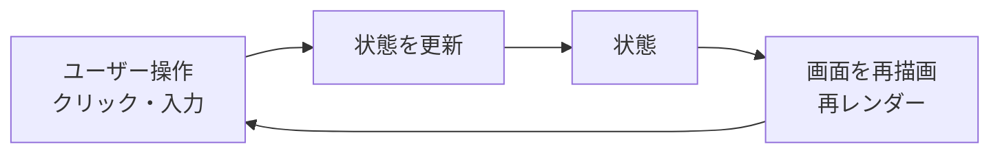

# 状態とは何か

> **ひとことで言うと**：状態（state）とは「時間とともに変わり、画面の見た目に影響するデータ」のこと。状態管理とは、そのデータを「どこに置き、誰が変え、どう画面に届けるか」を決めることです。

## たとえ話で理解する

レストランの厨房を思い浮かべてください。

- **メニュー表**：開店中はほぼ変わらない → 状態ではない（定数）
- **注文伝票**：お客さんが来るたびに増えたり、「調理中」「提供済み」に変わったりする → **状態**
- **在庫数**：本部の倉庫（サーバー）にある本当の数を、厨房は「さっき確認した数」として持っている → **サーバー状態**

伝票をどこに貼るか（各コック？ 中央ボード？）を決めるのが「状態管理」です。貼り場所を間違えると、同じ料理が2回作られたり、注文が消えたりします。

## なぜ必要？（困りごと）

画面は「データの写し絵」です。データが変わったのに画面が変わらない、または画面ごとに違う値が見えている――これがUIのバグの大半です。

- カートに商品を入れたのに、ヘッダーのカート件数が 0 のまま
- 一覧画面で名前を編集したのに、詳細画面では古い名前が表示される
- ページを再読み込みしたら、せっかく選んだ絞り込み条件が消えた

どれも「状態をどこに置くか・どう同期するか」を決めていないことが原因です。

## 基本の仕組み

### 状態かどうかの見分け方

| 質問 | Yes なら |
|---|---|
| 時間とともに変わる？ | 状態の候補 |
| 変わったら画面が変わる？ | 状態の候補 |
| 他の値から計算できる？ | 状態にしない（**派生状態**） |
| ずっと変わらない？ | 定数にする |

「計算できるものは状態にしない」は大切な原則です → [[04_派生状態と単一の情報源]]

### 状態 → 画面 の関係



React では「画面 = 関数(状態)」と考えます。状態を変えれば、React が画面を描き直します（これを **再レンダー** と呼びます）。この一方向の流れは [[02_単方向データフロー]] で詳しく扱います。

### 状態の5つの種類

状態は「どこに住んでいるか」「誰が本当の持ち主か」で分けると整理しやすくなります。

| 種類 | 例 | 持ち主 | 詳しく |
|---|---|---|---|
| ローカル状態 | モーダルの開閉、入力中の文字 | 1つのコンポーネント | [[01_ローカル状態とは]] |
| グローバル状態 | ログインユーザー、テーマ、カート | アプリ全体 | [[01_グローバル状態とは]] |
| サーバー状態 | 商品一覧、ユーザー情報 | サーバー（手元はコピー） | [[01_サーバー状態とは]] |
| URL状態 | 検索キーワード、ページ番号 | URL（アドレスバー） | [[01_URL状態とは]] |
| フォーム状態 | 入力値、エラー、送信中フラグ | フォーム | [[01_フォーム状態とは]] |

さらに応用として、手順が複雑な画面の [[01_ステートマシンとは]]、保存・共有の [[01_状態の永続化]] があります。

💡 **まず「これはどの種類？」と問う**のが状態管理の第一歩です。種類が決まれば、置き場所と道具がほぼ決まります。

## コード例

### 状態ではないもの・状態・派生状態

```tsx
import { useState } from "react";

const TAX_RATE = 0.1; // 定数：変わらないので状態ではない

export function PriceCalculator() {
  // 状態：ユーザー操作で変わり、画面に影響する
  const [price, setPrice] = useState(1000);

  // 派生状態：price から計算できるので useState にしない
  const priceWithTax = Math.round(price * (1 + TAX_RATE));

  return (
    <div>
      <input
        type="number"
        value={price}
        onChange={(e) => setPrice(Number(e.target.value))}
      />
      <p>税込: {priceWithTax} 円</p>
    </div>
  );
}
```

### ふつうの変数ではダメな理由

```tsx
// ❌ ただの変数：値は変わっても React は再描画しない
function BadCounter() {
  let count = 0;
  return <button onClick={() => { count++; }}>{count}</button>;
}

// ⭕ useState：更新すると React が再描画してくれる
function GoodCounter() {
  const [count, setCount] = useState(0);
  return <button onClick={() => setCount(count + 1)}>{count}</button>;
}
```

`useState` は「React に見張ってもらう変数」だと思ってください。

## よくある失敗

- ❌ 何でも `useState` にする → ⭕ 計算できる値（合計・件数・絞り込み結果）は描画中に計算する
- ❌ サーバーから取ったデータを「自分のもの」として扱い、更新を忘れる → ⭕ サーバー状態は「コピー」と意識し、再取得の仕組みを持つ（[[02_キャッシュと再取得]]）
- ❌ 最初から全部グローバルに置く → ⭕ まずローカルに置き、必要になったら持ち上げる（[[03_状態は使う場所の近くに置く]]）
- ❌ 絞り込み条件をローカル状態にして、リロードや共有で消える → ⭕ 共有したい条件は URL に置く（[[01_URL状態とは]]）
- ❌ オブジェクトを直接書き換える → ⭕ 新しいオブジェクトを作って置き換える（[[03_イミュータブルな更新]]）

## まとめ

- 状態＝時間とともに変わり、画面に影響するデータ。計算できるものは状態にしない
- 状態には ローカル / グローバル / サーバー / URL / フォーム の種類がある
- 「どの種類か」を決めると、置き場所と使う道具が決まる

## 関連ノート

- [[02_単方向データフロー]] — 状態が画面に届く流れ
- [[03_イミュータブルな更新]] — 状態の正しい変え方
- [[04_派生状態と単一の情報源]] — 状態を増やしすぎないコツ
- [[05_状態の正規化]] — 複雑なデータの持ち方
- [[01_ローカル状態とは]] / [[01_グローバル状態とは]] / [[01_サーバー状態とは]] / [[01_URL状態とは]] / [[01_フォーム状態とは]] — 各種類の入口
- [[ライブラリ比較]] — 道具の全体比較
- 上位: [[MOC_状態管理体系]]
