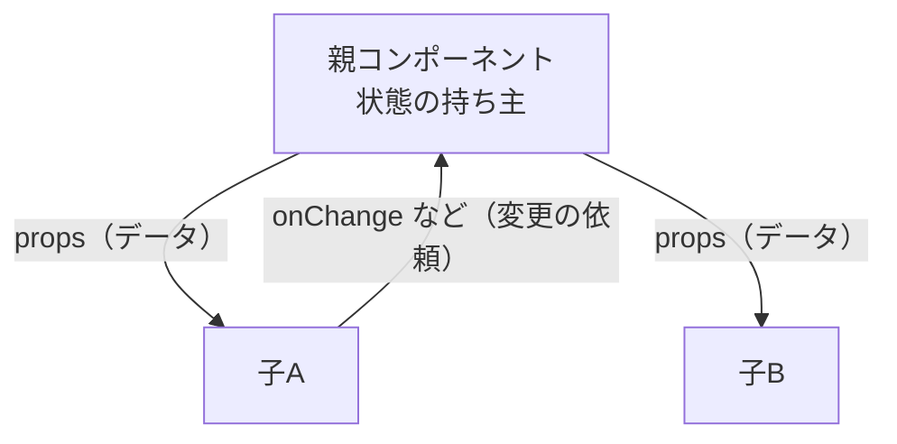

# 単方向データフロー

> **ひとことで言うと**：データは「親 → 子」へ props で流れ、変更の依頼は「子 → 親」へイベント（関数呼び出し）で伝える。流れを一方向に固定することで、「誰がこの値を変えたのか」を追いやすくします。

## たとえ話で理解する

会社の稟議（りんぎ）を想像してください。

- 方針（データ）は **部長 → 課長 → 担当者** と上から下へ伝わる
- 担当者が方針を変えたいときは、勝手に書き換えず **「変えてください」と上に申請** する
- 部長が方針を変えると、その変更がまた下へ伝わる

担当者が各自で方針を書き換えられたら、誰の方針が正しいのか分からなくなります。これが「双方向に書き換えられる」状態の混乱です。

## なぜ必要？（困りごと）

どこからでもデータを書き換えられる設計だと、次のような問題が起きます。

- 値がおかしくなったとき、**どのコンポーネントが犯人か** 分からない
- A を変えたら B が変わり、B の変更で A がまた変わる……という **連鎖・無限ループ**
- 同じデータのコピーが複数あり、**どれが本物か** 分からない

単方向にすると「値を変えられるのは持ち主だけ」になり、デバッグの起点がはっきりします。

## 基本の仕組み



| 方向 | 何が流れる | 手段 |
|---|---|---|
| 下向き（親→子） | 表示に使うデータ | props |
| 上向き（子→親） | 「こう変えて」という依頼 | props で渡したコールバック関数 |

- **props**：親から子へ渡す引数のようなもの。子の側では読み取り専用
- **コールバック関数**：「あとで呼んでね」と渡しておく関数。子はこれを呼ぶだけで、実際の更新は親がする

### 1サイクルの流れ

1. ユーザーが子コンポーネントのボタンを押す
2. 子が親から受け取った関数（例：`onIncrement`）を呼ぶ
3. 親が `setState` で状態を更新する
4. React が親を再レンダーし、新しい props が子へ流れる
5. 子の表示が変わる

このパターンは Redux などのライブラリでも同じです（「アクションを dispatch → ストア更新 → 画面反映」）。→ [[01_Redux]]

## コード例

### Before：子が props を直接書き換えようとする

```tsx
type Props = { user: { name: string } };

// ❌ props を直接書き換えても親の状態は変わらず、再描画もされない
function NameEditor({ user }: Props) {
  return (
    <input
      value={user.name}
      onChange={(e) => {
        user.name = e.target.value; // やってはいけない
      }}
    />
  );
}
```

### After：変更は親に依頼する

```tsx
import { useState } from "react";

type EditorProps = {
  name: string;                       // 下向き：データ
  onNameChange: (next: string) => void; // 上向き：変更の依頼
};

function NameEditor({ name, onNameChange }: EditorProps) {
  return <input value={name} onChange={(e) => onNameChange(e.target.value)} />;
}

export function Profile() {
  const [name, setName] = useState("たろう"); // 持ち主は親
  return (
    <>
      <NameEditor name={name} onNameChange={setName} />
      <p>こんにちは、{name} さん</p>
    </>
  );
}
```

`name` を変えられるのは `Profile` だけ。バグがあれば `setName` の呼び出し箇所を探せばよい、というのが単方向の強みです。

## よくある失敗

- ❌ 子で props を書き換える → ⭕ 変更用の関数を props で受け取り、それを呼ぶ
- ❌ props を `useState` の初期値にコピーして、親の変更が反映されない → ⭕ そのまま props を使う（コピーが必要な理由がない限り）
- ❌ 兄弟コンポーネント同士で直接値をやり取りしようとする → ⭕ 共通の親に状態を持ち上げる（[[02_状態の持ち上げ]]）
- ❌ `useEffect` で「A が変わったら B を set」を連鎖させる → ⭕ B が A から計算できるなら派生値にする（[[04_派生状態と単一の情報源]]）

## まとめ

- データは props で上から下へ、変更依頼はコールバックで下から上へ
- 状態を変えられるのは持ち主だけ → 犯人探しが簡単
- 兄弟で共有したいなら共通の親へ持ち上げる

## 関連ノート

- [[01_状態とは何か]] — 状態の定義と種類
- [[03_イミュータブルな更新]] — 持ち主が状態を変えるときの作法
- [[02_状態の持ち上げ]] — 兄弟で共有する方法
- [[02_propsバケツリレーとContextの限界]] — 下向きの流れが深くなりすぎたとき
- [[01_Redux]] — 単方向データフローを徹底したライブラリ
- 上位: [[MOC_状態管理体系]]
