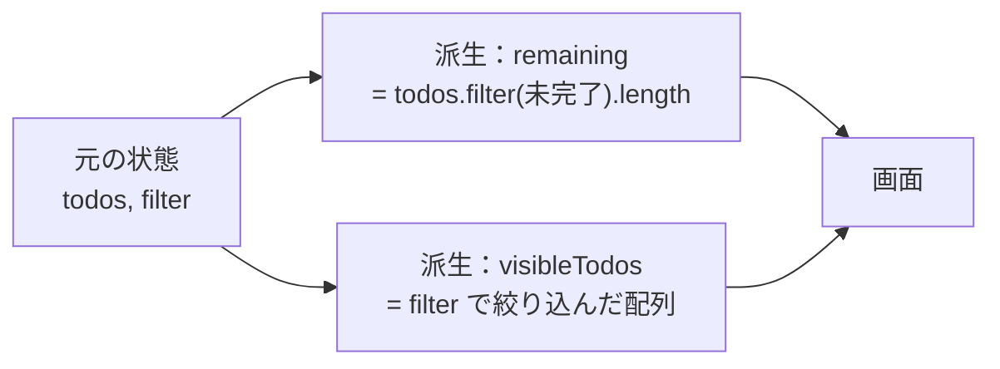

# 派生状態と単一の情報源

> **ひとことで言うと**：他の値から計算できるもの（派生状態）は状態として持たず、描画のたびに計算する。1つの事実は1か所にだけ保存する（単一の情報源 = Single Source of Truth）ことで、値の食い違いをなくします。

## たとえ話で理解する

家計簿で「収入」「支出」を記録しているのに、別のノートに「残高」も手書きしていたらどうなるでしょう。支出を書き足したのに残高を直し忘れると、**2冊の数字が合わなくなります**。

残高は「収入 − 支出」で毎回計算できます。だから残高は書かない。記録するのは元になる事実（収入・支出）だけ――これが「派生状態は持たない」「情報源は1つ」の考え方です。

## なぜ必要？（困りごと）

- `todos` と `remainingCount` を別々の状態で持つ → Todo を完了にしたのに件数が減らない
- `firstName`・`lastName`・`fullName` を全部 state にする → 名前を変えたのにフルネームが古い
- 選択中の商品を `selectedItem`（オブジェクトのコピー）で持つ → 一覧側で価格を更新しても、選択中の表示は古い価格のまま

どれも **同じ事実を2か所に保存している** のが原因です。同期のために `useEffect` を書き始めたら黄色信号です。

## 基本の仕組み



### 状態にするか？の判定

| 質問 | 答え | 結論 |
|---|---|---|
| props や他の state から計算できる？ | Yes | **状態にしない**（描画中に計算） |
| 時間が経っても変わらない？ | Yes | 状態にしない（定数） |
| 親から props で来る？ | Yes | 自分で状態にしない（コピーしない） |
| 上のどれでもない | — | 状態にする |

### 単一の情報源（SSOT）の実践ルール

- **オブジェクトをコピーせず ID を持つ**：`selectedItem` ではなく `selectedId` を持ち、表示時に一覧から探す
- **状態の持ち主は1人**：同じ値を親と子の両方で `useState` しない
- サーバーのデータはサーバーが情報源。手元はキャッシュと割り切る（[[01_サーバー状態とは]]）
- URL にある値はURLが情報源。state に二重に持たない（[[01_URL状態とは]]）

## コード例

### Before：派生値を state で持ち、useEffect で同期

```tsx
// ❌ remaining は todos から計算できるのに state にしている
const [todos, setTodos] = useState<Todo[]>([]);
const [remaining, setRemaining] = useState(0);

useEffect(() => {
  setRemaining(todos.filter((t) => !t.done).length); // 1テンポ遅れて再描画も余計に走る
}, [todos]);
```

### After：描画中に計算する

```tsx
const [todos, setTodos] = useState<Todo[]>([]);
const [filter, setFilter] = useState<"all" | "active">("all");

// ⭕ 毎回計算すれば、絶対にズレない
const remaining = todos.filter((t) => !t.done).length;
const visibleTodos = filter === "all" ? todos : todos.filter((t) => !t.done);
```

### オブジェクトではなく ID を持つ

```tsx
type Item = { id: string; name: string; price: number };

export function ItemPicker({ items }: { items: Item[] }) {
  // ❌ const [selected, setSelected] = useState<Item | null>(null);
  const [selectedId, setSelectedId] = useState<string | null>(null); // ⭕

  // 表示時に最新の一覧から探す → 価格が更新されても常に最新
  const selected = items.find((i) => i.id === selectedId) ?? null;

  return (
    <>
      {items.map((i) => (
        <button key={i.id} onClick={() => setSelectedId(i.id)}>{i.name}</button>
      ))}
      {selected && <p>{selected.name}：{selected.price}円</p>}
    </>
  );
}
```

### 計算が重いときだけ useMemo

```tsx
// 数万件のソートなど、本当に重い計算だけメモ化する
const sorted = useMemo(() => items.toSorted((a, b) => a.price - b.price), [items]);
```

`useMemo` は「依存する値が変わらない限り、前回の計算結果を使い回す」フックです。軽い計算には不要です（React Compiler を使う環境では自動で最適化されることもあります）。

## よくある失敗

- ❌ 派生値を `useState` + `useEffect` で同期 → ⭕ 描画中に計算する
- ❌ 選択中のオブジェクトを丸ごと state にコピー → ⭕ ID だけ持ち、表示時に引く
- ❌ props を `useState(props.value)` でコピーし、親の変更が反映されない → ⭕ props をそのまま使う
- ❌ 何でも `useMemo` で包む → ⭕ 実際に重いと分かった計算だけ
- ❌ 同じフラグを複数持つ（`isLoading` と `status === "loading"`）→ ⭕ 1つの `status` から導く（[[01_ステートマシンとは]]）

## まとめ

- 計算できるものは状態にしない。描画中に計算すればズレない
- 1つの事実は1か所に。オブジェクトのコピーより ID を持つ
- `useEffect` で状態同士を同期し始めたら設計を見直すサイン

## 関連ノート

- [[01_状態とは何か]] — 状態の見分け方
- [[05_状態の正規化]] — ID 参照を徹底したデータの持ち方
- [[04_セレクタと再レンダー対策]] — グローバルストアでの派生値
- [[01_URL状態とは]] — URL を情報源にする
- [[01_ステートマシンとは]] — 矛盾したフラグをなくす
- 上位: [[MOC_状態管理体系]]
