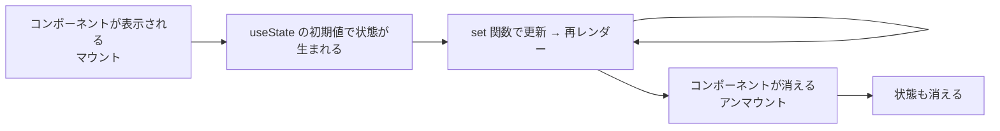

# ローカル状態とは

> **ひとことで言うと**：ローカル状態とは、1つのコンポーネント（とその子）だけが使う状態のこと。モーダルの開閉やタブの選択など「UIの一時的な見た目」の多くはこれで、`useState` で持つのが基本です。

## たとえ話で理解する

オフィスの **自分の机の上のメモ** がローカル状態です。

- 「今どの資料を開いているか」「付箋をどこに貼ったか」は自分しか気にしない
- これを全社共有のホワイトボード（グローバル状態）に書くと、他の人の邪魔になるし、消し忘れも起きる

自分だけが使う情報は、自分の机に置くのがいちばん扱いやすいのです。

## なぜ必要？（困りごと）

「状態管理＝Redux などのライブラリ」と思い込むと、次のようなことが起きがちです。

- ドロップダウンの開閉まで全部グローバルストアに入れて、コードが遠く・重くなる
- 画面を離れても前の開閉状態が残っていて、戻ったらモーダルが開いたまま
- 同じコンポーネントを2つ並べたら、開閉状態を共有してしまい両方同時に開く

ローカル状態は **コンポーネントごとに独立** していて、コンポーネントが画面から消えれば一緒に消えます。この性質がUIの一時的な状態にぴったりです。

## 基本の仕組み

### ローカル状態の代表例

| 例 | 型のイメージ |
|---|---|
| モーダル・ドロワーの開閉 | `boolean` |
| 選択中のタブ | `"info" \| "review"` |
| アコーディオンの展開 | `boolean` / `Set<string>` |
| ホバー中・フォーカス中 | `boolean` |
| 入力途中の文字（送信前） | `string` |

### ライフサイクル（一生）



- **マウント**：コンポーネントが画面に初めて表示されること
- **アンマウント**：画面から取り除かれること

💡 同じコンポーネントを2つ置けば、状態も2つ独立して生まれます。

### ローカルで足りるかのチェック

- その値を使うのは、このコンポーネントとその子だけ？ → **ローカルでOK**
- 兄弟や離れたコンポーネントも使う？ → [[02_状態の持ち上げ]] や [[01_グローバル状態とは]]
- リロードしても残したい・URLで共有したい？ → [[01_URL状態とは]] / [[01_状態の永続化]]
- サーバーから取ってきたデータ？ → [[01_サーバー状態とは]]

## コード例

### モーダルの開閉

```tsx
import { useState } from "react";

export function DeleteButton({ onDelete }: { onDelete: () => void }) {
  const [isOpen, setIsOpen] = useState(false); // このボタンだけの状態

  return (
    <>
      <button onClick={() => setIsOpen(true)}>削除</button>
      {isOpen && (
        <div role="dialog">
          <p>本当に削除しますか？</p>
          <button onClick={() => { onDelete(); setIsOpen(false); }}>はい</button>
          <button onClick={() => setIsOpen(false)}>キャンセル</button>
        </div>
      )}
    </>
  );
}
```

`DeleteButton` を一覧の各行に置いても、それぞれが自分の `isOpen` を持つので干渉しません。

### 初期値の計算が重いとき

```tsx
// 関数を渡すと、初回だけ実行される（毎回の再レンダーで計算しない）
const [draft, setDraft] = useState(() => loadDraftFromStorage());
```

### key で状態をリセットする

```tsx
// userId が変わると別のコンポーネント扱いになり、中のローカル状態が初期化される
<ProfileEditor key={userId} userId={userId} />
```

`key` は React がコンポーネントを見分ける名札です。名札が変わると「別人」とみなされ、状態が作り直されます。

## よくある失敗

- ❌ UIの開閉まで全部グローバルに置く → ⭕ まずローカル。共有が必要になってから移す
- ❌ 別ユーザーに切り替えても前の入力が残る → ⭕ `key` を変えてリセットする
- ❌ 画面を離れても残したい値をローカルに置いて消える → ⭕ URL や永続化を検討する
- ❌ 親から来た props を `useState` にコピーして同期がズレる → ⭕ props はそのまま使う（[[04_派生状態と単一の情報源]]）
- ❌ 関連する `useState` が5個も6個も増えて更新がバラバラ → ⭕ reducer でまとめる（[[04_複雑なローカル状態をreducerで整理する]]）

## まとめ

- ローカル状態＝1つのコンポーネントだけが使う状態。`useState` が基本
- コンポーネントと一緒に生まれて消える。インスタンスごとに独立
- 「まずローカル、必要になったら持ち上げる」が鉄則

## 関連ノート

- [[01_状態とは何か]] — 状態の種類の全体像
- [[02_状態の持ち上げ]] — 兄弟で共有したくなったら
- [[03_状態は使う場所の近くに置く]] — 置き場所の考え方
- [[04_複雑なローカル状態をreducerで整理する]] — 状態が増えてきたら
- [[01_グローバル状態とは]] — アプリ全体で共有する状態
- 上位: [[MOC_状態管理体系]]
