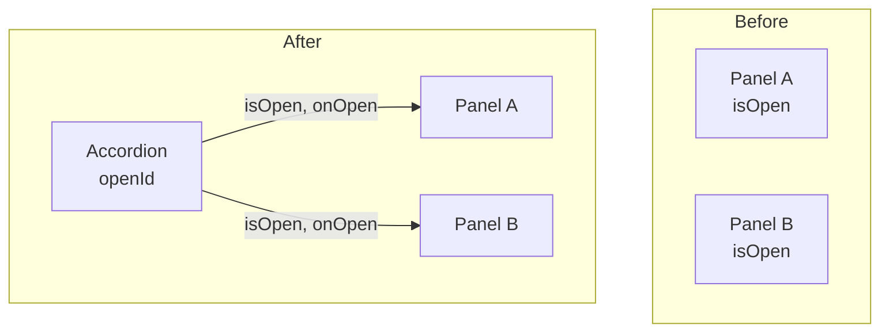

# 状態の持ち上げ

> **ひとことで言うと**：複数のコンポーネントが同じ状態を使いたいときは、それらの「いちばん近い共通の親」に状態を移し、props で配る。これを「状態の持ち上げ（Lifting State Up）」と呼びます。

## たとえ話で理解する

兄弟2人がそれぞれ「今日の夕飯の予定」をメモしていたら、兄は「カレー」、弟は「ハンバーグ」と食い違うかもしれません。

そこで **親がメモを1枚だけ持ち**、兄弟には「今日はカレーだよ」と伝える。変えたいときは親に「ハンバーグにして」と頼む。これで兄弟の予定が必ず一致します。

## なぜ必要？（困りごと）

アコーディオン（開閉できるパネル）で「同時に1つだけ開く」ようにしたいとします。

- 各パネルが自分で `isOpen` を持っていると、**他のパネルが開いているか分からない**
- 無理に揃えようとして、パネル同士で `useEffect` を使って同期し始める → バグの温床

兄弟コンポーネント同士は直接データをやり取りできません（[[02_単方向データフロー]]）。共通の親を経由するしかないのです。

## 基本の仕組み



### 手順（3ステップ）

1. **子から状態を取り除く**：子の `useState` を消し、値を props で受け取る
2. **共通の親に状態を置く**：親で `useState` する
3. **親から値と変更関数を渡す**：子は受け取った関数を呼ぶだけ

- 状態を持たず props だけで動くコンポーネントを **制御されたコンポーネント（controlled）** と呼ぶことがあります。フォームでの意味は [[02_controlledとuncontrolled]] を参照

### どこまで持ち上げる？

- 使うコンポーネントたちの **いちばん近い共通の祖先** まで。それより上には上げない
- 上げすぎると、関係ないコンポーネントまで再レンダーされ、props の受け渡しも長くなる（[[03_状態は使う場所の近くに置く]]）

## コード例

### Before：各パネルが自分で状態を持つ

```tsx
// ❌ 他のパネルの開閉が分からないので「1つだけ開く」が作れない
function Panel({ title, children }: { title: string; children: React.ReactNode }) {
  const [isOpen, setIsOpen] = useState(false);
  return (
    <section>
      <button onClick={() => setIsOpen(!isOpen)}>{title}</button>
      {isOpen && <div>{children}</div>}
    </section>
  );
}
```

### After：親が「開いているパネルのID」を持つ

```tsx
import { useState } from "react";

type PanelProps = {
  title: string;
  isOpen: boolean;       // 親から受け取る
  onOpen: () => void;    // 親に依頼する
  children: React.ReactNode;
};

function Panel({ title, isOpen, onOpen, children }: PanelProps) {
  return (
    <section>
      <button onClick={onOpen}>{title}</button>
      {isOpen && <div>{children}</div>}
    </section>
  );
}

export function Accordion() {
  const [openId, setOpenId] = useState<string | null>("about"); // 1つの情報源
  return (
    <>
      <Panel title="概要" isOpen={openId === "about"} onOpen={() => setOpenId("about")}>…</Panel>
      <Panel title="料金" isOpen={openId === "price"} onOpen={() => setOpenId("price")}>…</Panel>
    </>
  );
}
```

`isOpen` を2つの boolean ではなく `openId` 1つで表したので、「2つ同時に開く」という矛盾した状態がそもそも作れません（[[04_派生状態と単一の情報源]]）。

### 兄弟で値を共有する例

```tsx
export function TemperatureConverter() {
  const [celsius, setCelsius] = useState(20); // 親が持つ
  return (
    <>
      <CelsiusInput value={celsius} onChange={setCelsius} />
      <FahrenheitView fahrenheit={celsius * 9 / 5 + 32} /> {/* 派生値を渡す */}
    </>
  );
}
```

## よくある失敗

- ❌ 兄弟同士を `useEffect` で同期しようとする → ⭕ 共通の親へ持ち上げる
- ❌ 念のためアプリの最上位まで持ち上げる → ⭕ いちばん近い共通の親まで
- ❌ 持ち上げた後も子に `useState` が残って二重管理 → ⭕ 子の状態は消して props に一本化
- ❌ 5階層も props を中継して苦しい → ⭕ コンポジション（children で渡す）や Context を検討（[[02_propsバケツリレーとContextの限界]]）
- ❌ boolean を並べて矛盾した組み合わせが生まれる → ⭕ `openId` のように1つの値で表す

## まとめ

- 共有したい状態は、いちばん近い共通の親へ移す
- 親は値と変更関数を props で配り、子はそれを使うだけ
- 深くなりすぎたら Context やグローバル状態を検討する

## 関連ノート

- [[01_ローカル状態とは]] — 持ち上げる前の出発点
- [[02_単方向データフロー]] — 値は下へ、依頼は上へ
- [[03_状態は使う場所の近くに置く]] — 上げすぎないための考え方
- [[02_propsバケツリレーとContextの限界]] — 中継が深くなったとき
- [[01_グローバル状態とは]] — アプリ全体で共有するとき
- 上位: [[MOC_状態管理体系]]
