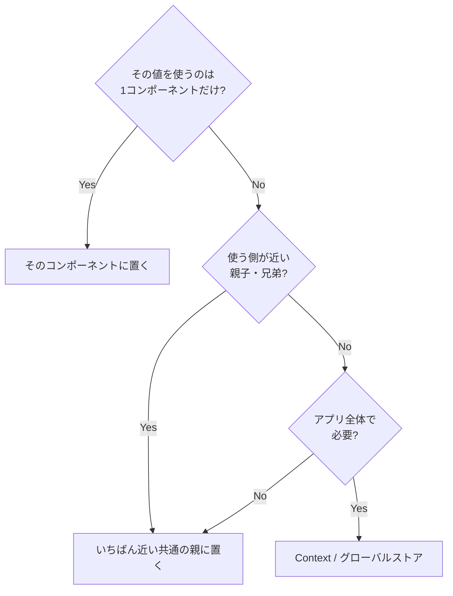

# 状態は使う場所の近くに置く

> **ひとことで言うと**：状態は「それを使うコンポーネントにできるだけ近い場所」に置く（コロケーション＝colocation）。上に置きすぎると、関係ない部分まで再レンダーされ、コードも追いにくくなります。

## たとえ話で理解する

キッチンで使う塩を、わざわざ2階の物置にしまう人はいません。**使う場所のすぐ近く** に置けば、取りに行く手間も、どこにあるか探す手間もありません。

逆に、家族全員が使う救急箱はリビング（共通の場所）に置きます。「誰が使うか」で置き場所が決まる――状態も同じです。

## なぜ必要？（困りごと）

「後で使うかもしれないから」とアプリの上の方に状態を置くと……

- 検索欄に1文字打つたびに **ページ全体が再レンダー** されて重くなる
- 状態が遠くにあるので、どこで変更されているか **ファイルをまたいで探す** ことになる
- 使わなくなったコンポーネントを消しても、状態だけが上に **取り残される**

## 基本の仕組み

### 置き場所の判断フロー



※ サーバーのデータ・URL・フォームは、それぞれ専用の置き場所を先に検討します（[[01_状態とは何か]]）。

### 再レンダーの範囲

React では、状態を更新したコンポーネントと **その子孫すべて** が再レンダーされます（`memo` などで止めない限り）。

```
App（検索文字をここに置くと…）
├─ Header        ← 再レンダー
├─ Sidebar       ← 再レンダー
└─ Main
   └─ SearchBox  ← 本当に必要なのはここだけ
```

状態を `SearchBox` に下ろせば、再レンダーは `SearchBox` だけで済みます。

### 2つの動き

| 動き | いつ | 例 |
|---|---|---|
| 持ち上げる（lift up） | 共有が必要になったとき | [[02_状態の持ち上げ]] |
| 押し下げる（push down / colocate） | 使うのが一部だけと分かったとき | このノート |

状態の置き場所は一度決めたら終わりではなく、**必要に応じて上げ下げする** ものです。

## コード例

### Before：上に置きすぎ

```tsx
// ❌ 検索欄の入力値がページ最上位にあり、1文字ごとに全体が再描画
export function Page() {
  const [query, setQuery] = useState("");
  return (
    <>
      <HeavyChart />      {/* query と無関係なのに再レンダー */}
      <SearchBox query={query} onChange={setQuery} />
    </>
  );
}
```

### After：使う場所へ押し下げる

```tsx
import { useState } from "react";

export function Page() {
  return (
    <>
      <HeavyChart />   {/* もう巻き込まれない */}
      <SearchBox />
    </>
  );
}

function SearchBox() {
  const [query, setQuery] = useState(""); // 使う場所に置く
  return <input value={query} onChange={(e) => setQuery(e.target.value)} />;
}
```

### 部分だけ切り出してコンポーネントにする

```tsx
// ホバー状態のためにカード全体を再描画しないよう、小さく切り出す
function LikeButton() {
  const [hovered, setHovered] = useState(false);
  return (
    <button onMouseEnter={() => setHovered(true)} onMouseLeave={() => setHovered(false)}>
      {hovered ? "♥ いいね！" : "♡"}
    </button>
  );
}
```

💡 「状態を持つ部分だけを小さなコンポーネントに切り出す」は、`memo` よりも先に試すべき最もシンプルな最適化です。

## よくある失敗

- ❌ 「いつか使うかも」で最上位に置く → ⭕ 今使う場所に置き、必要になったら持ち上げる
- ❌ 再レンダー対策でいきなり `memo` だらけにする → ⭕ まず状態を下ろす・切り出す
- ❌ UIの一時状態（開閉・ホバー）をグローバルストアへ → ⭕ ローカルに置く
- ❌ 共有しているのに無理にローカルに置いてコピーを作る → ⭕ 共有が必要なら共通の親へ（[[02_状態の持ち上げ]]）
- ❌ Context に頻繁に変わる値を入れて広範囲が再レンダー → ⭕ Context は分割するか、セレクタのあるストアを使う（[[04_セレクタと再レンダー対策]]）

## まとめ

- 状態は使う場所のいちばん近くに置く（コロケーション）
- 近いほど再レンダーが減り、コードも読みやすい
- 共有が必要なら上げ、不要と分かったら下げる

## 関連ノート

- [[01_ローカル状態とは]] — 近くに置く状態の代表
- [[02_状態の持ち上げ]] — 逆方向の動き
- [[02_propsバケツリレーとContextの限界]] — 遠くに届けたいとき
- [[04_セレクタと再レンダー対策]] — グローバルでの再レンダー対策
- [[05_状態管理ライブラリの選び方]] — それでも足りないとき
- 上位: [[MOC_状態管理体系]]
