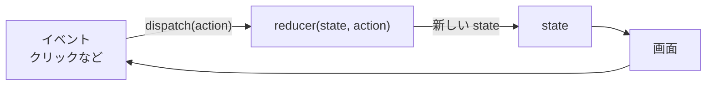

# 複雑なローカル状態をreducerで整理する

> **ひとことで言うと**：関連する状態がいくつもあり、更新ロジックがあちこちに散らばってきたら、`useReducer` で「何が起きたか（アクション）」と「どう変わるか（reducer）」を1か所にまとめる。状態の変化が読みやすく、テストしやすくなります。

## たとえ話で理解する

銀行の窓口を想像してください。

- お客さんは金庫を自分で開けず、**「5000円入金」という伝票（アクション）** を出す
- 窓口係（**reducer**）が伝票を見て、ルールどおりに残高を計算する
- 伝票の種類は「入金」「出金」「振込」と決まっていて、それ以外は受け付けない

誰が何をしても、残高が変わる場所は窓口1か所だけ。だから記録も確認も簡単です。

## なぜ必要？（困りごと）

`useState` が増えていくと、こうなりがちです。

```tsx
const [items, setItems] = useState<Item[]>([]);
const [isLoading, setIsLoading] = useState(false);
const [error, setError] = useState<string | null>(null);
const [page, setPage] = useState(1);
// ハンドラごとに4つの set をバラバラに呼ぶ…
```

- 「読み込み開始時は error を消して isLoading を true に」のようなルールが **各ハンドラにコピペ** される
- 1か所で `setError(null)` を忘れると、**エラー表示が残ったまま** になる
- 「状態がどう変わりうるか」の全体像がどこにも書かれていない

## 基本の仕組み



| 用語 | 意味 |
|---|---|
| state | 現在の状態（オブジェクトにまとめる） |
| action | 「何が起きたか」を表すオブジェクト。`{ type: "added", title }` など |
| reducer | `(state, action) => 新しいstate` を返す **純粋関数** |
| dispatch | action を reducer に届ける関数 |

- **純粋関数**：同じ入力なら必ず同じ出力を返し、外の世界を変えない関数。reducer の中で fetch や乱数・現在時刻の取得はしない
- reducer は状態を書き換えず、新しいオブジェクトを返す（[[03_イミュータブルな更新]]）

### useState と useReducer の使い分け

| 状況 | おすすめ |
|---|---|
| 独立した単純な値（開閉、入力1つ） | `useState` |
| 関連する値が複数あり、一緒に変わる | `useReducer` |
| 「次の状態」が前の状態と操作の種類で決まる | `useReducer` |
| 更新ルールを単体テストしたい | `useReducer`（reducer は普通の関数） |

## コード例

### Todo リストを reducer で

```tsx
type Todo = { id: number; title: string; done: boolean };

type Action =
  | { type: "added"; id: number; title: string }
  | { type: "toggled"; id: number }
  | { type: "deleted"; id: number };

// 状態がどう変わるかは、すべてここを見れば分かる
function todosReducer(todos: Todo[], action: Action): Todo[] {
  switch (action.type) {
    case "added":
      return [...todos, { id: action.id, title: action.title, done: false }];
    case "toggled":
      return todos.map((t) => (t.id === action.id ? { ...t, done: !t.done } : t));
    case "deleted":
      return todos.filter((t) => t.id !== action.id);
  }
}
```

TypeScript の **判別可能なユニオン型**（`type` の値で種類を見分ける型）を使うと、`case` ごとに `action` の中身が正しく推論されます。

```tsx
import { useReducer, useState } from "react";

export function TodoApp() {
  const [todos, dispatch] = useReducer(todosReducer, []);
  const [title, setTitle] = useState(""); // 入力中の文字は useState で十分

  const add = () => {
    // ID の生成（副作用）は reducer の外で行う
    dispatch({ type: "added", id: Date.now(), title });
    setTitle("");
  };

  return (
    <>
      <input value={title} onChange={(e) => setTitle(e.target.value)} />
      <button onClick={add}>追加</button>
      {todos.map((t) => (
        <li key={t.id} onClick={() => dispatch({ type: "toggled", id: t.id })}>
          {t.done ? "✔ " : ""}{t.title}
        </li>
      ))}
    </>
  );
}
```

### reducer はそのままテストできる

```ts
const next = todosReducer([], { type: "added", id: 1, title: "牛乳" });
// next → [{ id: 1, title: "牛乳", done: false }]
```

💡 `useReducer` 自体の細かい仕様（初期化関数の第3引数など）は vault の 32_React フォルダを参照してください。ここでは「状態の整理術」として扱います。

### ライブラリを使うと

この「アクション → reducer → 新しい状態」の形をアプリ全体に広げたのが Redux です（[[01_Redux]]）。状態の組み合わせ（「読み込み中なのにエラー」など）の矛盾まで防ぎたいならステートマシンが向いています（[[01_ステートマシンとは]]）。

## よくある失敗

- ❌ reducer の中で state を書き換える（`todos.push(...)`）→ ⭕ 新しい配列・オブジェクトを返す
- ❌ reducer の中で fetch や `Date.now()` を呼ぶ → ⭕ 副作用はイベントハンドラ側で行い、結果を action に載せる
- ❌ action 名を `setItems` のような「命令」にする → ⭕ `added` / `toggled` のように「起きたこと」で名付ける
- ❌ 単純な boolean 1つにまで reducer を使う → ⭕ 単純なものは `useState` のままで良い
- ❌ 派生値（件数など）まで state に入れる → ⭕ 描画中に計算する（[[04_派生状態と単一の情報源]]）

## まとめ

- 関連する状態が増えたら `useReducer` で更新ルールを1か所にまとめる
- action は「何が起きたか」、reducer は「どう変わるか」を表す純粋関数
- reducer は普通の関数なのでテストしやすく、Redux やステートマシンへの入口にもなる

## 関連ノート

- [[01_ローカル状態とは]] — useState の基本
- [[03_イミュータブルな更新]] — reducer で新しい state を返す作法
- [[02_単方向データフロー]] — dispatch も一方向の流れ
- [[01_ステートマシンとは]] — ありえない状態を型で防ぐ次の一歩
- [[01_Redux]] — reducer の考え方をアプリ全体へ
- 上位: [[MOC_状態管理体系]]
