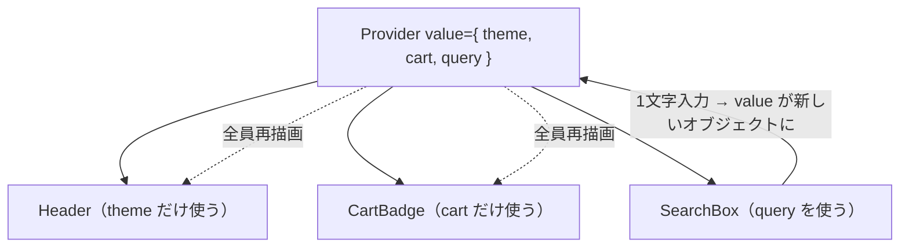

# propsバケツリレーとContextの限界

> **ひとことで言うと**：props を何階層も手渡しする「バケツリレー」は Context で解消できるが、Context は値が変わると使っている全員を再描画するため、頻繁に変わる状態の置き場所には向かない。

## たとえ話で理解する

- **バケツリレー**：3階の部屋に手紙を届けるのに、1階→2階→3階と住人に手渡しで回してもらう。途中の住人は中身に興味がないのに手間だけかかる。
- **Context**：建物全体に館内放送を流す。3階の人に直接届くが、放送のたびに**放送を聞いている全員**が手を止めて耳を傾ける。「3階の田中さんだけ」に伝えたくても、全員が反応してしまう。

## なぜ必要？（困りごと）

### バケツリレー（prop drilling）の困りごと

- 中継するだけのコンポーネントが増え、props の型定義が長くなる。
- 途中の1つで渡し忘れると、下のほうで値が `undefined` になる。
- 1つの値を追加するだけで、経路上の全ファイルを修正することになる。

### Context に全部入れたときの困りごと

- テーマとカートと入力中の検索語を1つの Context に入れると、検索語を1文字打つたびに**テーマしか使っていないヘッダーまで再描画**される。
- アプリが大きくなると、画面がもたつく原因になる。

## 基本の仕組み

### バケツリレー

```
App (cart を持つ)
 └─ Layout      ← cart を受け取って渡すだけ
     └─ Main    ← cart を受け取って渡すだけ
         └─ CartBadge  ← 本当に使うのはここだけ
```

### Context の再レンダーの仕組み



- `useContext` を呼んでいるコンポーネントは、Provider の `value` が**別物（参照が変わる）**になると必ず再描画される。
- 「value の一部だけを見る」機能は Context にはない。これが限界。

### 比較

| 方法 | 良い点 | 弱い点 | 向いている値 |
| --- | --- | --- | --- |
| props | 流れが明確、型で追える | 深いと中継だらけ | 2〜3階層までの受け渡し |
| Context | 中継不要、React 標準 | 一部だけ購読できない | テーマ・言語・ログイン情報など変化が少ない値 |
| 外部ストア | 必要な部分だけ購読できる | 仕組みを1つ覚える必要 | カートなど頻繁に変わる共有データ |

## コード例

### Before：1つの Context に何でも入れる

```tsx
const AppContext = createContext<{
  theme: "light" | "dark";
  query: string;
  setQuery: (q: string) => void;
} | null>(null);

function AppProvider({ children }: { children: React.ReactNode }) {
  const [theme] = useState<"light" | "dark">("light");
  const [query, setQuery] = useState("");
  // query が変わるたびに新しいオブジェクト → 全利用者が再描画
  return (
    <AppContext.Provider value={{ theme, query, setQuery }}>
      {children}
    </AppContext.Provider>
  );
}

function Header() {
  const { theme } = useContext(AppContext)!; // theme しか使わないのに再描画される
  return <header className={theme}>ショップ</header>;
}
```

### After：変わる頻度で Context を分ける＋必要なら値を固定する

```tsx
const ThemeContext = createContext<"light" | "dark">("light");
const QueryContext = createContext<{ query: string; setQuery: (q: string) => void } | null>(null);

function Providers({ children }: { children: React.ReactNode }) {
  const [theme] = useState<"light" | "dark">("light");
  const [query, setQuery] = useState("");
  // query が変わったときだけ新しいオブジェクトを作る
  const queryValue = useMemo(() => ({ query, setQuery }), [query]);
  return (
    <ThemeContext.Provider value={theme}>
      <QueryContext.Provider value={queryValue}>{children}</QueryContext.Provider>
    </ThemeContext.Provider>
  );
}

function Header() {
  const theme = useContext(ThemeContext); // query が変わっても再描画されない
  return <header className={theme}>ショップ</header>;
}
```

- `useMemo`：依存する値が変わったときだけ計算し直し、それ以外は前回の結果を使い回すフック。
- 💡 React Compiler（自動でメモ化してくれるビルド時の仕組み）を導入していれば `useMemo` を手で書く場面は減りますが、「Context を分ける」考え方は変わりません。

### それでも足りないとき

頻繁に変わる値を多くのコンポーネントが「一部だけ」読みたい場合は、外部ストア＋セレクタ（必要な部分だけ取り出す関数）を使います。自作の方法は [[03_ストア設計の基本]]、再レンダー対策は [[04_セレクタと再レンダー対策]]。ライブラリなら [[02_Zustand]] や [[04_Jotai]] が代表的です。

## よくある失敗

- ❌ バケツリレーが2階層あるだけで Context を作る → ⭕ 浅いうちは props のほうが読みやすい。コンポーネントの `children` を使って中継を減らす手もある
- ❌ アプリの全状態を1つの巨大 Context に入れる → ⭕ 変わる頻度・使う場所ごとに分ける
- ❌ `value={{ ... }}` を毎回新しく作ってしまう → ⭕ `useMemo` で包むか、プリミティブ値（文字列・数値）を渡す
- ❌ Context を「状態管理ライブラリの代わり」として何でも入れる → ⭕ Context は「値を届ける仕組み」。頻繁に変わる共有データは外部ストアへ

## まとめ

- props バケツリレーは、中継だけのコンポーネントが増えるのが問題。
- Context はそれを解消するが、value が変わると利用者全員が再描画される。
- 変化の少ない値は Context、頻繁に変わる共有データは外部ストアとセレクタで。

## 関連ノート

- [[02_状態の持ち上げ]] — バケツリレーが生まれる原因
- [[01_グローバル状態とは]] — 共有状態の置き場所の考え方
- [[03_ストア設計の基本]] — Context の次の一手
- [[04_セレクタと再レンダー対策]] — 必要な部分だけ購読する
- [[05_状態管理ライブラリの選び方]] — ライブラリ比較
- 上位: [[MOC_状態管理体系]]
