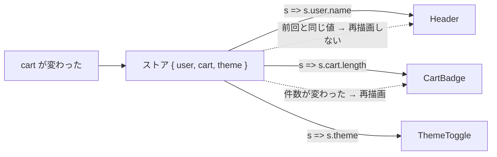

# セレクタと再レンダー対策

> **ひとことで言うと**：セレクタは「ストア全体から自分が使う部分だけを取り出す関数」。取り出した値が変わったときだけ再描画されるので、関係ない更新で画面がもたつくのを防げる。

## たとえ話で理解する

新聞を丸ごと毎朝届けてもらうと、読まない記事のためにも毎回ページをめくります。

- **セレクタなし**：新聞が1文字でも変わるたびに、全ページを読み直す。
- **セレクタあり**：「スポーツ欄の野球の結果だけ」と切り抜きを頼む。野球の結果が変わった日だけ知らせが来る。

## なぜ必要？（困りごと）

- **再レンダー（再描画）**：状態が変わったとき、React がコンポーネント関数をもう一度実行して画面を作り直すこと。
- ストア全体を読んでいると、カートに商品を1つ足しただけで「ユーザー名しか表示していないヘッダー」まで再レンダーされる。
- 1つ1つは速くても、商品が1000件並ぶ一覧などで積み重なると、入力が遅れる・スクロールがカクつくといった体感の悪化につながる。

## 基本の仕組み



1. ストアが更新されると、購読しているすべてのコンポーネントのセレクタが実行される。
2. セレクタの結果を**前回の結果と比べる**（`Object.is`：同じ値・同じ参照かを調べる比較）。
3. 違うときだけ再レンダーする。

### 比べ方の注意（ここが一番つまずく）

| セレクタの戻り値 | 前回との比較 | 結果 |
| --- | --- | --- |
| 数値・文字列（`s.cart.length`） | 値で比べられる | ⭕ 変わったときだけ再描画 |
| ストア内の既存オブジェクト（`s.user`） | 同じ参照なら同じ | ⭕ user が変わったときだけ |
| その場で作る新しいオブジェクト（`{ a: s.a, b: s.b }`） | 毎回別物 | ❌ 毎回再描画、場合によっては無限ループ |
| `filter` / `map` の結果 | 毎回新しい配列 | ❌ 同上 |

## コード例

[[03_ストア設計の基本]] で作った `createStore` に、セレクタ付きフックを足します。

### Before：ストア全体を読む

```tsx
function useCart() {
  return useSyncExternalStore(store.subscribe, store.getState);
}

function CartBadge() {
  const { items } = useCart(); // ストアのどこが変わっても再描画
  return <span>{items.length}</span>;
}
```

### After：セレクタで必要な部分だけ読む

```tsx
import { useSyncExternalStore } from "react";

// セレクタを受け取るフック
export function useCartStore<S>(selector: (s: CartState) => S): S {
  return useSyncExternalStore(store.subscribe, () => selector(store.getState()));
}

function CartBadge() {
  // 数値を返す → 件数が変わったときだけ再描画
  const count = useCartStore((s) => s.items.length);
  return <span>{count}</span>;
}

function CartTotal() {
  // 合計も数値なので安全
  const total = useCartStore((s) => s.items.reduce((sum, i) => sum + i.price * i.qty, 0));
  return <p>合計 {total} 円</p>;
}
```

### ❌ やりがちな NG：セレクタで新しいオブジェクトを作る

```tsx
// 毎回 { count, total } という新しいオブジェクト → 「前回と違う」と判定され続ける
const { count, total } = useCartStore((s) => ({
  count: s.items.length,
  total: s.items.reduce((sum, i) => sum + i.price, 0),
}));
```

`useSyncExternalStore` では、スナップショット（読み取った値）が毎回変わると React が警告を出し、無限ループになることがあります。

### ⭕ 直し方

```tsx
// 1. 値ごとにフックを分ける（いちばん簡単）
const count = useCartStore((s) => s.items.length);
const total = useCartStore((s) => s.items.reduce((sum, i) => sum + i.price, 0));

// 2. 配列の絞り込みは、元の配列を取ってからコンポーネント内で計算する
const items = useCartStore((s) => s.items); // 参照は items が変わったときだけ変わる
const expensive = useMemo(() => items.filter((i) => i.price > 5000), [items]);
```

### その他の再レンダー対策

- **コンポーネントを分ける**：頻繁に変わる部分（入力欄など）を小さな子コンポーネントに切り出すと、再描画の範囲が狭まる。
- **`memo`**：props が同じなら再描画を飛ばすようにコンポーネントを包む React の関数。一覧の1行など、数が多い部品に効く。
- **状態を近くに置く**：そもそもグローバルに置かなくてよい状態はローカルへ（[[03_状態は使う場所の近くに置く]]）。

💡 まず React DevTools の Profiler（どのコンポーネントが何回描画されたかを記録する機能）で遅い場所を確かめてから対策しましょう。

### ライブラリを使うと

- Zustand：`useStore((s) => s.count)` がセレクタ。複数の値をオブジェクトで取りたいときは `useShallow`（中身を1段だけ比べる関数）で包む（[[02_Zustand]]）。
- Redux Toolkit：`useSelector((state) => state.cart.items.length)`。重い計算は `createSelector` で結果を覚えておける（[[01_Redux]]）。
- Jotai：状態を小さな atom（状態の最小単位）に分けるので、atom ごとに購読される（[[04_Jotai]]）。

## よくある失敗

- ❌ セレクタで `{ ... }` や `filter()` の結果を返す → ⭕ プリミティブ値か既存の参照を返す。複数ならフックを分ける
- ❌ 何でも `memo` / `useMemo` で包む → ⭕ Profiler で遅いと分かった場所だけ対策する
- ❌ ストア全体 `s => s` を返す → ⭕ 使う項目だけ選ぶ
- ❌ 派生値をストアに保存して二重管理する → ⭕ セレクタで計算する（[[04_派生状態と単一の情報源]]）

## まとめ

- セレクタは「必要な部分だけ取り出す関数」で、結果が変わったときだけ再描画される。
- 結果は `Object.is` で比べられるので、新しいオブジェクト・配列を返さない。
- 対策は計測してから。コンポーネント分割・`memo`・状態を近くに置くのも有効。

## 関連ノート

- [[03_ストア設計の基本]] — セレクタを足す元のストア
- [[02_propsバケツリレーとContextの限界]] — Context にはセレクタがない
- [[04_派生状態と単一の情報源]] — 派生値は保存せず計算する
- [[03_イミュータブルな更新]] — 参照が変わる仕組み
- [[05_状態管理ライブラリの選び方]] — セレクタの有無も比較
- 上位: [[MOC_状態管理体系]]
