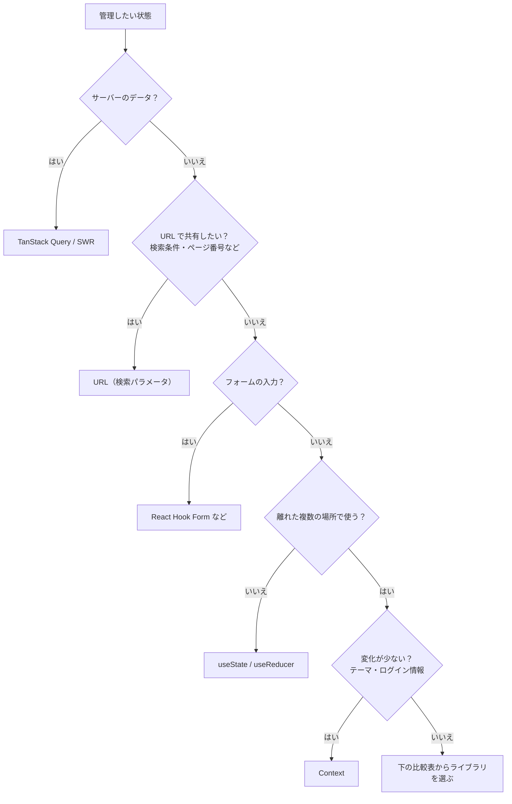

# 状態管理ライブラリの選び方

> **ひとことで言うと**：まず「その状態は本当にグローバルか、サーバー状態や URL 状態ではないか」を確かめ、残ったクライアントの共有状態だけをライブラリで扱う。小さく始めるなら Context か Zustand、状態が細かく分かれるなら Jotai、大規模で決まりごとを重視するなら Redux Toolkit、オブジェクト中心に書きたいなら MobX。

## たとえ話で理解する

引っ越しの荷物運びにたとえると、

- **Context**：自分の手で運ぶ。軽い荷物なら十分。
- **Zustand**：台車。軽くて扱いやすく、たいていの荷物に使える。
- **Jotai**：小分けの箱。細かい荷物を箱ごとに管理できる。
- **Redux Toolkit**：引っ越し業者。手順書・記録がしっかりしていて大人数でも混乱しないが、準備は多め。
- **MobX**：自動で動くベルトコンベア。置けば勝手に運ばれるが、仕組みを知らないと何が起きているか分かりにくい。

荷物の量と人数で選ぶのが正解で、「一番有名だから」で選ぶと持て余します。

## なぜ必要？（困りごと）

- 「とりあえず Redux」で始めて、小さなアプリに大量の定型コード（ボイラープレート）を書くことになる。
- 逆に Context だけで大きくなり、再レンダーの多さに悩む（[[02_propsバケツリレーとContextの限界]]）。
- サーバーから取ったデータまでグローバルストアに入れて、ローディング・キャッシュ・再取得を手作りしてしまう。

## 基本の仕組み

### 判断フロー



💡 実際には、グローバルストアに残る状態はかなり少なくなります。

### 比較表

| | Context（React 標準） | Zustand | Jotai | Redux Toolkit | MobX |
| --- | --- | --- | --- | --- | --- |
| 考え方 | 値を下に届ける | 1つのストア＋アクション | 小さな atom を組み合わせる | slice＋reducer＋アクション | 観測可能なオブジェクトを直接変更 |
| 追加インストール | 不要 | 必要（とても小さい） | 必要（小さい） | 必要（react-redux も） | 必要（mobx-react-lite も） |
| 書く量 | 少ない | 少ない | 少ない | 多め | 少ない |
| Provider | 必要 | 不要 | 不要（任意） | 必要 | 不要 |
| 一部だけ購読 | できない | セレクタ | atom 単位で自動 | `useSelector` | 使ったプロパティを自動追跡 |
| 学習コスト | 低 | 低 | 低〜中 | 中〜高 | 中 |
| デバッグ | React DevTools | Redux DevTools 連携可 | 専用 DevTools あり | Redux DevTools が強力 | 専用ツールあり |
| 向いている規模 | 小 | 小〜大 | 小〜大 | 中〜大・多人数 | 中〜大 |
| 詳しく | [[02_propsバケツリレーとContextの限界]] | [[02_Zustand]] | [[04_Jotai]] | [[01_Redux]] | [[03_MobX]] |

用語メモ：

- **atom**：Jotai の状態の最小単位。1つの値を表す小さな箱。
- **slice**：Redux Toolkit で「状態の一部＋それを変える reducer」をまとめた単位。
- **観測可能（observable）**：MobX で、値が変わったことを自動で検知できるようにしたデータ。

### 判断基準

| 状況 | おすすめ | 理由 |
| --- | --- | --- |
| テーマ・言語・ログイン情報くらい | Context | 追加ライブラリ不要。変化が少ないので再レンダーも問題になりにくい |
| 共有状態がいくつかあり、手軽に始めたい | Zustand | 書く量が少なく、セレクタで再レンダーも抑えられる |
| 値同士の依存（A から B を計算、など）が多い | Jotai | atom を組み合わせて派生状態を自然に書ける |
| チームが大きい・更新履歴を追いたい・ルールで統一したい | Redux Toolkit | 決まった書き方と強力な DevTools |
| クラス・オブジェクト指向で書きたい、変更を自動追跡したい | MobX | 直接代入で書けて、使う部分だけ自動で再描画 |

## コード例

同じ「カウンターを共有する」例を並べると、書き味の違いが分かります（細部は各ライブラリのノート参照）。

```tsx
// Zustand：ストアとアクションを1か所に
import { create } from "zustand";

const useCounter = create<{ count: number; inc: () => void }>((set) => ({
  count: 0,
  inc: () => set((s) => ({ count: s.count + 1 })),
}));

function Counter() {
  const count = useCounter((s) => s.count); // セレクタ
  const inc = useCounter((s) => s.inc);
  return <button onClick={inc}>{count}</button>;
}
```

```tsx
// Jotai：atom を作って useAtom で読む
import { atom, useAtom } from "jotai";

const countAtom = atom(0);

function Counter() {
  const [count, setCount] = useAtom(countAtom);
  return <button onClick={() => setCount((c) => c + 1)}>{count}</button>;
}
```

```tsx
// Redux Toolkit：slice を作り、store と Provider で配る
import { createSlice, configureStore } from "@reduxjs/toolkit";

const counterSlice = createSlice({
  name: "counter",
  initialState: { count: 0 },
  reducers: { inc: (state) => { state.count += 1; } }, // Immer で書き換え風に書ける
});
export const store = configureStore({ reducer: { counter: counterSlice.reducer } });
// 使う側：useSelector((s) => s.counter.count) と useDispatch()(counterSlice.actions.inc())
```

素の React で同じことをする方法は [[03_ストア設計の基本]] を参照。仕組みが分かっていれば、どのライブラリも「状態＋更新関数＋購読」の別の書き方だと分かります。

## よくある失敗

- ❌ 有名だから・前の現場で使ったからで選ぶ → ⭕ アプリの規模・チーム人数・状態の性質で選ぶ
- ❌ サーバーデータをグローバルストアで管理する → ⭕ [[05_TanStack Query]] や [[06_SWR]] に任せ、ストアにはクライアント側の状態だけ残す
- ❌ 1つのアプリに複数の状態管理ライブラリを混在させる → ⭕ クライアント状態用は基本1つに絞る（サーバー状態用・フォーム用は別でよい）
- ❌ 最初から大規模向けの構成にする → ⭕ Context や Zustand で小さく始め、困ってから移行する
- ❌ ライブラリを入れれば設計不要と考える → ⭕ 状態を最小限にする・派生値は計算する、といった原則はどれでも同じ

## まとめ

- まず「サーバー状態？URL 状態？フォーム？ローカルで足りる？」を仕分けし、残りだけをグローバルストアへ。
- 小さく始めるなら Context / Zustand、細かい依存が多いなら Jotai、大規模・多人数なら Redux Toolkit、オブジェクト中心なら MobX。
- どれも「状態＋更新関数＋購読」の違う書き方。原則を押さえれば乗り換えも難しくない。

## 関連ノート

- [[01_Redux]] — Redux Toolkit の使い方
- [[02_Zustand]] — Zustand の使い方
- [[03_MobX]] — MobX の使い方
- [[04_Jotai]] — Jotai の使い方
- [[ライブラリ比較]] — ライブラリ全体の比較
- [[01_サーバー状態とは]] — グローバルストアに入れないもの
- [[01_URL状態とは]] — URL に置く状態
- [[03_ストア設計の基本]] — ライブラリなしのストア
- 上位: [[MOC_状態管理体系]]
