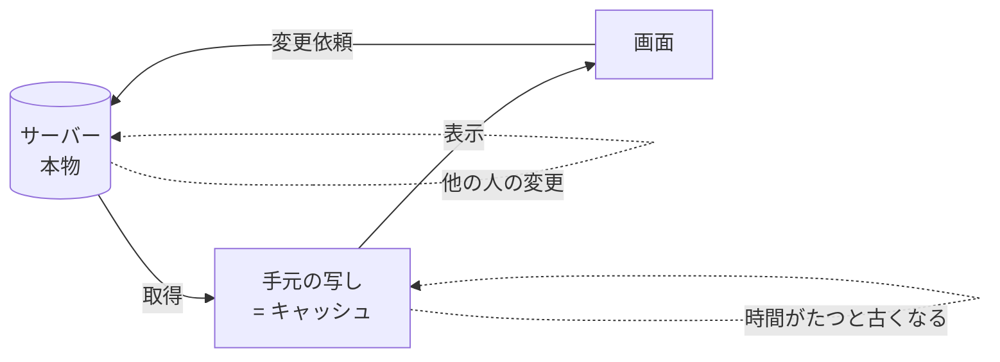

# サーバー状態とは

> **ひとことで言うと**：サーバー状態は「本物はサーバーにあり、手元にあるのはその写し」というデータのこと。写しはいつの間にか古くなるので、`useState` の値とは別物として扱う必要がある。

## たとえ話で理解する

図書館の本の「貸出状況」をメモ帳に書き写したとします。

- メモ帳（手元）：「『はらぺこあおむし』貸出可」
- 図書館の台帳（本物）：10分前に誰かが借りた → 実はもう「貸出中」

メモ帳は **書いた瞬間から古くなり始める** 写しです。自分の机の上の消しゴムの数（＝ローカル状態）なら自分しか変えないので古くなりませんが、図書館の台帳は他の人も書き換えます。
サーバー状態とは、この「図書館の台帳の写し」のことです。

## なぜ必要？（困りごと）

API から取ってきたデータを、ふつうの状態（`useState`）と同じ感覚で扱うと、こんなことが起きます。

- 画面Aと画面Bで同じユーザー一覧を **2回取りに行く**（重複リクエスト）
- 別タブで名前を変えたのに、こちらの画面は **古い名前のまま**（古いデータ）
- 検索語を素早く変えると、**遅れて届いた古い結果** で上書きされる（競合）
- 画面を離れたのに通信が続き、**消えたコンポーネントに値をセット** しようとする（キャンセル漏れ）
- 「読み込み中」「エラー」「データあり」のフラグ管理が **コンポーネントごとにコピペ** される

これらは「サーバー状態はローカル状態と性質が違う」ことを知らないと、毎回同じ落とし穴にはまる問題です。

## 基本の仕組み

### ローカル状態との違い

| 観点 | ローカル・UI状態 | サーバー状態 |
|---|---|---|
| 本物の置き場所 | 手元（ブラウザのメモリ） | サーバー（DB） |
| 誰が変えるか | 自分だけ | 自分＋他のユーザー＋バッチ処理など |
| 取得方法 | すぐ読める（同期） | 通信が必要（非同期＝待ち時間がある） |
| 古くなるか | ならない | **なる** |
| 例 | モーダルの開閉、入力中の文字 | ユーザー一覧、商品詳細、通知件数 |

※ **非同期**：結果がすぐ返らず、あとで届く処理のこと。

### サーバー状態で考えるべきこと



- **キャッシュ**：一度取ったデータを手元に取っておく仕組み。次に同じデータが要るとき、通信せずにすぐ見せられる → [[02_キャッシュと再取得]]
- **stale（ステイル）**：「古くなっているかもしれない」状態のこと。キャッシュは時間がたつと stale 扱いになる
- **再検証（revalidate）**：「手元の写しがまだ正しいか」をサーバーに聞き直すこと
- **ミューテーション**：サーバー上のデータを変更する操作（作成・更新・削除）→ [[04_ミューテーションとキャッシュの無効化]]

## コード例

### Before：素の fetch + useState / useEffect

```tsx
type User = { id: number; name: string };

function UserList() {
  const [users, setUsers] = useState<User[] | null>(null);
  const [loading, setLoading] = useState(true);
  const [error, setError] = useState<Error | null>(null);

  useEffect(() => {
    const controller = new AbortController(); // 画面を離れたら通信を中止するため
    fetch("/api/users", { signal: controller.signal })
      .then((res) => {
        if (!res.ok) throw new Error(`HTTP ${res.status}`);
        return res.json();
      })
      .then(setUsers)
      .catch((e) => {
        if (e.name !== "AbortError") setError(e); // 中止は失敗扱いしない
      })
      .finally(() => setLoading(false));
    return () => controller.abort(); // 後片付け
  }, []);

  if (loading) return <p>読み込み中…</p>;
  if (error) return <p>エラー: {error.message}</p>;
  return <ul>{users?.map((u) => <li key={u.id}>{u.name}</li>)}</ul>;
}
```

これでも動きますが、まだ次の問題が残っています。

- 別の画面も `/api/users` を使うと、またゼロから取りに行く（キャッシュなし）
- 一度表示したら二度と取り直さない（古いまま）
- 同じコードを API ごとに書く必要がある

### After：サーバー状態ライブラリを使うと

```tsx
import { useQuery } from "@tanstack/react-query";

function UserList() {
  const { data, isPending, error } = useQuery({
    queryKey: ["users"], // このデータの名札（キャッシュのキー）
    queryFn: () => fetch("/api/users").then((r) => r.json()) as Promise<User[]>,
  });

  if (isPending) return <p>読み込み中…</p>;
  if (error) return <p>エラー: {error.message}</p>;
  return <ul>{data.map((u) => <li key={u.id}>{u.name}</li>)}</ul>;
}
```

- 同じ `queryKey` を使う画面同士でキャッシュを共有 → 重複リクエストがまとめられる
- タブに戻ったときなどに自動で再検証
- ローディング・エラーのフラグをライブラリが持ってくれる

SWR でもほぼ同じ形で書けます（`useSWR("/api/users", fetcher)`）。詳しくは [[05_TanStack Query]] / [[06_SWR]]。

💡 ライブラリは「魔法」ではなく、上の Before で手書きしていた面倒を **決まった形で肩代わりしてくれる道具** です。

## よくある失敗

- ❌ API のレスポンスを Redux や Context などのグローバルストアに入れて、自前で「いつ取り直すか」を管理する → ⭕ サーバー状態はサーバー状態専用の仕組み（キャッシュ）に任せ、グローバルストアには UI の状態だけを置く
- ❌ 取ってきたデータを別の `useState` にコピーして編集する → ⭕ 表示はキャッシュから直接読み、編集中の値だけをフォーム状態として持つ（[[04_派生状態と単一の情報源]]）
- ❌ 「一度取れば正しいまま」と思い込む → ⭕ サーバーのデータは他人も変える。いつ再検証するかを決めておく
- ❌ `useEffect` の後片付け（abort）を書かない → ⭕ 画面を離れたら通信を中止するか、結果を無視する
- ❌ すべてのデータを毎回取り直す → ⭕ 変わりにくいデータは「新鮮とみなす時間」を長めにする（[[02_キャッシュと再取得]]）

## まとめ

- サーバー状態は「本物がサーバーにある写し」で、時間とともに古く（stale に）なる
- 素の fetch だと、重複・古いデータ・競合・キャンセルを毎回自分で面倒みることになる
- TanStack Query / SWR はそれらをキャッシュを中心に解決してくれる

## 関連ノート

- [[01_状態とは何か]] — 状態の種類の全体像
- [[01_ローカル状態とは]] — 手元だけで完結する状態との比較
- [[02_キャッシュと再取得]] — 写しをいつ使い、いつ取り直すか
- [[03_ローディング・エラー・空状態]] — 非同期データの表示パターン
- [[04_ミューテーションとキャッシュの無効化]] — データを変更したあとの扱い
- [[05_TanStack Query]] — 代表的なサーバー状態ライブラリ
- [[06_SWR]] — 軽量なサーバー状態ライブラリ
- 上位: [[MOC_状態管理体系]]
