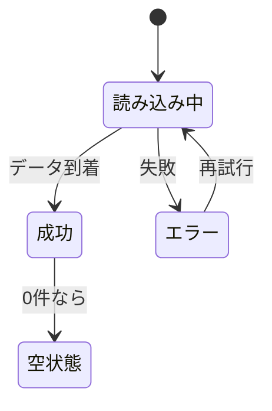

# ローディング・エラー・空状態

> **ひとことで言うと**：サーバーからデータを取る画面には「読み込み中」「失敗」「0件」「データあり」の4つの顔がある。フラグをバラバラに持たず、1つの「状態」として表すと表示ミスがなくなる。

## たとえ話で理解する

レストランで料理を待つときを思い浮かべてください。

- **読み込み中**：「ただいまお作りしています」
- **エラー**：「申し訳ありません、食材を切らしておりまして」
- **空状態**：「本日のおすすめは売り切れです」
- **データあり**：料理が届く

店員さんが何も言わずに空のお皿を置いたら、お客さんは「0件なの？まだなの？失敗したの？」と混乱します。画面も同じで、4つを **はっきり言い分ける** ことが大切です。

## なぜ必要？（困りごと）

`loading` / `error` / `data` を別々の `useState` で持つと、ありえない組み合わせが生まれます。

- `loading: true` なのに `error` も入っている → スピナーとエラーが同時に出る
- `data: []`（0件）と `data: null`（まだ取ってない）を区別せず、読み込み中に「データがありません」と一瞬表示される
- 再取得のたびに画面全体がスピナーに戻り、ちらつく
- エラー後に再試行しても、古いエラーメッセージが消えない

## 基本の仕組み

### 4つの状態



| 状態 | 画面に出すもの | 注意点 |
|---|---|---|
| 読み込み中 | スケルトン・スピナー | 初回だけ全体を置き換える |
| エラー | メッセージ＋「再試行」ボタン | 技術的なエラー文をそのまま出さない |
| 空状態 | 「まだありません」＋次の行動（作成ボタン等） | 「読み込み中」と区別する |
| 成功 | データ | 裏で再取得中なら小さく知らせる程度 |

- **スケルトン**：中身が入る場所に灰色の箱を並べた「骨組み」表示。レイアウトが崩れにくい

### 「初回の読み込み」と「裏での再取得」は別物

- 初回：キャッシュが無い → 画面全体を「読み込み中」にする
- 再取得（再検証）：キャッシュがある → **古いデータを出したまま**、小さなインジケーターだけ出す

TanStack Query ではこれが `isPending`（まだデータが無い）と `isFetching`（通信中かどうか）に分かれています。

## コード例

### Before：フラグを別々に持つ

```tsx
const [loading, setLoading] = useState(false);
const [error, setError] = useState<string | null>(null);
const [items, setItems] = useState<Item[]>([]); // 初期値 [] だと「0件」と区別できない
// → loading=true かつ error あり、のような矛盾が起こりうる
```

### After（素の React）：1つの状態にまとめる

```tsx
type Item = { id: number; title: string };
type FetchState =
  | { status: "loading" }
  | { status: "error"; message: string }
  | { status: "success"; items: Item[] };

function ItemList() {
  const [state, setState] = useState<FetchState>({ status: "loading" });

  useEffect(() => {
    let ignore = false; // 画面を離れたら結果を無視する
    fetch("/api/items")
      .then((r) => (r.ok ? r.json() : Promise.reject(new Error("取得に失敗しました"))))
      .then((items) => !ignore && setState({ status: "success", items }))
      .catch((e) => !ignore && setState({ status: "error", message: e.message }));
    return () => { ignore = true; };
  }, []);

  if (state.status === "loading") return <Skeleton />;
  if (state.status === "error") return <p role="alert">{state.message}</p>;
  if (state.items.length === 0) return <p>まだアイテムがありません</p>;
  return <ul>{state.items.map((i) => <li key={i.id}>{i.title}</li>)}</ul>;
}
```

`status` で分岐する型（**判別可能なユニオン型**：共通のフィールドの値で種類を見分ける TypeScript の型）にすると、ありえない組み合わせが型レベルで作れなくなります（[[01_ステートマシンとは]] の考え方と同じ）。

### ライブラリを使うと

```tsx
function ItemList() {
  const { data, isPending, isError, error, isFetching, refetch } = useQuery({
    queryKey: ["items"],
    queryFn: fetchItems,
  });

  if (isPending) return <Skeleton />; // 初回だけ
  if (isError)
    return (
      <div role="alert">
        <p>{error.message}</p>
        <button onClick={() => refetch()}>再試行</button>
      </div>
    );
  if (data.length === 0) return <p>まだアイテムがありません</p>;
  return (
    <>
      {isFetching && <small>更新中…</small>} {/* 裏での再取得 */}
      <ul>{data.map((i) => <li key={i.id}>{i.title}</li>)}</ul>
    </>
  );
}
```

SWR では `isLoading`（初回）と `isValidating`（再検証中）が同じ役割です。詳しくは [[05_TanStack Query]] / [[06_SWR]]。

💡 React の `<Suspense>` と組み合わせて「読み込み中」を親に任せる方法もあります（TanStack Query の `useSuspenseQuery` など）。まずは上の4分岐を確実に書けるようになってからで十分です。

## よくある失敗

- ❌ 初期値を `[]` にして「読み込み中」と「0件」を区別できない → ⭕ `status` を持つか、`undefined` を「まだ無い」として扱う
- ❌ 再取得のたびに全画面スピナーにする → ⭕ データがあるなら出したまま、小さく「更新中」を出す
- ❌ エラーメッセージだけ出して行き止まり → ⭕ 「再試行」ボタンや戻る導線を付ける
- ❌ 空状態を「データがありません」だけにする → ⭕ 「最初の1件を作成」など次の行動を示す
- ❌ `res.ok` を確認せず、404 や 500 を成功として扱う → ⭕ `fetch` は HTTP エラーでは失敗しないので、自分で `ok` を確認して例外にする

## まとめ

- 非同期データの画面は「読み込み中・エラー・空・成功」の4つを必ず描き分ける
- フラグを別々に持たず、1つの状態（判別可能なユニオン型）にまとめる
- 初回読み込みと裏での再取得を区別すると、ちらつかない画面になる

## 関連ノート

- [[01_サーバー状態とは]] — なぜ非同期データは扱いが特殊か
- [[02_キャッシュと再取得]] — 再取得中にキャッシュを見せる仕組み
- [[04_複雑なローカル状態をreducerで整理する]] — 状態を1つにまとめる手法
- [[01_ステートマシンとは]] — ありえない状態を作らない考え方
- [[04_送信フローの状態]] — 送信時の「送信中・成功・失敗」
- [[05_TanStack Query]] — `isPending` / `isFetching`
- [[06_SWR]] — `isLoading` / `isValidating`
- 上位: [[MOC_状態管理体系]]
