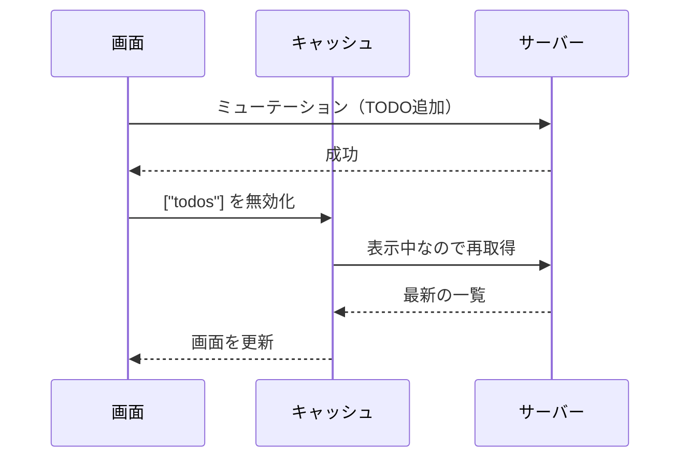

# ミューテーションとキャッシュの無効化

> **ひとことで言うと**：データを変更（ミューテーション）したら、関係するキャッシュに「もう古いよ」と印を付けて（無効化）取り直させる。これを忘れると、保存したのに画面が変わらない。

## たとえ話で理解する

家族で共有している冷蔵庫の「中身メモ」がドアに貼ってあるとします。

- 牛乳を飲み切った（＝ミューテーション）
- でもメモを直さないと、家族は「牛乳ある」と思ったまま（＝古いキャッシュ）
- 一番確実なのは、メモに **「要確認」と赤ペンで書く**（＝無効化）。次に見た人が冷蔵庫を開けて確かめ、書き直す（＝再取得）

メモを自分で正確に書き直す方法（キャッシュを直接更新）もありますが、書き間違えるリスクがあります。「要確認」にするのが一番シンプルで安全です。

## なぜ必要？（困りごと）

- TODO を追加したのに、一覧に出てこない（一覧のキャッシュが古いまま）
- 詳細画面で名前を変えたのに、一覧画面に戻ると古い名前
- 保存ボタンを連打して、同じデータが2件作られる
- 保存中かどうか分からず、ユーザーが何度もクリックする

素の fetch だと「保存したあと、どの画面のどのデータを取り直すか」を全部手で書く必要があり、画面が増えるほど漏れが出ます。

## 基本の仕組み

### 用語

- **ミューテーション**：サーバーのデータを変える操作（POST / PUT / PATCH / DELETE）。取得（クエリ）の反対
- **無効化（invalidate）**：キャッシュに「古い（stale）」と印を付けること。そのデータを表示中なら、すぐ裏で再取得される
- **クエリ**：データを読むだけの操作（GET）

### 流れ



### 変更後の3つの選択肢

| 方法 | 内容 | 向いている場面 |
|---|---|---|
| 無効化して再取得 | 「古い」印を付け、取り直す | 基本はこれ。確実 |
| レスポンスで直接更新 | サーバーが返した新データをキャッシュに書き込む | 返り値に更新後の全データが入っているとき |
| 楽観的更新 | サーバーの返事を待たずに先に画面を変える | いいね・チェックなど即反応が欲しいとき（→ [[05_楽観的更新]]） |

## コード例

### Before：素の fetch で「保存 → 一覧を取り直す」

```tsx
function TodoApp() {
  const [todos, setTodos] = useState<Todo[]>([]);
  const [saving, setSaving] = useState(false);

  const load = () => fetch("/api/todos").then((r) => r.json()).then(setTodos);
  useEffect(() => { load(); }, []);

  const add = async (title: string) => {
    setSaving(true);
    try {
      await fetch("/api/todos", { method: "POST", body: JSON.stringify({ title }) });
      await load(); // この画面の一覧は取り直せる
      // でもヘッダーの「残り件数」や別画面の一覧は？ → 自分で伝える手段が無い
    } finally {
      setSaving(false);
    }
  };
  return <TodoForm onSubmit={add} disabled={saving} />;
}
```

### After：ライブラリを使うと

```tsx
import { useMutation, useQueryClient } from "@tanstack/react-query";

function AddTodo() {
  const queryClient = useQueryClient();
  const mutation = useMutation({
    mutationFn: (title: string) =>
      fetch("/api/todos", {
        method: "POST",
        headers: { "Content-Type": "application/json" },
        body: JSON.stringify({ title }),
      }).then((r) => r.json()),
    onSuccess: () => {
      // ["todos"] で始まるキャッシュを全部「古い」にする
      queryClient.invalidateQueries({ queryKey: ["todos"] });
    },
  });

  return (
    <TodoForm
      onSubmit={(title) => mutation.mutate(title)}
      disabled={mutation.isPending} // 保存中は連打できない
    />
  );
}
```

- `["todos"]` を使っている画面は、どこにあっても自動で最新になる
- `["todos", "count"]` のようにキーを階層にしておくと、前方一致でまとめて無効化できる

SWR 2 では `useSWRMutation(key, fetcher)` の `trigger()` で変更し、終わると同じキーが自動で再検証されます。別のキーは `mutate("/api/todos/count")` で再検証します。詳しくは [[05_TanStack Query]] / [[06_SWR]]。

💡 キーの設計（`["todos"]`、`["todos", id]`、`["todos", { filter }]`）を最初に決めておくと、無効化の範囲を1行で指定できます。

## よくある失敗

- ❌ 保存後に何もせず「画面が更新されない」と悩む → ⭕ 成功時に関係するキーを無効化する
- ❌ 無効化の範囲が狭すぎる（詳細だけ直して一覧を忘れる）→ ⭕ 階層キーにして親キーで無効化する
- ❌ 何でも `invalidateQueries()`（引数なし）で全キャッシュを無効化する → ⭕ 関係するキーだけに絞る。全部だと通信が爆発する
- ❌ 保存中にボタンを押せるままにする → ⭕ `isPending` 中は無効化（disabled）して二重送信を防ぐ
- ❌ エラー時に何も表示しない → ⭕ `mutation.isError` / `mutation.error` でメッセージを出す（[[04_送信フローの状態]]）

## まとめ

- ミューテーション＝サーバーのデータを変える操作。変えたらキャッシュは古くなる
- 基本は「成功したら関係するキーを無効化 → 自動で再取得」
- キーを階層で設計すると、無効化の範囲を簡単に指定できる

## 関連ノート

- [[02_キャッシュと再取得]] — 無効化されたキャッシュがどう取り直されるか
- [[05_楽観的更新]] — 返事を待たずに画面を変える方法
- [[06_ページングと無限スクロール]] — ページ付きデータの無効化
- [[04_送信フローの状態]] — 送信中・成功・失敗の表示
- [[04_リアルタイム同期]] — 他人の変更を受け取って無効化する
- [[05_TanStack Query]] — `useMutation` / `invalidateQueries`
- [[06_SWR]] — `useSWRMutation` / `mutate`
- 上位: [[MOC_状態管理体系]]
