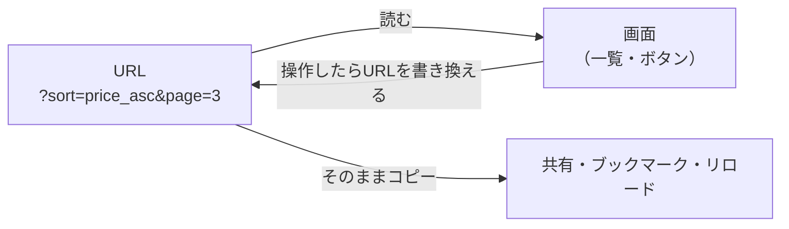

# URL状態とは

> **ひとことで言うと**：画面の状態のうち「URLに書いておく」ものを URL状態と呼ぶ。URLをコピーして渡せば、相手も同じ画面を開けるのが最大の特徴。

## たとえ話で理解する

図書館で本を探す場面を思い浮かべてください。

- **ローカル状態（useState）**：頭の中で「3階の、歴史の棚の、上から2段目」と覚えている状態。自分にしか分からず、忘れたら（ページを再読み込みしたら）消える。
- **URL状態**：その場所を**メモ用紙に書いた**状態。メモを友達に渡せば、友達も同じ棚にたどり着ける。

URLは、画面の場所と条件を書いた「共有できるメモ用紙」です。

## なぜ必要？（困りごと）

ネットショップの商品一覧で、「カテゴリ：靴」「価格の安い順」「3ページ目」にしたとします。これを `useState` だけで持っていると……

- ページを**再読み込み（リロード）**すると、条件が全部リセットされて1ページ目に戻る
- 商品詳細を開いて**ブラウザの戻るボタン**を押すと、条件が消えている
- 友達に「この一覧見て」と**URLを送っても**、相手には条件なしの一覧が表示される
- **ブックマーク**しても、条件は保存されない

URL に `?category=shoes&sort=price_asc&page=3` のように書いておけば、これらがすべて解決します。

## 基本の仕組み

### URLの各部分

```
https://shop.example.com/products?category=shoes&sort=price_asc#reviews
└─────────┬────────────┘└───┬───┘└──────────────┬───────────────┘└──┬──┘
       オリジン          パス        クエリ文字列（検索パラメータ）   ハッシュ
```

| 部分 | 例 | 主な用途 |
|---|---|---|
| パス（path） | `/products/42` | 「どのページ・どのデータか」を表す |
| クエリ文字列（query string） | `?sort=price_asc` | 絞り込み・並び替え・ページ番号など「見え方の条件」 |
| ハッシュ（hash） | `#reviews` | ページ内の位置。サーバーには送られない |

- **クエリ文字列**：`?` 以降の `キー=値` を `&` でつないだもの。**検索パラメータ（search params）** とも呼ぶ。
- 状態管理でいう「URL状態」は、主にパスとクエリ文字列のことです。

### URL状態は「単一の情報源」になれる



- 画面は URL を**読んで**表示を決める
- ユーザーの操作は、`useState` ではなく **URL を書き換える**
- URL が「本当の値」を持つので、[[04_派生状態と単一の情報源]] の考え方と同じく、値が二重管理にならない

### 他の状態との違い

| 種類 | 置き場所 | リロード後 | 共有できる？ |
|---|---|---|---|
| ローカル状態 | コンポーネントのメモリ | 消える | できない |
| グローバル状態 | アプリ全体のメモリ | 消える | できない |
| URL状態 | ブラウザのアドレスバー | **残る** | **できる** |
| 永続化した状態 | localStorage など | 残る | できない（その端末だけ） |

## コード例

### Before：useState だけで持つ

```tsx
import { useState } from "react";

export function ProductList() {
  // リロードや共有で消えてしまう
  const [sort, setSort] = useState("new");

  return (
    <select value={sort} onChange={(e) => setSort(e.target.value)}>
      <option value="new">新着順</option>
      <option value="price_asc">安い順</option>
    </select>
  );
}
```

### After：URL から読み、URL に書く

```tsx
import { useEffect, useState } from "react";

// 現在のURLから sort を読む（無ければ "new"）
function readSort() {
  return new URLSearchParams(window.location.search).get("sort") ?? "new";
}

export function ProductList() {
  const [sort, setSort] = useState(readSort);

  // 戻る・進むボタンでURLが変わったら読み直す
  useEffect(() => {
    const onPop = () => setSort(readSort());
    window.addEventListener("popstate", onPop);
    return () => window.removeEventListener("popstate", onPop);
  }, []);

  const change = (value: string) => {
    const params = new URLSearchParams(window.location.search);
    params.set("sort", value);
    window.history.pushState(null, "", `?${params}`); // URLを書き換える
    setSort(value); // 画面にも反映
  };

  return (
    <select value={sort} onChange={(e) => change(e.target.value)}>
      <option value="new">新着順</option>
      <option value="price_asc">安い順</option>
    </select>
  );
}
```

- `URLSearchParams`：クエリ文字列を読み書きするためのブラウザ標準の道具
- `history.pushState`：ページを再読み込みせずに URL だけ書き換える関数
- `popstate`：戻る・進むボタンで URL が変わったときに発生するイベント

詳しい読み書きの方法は [[02_検索パラメータの読み書き]] で扱います。

💡 実際のアプリではルーター（画面遷移を管理するライブラリ）が URL の読み書きを代わりにやってくれます。React Router なら `useSearchParams`、Next.js なら `useSearchParams` + `useRouter` です。

## よくある失敗

- ❌ 絞り込み条件を useState だけで持ち、「戻ったら条件が消えた」と言われる → ⭕ 共有・リロードで残したい条件は URL に置く
- ❌ URL と useState の両方に同じ値を持ち、片方だけ更新してズレる → ⭕ URL を正として、画面は URL から読む
- ❌ モーダルの開閉やホバー状態まで全部 URL に入れる → ⭕ 一時的な UI の状態はローカル状態で十分（[[04_URLに入れるもの入れないもの]]）
- ❌ URL の値を信じ切って、そのまま使う → ⭕ URL はユーザーが自由に書き換えられるので、不正な値にはデフォルト値を使う

## まとめ

- URL状態は、アドレスバーに書かれた「共有できる」画面の状態
- リロード・戻るボタン・共有・ブックマークで条件が残るのが強み
- 画面は URL を読み、操作は URL を書き換える、という一方向の流れで扱う

## 関連ノート

- [[02_検索パラメータの読み書き]] — URLSearchParams と history の使い方
- [[03_フィルタ・並び替え・ページネーション]] — URL状態の代表的な使いどころ
- [[04_URLに入れるもの入れないもの]] — 何を URL に置くかの判断基準
- [[01_状態とは何か]] — そもそも状態とは
- [[04_派生状態と単一の情報源]] — URL を「正」にする考え方
- [[01_状態の永続化]] — localStorage との違い
- 上位: [[MOC_状態管理体系]]
