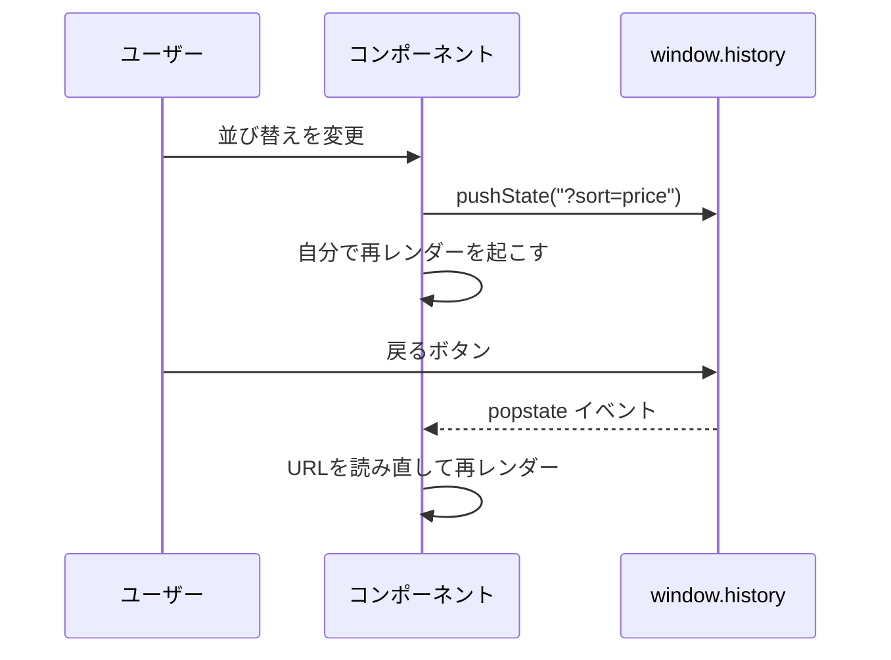

# 検索パラメータの読み書き

> **ひとことで言うと**：`URLSearchParams` で `?キー=値` を読み書きし、`history.pushState` / `replaceState` で URL を書き換え、`popstate` で戻る・進むを検知する。この3つが URL状態の基本セット。

## たとえ話で理解する

URLの検索パラメータは、ホワイトボードに貼った**付箋の束**です。

- `URLSearchParams`：付箋を読んだり、書き換えたり、はがしたりする**手**
- `pushState`：書き換えた後のホワイトボードを**写真に撮って履歴に残す**（戻るボタンで前の写真に戻れる）
- `replaceState`：写真は撮らず、**今の写真を上書き**する（履歴は増えない）
- `popstate`：誰かが「前の写真に戻して」と言ったときに鳴る**ベル**

## なぜ必要？（困りごと）

URL を文字列のまま自分で組み立てると、すぐに壊れます。

```ts
// ❌ 文字列の手作り：日本語や & が入ると壊れる
const url = "?q=" + keyword + "&page=" + page;
// keyword = "靴&バッグ" だと ?q=靴&バッグ&page=1 になり、q が "靴" だけになる
```

また、URL を書き換えても React は自動では再レンダーしません。「URLは変わったのに画面が古いまま」「戻るボタンを押しても画面が変わらない」というバグが起きがちです。

## 基本の仕組み

### URLSearchParams の主なメソッド

| メソッド | 役割 | 例 |
|---|---|---|
| `get(key)` | 値を1つ読む（無ければ `null`） | `params.get("page")` → `"2"` |
| `getAll(key)` | 同じキーの値を全部読む | `?tag=a&tag=b` → `["a","b"]` |
| `set(key, v)` | 値を上書き | `params.set("page", "3")` |
| `append(key, v)` | 値を追加 | `params.append("tag", "c")` |
| `delete(key)` | キーを消す | `params.delete("q")` |
| `has(key)` | キーがあるか | `params.has("q")` |
| `toString()` | `a=1&b=2` 形式の文字列に | 日本語などは自動でエンコード |

- **エンコード**：日本語や記号を URL で使える形（`%E9%9D%B4` など）に変換すること。URLSearchParams は自動でやってくれる。
- 値は**すべて文字列**。数値や真偽値は自分で変換する。

### pushState と replaceState の使い分け

| | pushState | replaceState |
|---|---|---|
| 履歴 | 1つ増える | 増えない（上書き） |
| 戻るボタン | 前の条件に戻る | 前のページに戻る |
| 向いている操作 | ページ切り替え、カテゴリ変更 | 検索欄の1文字ごとの入力、初期値の補正 |

### 読み書きの流れ



💡 `pushState` / `replaceState` を呼んでも `popstate` は**発生しません**。自分で書き換えたときは、自分で画面更新を起こす必要があります。

## コード例

### 読み方・書き方の基本

```ts
const params = new URLSearchParams(window.location.search);

const q = params.get("q") ?? "";                 // 文字列
const page = Number(params.get("page") ?? "1");  // 数値に変換
const tags = params.getAll("tag");               // 配列

params.set("page", String(page + 1));
params.delete("q");
window.history.pushState(null, "", `?${params.toString()}`);
```

### After：どこでも使える useSearchParam フック

`useSyncExternalStore`（React の外にある値を購読するための hook）を使うと、URL の変化に追従できます。

```tsx
import { useSyncExternalStore } from "react";

const listeners = new Set<() => void>();
const notify = () => listeners.forEach((l) => l());

function subscribe(cb: () => void) {
  listeners.add(cb);
  window.addEventListener("popstate", cb); // 戻る・進む
  return () => {
    listeners.delete(cb);
    window.removeEventListener("popstate", cb);
  };
}

export function useSearchParam(key: string) {
  // location.search は文字列なので、変化の検知が簡単
  const search = useSyncExternalStore(subscribe, () => window.location.search);
  const value = new URLSearchParams(search).get(key);

  const setValue = (next: string | null, replace = false) => {
    const params = new URLSearchParams(window.location.search);
    if (next === null || next === "") params.delete(key);
    else params.set(key, next);
    const qs = params.toString();
    const url = qs ? `?${qs}` : window.location.pathname;
    window.history[replace ? "replaceState" : "pushState"](null, "", url);
    notify(); // 自分で書き換えたので購読者に知らせる
  };

  return [value, setValue] as const;
}
```

```tsx
function SearchBox() {
  const [q, setQ] = useSearchParam("q");
  // 1文字ごとに履歴が増えないよう replace にする
  return <input value={q ?? ""} onChange={(e) => setQ(e.target.value, true)} />;
}
```

### ルーターを使うと

**React Router（v6.4 以降 / v7）**

```tsx
import { useSearchParams } from "react-router";  // v6 は "react-router-dom"

function SortSelect() {
  const [searchParams, setSearchParams] = useSearchParams();
  const sort = searchParams.get("sort") ?? "new";
  const change = (v: string) =>
    setSearchParams((prev) => { prev.set("sort", v); return prev; });
  return <select value={sort} onChange={(e) => change(e.target.value)}>{/* … */}</select>;
}
```

**Next.js App Router**

```tsx
"use client";
import { useSearchParams, useRouter, usePathname } from "next/navigation";

function SortSelect() {
  const searchParams = useSearchParams(); // 読み取り専用
  const router = useRouter();
  const pathname = usePathname();
  const change = (v: string) => {
    const params = new URLSearchParams(searchParams.toString()); // コピーして編集
    params.set("sort", v);
    router.push(`${pathname}?${params.toString()}`); // replace なら router.replace
  };
  return <select value={searchParams.get("sort") ?? "new"} onChange={(e) => change(e.target.value)}>{/* … */}</select>;
}
```

💡 Next.js の `useSearchParams()` の戻り値は読み取り専用なので、`new URLSearchParams(...)` でコピーしてから編集します。

## よくある失敗

- ❌ `"?q=" + keyword` と文字列で組み立てる → ⭕ `URLSearchParams` の `set` と `toString` を使う（エンコードも自動）
- ❌ `pushState` の後、画面が更新されない → ⭕ `pushState` は `popstate` を起こさないので、自分で通知・再レンダーする
- ❌ 検索欄の入力ごとに `pushState` して、戻るボタンが1文字ずつ戻る → ⭕ 入力中は `replaceState`、確定時だけ `pushState`
- ❌ `params.get("page")` を数値のつもりで計算する → ⭕ 値は常に文字列。`Number()` で変換し、`NaN` ならデフォルト値
- ❌ `set` で書き換えたら、他のパラメータが消えた → ⭕ 現在の `location.search` から `URLSearchParams` を作ってから編集する

## まとめ

- 読む：`new URLSearchParams(location.search).get(key)`、書く：`set` → `pushState` / `replaceState`
- 自分で書き換えたら自分で再レンダー、戻る・進むは `popstate` で検知する
- ルーターを使うなら `useSearchParams` が同じことをまとめてやってくれる

## 関連ノート

- [[01_URL状態とは]] — URL状態の考え方
- [[03_フィルタ・並び替え・ページネーション]] — 複数パラメータを組み合わせる実践
- [[04_URLに入れるもの入れないもの]] — URLに置く値の選び方
- [[04_セレクタと再レンダー対策]] — useSyncExternalStore の背景
- [[02_タブ間同期]] — 外部の変化を購読する別の例
- 上位: [[MOC_状態管理体系]]
