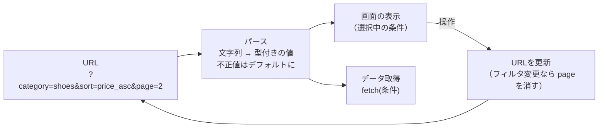

# フィルタ・並び替え・ページネーション

> **ひとことで言うと**：一覧画面の「絞り込み・並び順・ページ番号」は URL状態の代表例。URL → 型付きの値に変換（パース）→ データ取得、という一方向の流れで作ると壊れにくい。

## たとえ話で理解する

レストランの**注文票**をイメージしてください。

- 「パスタ／辛さ控えめ／大盛り」と注文票に書けば、厨房（データ取得）はそれを見て料理を作る
- 注文票に「辛さ：999」とあり得ない値が書かれていたら、店員が「普通」に直す（パースとデフォルト値）
- 料理の種類を変えたら、「おかわり何杯目」はリセットする（フィルタ変更でページを1に戻す）

URL が注文票、画面とデータ取得は注文票どおりに動く係です。

## なぜ必要？（困りごと）

- 3ページ目を見ている状態でカテゴリを変えたら、**新しい条件の3ページ目**（存在しないかも）が表示された
- `?page=abc` や `?sort=hack` のような**不正な URL** で画面がエラーになった
- 並び順を変えたのに、データの**再取得が走らない**／古い結果が一瞬表示される
- `useState` と URL の**両方**に条件を持って、どちらが正しいか分からなくなった

## 基本の仕組み



### 設計のポイント

| ポイント | 内容 |
|---|---|
| パースを1か所に | URL → `{ category, sort, page }` への変換関数を1つ作る |
| デフォルト値は URL から省く | `page=1` や `sort=new` は書かない。URL が短く、見た目も同じになる |
| 許可リストで検証 | `sort` は決められた値だけ受け付ける |
| フィルタ変更時はページをリセット | 条件が変われば結果の件数も変わるため |
| 取得の「鍵」は URL の条件 | 条件が同じなら同じデータ、という対応を作る |

- **パース（parse）**：文字列を読み取って、プログラムで扱いやすい形（数値・決められた選択肢など）に変換すること。

## コード例

### 1. URL を型付きの条件に変換する

```ts
const SORTS = ["new", "price_asc", "price_desc"] as const;
type Sort = (typeof SORTS)[number];

export type ListQuery = { category: string | null; sort: Sort; page: number };

export function parseQuery(search: string): ListQuery {
  const p = new URLSearchParams(search);
  const sortRaw = p.get("sort");
  const pageNum = Number(p.get("page"));
  return {
    category: p.get("category"),
    // 許可リストに無ければデフォルト
    sort: SORTS.includes(sortRaw as Sort) ? (sortRaw as Sort) : "new",
    // 1以上の整数でなければ 1
    page: Number.isInteger(pageNum) && pageNum >= 1 ? pageNum : 1,
  };
}
```

### 2. 条件を URL に書き戻す（デフォルト値は省く）

```ts
export function toSearch(q: ListQuery): string {
  const p = new URLSearchParams();
  if (q.category) p.set("category", q.category);
  if (q.sort !== "new") p.set("sort", q.sort);
  if (q.page !== 1) p.set("page", String(q.page));
  const s = p.toString();
  return s ? `?${s}` : "";
}
```

### 3. 一覧コンポーネント

[[02_検索パラメータの読み書き]] と同じ購読の仕組みで `location.search` を読みます。

```tsx
import { useEffect, useState, useSyncExternalStore } from "react";

const subscribe = (cb: () => void) => {
  window.addEventListener("popstate", cb);
  return () => window.removeEventListener("popstate", cb);
};

export function ProductList() {
  const search = useSyncExternalStore(subscribe, () => window.location.search);
  const query = parseQuery(search);
  const [items, setItems] = useState<{ id: number; name: string }[]>([]);

  const update = (patch: Partial<ListQuery>) => {
    // ページ以外が変わったら page を 1 に戻す
    const next = { ...query, page: 1, ...patch };
    window.history.pushState(null, "", window.location.pathname + toSearch(next));
    window.dispatchEvent(new PopStateEvent("popstate")); // 購読者に知らせる
  };

  useEffect(() => {
    let ignore = false; // 古いレスポンスで上書きしないため
    fetch(`/api/products${search}`)
      .then((r) => r.json())
      .then((data) => { if (!ignore) setItems(data); });
    return () => { ignore = true; };
  }, [search]);

  return (
    <div>
      <select value={query.sort} onChange={(e) => update({ sort: e.target.value as Sort })}>
        <option value="new">新着順</option>
        <option value="price_asc">安い順</option>
        <option value="price_desc">高い順</option>
      </select>
      <ul>{items.map((i) => <li key={i.id}>{i.name}</li>)}</ul>
      <button disabled={query.page <= 1} onClick={() => update({ page: query.page - 1 })}>前へ</button>
      <button onClick={() => update({ page: query.page + 1 })}>次へ</button>
    </div>
  );
}
```

- 条件は `useState` に**コピーしない**。毎回 URL からパースする（[[04_派生状態と単一の情報源]]）
- `ignore` フラグで、素早く条件を切り替えたときに古い結果が表示されるのを防ぐ
- 💡 `dispatchEvent(new PopStateEvent("popstate"))` は、自前の通知の代わりに使える簡易テクニック

### ライブラリを使うと

データ取得は TanStack Query を使うと、URL の条件をそのまま**キャッシュの鍵**にできます。

```tsx
const { data, isPending } = useQuery({
  queryKey: ["products", query],          // 条件が変わると自動で再取得
  queryFn: () => fetch(`/api/products${toSearch(query)}`).then((r) => r.json()),
  placeholderData: keepPreviousData,       // ページ切替中も前の結果を表示
});
```

詳しくは [[05_TanStack Query]]、[[06_ページングと無限スクロール]] を参照。ルーターを使う場合は `update` の中身を React Router の `setSearchParams` や Next.js の `router.push` に置き換えるだけです。

## よくある失敗

- ❌ カテゴリを変えてもページ番号がそのまま → ⭕ フィルタ・並び順の変更時は `page` を消して1ページ目へ
- ❌ `?page=-5` や `?sort=xxx` でクラッシュ → ⭕ パース関数で許可リスト・範囲チェックし、ダメならデフォルト値
- ❌ URL の値を `useState` にコピーして、戻るボタンで同期が崩れる → ⭕ 毎回 URL からパースする（コピーしない）
- ❌ `page=1&sort=new` など既定値まで全部 URL に書く → ⭕ 既定値は省略して URL を短く、同じ画面は同じ URL にする
- ❌ 条件を素早く切り替えると古い結果が後から表示される → ⭕ `ignore` フラグやデータ取得ライブラリで古いレスポンスを捨てる

## まとめ

- 一覧の条件は URL を正とし、パース関数で「型付き・安全な値」に変換して使う
- フィルタ変更でページをリセット、既定値は URL から省く
- データ取得は URL の条件を鍵にして、条件が変われば再取得する

## 関連ノート

- [[02_検索パラメータの読み書き]] — URL を読み書きする基本
- [[04_URLに入れるもの入れないもの]] — 何をパラメータにするか
- [[06_ページングと無限スクロール]] — ページングのサーバー状態側の話
- [[02_キャッシュと再取得]] — 条件ごとのキャッシュ
- [[05_TanStack Query]] — queryKey に条件を入れる
- 上位: [[MOC_状態管理体系]]
