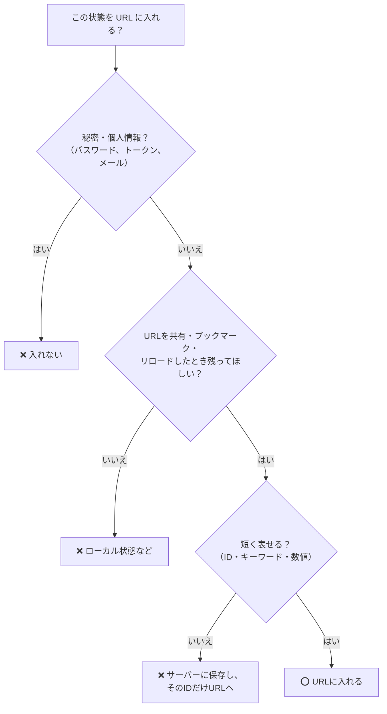

# URLに入れるもの入れないもの

> **ひとことで言うと**：「そのURLを他人に送ったとき、同じ画面が見えてほしいか？」で判断する。見えてほしい条件は URL へ、一時的な UI・秘密・大きなデータは URL に入れない。

## たとえ話で理解する

URL は**はがき**に似ています。

- はがきには「住所」と「どの部屋か」を書く（＝どのページ・どの条件か）
- 誰に読まれてもいい内容だけを書く（＝パスワードやトークンは書かない）
- 裏面に書ける量は限られている（＝大きなデータは入れない）
- 「今ペンを持っている」「消しゴムを探している」のような一瞬の様子は書かない（＝ホバー・入力途中の値）

## なぜ必要？（困りごと）

URL に入れる・入れないを間違えると、次のような問題が起きます。

**入れなさすぎ**
- 検索条件が共有できず、「このURL開いて、そのあと靴で絞って安い順にして……」と説明が必要になる
- 詳細を見て戻ると、一覧の条件が消えている

**入れすぎ**
- メールアドレスやトークンが URL に載り、**アクセスログ・閲覧履歴・共有先**に漏れる
- 入力中の文字まで URL に入れて、戻るボタンが使い物にならない
- 選択中の100件の ID を詰め込んで、URL が数千文字になる

## 基本の仕組み

### 判断フローチャート



### 早見表

| 状態 | URL？ | 理由・代わりの置き場所 |
|---|---|---|
| 表示中の記事・商品 ID | ⭕ パス | ページそのものを表す（`/products/42`） |
| 検索キーワード | ⭕ クエリ | 共有したい（`?q=靴`） |
| 絞り込み・並び順・ページ番号 | ⭕ クエリ | 共有・戻るで残したい |
| 表示中のタブ | ⭕ が多い | 「設定の通知タブ」を直接開きたいなら |
| 詳細モーダル（商品プレビュー） | △ | 直接リンクしたいなら URL、確認ダイアログならローカル |
| ホバー・フォーカス・アニメーション中 | ❌ | 一瞬の状態。ローカル状態 |
| 入力途中のフォームの値 | ❌ | [[01_フォーム状態とは]] で管理 |
| 複数選択中の行（チェックボックス） | ❌ が多い | ローカル状態。大量になりやすい |
| ログイン中のユーザー情報 | ❌ | サーバー状態・Cookie |
| パスワード・トークン・個人情報 | ❌ 絶対 | ログや履歴に残る |
| テーマ（ダーク／ライト） | ❌ | 個人の好み。localStorage（[[01_状態の永続化]]） |
| 取得したデータ本体 | ❌ | サーバー状態としてキャッシュ（[[01_サーバー状態とは]]） |

### パスとクエリの使い分け

| | パス（`/users/42`） | クエリ（`?tab=posts`） |
|---|---|---|
| 意味 | 「何を」見ているか | 「どう」見ているか |
| 省略 | できない（無いと別のページ） | できる（無ければデフォルト） |
| 例 | 商品 ID、カテゴリページ | 並び順、ページ番号、絞り込み |

## コード例

### Before：何でも URL に入れてしまう

```tsx
// ❌ ホバー中の行や入力途中の値まで URL に
function onHover(id: number) {
  const p = new URLSearchParams(location.search);
  p.set("hover", String(id));               // 一瞬の状態
  history.pushState(null, "", `?${p}`);      // 履歴が大量に増える
}

// ❌ 秘密の情報を URL に
location.href = `/reset?email=${email}&token=${token}`;
```

### After：URL とローカル状態を分ける

```tsx
import { useState } from "react";
import { useSearchParam } from "./useSearchParam"; // 02 で作ったフック

export function UserTable() {
  // 共有したい条件 → URL
  const [q, setQ] = useSearchParam("q");
  const [tab, setTab] = useSearchParam("tab");

  // 一時的な UI → ローカル状態
  const [hoverId, setHoverId] = useState<number | null>(null);
  const [selected, setSelected] = useState<Set<number>>(new Set());

  // …
  return null;
}
```

### 大きな状態は「保存して ID だけ URL に」

```ts
// 複雑な検索条件をサーバーに保存し、ID だけを共有する
const res = await fetch("/api/saved-searches", {
  method: "POST",
  body: JSON.stringify(complexFilter),
});
const { id } = await res.json();
history.pushState(null, "", `?search=${id}`); // ?search=abc123
```

💡 URL の長さはブラウザやサーバーによって上限があり、目安として**2,000文字程度**に収めるのが安全です。

### ルーターを使うと

React Router でも Next.js でも考え方は同じです。`useSearchParams` で扱うのは「共有したい条件」だけにし、それ以外は `useState` に置きます。

## よくある失敗

- ❌ パスワード再設定トークンやメールアドレスを通常のクエリに載せる → ⭕ 秘密は URL に置かない。どうしても必要な一回限りのリンクは短い有効期限にする
- ❌ 入力欄の1文字ごとに `pushState` → ⭕ 入力中はローカル状態、確定（Enter・検索ボタン）で URL に反映
- ❌ 配列やオブジェクトを `JSON.stringify` して URL に詰め込む → ⭕ 必要な値だけを短いキーで。大きいならサーバーに保存して ID を渡す
- ❌ テーマや言語設定などの「個人の好み」を URL に → ⭕ localStorage やユーザー設定に保存
- ❌ 「とりあえず全部ローカル状態」で戻るボタンが効かない → ⭕ 検索・絞り込み・ページ番号・タブは URL を検討する

## まとめ

- 判断基準は「URL を送った相手に同じ画面が見えてほしいか」
- 秘密・一時的な UI・大きなデータは URL に入れない
- 「何を見ているか」はパス、「どう見ているか」はクエリ

## 関連ノート

- [[01_URL状態とは]] — URL状態の基本
- [[03_フィルタ・並び替え・ページネーション]] — URL に入れる代表例
- [[03_状態は使う場所の近くに置く]] — ローカル状態に置く判断
- [[01_フォーム状態とは]] — 入力途中の値の置き場所
- [[01_状態の永続化]] — 好みの設定は localStorage へ
- [[01_サーバー状態とは]] — 取得データの置き場所
- 上位: [[MOC_状態管理体系]]
