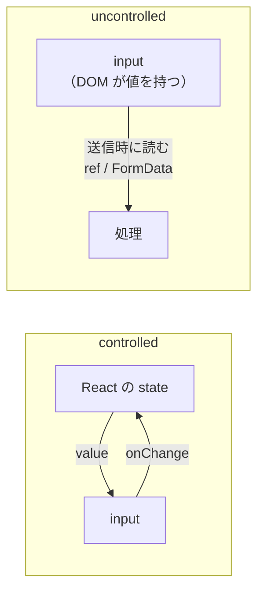

# controlled と uncontrolled

> **ひとことで言うと**：入力値を React の state が持つのが controlled（制御）、ブラウザの入力欄（DOM）自身が持つのが uncontrolled（非制御）。入力中に値を使うなら controlled、送信時に読めば十分なら uncontrolled が手軽。

## たとえ話で理解する

黒板に字を書く場面です。

- **controlled**：生徒が黒板に書くたびに、先生（React）がノートに書き写し、「ノートの内容」を黒板に書き直す。先生は常に全部を把握しているが、手間がかかる。
- **uncontrolled**：生徒は自由に黒板に書く。先生は授業の最後（送信時）に黒板を見て読み取る。手軽だが、途中の内容は見に行かないと分からない。

## なぜ必要？（困りごと）

この違いを知らないと、次のような混乱が起きます。

- `value` を指定したのに `onChange` を書かず、**入力欄に文字が打てない**
- 最初は `value={undefined}`、あとで文字列を入れて、コンソールに「**uncontrolled から controlled に変わった**」という警告が出る
- 20個の入力欄を全部 controlled にして、1文字ごとにフォーム全体が**再レンダー**されて重い
- uncontrolled で作ったのに、「入力中に文字数を表示したい」要件が来て困る

## 基本の仕組み



| | controlled | uncontrolled |
|---|---|---|
| 値の持ち主 | React の state | DOM（入力欄自身） |
| 書き方 | `value` + `onChange` | `defaultValue`（初期値のみ）+ `name` や `ref` |
| 値の読み方 | state をそのまま使う | `ref.current.value` や `FormData` |
| 入力中の即時処理（文字数表示・整形） | 得意 | 苦手 |
| 再レンダー | 1文字ごとに発生 | 発生しない |
| コード量 | 多め | 少なめ |

- **ref（参照）**：`useRef` で作る、DOM 要素に直接触れるための「取っ手」。
- **FormData**：`<form>` 内の入力値を `name` ごとにまとめて取り出せるブラウザ標準の仕組み。

### どちらを選ぶ？

- 入力中に値を使う（リアルタイム検証、文字数カウント、他の欄と連動、入力の自動整形） → **controlled**
- 送信時に値を読めれば十分（シンプルな問い合わせフォーム、検索フォーム） → **uncontrolled**
- `<input type="file">` はブラウザの制約で **常に uncontrolled**

## コード例

### controlled

```tsx
import { useState } from "react";

export function TweetBox() {
  const [text, setText] = useState(""); // 初期値は "" （undefined にしない）

  return (
    <div>
      <textarea value={text} onChange={(e) => setText(e.target.value)} />
      {/* 入力中の値をすぐ使える */}
      <p>{text.length} / 140</p>
      <button disabled={text.length === 0 || text.length > 140}>投稿</button>
    </div>
  );
}
```

### uncontrolled（FormData で読む）

```tsx
export function ContactForm() {
  const onSubmit = (e: React.FormEvent<HTMLFormElement>) => {
    e.preventDefault();
    const data = new FormData(e.currentTarget); // name ごとに値が取れる
    const email = String(data.get("email") ?? "");
    const message = String(data.get("message") ?? "");
    console.log({ email, message });
  };

  return (
    <form onSubmit={onSubmit}>
      <input name="email" type="email" defaultValue="" />
      <textarea name="message" defaultValue="" />
      <button>送信</button>
    </form>
  );
}
```

### uncontrolled（ref で読む）

```tsx
import { useRef } from "react";

export function SearchBox({ onSearch }: { onSearch: (q: string) => void }) {
  const inputRef = useRef<HTMLInputElement>(null);
  return (
    <form onSubmit={(e) => { e.preventDefault(); onSearch(inputRef.current?.value ?? ""); }}>
      <input ref={inputRef} defaultValue="" />
      <button>検索</button>
    </form>
  );
}
```

💡 React 19 では `<form action={関数}>` と書くと、送信時にその関数が `FormData` を受け取って呼ばれます。uncontrolled なフォームと相性の良い書き方です（[[04_送信フローの状態]]）。

### ライブラリを使うと

React Hook Form は、基本的に **uncontrolled**（`register` で ref を登録）で動くため、入力ごとの再レンダーが少ないのが特徴です。UI ライブラリの独自コンポーネントなど controlled でしか使えない部品には `Controller` を使います。詳しくは [[08_React Hook Form]]。

## よくある失敗

- ❌ `value` だけ指定して `onChange` が無く、文字が打てない → ⭕ `onChange` を付けるか、初期値だけなら `defaultValue` を使う
- ❌ `useState<string>()` で初期値が `undefined` になり警告が出る → ⭕ `useState("")` のように必ず文字列で初期化
- ❌ 1つの入力欄に `value` と `defaultValue` を両方書く → ⭕ どちらか一方だけ（controlled か uncontrolled かを決める）
- ❌ uncontrolled の入力欄を state で「リセット」しようとする → ⭕ `form.reset()` を呼ぶか、`key` を変えて作り直す
- ❌ 大きなフォームを全部 controlled にして重い → ⭕ 入力中に値が要らない欄は uncontrolled、またはフォームライブラリを使う

## まとめ

- controlled ＝ React が値を持つ（`value` + `onChange`）、uncontrolled ＝ DOM が値を持つ（`defaultValue` + ref / FormData）
- 入力中に値を使うなら controlled、送信時だけなら uncontrolled が手軽
- 1つの入力欄の中で、2つの方式を混ぜない

## 関連ノート

- [[01_フォーム状態とは]] — フォーム状態の全体像
- [[03_バリデーション]] — 入力中の検証には controlled が向く
- [[04_送信フローの状態]] — FormData と送信処理
- [[01_ローカル状態とは]] — useState の基本
- [[04_セレクタと再レンダー対策]] — 再レンダーを減らす考え方
- [[08_React Hook Form]] — uncontrolled ベースのフォームライブラリ
- 上位: [[MOC_状態管理体系]]
