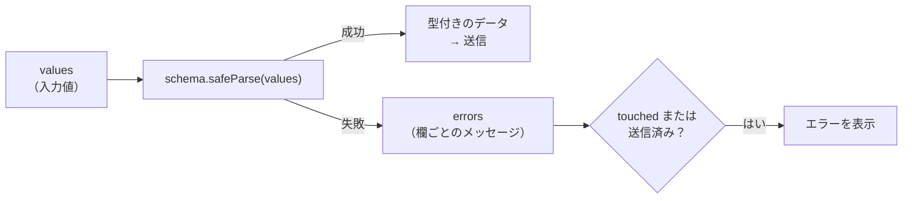

# バリデーション

> **ひとことで言うと**：バリデーション（入力チェック）は「ルールを1か所（スキーマ）に書き、値から errors を計算する」のが基本。いつ見せるか（タイミング）と、サーバー側でも必ずチェックすることが大切。

## たとえ話で理解する

空港の**保安検査**です。

- **ルール表（スキーマ）**：「液体は100mlまで」「刃物は不可」と1枚の表にまとまっている。係員ごとにルールが違ったら困る
- **検査のタイミング**：荷物を置いた瞬間に怒鳴るのではなく、ゲートを通るとき（blur・送信時）にチェックする
- **二重チェック**：手荷物検査を通っても、搭乗口（サーバー）でもう一度確認する。手前の検査はすり抜けられる可能性があるから

## なぜ必要？（困りごと）

- `if (!email.includes("@"))` のようなチェックが**あちこちに散らばり**、画面ごとにルールが違う
- 入力の1文字目から「形式が違います」と**赤字で怒られて**不快
- ブラウザ側でしかチェックしておらず、開発者ツールで回避されて**不正なデータが保存**される
- 検証済みのはずの値の**型が `string` のまま**で、数値として使えない

## 基本の仕組み

### 3つの観点

| 観点 | 内容 |
|---|---|
| 何を（ルール） | 必須、文字数、形式（メール・URL）、範囲、他の欄との関係 |
| いつ（タイミング） | 入力中（change）、フォーカスが外れた時（blur）、送信時（submit） |
| どこで（場所） | クライアント（使いやすさのため）＋ サーバー（安全のため、必須） |

### よく使われるタイミングの組み合わせ

```
最初の送信まで：blur で検証し、触った欄だけエラー表示
一度送信した後：change（入力ごと）で検証し、直したらすぐエラーが消える
```

エラーが出るのは遅めに、消えるのは早めに、が使いやすさのコツです。

### スキーマで書くと何が良い？

- **スキーマ**：データの形とルールを宣言的に書いた「設計図」
- ルールが1か所にまとまり、クライアントとサーバーで**同じスキーマを共有**できる
- 検証を通った値に**型が付く**（TypeScript の型をスキーマから自動生成できる）



## コード例

ここでは **Zod**（TypeScript 向けのスキーマ検証ライブラリ。React に依存しない）を使います。例は Zod v4 を想定しています。

### 1. スキーマを定義する

```ts
import { z } from "zod";

export const signupSchema = z
  .object({
    name: z.string().min(1, "名前は必須です").max(20, "20文字以内で入力してください"),
    email: z.email("メールアドレスの形式で入力してください"),
    age: z.coerce.number().int().min(18, "18歳以上が対象です"), // 文字列→数値に変換
    password: z.string().min(8, "8文字以上で入力してください"),
    confirm: z.string(),
  })
  // 複数の欄にまたがるルール
  .refine((d) => d.password === d.confirm, {
    message: "パスワードが一致しません",
    path: ["confirm"], // どの欄のエラーにするか
  });

// スキーマから型を自動生成
export type SignupData = z.infer<typeof signupSchema>;
```

- `z.coerce.number()`：入力欄の値（常に文字列）を数値に変換してからチェックする

### 2. errors を計算する関数

```ts
type Errors = Partial<Record<string, string>>;

export function getErrors(values: unknown): Errors {
  const result = signupSchema.safeParse(values); // 例外を投げずに結果を返す
  if (result.success) return {};
  const errors: Errors = {};
  for (const issue of result.error.issues) {
    const key = String(issue.path[0]);
    errors[key] ??= issue.message; // 欄ごとに最初のエラーだけ
  }
  return errors;
}
```

### 3. フォームで使う

```tsx
import { useState } from "react";

export function SignupForm() {
  const [values, setValues] = useState({ name: "", email: "", age: "", password: "", confirm: "" });
  const [touched, setTouched] = useState<Record<string, boolean>>({});
  const [submitted, setSubmitted] = useState(false);

  const errors = getErrors(values); // 値から毎回計算（派生状態）
  const show = (k: string) => (submitted || touched[k]) && errors[k];

  const onSubmit = (e: React.FormEvent) => {
    e.preventDefault();
    setSubmitted(true);
    const result = signupSchema.safeParse(values);
    if (!result.success) return;
    console.log(result.data.age + 1); // data は型付き（age は number）
  };

  return (
    <form onSubmit={onSubmit} noValidate>
      <input
        name="email" value={values.email}
        onChange={(e) => setValues({ ...values, email: e.target.value })}
        onBlur={() => setTouched({ ...touched, email: true })}
        aria-invalid={Boolean(show("email"))}
      />
      {show("email") && <p role="alert">{show("email")}</p>}
      {/* 他の欄も同様 */}
      <button>登録</button>
    </form>
  );
}
```

- `noValidate`：ブラウザ標準の検証吹き出しを止め、自前のエラー表示に統一する
- `aria-invalid` / `role="alert"`：画面読み上げソフトにもエラーを伝える

### 4. サーバーでも同じスキーマで検証

```ts
// サーバー側（API ルートなど）
export async function POST(req: Request) {
  const result = signupSchema.safeParse(await req.json());
  if (!result.success) {
    return Response.json({ issues: result.error.issues }, { status: 400 });
  }
  // result.data を保存……
}
```

「メールアドレスが既に使われている」のようにサーバーでしか分からないエラーもあります。サーバーから返ったエラーは送信フロー側で受け取り、欄に表示します（[[04_送信フローの状態]]）。

### ライブラリを使うと

React Hook Form では `zodResolver` でスキーマをそのまま渡せます。タイミングは `mode`（例：`"onBlur"`）で切り替えられます。

```tsx
import { useForm } from "react-hook-form";
import { zodResolver } from "@hookform/resolvers/zod";

const { register, handleSubmit, formState: { errors } } = useForm({
  resolver: zodResolver(signupSchema),
  mode: "onBlur",
});
```

詳しくは [[08_React Hook Form]]。

## よくある失敗

- ❌ 入力の1文字目からエラーを表示 → ⭕ blur 後または送信後に表示し、送信後は入力ごとに再検証して早く消す
- ❌ クライアントだけでチェックして安心する → ⭕ サーバーでも必ず検証する（同じスキーマを共有すると楽）
- ❌ ルールを画面ごとに if 文で書き散らす → ⭕ スキーマ1か所にまとめ、型も `z.infer` で生成
- ❌ errors を useState に入れて、値を直してもエラーが残る → ⭕ errors は values から計算する
- ❌ 「パスワード確認」のエラーがフォーム全体に出てどこか分からない → ⭕ `refine` の `path` で欄を指定する

## まとめ

- ルールはスキーマに1か所で書き、`safeParse` で errors と型付きデータを得る
- エラーは「遅めに出して、早めに消す」タイミングで表示する
- クライアントの検証は使いやすさのため、安全のためにはサーバーでも検証する

## 関連ノート

- [[01_フォーム状態とは]] — touched・errors の位置づけ
- [[02_controlledとuncontrolled]] — 入力中の検証には controlled
- [[04_送信フローの状態]] — サーバーエラーの受け取り方
- [[04_派生状態と単一の情報源]] — errors を計算で出す理由
- [[02_ウィザード（多段階フォーム）]] — ステップごとの検証
- [[08_React Hook Form]] — zodResolver での連携
- 上位: [[MOC_状態管理体系]]
