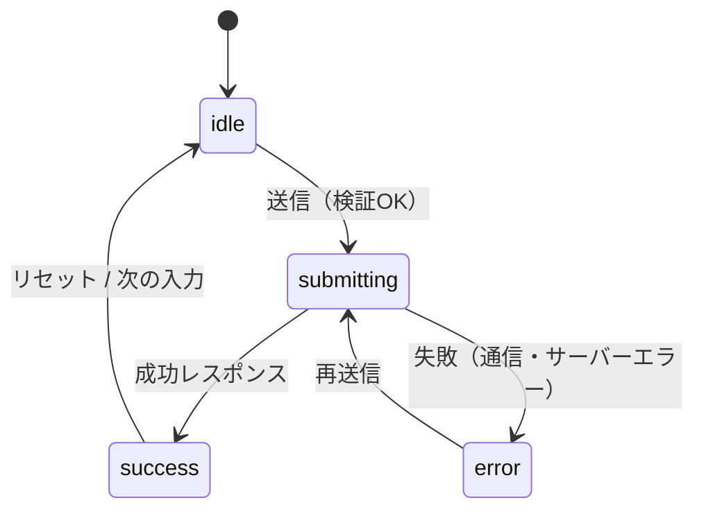

# 送信フローの状態

> **ひとことで言うと**：フォーム送信は「待機 → 送信中 → 成功 / 失敗」と段階が進むフロー。段階を1つの status で表し、二重送信の防止・エラー表示・成功後の後片付けを段階ごとに決める。

## たとえ話で理解する

**郵便局で書留を出す**場面です。

1. **待機（idle）**：窓口の前。まだ出していない
2. **送信中（submitting）**：窓口に渡して手続き中。この間にもう一通同じものを出したら二重になる
3. **成功（success）**：控えを受け取った。次の人に窓口を譲る（フォームをリセット・画面移動）
4. **失敗（error）**：「宛先の書き方が違います」と戻された。**書いた内容は捨てずに**直してもう一度出す

## なぜ必要？（困りごと）

- 送信ボタンを連打して**注文が2件**入った
- 通信エラーが起きても**何も表示されず**、ユーザーは成功したと思い込む
- エラーになったら**入力内容が消えて**、全部書き直し
- `isLoading`・`isError`・`isSuccess` を別々の boolean で持ち、「送信中なのに成功」のような**あり得ない組み合わせ**が起きる
- 「このメールアドレスは登録済みです」のような**サーバーからのエラー**をどの欄に出すか決めていない

## 基本の仕組み

### 状態遷移図



- **状態遷移**：ある状態から別の状態へ移ること。このように「決まった段階を決まった矢印でだけ移る」考え方を**ステートマシン**と呼ぶ（[[01_ステートマシンとは]]）。

### 段階ごとにやること

| status | ボタン | 表示 | 入力値 |
|---|---|---|---|
| idle | 押せる | — | 編集可 |
| submitting | **押せない**（「送信中…」） | スピナーなど | 編集不可にすることが多い |
| success | — | 完了メッセージ／画面移動 | リセットする |
| error | 押せる（再送信） | エラーメッセージ | **そのまま残す** |

### エラーの種類

| 種類 | 例 | 表示場所 |
|---|---|---|
| 欄ごとのエラー | 「このメールアドレスは登録済みです」 | その入力欄の下 |
| フォーム全体のエラー | 「通信に失敗しました」「権限がありません」 | フォームの上部やボタン付近 |

## コード例

### Before：boolean を並べる

```tsx
const [isLoading, setIsLoading] = useState(false);
const [isError, setIsError] = useState(false);
const [isSuccess, setIsSuccess] = useState(false);
// setIsError(true) の後に setIsLoading(false) を忘れると「送信中かつ失敗」に
```

### After：status を1つにまとめる

```tsx
import { useState } from "react";

type SubmitState =
  | { status: "idle" }
  | { status: "submitting" }
  | { status: "success" }
  | { status: "error"; message: string; fieldErrors?: Record<string, string> };

export function useSubmit<T>(send: (data: T) => Promise<Response>) {
  const [state, setState] = useState<SubmitState>({ status: "idle" });

  const submit = async (data: T) => {
    if (state.status === "submitting") return; // 二重送信ガード
    setState({ status: "submitting" });
    try {
      const res = await send(data);
      if (res.ok) return setState({ status: "success" });
      const body = await res.json().catch(() => ({}));
      setState({ status: "error", message: body.message ?? "送信に失敗しました", fieldErrors: body.fieldErrors });
    } catch {
      setState({ status: "error", message: "通信エラーです。時間をおいて再度お試しください" });
    }
  };

  return { state, submit, reset: () => setState({ status: "idle" }) };
}
```

- 「送信中かつ失敗」のような矛盾した状態は、型の上で**作れない**
- `fieldErrors` はサーバーが返す欄ごとのエラー（例：`{ email: "登録済みです" }`）

### フォームで使う

```tsx
export function SignupForm() {
  const [email, setEmail] = useState(""); // エラー時も消さない
  const { state, submit } = useSubmit((d: { email: string }) =>
    fetch("/api/signup", { method: "POST", body: JSON.stringify(d) }),
  );

  if (state.status === "success") return <p>登録が完了しました</p>;
  const submitting = state.status === "submitting";

  return (
    <form onSubmit={(e) => { e.preventDefault(); submit({ email }); }}>
      {state.status === "error" && <p role="alert">{state.message}</p>}
      <input value={email} disabled={submitting} onChange={(e) => setEmail(e.target.value)} />
      {state.status === "error" && state.fieldErrors?.email && <p>{state.fieldErrors.email}</p>}
      <button disabled={submitting}>{submitting ? "送信中…" : "登録"}</button>
    </form>
  );
}
```

💡 `disabled` だけでは Enter キー連打などをすり抜けることがあるため、`submit` 内のガードと併用します。さらに確実にするには、サーバー側で同じリクエストを2回処理しない仕組み（重複チェック）も用意します。

### React 19 の useActionState を使うと

React 19 では、送信の状態管理を React が手伝ってくれます。

```tsx
import { useActionState } from "react";

async function signup(prev: string | null, formData: FormData) {
  const res = await fetch("/api/signup", { method: "POST", body: formData });
  return res.ok ? null : "送信に失敗しました"; // 戻り値が次の state になる
}

export function SignupForm() {
  const [error, formAction, isPending] = useActionState(signup, null);
  return (
    <form action={formAction}>
      <input name="email" />
      {error && <p role="alert">{error}</p>}
      <button disabled={isPending}>{isPending ? "送信中…" : "登録"}</button>
    </form>
  );
}
```

### ライブラリを使うと

- React Hook Form：`formState.isSubmitting` と `setError("email", { message })` でサーバーエラーを欄に表示できる（[[08_React Hook Form]]）
- 送信後にサーバーのデータを更新するなら TanStack Query の `useMutation`（`isPending`・`isError` を持つ）が便利（[[04_ミューテーションとキャッシュの無効化]]、[[05_TanStack Query]]）

## よくある失敗

- ❌ 送信中もボタンが押せて二重送信 → ⭕ submitting 中は disabled ＋ 関数内でもガード
- ❌ isLoading / isError / isSuccess を別々の boolean で管理 → ⭕ status を1つの値（判別可能なユニオン型）にまとめる
- ❌ エラー時に入力内容をリセットしてしまう → ⭕ 失敗時は値を残し、成功時だけリセット
- ❌ `catch` を書かず、通信エラーで「送信中…」のまま固まる → ⭕ try / catch で必ず error に遷移させる
- ❌ サーバーの欄ごとエラーを全部フォーム上部にまとめて出す → ⭕ 欄に対応するエラーはその欄の下に表示する

## まとめ

- 送信は idle → submitting → success / error の流れ。status は1つの値で持つ
- 送信中は二重送信を防ぎ、失敗時は入力を残してエラーを見せる
- React 19 の useActionState やフォーム・データ取得ライブラリがこの管理を肩代わりしてくれる

## 関連ノート

- [[01_フォーム状態とは]] — フォーム状態の全体像
- [[03_バリデーション]] — 送信前のクライアント検証
- [[01_ステートマシンとは]] — 状態遷移の考え方
- [[04_ミューテーションとキャッシュの無効化]] — 送信後のサーバー状態の更新
- [[05_楽観的更新]] — 結果を待たずに画面を更新する方法
- [[08_React Hook Form]] — isSubmitting と setError
- 上位: [[MOC_状態管理体系]]
