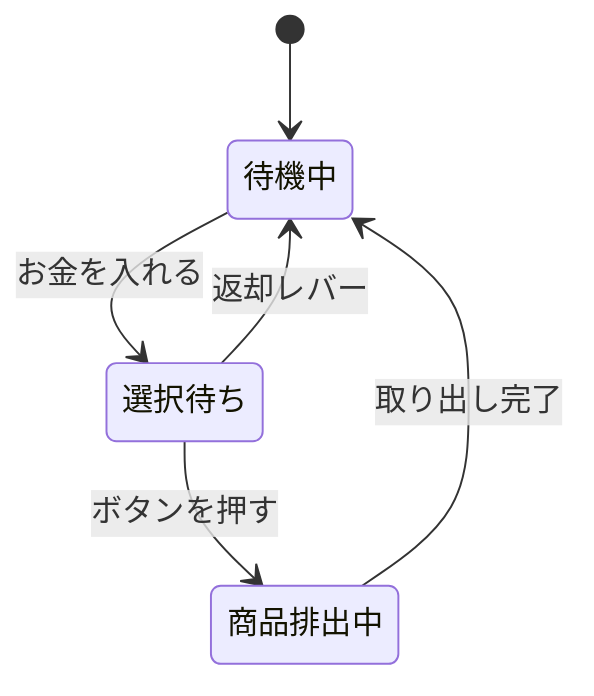
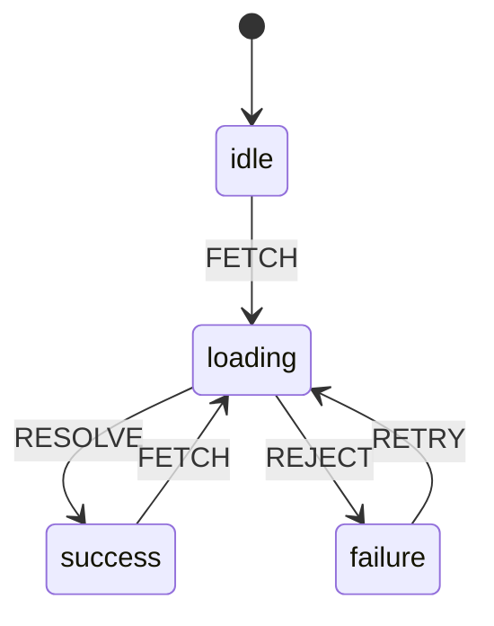

# ステートマシンとは

> **ひとことで言うと**：「今どの状態か」を1つだけ持ち、「その状態で受け付けるイベント」と「次に進む状態」をあらかじめ決めておく設計のこと。ありえない状態の組み合わせを最初から作れなくする。

## たとえ話で理解する

**信号機**を思い浮かべてください。

- 信号は「青」「黄」「赤」のどれか **1つ** だけ。青と赤が同時に点くことはない。
- 青の次は黄、黄の次は赤、赤の次は青。**順番が決まっている**。
- 青からいきなり赤には飛ばない。

**自動販売機**も同じです。

- 「待機中」のときにお金を入れると「選択待ち」になる。
- 「選択待ち」でボタンを押すと「商品を出している」になる。
- 「待機中」でボタンを押しても何も起きない（**その状態では受け付けないイベント**）。

このように「状態」「イベント（きっかけ）」「遷移（状態の移り変わり）」を決めた仕組みを **ステートマシン（状態機械、有限状態機械）** と呼びます。

## なぜ必要？（困りごと）

データ取得の画面を、真偽値（true / false）のフラグを並べて作ったとします。

```tsx
const [isLoading, setIsLoading] = useState(false);
const [isError, setIsError] = useState(false);
const [data, setData] = useState<string | null>(null);
```

フラグが3つあると組み合わせは 2×2×2 = 8 通り。そのうち意味があるのは「待機」「読み込み中」「成功」「失敗」の4つだけです。

- ❌ `isLoading` と `isError` が両方 `true` → 読み込み中なのに失敗？
- ❌ エラー後に再試行したとき `isError` を戻し忘れ → 成功したのにエラー表示が残る
- ❌ 読み込み中にもう一度ボタンを押せてしまい、二重リクエスト

このような **「ありえない状態（impossible state）」** がバグの温床になります。ステートマシンでは「状態は1つ」と決めるので、そもそもこの組み合わせが作れません。

## 基本の仕組み

ステートマシンは次の4つで表します。

| 要素 | 意味 | 信号機の例 |
| --- | --- | --- |
| 状態（state） | 今どこにいるか。常に1つ | 青・黄・赤 |
| イベント（event） | 外から来るきっかけ | タイマー |
| 遷移（transition） | 「この状態でこのイベントが来たらこの状態へ」 | 青 + タイマー → 黄 |
| 初期状態 | 最初の状態 | 赤 |

自動販売機の状態遷移図（どの状態からどの状態へ移れるかを矢印で描いた図）です。



データ取得画面も同じように描けます。



💡 図に矢印が **無い** 組み合わせ（例：`loading` 中の `FETCH`）は「無視する」と決めたことになります。これで二重リクエストも自然に防げます。

## コード例

### Before：フラグを並べる

```tsx
function Profile() {
  const [isLoading, setIsLoading] = useState(false);
  const [isError, setIsError] = useState(false);
  const [name, setName] = useState<string | null>(null);

  const load = async () => {
    setIsLoading(true); // isError を戻し忘れがち
    try {
      const res = await fetch("/api/me");
      setName((await res.json()).name);
    } catch {
      setIsError(true);
    } finally {
      setIsLoading(false);
    }
  };
  // 読み込み中でも load を何度でも呼べてしまう
  return <button onClick={load}>読み込む</button>;
}
```

### After：useReducer で「状態ごとに受け付けるイベント」を決める

`useReducer` は「今の状態」と「イベント（action）」を受け取って「次の状態」を返す関数（reducer）で状態を管理する React の hook です。

```tsx
type State =
  | { status: "idle" }
  | { status: "loading" }
  | { status: "success"; name: string }
  | { status: "failure"; message: string };

type Event =
  | { type: "FETCH" }
  | { type: "RESOLVE"; name: string }
  | { type: "REJECT"; message: string }
  | { type: "RETRY" };

function reducer(state: State, event: Event): State {
  switch (state.status) {
    case "idle":
    case "success":
      // 待機中・成功後は FETCH だけ受け付ける
      return event.type === "FETCH" ? { status: "loading" } : state;
    case "loading":
      // 読み込み中は結果だけ受け付ける（FETCH は無視）
      if (event.type === "RESOLVE") return { status: "success", name: event.name };
      if (event.type === "REJECT") return { status: "failure", message: event.message };
      return state;
    case "failure":
      return event.type === "RETRY" ? { status: "loading" } : state;
  }
}
```

ポイントは **外側の switch が「状態」、内側が「イベント」** になっていること。遷移図の矢印がそのままコードになります。

```tsx
function Profile() {
  const [state, send] = useReducer(reducer, { status: "idle" });

  // 「loading に入ったら取得する」を副作用として書く
  useEffect(() => {
    if (state.status !== "loading") return;
    fetch("/api/me")
      .then((res) => res.json())
      .then((d) => send({ type: "RESOLVE", name: d.name }))
      .catch(() => send({ type: "REJECT", message: "取得に失敗しました" }));
  }, [state.status]);

  switch (state.status) {
    case "idle":
      return <button onClick={() => send({ type: "FETCH" })}>読み込む</button>;
    case "loading":
      return <p>読み込み中…</p>;
    case "success":
      return <p>こんにちは、{state.name} さん</p>;
    case "failure":
      return <button onClick={() => send({ type: "RETRY" })}>再試行</button>;
  }
}
```

- `status` が1つなので「読み込み中かつ失敗」は型の上で作れない。
- `name` は `success` のときにしか存在しないので、未取得のまま表示する事故も防げる。

### ライブラリを使うと

状態が増えたり、「入ったら実行」「一定時間後に遷移」「入れ子の状態」などが必要になったら **XState** が便利です。`setup()` と `createMachine` でマシンを定義し、`@xstate/react` の `useMachine` で使います。詳しくは [[07_XState]] へ。

## よくある失敗

- ❌ 真偽値フラグを増やし続ける → ⭕ `status: "idle" | "loading" | ...` のように状態を1つの値にまとめる
- ❌ reducer がイベントだけで switch していて、どの状態でも同じ処理をする → ⭕ まず「今の状態」で分け、その状態で受け付けるイベントだけ処理する
- ❌ 受け付けないイベントで例外を投げる → ⭕ 基本は `return state`（無視）でよい。「押せない」ことはボタンの非表示・無効化で伝える
- ❌ 図を描かずにいきなりコードを書く → ⭕ まず mermaid などで遷移図を描き、矢印の数だけ case を書く
- ❌ reducer の中で fetch する → ⭕ reducer は計算だけ（純粋関数）。通信は `useEffect` やイベントハンドラで行う

## まとめ

- ステートマシンは「状態は常に1つ」「状態ごとに受け付けるイベントと遷移先を決める」設計。
- フラグの組み合わせで生まれる「ありえない状態」をなくせる。
- 素の `useReducer` で書けるが、複雑になったら XState を検討する。

## 関連ノート

- [[04_複雑なローカル状態をreducerで整理する]] — useReducer の基本
- [[03_ローディング・エラー・空状態]] — 取得状態の表し方
- [[04_送信フローの状態]] — 送信の idle / submitting / success / error
- [[02_ウィザード（多段階フォーム）]] — ステップ遷移への応用
- [[03_Undo・Redo]] — 履歴を持つ reducer
- [[07_XState]] — ステートマシン専用ライブラリ
- 上位: [[MOC_状態管理体系]]
