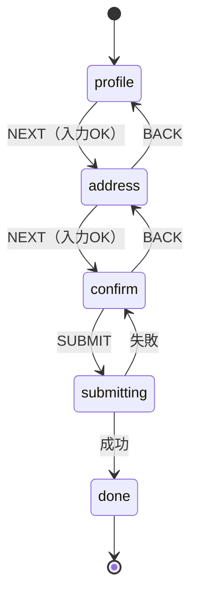

# ウィザード（多段階フォーム）

> **ひとことで言うと**：入力を「ステップ」に分けて1画面ずつ進めるフォーム。「今どのステップか」と「全ステップ分の入力データ」を分けて持ち、ステップの移動はステートマシンとして決めておく。

## たとえ話で理解する

**役所の窓口めぐり**を想像してください。

- 1番窓口で本人確認 → 2番窓口で書類記入 → 3番窓口で最終確認。
- 1番を済ませないと2番に行けない（**順番がある**）。
- 2番で「やっぱり住所を直したい」と1番に戻っても、書いた書類は **手元のクリアファイルに残っている**。

ウィザードの「今いる窓口」が **現在のステップ**、「クリアファイル」が **入力データ全体** です。

## なぜ必要？（困りごと）

1つの長いフォームを画面ごとに分けただけだと、こんな問題が起きます。

- ❌ ステップごとのコンポーネントが自分の `useState` で値を持っていて、「戻る」を押すと入力が消える
- ❌ ステップ1のバリデーション（入力チェック）が通っていないのにステップ3へ進めてしまう
- ❌ 「会員なら支払い画面をスキップ」のような分岐が `if` の山になり、どこから来たか分からない
- ❌ 送信中に「戻る」を押せて、中途半端なデータが送られる

## 基本の仕組み

状態を2つに分けて考えます。

| 持つもの | 例 | 置き場所 |
| --- | --- | --- |
| 現在のステップ | `"profile"` / `"address"` / `"confirm"` / `"done"` | 親（ウィザード全体） |
| 入力データ全体 | `{ name, email, zip, city }` | 親（ウィザード全体） |
| 各ステップの一時的なUI状態 | 入力欄のフォーカスなど | 各ステップ |

💡 データは各ステップではなく **親に持ち上げる**（[[02_状態の持ち上げ]]）ことで、戻っても消えません。

ステップの遷移図です。



- `submitting`（送信中）では BACK を受け付けない → 送信中に戻れない。
- 「入力OK」のような **条件付きの遷移** を「ガード（guard）」と呼びます。

## コード例

### reducer でステップとデータを管理する

```tsx
type Step = "profile" | "address" | "confirm" | "submitting" | "done";
type Data = { name: string; email: string; zip: string; city: string };
type State = { step: Step; data: Data; error?: string };

type Event =
  | { type: "CHANGE"; patch: Partial<Data> }
  | { type: "NEXT" }
  | { type: "BACK" }
  | { type: "SUBMIT" }
  | { type: "SUCCESS" }
  | { type: "FAILURE"; message: string };

// ステップごとの入力チェック（ガード）
const isValid = (step: Step, d: Data) =>
  step === "profile" ? d.name !== "" && d.email.includes("@")
  : step === "address" ? /^\d{7}$/.test(d.zip) && d.city !== ""
  : true;
```

```tsx
const next: Partial<Record<Step, Step>> = { profile: "address", address: "confirm" };
const back: Partial<Record<Step, Step>> = { address: "profile", confirm: "address" };

function reducer(state: State, e: Event): State {
  const { step, data } = state;
  if (step === "submitting") {
    // 送信中は結果だけ受け付ける
    if (e.type === "SUCCESS") return { ...state, step: "done" };
    if (e.type === "FAILURE") return { ...state, step: "confirm", error: e.message };
    return state;
  }
  if (step === "done") return state; // 完了後は何も受け付けない

  switch (e.type) {
    case "CHANGE":
      return { ...state, data: { ...data, ...e.patch } };
    case "NEXT":
      return next[step] && isValid(step, data) ? { ...state, step: next[step]! } : state;
    case "BACK":
      return back[step] ? { ...state, step: back[step]!, error: undefined } : state;
    case "SUBMIT":
      return step === "confirm" ? { ...state, step: "submitting" } : state;
    default:
      return state;
  }
}
```

### 親コンポーネントでステップを切り替える

```tsx
const initial: State = {
  step: "profile",
  data: { name: "", email: "", zip: "", city: "" },
};

function SignupWizard() {
  const [state, send] = useReducer(reducer, initial);
  const { step, data } = state;
  const change = (patch: Partial<Data>) => send({ type: "CHANGE", patch });

  useEffect(() => {
    if (step !== "submitting") return;
    fetch("/api/signup", { method: "POST", body: JSON.stringify(data) })
      .then((r) => send(r.ok ? { type: "SUCCESS" } : { type: "FAILURE", message: "送信に失敗しました" }))
      .catch(() => send({ type: "FAILURE", message: "通信エラーです" }));
  }, [step]); // data は送信直前の値を使う

  if (step === "done") return <p>登録が完了しました</p>;
  return (
    <div>
      {step === "profile" && <ProfileStep data={data} onChange={change} />}
      {step === "address" && <AddressStep data={data} onChange={change} />}
      {(step === "confirm" || step === "submitting") && <Confirm data={data} />}
      {state.error && <p role="alert">{state.error}</p>}
      <button onClick={() => send({ type: "BACK" })} disabled={step === "profile" || step === "submitting"}>戻る</button>
      {step === "confirm" || step === "submitting"
        ? <button onClick={() => send({ type: "SUBMIT" })} disabled={step === "submitting"}>送信</button>
        : <button onClick={() => send({ type: "NEXT" })} disabled={!isValid(step, data)}>次へ</button>}
    </div>
  );
}
```

各ステップ（`ProfileStep` など）は `data` と `onChange` を受け取るだけの **controlled コンポーネント**（値を親から受け取り、変更を親に知らせる部品。[[02_controlledとuncontrolled]]）にします。

### 分岐を足すとき

「会員は住所入力をスキップ」なら、`next` を関数にして状態から決めます。

```tsx
const nextStep = (step: Step, d: Data & { isMember?: boolean }): Step | undefined =>
  step === "profile" ? (d.isMember ? "confirm" : "address")
  : step === "address" ? "confirm"
  : undefined;
```

💡 BACK も同じように「どこから来たか」で決める必要があるので、分岐が増えたら XState（[[07_XState]]）で遷移図をそのままコードにするのがおすすめです。

### ステップをURLに入れるか

リロードしても同じステップに戻したいなら `?step=address` のようにURLに入れる方法もあります（[[04_URLに入れるもの入れないもの]]）。ただし入力データまでURLに入れるのは避け、必要なら [[01_状態の永続化]] で sessionStorage に下書き保存します。

### ライブラリを使うと

各ステップのバリデーションは React Hook Form + zod で書けます（`trigger()` で現在のステップの項目だけ検証してから NEXT する、など）。詳しくは [[08_React Hook Form]]。

## よくある失敗

- ❌ 各ステップが自分で入力値を持つ → ⭕ 入力データはウィザードの親に持ち上げる
- ❌ `step` を数値にして `step + 1` で進める → ⭕ 名前付きのステップと遷移表で「どこへ進めるか」を明示する（分岐に強い）
- ❌ 「次へ」ボタンの `disabled` だけで入力チェックする → ⭕ reducer 側でもガードする（キー操作などで抜けても進めない）
- ❌ 送信中に戻る・再送信できる → ⭕ `submitting` 状態では BACK / SUBMIT を無視する
- ❌ 送信成功後もデータが残って、戻ると再送信できる → ⭕ `done` を終了状態にし、何も受け付けない

## まとめ

- ウィザードは「現在のステップ」と「入力データ全体」を親で持つ。
- ステップ移動は遷移図を描き、reducer で「そのステップで受け付けるイベント」を決める。
- 分岐が増えたら XState、検証は React Hook Form を検討する。

## 関連ノート

- [[01_ステートマシンとは]] — 状態遷移の考え方
- [[02_状態の持ち上げ]] — 入力データを親に置く理由
- [[03_バリデーション]] — ステップごとの入力チェック
- [[04_送信フローの状態]] — 送信中・成功・失敗の扱い
- [[01_状態の永続化]] — 下書きの保存
- [[07_XState]] / [[08_React Hook Form]] — ライブラリで書く場合
- 上位: [[MOC_状態管理体系]]
