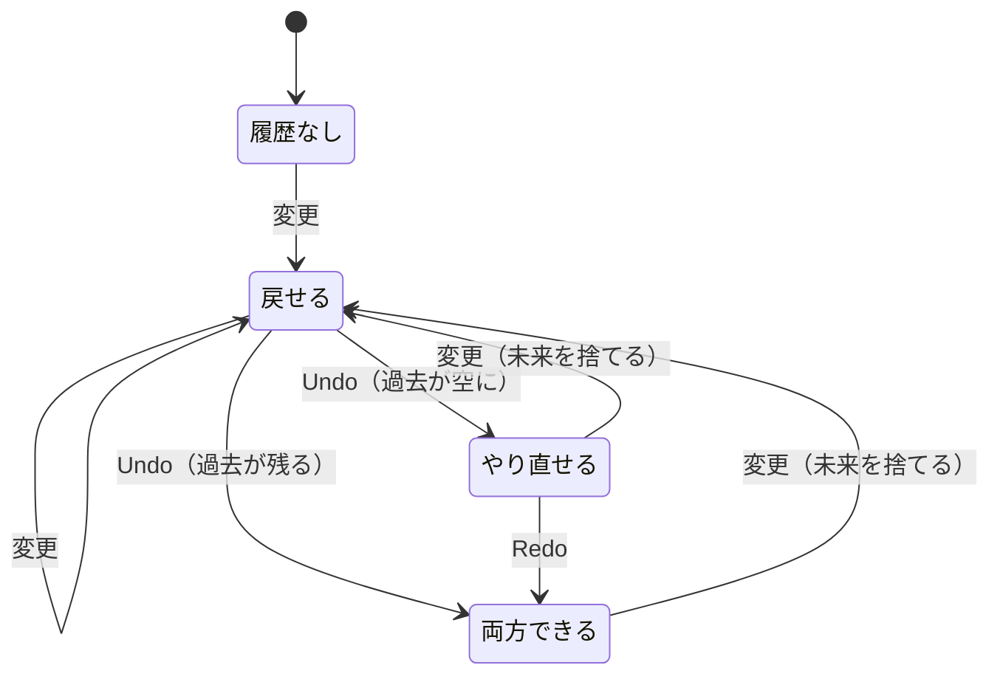

# Undo・Redo

> **ひとことで言うと**：状態を「過去（past）・現在（present）・未来（future）」の3つに分けて持ち、元に戻す（Undo）・やり直す（Redo）で現在を過去や未来と入れ替える仕組み。イミュータブルな更新をしていれば、状態のスナップショットを並べるだけで作れる。

## たとえ話で理解する

**ノートの切り取り線付きメモ帳**を想像してください。

- 書き直すたびに新しいページに清書し、古いページは左の山（過去）に積む。
- Undo：今のページを右の山（未来）に置き、左の山の一番上を取って戻る。
- Redo：右の山の一番上を取って戻る。
- 過去のページに戻ってから **新しく書き直すと、右の山は捨てる**（別の未来になったから）。

## なぜ必要？（困りごと）

お絵かきアプリやテキストエディタ、表の編集画面などで Undo が無いと、ユーザーは1回の操作ミスでやり直しがききません。

素朴に作ろうとすると次のような問題が起きます。

- ❌ 「直前の値」を1つだけ変数に保存 → 1回しか戻れない
- ❌ 配列を `push` で直接書き換えている → 保存したはずの過去も一緒に変わってしまう
- ❌ 戻った後に新しく操作したとき、未来の履歴が残って Redo で変な状態になる

## 基本の仕組み

```text
past:    [ S1, S2, S3 ]   ← 過去のスナップショット（古い順）
present:   S4             ← 画面に出ている今の状態
future:  [ S5, S6 ]       ← Undo で退避した状態（次に Redo するものが先頭）
```

| 操作 | past | present | future |
| --- | --- | --- | --- |
| 通常の変更（S4 → S7） | S4 を末尾に追加 | S7 | **空にする** |
| Undo | 末尾を取り出す | 取り出した値 | 元の present を先頭に追加 |
| Redo | present を末尾に追加 | future の先頭 | 先頭を取り出す |



💡 この仕組みが成り立つのは、状態を **イミュータブル**（元のオブジェクトを書き換えず、新しいオブジェクトを作る）に更新しているからです（[[03_イミュータブルな更新]]）。過去のスナップショットは誰にも書き換えられないので、安心して取っておけます。

## コード例

### 汎用の履歴 reducer

どんな状態にも使えるよう、ジェネリクス（型を後から差し込める書き方）で作ります。

```tsx
type History<T> = { past: T[]; present: T; future: T[] };

type HistoryAction<T> =
  | { type: "SET"; value: T }
  | { type: "UNDO" }
  | { type: "REDO" }
  | { type: "RESET"; value: T };

const LIMIT = 50; // 履歴の上限（メモリ対策）

function historyReducer<T>(h: History<T>, a: HistoryAction<T>): History<T> {
  switch (a.type) {
    case "SET":
      if (Object.is(a.value, h.present)) return h; // 変化なしは記録しない
      return { past: [...h.past, h.present].slice(-LIMIT), present: a.value, future: [] };
    case "UNDO": {
      if (h.past.length === 0) return h; // 戻れないときは無視
      const prev = h.past[h.past.length - 1];
      return { past: h.past.slice(0, -1), present: prev, future: [h.present, ...h.future] };
    }
    case "REDO": {
      if (h.future.length === 0) return h;
      const [next, ...rest] = h.future;
      return { past: [...h.past, h.present], present: next, future: rest };
    }
    case "RESET":
      return { past: [], present: a.value, future: [] };
  }
}
```

### カスタムフックにする

```tsx
function useHistory<T>(initial: T) {
  const [h, dispatch] = useReducer(historyReducer<T>, {
    past: [], present: initial, future: [],
  });
  return {
    value: h.present,
    set: (value: T) => dispatch({ type: "SET", value }),
    undo: () => dispatch({ type: "UNDO" }),
    redo: () => dispatch({ type: "REDO" }),
    canUndo: h.past.length > 0,
    canRedo: h.future.length > 0,
  };
}
```

`canUndo` / `canRedo` は履歴から計算できる **派生状態**（他の状態から計算で求められる値）なので、別の `useState` にしません（[[04_派生状態と単一の情報源]]）。

### 使う側：TODO リスト

```tsx
function TodoEditor() {
  const { value: todos, set, undo, redo, canUndo, canRedo } = useHistory<string[]>([]);
  const [text, setText] = useState(""); // 入力中の文字は履歴に入れない

  useEffect(() => {
    // Ctrl/Cmd+Z で Undo、Shift も押すと Redo
    const onKey = (e: KeyboardEvent) => {
      if (!(e.metaKey || e.ctrlKey) || e.key.toLowerCase() !== "z") return;
      e.preventDefault();
      e.shiftKey ? redo() : undo();
    };
    window.addEventListener("keydown", onKey);
    return () => window.removeEventListener("keydown", onKey);
  }); // 毎回最新の undo/redo で登録し直す

  return (
    <div>
      <input value={text} onChange={(e) => setText(e.target.value)} />
      <button onClick={() => { set([...todos, text]); setText(""); }}>追加</button>
      <button onClick={undo} disabled={!canUndo}>元に戻す</button>
      <button onClick={redo} disabled={!canRedo}>やり直す</button>
      <ul>{todos.map((t, i) => <li key={i}>{t}</li>)}</ul>
    </div>
  );
}
```

💡 `set([...todos, text])` のように **新しい配列** を渡しているのがポイント。`todos.push(text)` だと過去のスナップショットまで変わってしまいます。

### 何を履歴に入れるか

- 入れる：ユーザーが「戻したい」と思う確定した変更（追加・削除・移動）
- 入れない：入力途中の文字、ホバー、モーダルの開閉、サーバーから取得したデータ
- 1文字ごとに記録すると Undo が細かすぎるので、入力は「確定時」や「少し止まったとき」にまとめて `set` する

### ライブラリを使うと

Zustand には履歴用のミドルウェア（zundo など）があり、Redux でも同じ past/present/future の形がよく使われます。考え方はこのノートと同じです（[[02_Zustand]] / [[01_Redux]]）。

## よくある失敗

- ❌ 配列やオブジェクトを直接書き換える → ⭕ 常に新しい値を作って `set` する
- ❌ 新しい変更のときに `future` を残す → ⭕ 通常の変更では `future` を空にする
- ❌ 履歴を無制限に溜める → ⭕ 上限（例：50件）を設けて古いものから捨てる
- ❌ 入力中の1文字ごと・UIの開閉まで履歴に入れる → ⭕ 「ユーザーが戻したい単位」だけを記録する
- ❌ サーバーに保存済みのデータを手元の Undo だけで戻す → ⭕ サーバー側も戻す処理（取り消しAPIなど）が必要。画面だけ戻すとずれる

## まとめ

- 状態を past / present / future の3つで持ち、Undo・Redo は入れ替えるだけ。
- 新しい変更をしたら future は捨てる。履歴には上限を設ける。
- イミュータブルな更新が前提。履歴に入れる「単位」を設計する。

## 関連ノート

- [[03_イミュータブルな更新]] — スナップショットを安全に取れる理由
- [[04_複雑なローカル状態をreducerで整理する]] — reducer の基本
- [[04_派生状態と単一の情報源]] — canUndo を計算で出す
- [[01_ステートマシンとは]] — 「できる操作」を状態で決める考え方
- [[02_Zustand]] / [[01_Redux]] — ライブラリでの履歴管理
- 上位: [[MOC_状態管理体系]]
