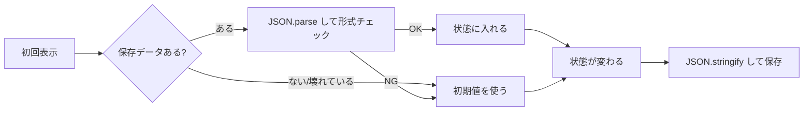

# 状態の永続化

> **ひとことで言うと**：React の状態はリロードで消えるので、残したいものだけをブラウザの保存領域（localStorage / sessionStorage / IndexedDB）に書き出し、次に開いたとき読み戻すこと。読み込み時は「値が無い・壊れている・古い形式」を前提に守りを固める。

## たとえ話で理解する

React の状態は **ホワイトボード**、ブラウザの保存領域は **引き出し** です。

- ホワイトボード（メモリ上の状態）は、部屋を出る（リロード・タブを閉じる）と消される。
- 残したいメモは引き出しにしまう。引き出しには種類がある。
  - **localStorage**：鍵のない自分の机の引き出し。ずっと残る。
  - **sessionStorage**：その日だけ使う一時ロッカー。帰る（タブを閉じる）と空になる。
  - **IndexedDB**：大きな書類棚。たくさん入り、整理して検索もできるが、出し入れに手間がかかる。
- どの引き出しも **鍵はかからない**。大事な書類（パスワード等）は入れない。

## なぜ必要？（困りごと）

- ❌ ダークモードを選んだのに、リロードすると毎回ライトに戻る
- ❌ 長い問い合わせフォームを書いている途中でタブを閉じ、全部消える
- ❌ 逆に、何でも保存した結果、古い形式のデータを読んでアプリが起動しなくなる
- ❌ サーバー描画（SSR）のフレームワークで `localStorage` を触って「window is not defined」エラー

## 基本の仕組み

### 3つの保存先の違い

| | localStorage | sessionStorage | IndexedDB |
| --- | --- | --- | --- |
| 残る期間 | 消すまでずっと | そのタブを閉じるまで | 消すまでずっと |
| 共有範囲 | 同じオリジン（※）の全タブ | そのタブだけ | 同じオリジンの全タブ |
| 容量の目安 | 約5MB | 約5MB | 数百MB以上（端末の空きによる） |
| 保存できる形 | 文字列のみ | 文字列のみ | オブジェクト・Blob なども可 |
| API | 同期（すぐ返る） | 同期 | 非同期（Promise 的に待つ） |
| 向いているもの | テーマ・言語・表示設定 | フォームの下書き・一時的な絞り込み | オフライン用データ・大量のキャッシュ |

※ オリジン：`https://example.com:443` のような「プロトコル + ドメイン + ポート」の組。これが違うと別の保存領域になります。

💡 容量はブラウザや端末によって変わります。あふれると `setItem` が例外（`QuotaExceededError`）を投げます。

### 保存と読み込みの流れ



### 何を保存するか

- ⭕ 保存してよい：テーマ、言語、表の列の並び、フォームの下書き（機密でないもの）
- ❌ 保存しない：パスワード、アクセストークン、クレジットカード番号、個人情報
  - JavaScript から誰でも読めるので、XSS（悪意あるスクリプトを埋め込まれる攻撃）で盗まれます。ログイン情報はサーバーが発行する `HttpOnly` Cookie（JavaScript から読めない Cookie）に任せるのが基本です。
- ❌ サーバーのデータのコピー：古くなりやすい。サーバー状態はキャッシュの仕組みに任せる（[[02_キャッシュと再取得]]）

## コード例

### Before：素朴に書く

```tsx
function ThemeToggle() {
  // SSR ではここで window が無くエラー、壊れた値だと parse で例外
  const [theme, setTheme] = useState(JSON.parse(localStorage.getItem("theme")!));
  localStorage.setItem("theme", JSON.stringify(theme)); // 描画のたびに書き込む
  return <button onClick={() => setTheme(theme === "dark" ? "light" : "dark")}>{theme}</button>;
}
```

### After：安全な読み書き関数を用意する

```tsx
// 読み込み：無い・壊れている・形式違いなら初期値
function load<T>(key: string, fallback: T, isValid: (v: unknown) => v is T): T {
  if (typeof window === "undefined") return fallback; // SSR 中は window が無い
  try {
    const raw = window.localStorage.getItem(key);
    if (raw === null) return fallback;
    const parsed: unknown = JSON.parse(raw);
    return isValid(parsed) ? parsed : fallback;
  } catch {
    return fallback; // JSON が壊れている / プライベートモードで使えない など
  }
}

// 書き込み：容量オーバーなどで失敗してもアプリは止めない
function save(key: string, value: unknown) {
  try {
    window.localStorage.setItem(key, JSON.stringify(value));
  } catch (e) {
    console.warn("保存に失敗しました", e);
  }
}
```

### After：usePersistentState フック

```tsx
type Theme = "light" | "dark";
const isTheme = (v: unknown): v is Theme => v === "light" || v === "dark";

function usePersistentState<T>(key: string, fallback: T, isValid: (v: unknown) => v is T) {
  // 関数を渡すと初回だけ実行される（毎回 localStorage を読まない）
  const [value, setValue] = useState<T>(() => load(key, fallback, isValid));

  useEffect(() => {
    save(key, value); // 値が変わったときだけ保存
  }, [key, value]);

  return [value, setValue] as const;
}

function ThemeToggle() {
  const [theme, setTheme] = usePersistentState<Theme>("app:theme:v1", "light", isTheme);
  return <button onClick={() => setTheme(theme === "dark" ? "light" : "dark")}>{theme}</button>;
}
```

- キーに `app:theme:v1` のように **アプリ名とバージョン** を入れておくと、形式を変えたときに `v2` に切り替えて古いデータを無視できます。
- `isValid` のような **型ガード**（値が期待した型か確かめる関数）で、保存データを信用しすぎないようにします。

### SSR（サーバー描画）での注意

Next.js などではコンポーネントがまずサーバーで実行されます。サーバーには `window` も `localStorage` もありません。

- 上の `load` はサーバーでは初期値を返すので、エラーにはなりません。
- ただし「サーバーの HTML は light、ブラウザで読んだら dark」と **初回の見た目がずれる**（ハイドレーションエラー：サーバーの HTML とブラウザでの最初の描画が一致しない警告）ことがあります。
- 対策：初回は必ず初期値で描画し、`useEffect`（ブラウザでだけ動く）の中で保存値を読み込んで反映する。テーマのようにちらつきが気になるものは Cookie に入れてサーバー側で読む方法もあります。

```tsx
const [theme, setTheme] = useState<Theme>("light"); // サーバーと同じ初期値
useEffect(() => {
  setTheme(load("app:theme:v1", "light", isTheme)); // ブラウザでだけ読む
}, []);
```

💡 この形に保存用の `useEffect` を組み合わせるときは、「読み込みが終わるまでは保存しない」フラグを持ちましょう。そうしないと、初回の `"light"` が保存済みの `"dark"` を上書きしてしまいます。

### JSON にするときの注意

- `Date` は文字列になる → 読み込み後に `new Date(str)` で戻す
- `Map` / `Set` / `undefined` / 関数は保存されない（空オブジェクトになる・消える）
- 大きな配列を毎回 `stringify` すると重い → 保存を間引く、または IndexedDB を使う

### ライブラリを使うと

Zustand の `persist` ミドルウェア、Jotai の `atomWithStorage` などで同じことを短く書けます。バージョン管理（`version` / `migrate`）の仕組みがあるものも多いです（[[02_Zustand]] / [[04_Jotai]]）。

## よくある失敗

- ❌ パスワードやトークンを localStorage に保存 → ⭕ 機密情報は保存しない。認証は HttpOnly Cookie に任せる
- ❌ `JSON.parse` を try/catch なしで呼ぶ → ⭕ 壊れた値・形式違いは初期値に戻す
- ❌ コンポーネントの本体で直接 `localStorage` を読む（SSR でエラー） → ⭕ `typeof window` で確認するか、`useEffect` の中で読む
- ❌ 保存形式を変えたのに古いデータをそのまま読む → ⭕ キーにバージョンを付ける／移行処理を書く
- ❌ 何でも保存する → ⭕ 「リロード後も残したいもの」だけを選ぶ。サーバーデータは保存しない

## まとめ

- localStorage は長期・全タブ、sessionStorage はタブ限定・一時、IndexedDB は大容量・非同期。
- 読み込みは「無い・壊れている・古い」を前提に、try/catch と形式チェックで守る。
- SSR では window が無い。機密情報は保存しない。

## 関連ノート

- [[02_タブ間同期]] — 保存した値を他のタブに伝える
- [[03_オフライン対応]] — IndexedDB に送信待ちを溜める
- [[04_URLに入れるもの入れないもの]] — URL と保存領域の使い分け
- [[02_キャッシュと再取得]] — サーバーのデータはキャッシュに任せる
- [[02_Zustand]] / [[04_Jotai]] — persist / atomWithStorage
- 上位: [[MOC_状態管理体系]]
