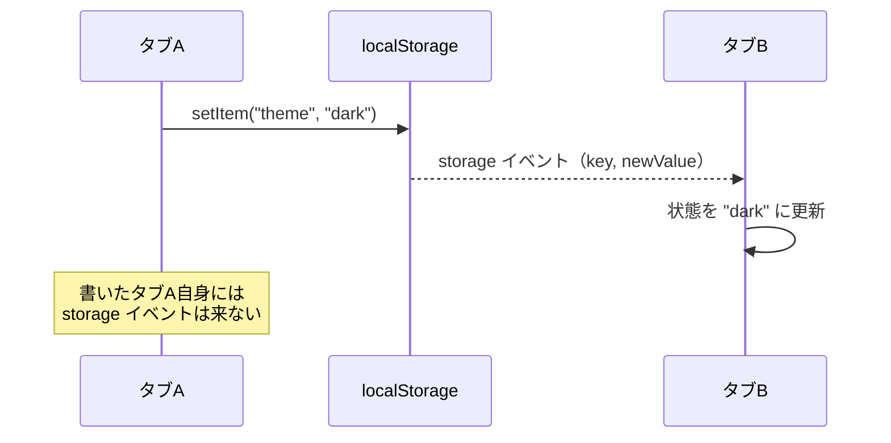

# タブ間同期

> **ひとことで言うと**：同じサイトを複数タブで開いているとき、1つのタブでの変更を他のタブに知らせて揃えること。localStorage の変更を知らせる `storage` イベントと、タブ同士でメッセージを送り合う `BroadcastChannel` の2つが基本の道具。

## たとえ話で理解する

同じ会社の **支店どうし** を想像してください。

- **storage イベント**：本社の共有掲示板（localStorage）に誰かが貼り紙をすると、**貼った支店以外** に「掲示板が更新されました」と通知が来る。中身は掲示板を見に行けば分かる。
- **BroadcastChannel**：支店どうしの **社内無線**。同じチャンネルに合わせた支店に、掲示板を使わず直接メッセージを流せる。流した本人には聞こえない。

## なぜ必要？（困りごと）

- ❌ タブAでログアウトしたのに、タブBではログイン中の画面のまま操作できてしまう
- ❌ タブAでテーマをダークにしても、タブBはライトのまま
- ❌ タブAでカートに商品を追加、タブBで古いカートを見て注文 → 数量がずれる
- ❌ タブBで保存 → タブAでも保存 → 後から保存した方が前の変更を上書き

React の状態は **タブごとに別のメモリ** にあるので、何もしなければ他のタブの変更は伝わりません。

## 基本の仕組み



| | storage イベント | BroadcastChannel |
| --- | --- | --- |
| 何を伝える | localStorage（※）の変更 | 任意のメッセージ |
| データの残り方 | localStorage に残る | 残らない（その場で届くだけ） |
| 送るもの | 文字列（key / oldValue / newValue） | オブジェクトもそのまま送れる（構造化複製） |
| 送信元タブに届くか | 届かない | 届かない |
| 向いている場面 | 保存済みの設定を揃える | 「ログアウトした」「データを更新した」などの通知 |

※ sessionStorage はタブごとに別なので、タブ間同期には使えません。

💡 構造化複製（structured clone）：オブジェクトを丸ごとコピーして渡す仕組み。`Date` や `Map` もそのまま送れますが、関数は送れません。

## コード例

### storage イベントで設定を揃える

`useSyncExternalStore` は、React の外にあるデータ（ここでは localStorage）を購読（変更を監視）して、変わったら再描画してくれる hook です。

```tsx
const KEY = "app:theme:v1";

function subscribe(onChange: () => void) {
  // 他のタブが書き換えたときに呼ばれる
  const handler = (e: StorageEvent) => {
    if (e.key === KEY || e.key === null) onChange(); // null は clear() のとき
  };
  window.addEventListener("storage", handler);
  return () => window.removeEventListener("storage", handler);
}

const getSnapshot = () => localStorage.getItem(KEY) ?? "light";
const getServerSnapshot = () => "light"; // SSR 用の初期値

function useSyncedTheme() {
  const theme = useSyncExternalStore(subscribe, getSnapshot, getServerSnapshot);
  const setTheme = (next: string) => {
    localStorage.setItem(KEY, next);
    // 自分のタブには storage イベントが来ないので、自分で知らせる
    window.dispatchEvent(new StorageEvent("storage", { key: KEY }));
  };
  return [theme, setTheme] as const;
}
```

- `getSnapshot` は **文字列を返す** のがポイント。毎回 `JSON.parse` した新しいオブジェクトを返すと「毎回違う値」と判断され、無限に再描画されます。オブジェクトを扱うなら、生の文字列が同じ間は前回の結果を使い回します。

### BroadcastChannel でログアウトを知らせる

```tsx
type Message = { type: "LOGOUT" } | { type: "CART_UPDATED" };
const channel = new BroadcastChannel("app"); // 同じ名前のチャンネル同士で届く

export function notifyLogout() {
  channel.postMessage({ type: "LOGOUT" } satisfies Message);
}

function useTabMessages(onLogout: () => void) {
  useEffect(() => {
    const handler = (e: MessageEvent<Message>) => {
      if (e.data.type === "LOGOUT") onLogout();
    };
    channel.addEventListener("message", handler);
    return () => channel.removeEventListener("message", handler);
  }, [onLogout]);
}
```

```tsx
function App() {
  const [user, setUser] = useState<string | null>("taro");
  const handleLogout = useCallback(() => setUser(null), []);
  useTabMessages(handleLogout); // 他のタブでログアウトしたら、こちらも消す

  const logout = () => {
    setUser(null);   // 自分のタブ
    notifyLogout();  // 他のタブ
  };
  return user ? <button onClick={logout}>ログアウト</button> : <p>ログアウトしました</p>;
}
```

💡 `new BroadcastChannel` はブラウザ専用です。SSR のあるフレームワークでは、モジュールの一番上ではなく `useEffect` の中で作るか、`typeof window` で確認してから作ります。

### サーバーのデータを揃えるとき

タブAで投稿を編集したら、タブBの一覧も古くなります。データそのものを送るより、**「このデータが古くなった」とだけ伝え、受け取ったタブが再取得する** 方が安全です。

```tsx
// 受け取ったタブ側（TanStack Query の例）
channel.addEventListener("message", (e) => {
  if (e.data.type === "POSTS_UPDATED") queryClient.invalidateQueries({ queryKey: ["posts"] });
});
```

キャッシュの無効化については [[04_ミューテーションとキャッシュの無効化]]、ライブラリは [[05_TanStack Query]] を参照。

### ライブラリを使うと

- Jotai の `atomWithStorage` は localStorage を使う場合、既定で storage イベントを購読して他のタブの変更を反映します。[[04_Jotai]]
- Zustand の `persist` は自動ではタブ間同期しないので、storage イベントを受けたら `useStore.persist.rehydrate()` で読み直すなどの工夫をします。[[02_Zustand]]
- TanStack Query には複数タブでキャッシュを共有する実験的なプラグイン（broadcastQueryClient）があります。

## よくある失敗

- ❌ 書き込んだタブ自身にも storage イベントが来ると思い込む → ⭕ 来ないので、自分のタブは自分で状態を更新する
- ❌ sessionStorage でタブ間同期しようとする → ⭕ sessionStorage はタブごとに別。localStorage か BroadcastChannel を使う
- ❌ `getSnapshot` で毎回新しいオブジェクトを返す → ⭕ 文字列やキャッシュ済みの値を返し、無限再描画を防ぐ
- ❌ リスナーを解除しない → ⭕ `useEffect` の後片付けで `removeEventListener` する
- ❌ 大きなデータ本体を毎回送り合う → ⭕ 「更新された」通知だけ送り、受け取った側が読み直す

## まとめ

- タブごとに状態は別。揃えるには storage イベントか BroadcastChannel を使う。
- storage イベントは localStorage の変更を「他のタブ」に知らせる。BroadcastChannel は任意のメッセージを送れる。
- どちらも送信元タブには届かない。サーバーデータは「古くなった」と伝えて再取得させる。

## 関連ノート

- [[01_状態の永続化]] — localStorage への保存
- [[04_リアルタイム同期]] — 別の端末・別のユーザーとの同期
- [[04_ミューテーションとキャッシュの無効化]] — 再取得のきっかけ
- [[04_セレクタと再レンダー対策]] — 不要な再描画を防ぐ
- [[05_TanStack Query]] / [[02_Zustand]] / [[04_Jotai]]
- 上位: [[MOC_状態管理体系]]
