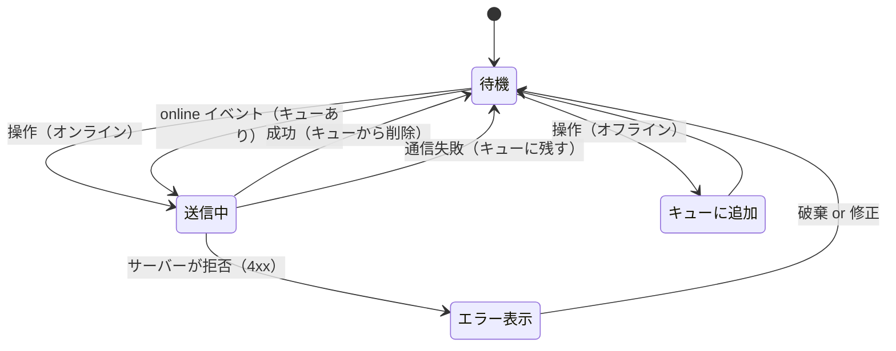

# オフライン対応

> **ひとことで言うと**：通信が切れても操作を失わないように、「今オンラインか」を状態として持ち、オフライン中の送信は「送信キュー（送信待ちの列）」に溜めて、つながったら順番に送り直すこと。

## たとえ話で理解する

**圏外の山小屋で書く手紙** を想像してください。

- 山小屋にはポストが無い（オフライン）。書いた手紙は **カバンの中の「出す予定」の束**（送信キュー）に入れておく。
- 麓に下りて電波が戻ったら（オンライン復帰）、束を **書いた順に** ポストへ出す。
- 宛先不明で戻ってきた手紙（送信失敗）は、書き直すか捨てるかを決める。
- カバンをなくすと手紙も消えるので、大事な束は **丈夫な箱**（IndexedDB などの保存領域）にしまっておく。

## なぜ必要？（困りごと）

- ❌ 電車でトンネルに入った瞬間に「送信」→ エラーになり、書いたコメントが消える
- ❌ オフラインなのに「保存しました」と表示され、実はサーバーに届いていない
- ❌ 復帰後にリトライ（再試行）が一斉に走り、同じデータが2回登録される
- ❌ 通信できないのに読み込み中のくるくるが永遠に回り続ける

## 基本の仕組み

### オンライン状態の検知

- `navigator.onLine`：今オンラインかを `true` / `false` で返す。
- `online` / `offline` イベント：切り替わったときに `window` で発生する。
- ⚠️ `navigator.onLine === true` でも「Wi-Fi にはつながっているがインターネットには出られない」ことがある。**最終的な判断は実際の通信の成否** で行う。

### 送信キューの流れ



| 失敗の種類 | 例 | 対応 |
| --- | --- | --- |
| 通信エラー | 圏外、タイムアウト | キューに残して後で再送 |
| サーバーエラー（5xx） | サーバー側の一時的な障害 | 間隔を空けて再送 |
| 入力エラー（4xx） | バリデーション違反、権限なし | 再送しても無駄。ユーザーに知らせる |

💡 **冪等性（べきとうせい）**：同じリクエストを何回送っても結果が1回分と同じになる性質。送信ごとに一意なID（`crypto.randomUUID()` など）を付け、サーバー側で重複を無視できるようにすると、二重登録を防げます。

## コード例

### オンライン状態を読む hook

```tsx
function subscribe(onChange: () => void) {
  window.addEventListener("online", onChange);
  window.addEventListener("offline", onChange);
  return () => {
    window.removeEventListener("online", onChange);
    window.removeEventListener("offline", onChange);
  };
}

export function useOnline() {
  return useSyncExternalStore(
    subscribe,
    () => navigator.onLine, // ブラウザでの値
    () => true,             // SSR では「オンライン」とみなす
  );
}
```

```tsx
function OfflineBanner() {
  const online = useOnline();
  return online ? null : <p role="status">オフラインです。変更はつながったときに送信されます</p>;
}
```

### 送信キュー

簡単のためキューは localStorage に保存します（件数が多い・大きいなら IndexedDB）。

```tsx
type Job = { id: string; url: string; body: unknown };
const KEY = "app:outbox:v1";

const readQueue = (): Job[] => {
  try { return JSON.parse(localStorage.getItem(KEY) ?? "[]"); } catch { return []; }
};
const writeQueue = (q: Job[]) => localStorage.setItem(KEY, JSON.stringify(q));

export function enqueue(url: string, body: unknown) {
  // id はサーバー側で重複を見分けるために使う
  writeQueue([...readQueue(), { id: crypto.randomUUID(), url, body }]);
}

let flushing = false; // 二重実行を防ぐ
export async function flush() {
  if (flushing) return;
  flushing = true;
  try {
    for (const job of readQueue()) { // 古い順に1件ずつ送る
      const res = await fetch(job.url, {
        method: "POST",
        headers: { "Content-Type": "application/json", "Idempotency-Key": job.id },
        body: JSON.stringify(job.body),
      });
      if (res.status >= 500) break; // サーバー障害：残りは次回
      // 成功 or 4xx はキューから外す（4xx は別途ユーザーに知らせる）
      writeQueue(readQueue().filter((j) => j.id !== job.id));
    }
  } catch {
    // 通信エラー：キューに残したまま次のオンライン時に再送
  } finally {
    flushing = false;
  }
}
```

### コンポーネントからつなぐ

```tsx
function CommentForm() {
  const online = useOnline();
  const [text, setText] = useState("");
  const [notice, setNotice] = useState("");

  useEffect(() => {
    if (online) flush(); // オンラインに戻ったら送信待ちを送る
  }, [online]);

  const submit = () => {
    enqueue("/api/comments", { text }); // まずキューに入れる
    setText("");
    setNotice(online ? "送信しています" : "オフラインのため、つながったら送信します");
    if (online) flush();
  };

  return (
    <div>
      <textarea value={text} onChange={(e) => setText(e.target.value)} />
      <button onClick={submit} disabled={text === ""}>送信</button>
      {notice && <p role="status">{notice}</p>}
    </div>
  );
}
```

💡 「いつもキューに入れてから送る」形にすると、オンライン・オフラインで処理を分けずに済み、送信中にタブを閉じても次回に送り直せます。

### 画面への反映

- 送信待ちのコメントは「送信待ち」ラベル付きで一覧に出しておくと、ユーザーは消えていないと分かります（[[05_楽観的更新]] と同じ考え方）。
- 取得系は、オフライン中は最後に取れたキャッシュを表示し、「最新ではない可能性」を伝えます。

### ライブラリを使うと

TanStack Query v5 は既定で `networkMode: 'online'` となっており、オフライン中はクエリやミューテーションを「一時停止」し、復帰すると再開します。一時停止中は `fetchStatus: 'paused'` で分かります（[[05_TanStack Query]]）。ページを閉じても残る本格的なオフライン対応では、Service Worker（ブラウザの裏で動き、通信を仲介できるスクリプト）と組み合わせることもあります。

## よくある失敗

- ❌ `navigator.onLine` だけを信じる → ⭕ 実際の通信失敗もオフライン扱いにして、キューに残す
- ❌ 失敗したら全部リトライ → ⭕ 通信エラー・5xx は再送、4xx は再送せずユーザーに知らせる
- ❌ 復帰時に送信が二重に走り、同じデータが2件できる → ⭕ 実行中フラグと一意なID（冪等キー）で重複を防ぐ
- ❌ キューをメモリだけに持つ → ⭕ localStorage / IndexedDB に保存し、リロードしても消えないようにする
- ❌ オフラインでも「保存しました」と表示 → ⭕ 「送信待ち」と正直に表示する

## まとめ

- オンラインかどうかは `online` / `offline` イベントで状態にするが、最終判断は通信の成否。
- オフライン中の操作は保存された送信キューに溜め、復帰したら古い順に送る。
- 再送してよい失敗とダメな失敗を分け、一意なIDで二重登録を防ぐ。

## 関連ノート

- [[01_状態の永続化]] — キューを保存する場所
- [[02_タブ間同期]] — 複数タブで同じキューを扱うとき
- [[05_楽観的更新]] — 送信前に画面へ反映する
- [[04_送信フローの状態]] — 送信中・成功・失敗の表し方
- [[01_ステートマシンとは]] — 送信の状態遷移
- [[05_TanStack Query]] — networkMode と一時停止
- 上位: [[MOC_状態管理体系]]
