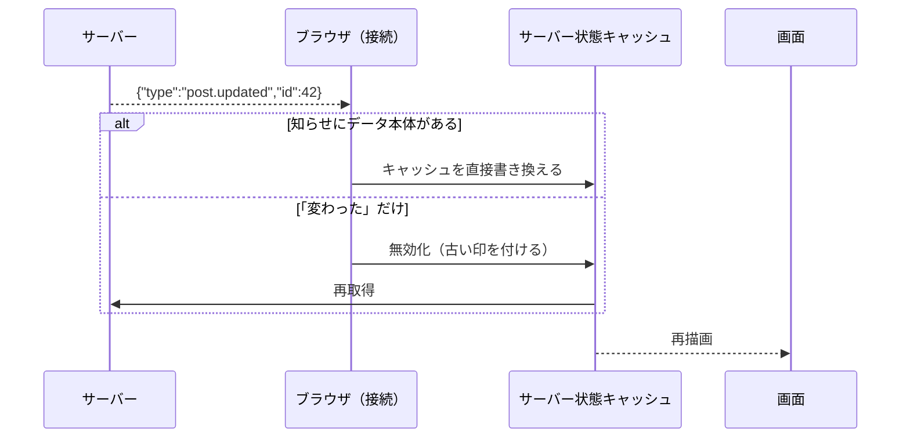

# リアルタイム同期

> **ひとことで言うと**：サーバーから「データが変わった」という知らせを WebSocket や SSE で受け取り、手元のサーバー状態キャッシュを更新（または無効化して再取得）すること。自分から何度も聞きに行かなくても、画面が最新に保たれる。

## たとえ話で理解する

レストランで料理ができたか知る方法を3つ比べます。

- **ポーリング**（一定間隔で問い合わせる）：1分ごとに厨房へ「まだですか？」と聞きに行く。無駄足が多い。
- **SSE**（Server-Sent Events）：席に置かれた **呼び出しベル**。厨房（サーバー）から客へ **一方通行** で「できました」と知らせる。
- **WebSocket**：厨房と客席をつなぐ **トランシーバー**。どちらからでも話せる（双方向）。

どれで知らせを受け取っても、最後は **手元の注文票（キャッシュ）を書き換える** のが大事です。

## なぜ必要？（困りごと）

- ❌ チャットで相手のメッセージが、自分がリロードするまで表示されない
- ❌ 在庫が売り切れたのに画面は「残り1」のまま → 注文してからエラー
- ❌ 知らせを受け取るたびに `useState` に直接足していて、再取得したデータと二重に表示される
- ❌ 接続が切れたことに気づかず、ずっと古い画面のまま

## 基本の仕組み

### 方式の比較

| | ポーリング | SSE | WebSocket |
| --- | --- | --- | --- |
| 向き | クライアント → サーバー（聞きに行く） | サーバー → クライアント | 双方向 |
| ブラウザの API | `fetch` + タイマー | `EventSource` | `WebSocket` |
| 自動再接続 | ー | ブラウザが自動で行う | 自分で書く |
| データ形式 | 何でも | テキスト | テキスト・バイナリ |
| 向いている場面 | 数十秒ごとで十分な更新 | 通知、ダッシュボード、進捗 | チャット、共同編集、ゲーム |

💡 「サーバーから知らせるだけ」なら SSE で十分なことが多いです。送信は普通の `fetch`（POST）で行えます。

### 受け取った知らせをどう反映するか



| 反映のしかた | 良い点 | 注意点 |
| --- | --- | --- |
| キャッシュを直接書き換え | 通信が増えない、速い | 順番の入れ替わりや取りこぼしで、ずれが起きうる |
| 無効化して再取得 | サーバーが正しい値を返すので確実 | 通信が増える。頻繁な更新には向かない |

**サーバー状態**（サーバーが持ち主で、手元にはコピーがあるだけのデータ）は、知らせを受けても **キャッシュの仕組みを通して** 更新するのが基本です（[[01_サーバー状態とは]]）。

## コード例

### SSE で受け取って TanStack Query のキャッシュを更新

```tsx
import { useQueryClient } from "@tanstack/react-query";

type ServerEvent =
  | { type: "post.updated"; post: { id: number; title: string } }
  | { type: "posts.changed" };

function useLiveUpdates() {
  const queryClient = useQueryClient();

  useEffect(() => {
    const es = new EventSource("/api/events"); // 切れてもブラウザが自動で再接続

    es.onmessage = (e) => {
      const ev: ServerEvent = JSON.parse(e.data);
      if (ev.type === "post.updated") {
        // 本体が届いた：その1件のキャッシュを直接書き換える
        queryClient.setQueryData(["post", ev.post.id], ev.post);
        // 一覧は「古い」印を付けて、表示中なら再取得させる
        queryClient.invalidateQueries({ queryKey: ["posts"] });
      } else {
        queryClient.invalidateQueries({ queryKey: ["posts"] });
      }
    };

    return () => es.close(); // 画面を離れたら接続を閉じる
  }, [queryClient]);
}
```

画面側は普段どおり `useQuery({ queryKey: ["posts"], queryFn })` で読むだけ。知らせを受けるとキャッシュが変わり、自動で再描画されます。

### WebSocket でチャット（再接続つき）

```tsx
type Msg = { id: string; text: string };

function useChatSocket(roomId: string, onMessage: (m: Msg) => void) {
  const [status, setStatus] = useState<"connecting" | "open" | "closed">("connecting");

  useEffect(() => {
    let ws: WebSocket;
    let retry = 0;
    let stopped = false;
    let timer: ReturnType<typeof setTimeout>;

    const connect = () => {
      setStatus("connecting");
      ws = new WebSocket(`wss://example.com/rooms/${roomId}`);
      ws.onopen = () => { retry = 0; setStatus("open"); };
      ws.onmessage = (e) => onMessage(JSON.parse(e.data));
      ws.onclose = () => {
        setStatus("closed");
        if (stopped) return;
        // 1秒, 2秒, 4秒…と間隔を広げて再接続（最大30秒）
        timer = setTimeout(connect, Math.min(1000 * 2 ** retry++, 30000));
      };
    };
    connect();
    return () => { stopped = true; clearTimeout(timer); ws.close(); };
  }, [roomId, onMessage]);

  return status;
}
```

- `onMessage` は `useCallback` で包んで渡す（毎回新しい関数だと、そのたびに接続し直してしまう）。
- 受け取ったメッセージは `setQueryData(["messages", roomId], (old: Msg[] = []) => ...)` のようにキャッシュへ追加し、**同じ `id` があれば追加しない**（再接続後の重複対策）。

### 取りこぼし対策

接続が切れていた間の知らせは届きません。再接続したら **一度まとめて再取得** するのが安全です。

```tsx
ws.onopen = () => {
  setStatus("open");
  queryClient.invalidateQueries({ queryKey: ["messages", roomId] }); // 抜けを埋める
};
```

💡 TanStack Query は既定でウィンドウに戻ったとき（`refetchOnWindowFocus`）やネット復帰時（`refetchOnReconnect`）にも再取得するので、取りこぼしの保険になります。

### ライブラリを使うと

- TanStack Query：`setQueryData` / `invalidateQueries` で反映（[[05_TanStack Query]]）
- SWR：`mutate(key, data)` で書き換え、`mutate(key)` で再検証（[[06_SWR]]）。購読用の `useSWRSubscription` もある
- 接続の状態（connecting / open / closed）が複雑になったら、ステートマシンとして整理する（[[01_ステートマシンとは]] / [[07_XState]]）

## よくある失敗

- ❌ 受け取ったデータを別の `useState` に溜め、取得データと二重管理 → ⭕ サーバー状態キャッシュ1か所に反映する（単一の情報源）
- ❌ `useEffect` の後片付けで接続を閉じない → ⭕ `close()` しないと画面を移動するたびに接続が増える
- ❌ 再接続を間隔なしで繰り返す → ⭕ 待ち時間を倍々に広げる（指数バックオフ）
- ❌ 切断中の知らせは届かないことを忘れる → ⭕ 再接続時に再取得して抜けを埋める
- ❌ 何でも WebSocket にする → ⭕ 一方向の通知なら SSE、更新頻度が低いならポーリングで十分

## まとめ

- サーバーからの知らせは SSE（一方向）か WebSocket（双方向）で受け取る。
- 受け取ったら、サーバー状態キャッシュを直接書き換えるか、無効化して再取得する。
- 接続の後片付け・再接続・取りこぼし対策をセットで考える。

## 関連ノート

- [[01_サーバー状態とは]] — サーバー状態は「コピー」
- [[02_キャッシュと再取得]] — キャッシュの仕組み
- [[04_ミューテーションとキャッシュの無効化]] — invalidate の使い方
- [[04_派生状態と単一の情報源]] — 二重管理を避ける
- [[02_タブ間同期]] — 同じ端末のタブ同士の同期
- [[03_オフライン対応]] — 切断中の扱い
- [[05_TanStack Query]] / [[06_SWR]]
- 上位: [[MOC_状態管理体系]]
