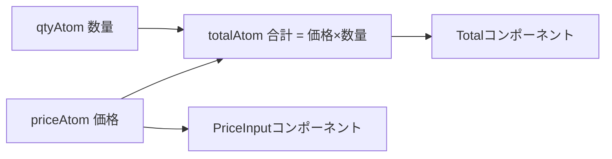

# Jotai（ジョウタイ）

> **ひとことで言うと**：状態を「atom（アトム）」という小さな部品に分けて持ち、使うコンポーネントだけが再レンダーされるようにする、React 向けの軽量なグローバル状態ライブラリです。

**扱う状態の種類**：主に **グローバル状態（クライアント側の共有状態）**。派生状態も得意。サーバー状態は専用ライブラリ（[[05_TanStack Query]] など）に任せるのが基本です。
→ 考え方は [[01_グローバル状態とは]] / [[04_派生状態と単一の情報源]] / [[04_セレクタと再レンダー対策]]

## たとえ話で理解する

冷蔵庫（1つの大きなストア）に全部入れるのではなく、**調味料ごとに小瓶（atom）** を用意するイメージです。
醤油の瓶を使う人は醤油が減ったときだけ気づけばよく、塩の瓶が変わっても関係ありません。
さらに「醤油＋みりん＝タレ」のように、**小瓶を組み合わせて新しい小瓶（派生 atom）** も作れます。

## なぜ必要？（困りごと）

- `useState` だけだと、離れたコンポーネントで同じ値を使うために props のバケツリレーが発生する（[[02_propsバケツリレーとContextの限界]]）
- `Context` で共有すると、値の一部が変わっただけで **Context を使う全コンポーネントが再レンダー** される
- 1つの大きなストア（Redux など）は、小さなアプリには設定やコード量が多すぎる

Jotai は「`useState` と同じ感覚でグローバルに共有できる」ことを目指しており、この3つをまとめて解決します。

## 基本の仕組み

### 基本情報

- **開発元**: pmndrs（Zustand と同じ開発コミュニティ）
- **ライセンス**: MIT
- **言語**: TypeScript（型定義が標準装備）
- **公式サイト**: https://jotai.org
- **バージョン**: v2 系（2026年時点）

### インストール

```bash
npm install jotai
```

### atom の依存関係のイメージ



- `priceAtom` が変わると、それを **読んでいる** `totalAtom` と `PriceInput` だけが更新される
- 関係のないコンポーネントは再レンダーされない

### コアAPI

| API | 役割 |
|---|---|
| `atom(初期値)` | 読み書きできる基本の atom を作る |
| `atom((get) => ...)` | 他の atom から計算する **読み取り専用の派生 atom** |
| `atom(null, (get, set, 引数) => ...)` | 書き込み専用の atom（アクションのように使う） |
| `useAtom(a)` | `[値, 更新関数]` を返す（`useState` とほぼ同じ形） |
| `useAtomValue(a)` | 値だけ読む |
| `useSetAtom(a)` | 更新関数だけ取る（値が変わっても再レンダーされない） |
| `Provider` / `createStore` | atom の値を入れる「保管庫」を分けたいときに使う（省略可） |
| `atomWithStorage`（`jotai/utils`） | localStorage などに保存される atom |

💡 **atom 自体は値を持っていません**。atom は「設計図（キー）」で、実際の値は store（省略時はデフォルトの store）に保存されます。

## コード例

### 基本：useState からの置き換え

```tsx
import { atom, useAtom, useAtomValue } from 'jotai';

// コンポーネントの外で atom を定義する
const countAtom = atom(0);

function Counter() {
  const [count, setCount] = useAtom(countAtom); // useState と同じ感覚
  return <button onClick={() => setCount((c) => c + 1)}>{count}</button>;
}

function Display() {
  const count = useAtomValue(countAtom); // 別の場所で同じ値を読む
  return <p>現在: {count}</p>;
}
```

`Provider` で囲まなくても動きます（デフォルトの store が使われる）。

### 派生 atom と書き込み専用 atom

```tsx
import { atom, useAtomValue, useSetAtom } from 'jotai';

type Todo = { id: number; text: string; done: boolean };

const todosAtom = atom<Todo[]>([]);

// 派生 atom：未完了の件数（元データは todosAtom だけ＝単一の情報源）
const remainingAtom = atom((get) => get(todosAtom).filter((t) => !t.done).length);

// 書き込み専用 atom：追加処理をまとめる
const addTodoAtom = atom(null, (get, set, text: string) => {
  set(todosAtom, [...get(todosAtom), { id: Date.now(), text, done: false }]);
});

function Remaining() {
  const n = useAtomValue(remainingAtom);
  return <p>残り {n} 件</p>;
}

function AddButton() {
  const addTodo = useSetAtom(addTodoAtom); // 値を読まないので再レンダーされない
  return <button onClick={() => addTodo('牛乳を買う')}>追加</button>;
}
```

### 永続化（localStorage）

```tsx
import { useAtom } from 'jotai';
import { atomWithStorage } from 'jotai/utils';

// 第1引数が localStorage のキー
const themeAtom = atomWithStorage<'light' | 'dark'>('theme', 'light');

function ThemeToggle() {
  const [theme, setTheme] = useAtom(themeAtom);
  return (
    <button onClick={() => setTheme(theme === 'light' ? 'dark' : 'light')}>
      今: {theme}
    </button>
  );
}
```

考え方は [[01_状態の永続化]] を参照。`atomWithStorage` は他タブでの変更も（localStorage の場合）反映されます（[[02_タブ間同期]]）。

### 非同期 atom（簡単なデータ取得）

```tsx
import { Suspense } from 'react';
import { atom, useAtomValue } from 'jotai';

const userIdAtom = atom(1);

// Promise を返す派生 atom。読む側は Suspense で待つ
const userAtom = atom(async (get) => {
  const res = await fetch(`/api/users/${get(userIdAtom)}`);
  return (await res.json()) as { name: string };
});

function UserName() {
  const user = useAtomValue(userAtom);
  return <p>{user.name}</p>;
}

export const Page = () => (
  <Suspense fallback={<p>読み込み中...</p>}>
    <UserName />
  </Suspense>
);
```

💡 キャッシュ・再取得・無効化まで必要になったら、Jotai で頑張らず [[05_TanStack Query]] を使いましょう（[[02_キャッシュと再取得]]）。

### Zustand との違い（ざっくり）

| | Jotai | [[02_Zustand]] |
|---|---|---|
| 形 | 小さな atom をたくさん（ボトムアップ） | 1つのストアにまとめる（トップダウン） |
| 再レンダー対策 | atom 単位で自動 | セレクタを書く |
| 向いている場面 | 細かい状態が多い・派生が多い UI | アクション中心・React 外からも触りたい |

## よくある失敗

- ❌ コンポーネントの中で `atom()` を作る → 毎レンダーで別の atom になり値が消える → ⭕ atom はモジュールのトップレベル（コンポーネントの外）で定義する（動的に作るなら `useMemo`）
- ❌ 何でも1つの巨大なオブジェクト atom に入れる → 一部の変更で全体が再レンダー → ⭕ 変わる単位ごとに atom を分け、まとめたい値は派生 atom で作る
- ❌ 派生できる値（合計・件数など）を別の atom に保存して手で同期する → ⭕ `atom((get) => ...)` で計算する（[[04_派生状態と単一の情報源]]）
- ❌ 更新しかしないボタンで `useAtom` を使う → 値が変わるたびに無駄な再レンダー → ⭕ `useSetAtom` を使う
- ❌ API のキャッシュ管理を非同期 atom で自作する → ⭕ サーバー状態は TanStack Query / SWR に任せる

## まとめ

- Jotai は状態を atom という小さな単位で持ち、`useAtom` で `useState` のように使える
- 派生 atom で「計算できる値」を自然に表現でき、再レンダーも atom 単位で最小化される
- クライアント側の共有状態向け。サーバー状態は専用ライブラリと組み合わせる

## 関連ノート

- [[01_グローバル状態とは]] — Jotai が扱う状態の種類
- [[02_propsバケツリレーとContextの限界]] — Jotai が解決する困りごと
- [[04_セレクタと再レンダー対策]] — atom 単位の購読が効く理由
- [[04_派生状態と単一の情報源]] — 派生 atom の考え方
- [[05_状態管理ライブラリの選び方]] — 他ライブラリとの使い分け
- [[01_状態の永続化]] — atomWithStorage の背景
- [[02_Zustand]] — 同じ pmndrs 製のストア型ライブラリ
- [[05_TanStack Query]] — サーバー状態はこちら
- [[ライブラリ比較]] — 一覧で比較
- 上位: [[MOC_状態管理体系]]
