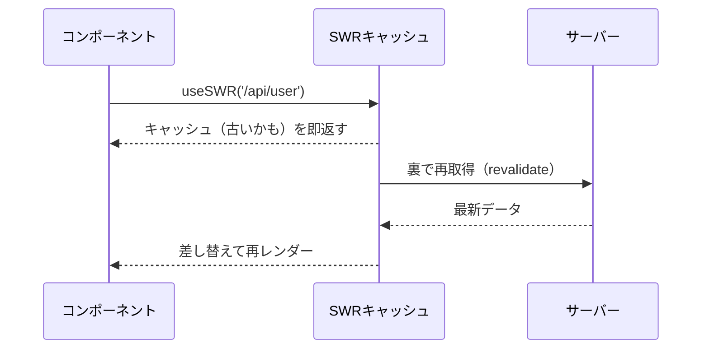

# SWR（エス・ダブリュー・アール）

> **ひとことで言うと**：「まず手元の古いデータ（キャッシュ）を見せ、裏で最新を取りに行って差し替える」という戦略で、サーバーのデータ取得をシンプルにする Vercel 製の軽量フックです。

**扱う状態の種類**：**サーバー状態** 専用。クライアントだけの状態（モーダルの開閉・入力中の値など）は扱いません。
→ 考え方は [[01_サーバー状態とは]] / [[02_キャッシュと再取得]] / [[04_ミューテーションとキャッシュの無効化]] / [[05_楽観的更新]] / [[06_ページングと無限スクロール]]

## たとえ話で理解する

朝の **新聞** のようなものです。
テーブルの上に昨日の新聞（キャッシュ）があれば、とりあえずそれを読み始められます。その間に家族がコンビニで今日の新聞（最新データ）を買ってきて、届いたら差し替えます。
「待たされない」けれど「最終的には最新になる」。これが SWR の名前の由来 **stale-while-revalidate**（古いものを出しつつ再検証する）です。

## なぜ必要？（困りごと）

- `useEffect` で fetch すると、画面を開くたびに真っ白な「読み込み中」になる
- 同じ API を複数のコンポーネントで呼ぶと、リクエストが重複する
- 他のタブで作業して戻ってきたとき、データが古いまま
- ローディング・エラー用の `useState` を毎回書くのが面倒（[[03_ローディング・エラー・空状態]]）

SWR は `useSWR(キー, 取得関数)` の1行でこれらを解決します。

## 基本の仕組み

### 基本情報

- **開発元**: Vercel（Next.js の開発元）
- **ライセンス**: MIT
- **言語**: TypeScript
- **公式サイト**: https://swr.vercel.app
- **バージョン**: 2.x 系（2026年時点）

### インストール

```bash
npm install swr
```

### stale-while-revalidate の流れ



- **キー**：多くの場合は API の URL 文字列。同じキーなら全コンポーネントでキャッシュを共有
- **fetcher**：キーを受け取ってデータを返す関数。SWR 自体は通信方法を決めない（fetch でも axios でもよい）
- **再検証のタイミング**：マウント時・タブに戻ったとき（focus）・ネット復帰時（reconnect）など

### コアAPI

| API | 役割 |
|---|---|
| `useSWR(key, fetcher, options?)` | データを読む。`data`, `error`, `isLoading`, `isValidating`, `mutate` を返す |
| `SWRConfig` | アプリ全体の既定値（共通 fetcher など）を設定 |
| `mutate`（戻り値の／`useSWRConfig()` の） | キャッシュを更新・再検証する |
| `useSWRMutation`（`swr/mutation`） | POST などの「書き込み」を手動で実行 |
| `useSWRInfinite`（`swr/infinite`） | ページング・無限スクロール |

💡 `isLoading` は「まだデータがなく初回取得中」、`isValidating` は「裏の再取得も含めて通信中」です。

## コード例

### 共通 fetcher とセットアップ

```tsx
import { SWRConfig } from 'swr';

// エラー時に throw する fetcher（fetch は 404 でも成功扱いなので）
export const fetcher = async (url: string) => {
  const res = await fetch(url);
  if (!res.ok) throw new Error('取得に失敗しました');
  return res.json();
};

export function App() {
  return (
    <SWRConfig value={{ fetcher, revalidateOnFocus: true }}>
      <Profile />
    </SWRConfig>
  );
}
```

### 基本：データを読む

```tsx
import useSWR from 'swr';

type User = { id: number; name: string };

function Profile() {
  // SWRConfig で fetcher を設定済みなので第2引数は省略できる
  const { data, error, isLoading } = useSWR<User>('/api/user');

  if (isLoading) return <p>読み込み中...</p>;
  if (error) return <p>エラー: {error.message}</p>;
  return <p>こんにちは、{data?.name} さん</p>;
}
```

### 条件付き取得（キーを null にすると取得しない）

```tsx
function Orders({ userId }: { userId: number | null }) {
  // userId が決まるまでは null → リクエストしない
  const { data } = useSWR(userId ? `/api/users/${userId}/orders` : null);
  return <p>注文数: {data?.length ?? '-'}</p>;
}
```

### 書き込み：useSWRMutation

```tsx
import useSWRMutation from 'swr/mutation';

// 第2引数の { arg } に trigger() へ渡した値が入る
async function addTodo(url: string, { arg }: { arg: { title: string } }) {
  const res = await fetch(url, { method: 'POST', body: JSON.stringify(arg) });
  return res.json();
}

function AddTodo() {
  // 同じキー '/api/todos' の useSWR は、成功後に自動で再検証される
  const { trigger, isMutating } = useSWRMutation('/api/todos', addTodo);
  return (
    <button disabled={isMutating} onClick={() => trigger({ title: '買い物' })}>
      追加
    </button>
  );
}
```

### 楽観的更新（mutate のオプション）

```tsx
function LikeButton({ postId }: { postId: number }) {
  const { data, mutate } = useSWR<{ likes: number }>(`/api/posts/${postId}`);

  const like = () =>
    mutate(
      fetch(`/api/posts/${postId}/like`, { method: 'POST' }).then((r) => r.json()),
      {
        optimisticData: { likes: (data?.likes ?? 0) + 1 }, // 先に画面へ反映
        rollbackOnError: true, // 失敗したら元に戻す
        revalidate: false, // レスポンスで上書きするので再取得しない
      },
    );

  return <button onClick={like}>♥ {data?.likes}</button>;
}
```

考え方は [[05_楽観的更新]] を参照。

### よく使うオプション

| オプション | 意味 |
|---|---|
| `revalidateOnFocus` | タブに戻ったら再検証（初期値 true） |
| `revalidateOnReconnect` | ネット復帰時に再検証（初期値 true） |
| `refreshInterval` | ミリ秒ごとに自動で再取得（ポーリング） |
| `dedupingInterval` | この時間内の同じキーの取得を1回にまとめる |
| `fallbackData` | 初期表示用のデータ |

### TanStack Query との使い分け

| | SWR | [[05_TanStack Query]] |
|---|---|---|
| サイズ・API | 小さく覚えることが少ない | 多機能で設定項目が多い |
| 書き込み | `useSWRMutation` / `mutate` | `useMutation` + 細かいライフサイクル |
| キャッシュ制御 | シンプル | `staleTime` / `gcTime` など細かく調整可 |
| 向いている場面 | 読み取り中心・小〜中規模 | 更新が多い・複雑なキャッシュ操作 |

## よくある失敗

- ❌ fetcher で `res.ok` を見ずに返す → エラーなのに `data` に入ってしまう → ⭕ `!res.ok` なら `throw` する
- ❌ 条件が揃っていないのに URL を組み立てる（`/api/users/undefined`）→ ⭕ 準備できるまでキーを `null` にする
- ❌ `data` を `useState` にコピーして編集する → 再検証で食い違う → ⭕ 表示は `data` をそのまま使い、変更は `mutate` / `useSWRMutation` で行う
- ❌ 更新後に別キーの一覧が古いまま → ⭕ `useSWRConfig()` の `mutate('/api/todos')` で関係するキーを再検証する（[[04_ミューテーションとキャッシュの無効化]]）
- ❌ `isValidating` を初回表示の判定に使い、裏の再取得のたびに画面がちらつく → ⭕ 初回は `isLoading` を使う

## まとめ

- SWR は「キャッシュを即表示 → 裏で再検証」でサーバー状態を扱う軽量ライブラリ
- `useSWR(key, fetcher)` が基本。書き込みは `useSWRMutation`、ページングは `useSWRInfinite`
- 更新が複雑になってきたら TanStack Query も検討する

## 関連ノート

- [[01_サーバー状態とは]] — SWR が扱う状態の種類
- [[02_キャッシュと再取得]] — stale-while-revalidate の考え方
- [[03_ローディング・エラー・空状態]] — isLoading / error の扱い
- [[04_ミューテーションとキャッシュの無効化]] — mutate による再検証
- [[05_楽観的更新]] — optimisticData / rollbackOnError
- [[06_ページングと無限スクロール]] — useSWRInfinite の背景
- [[05_TanStack Query]] — より多機能な選択肢
- [[ライブラリ比較]] — 一覧で比較
- 上位: [[MOC_状態管理体系]]
