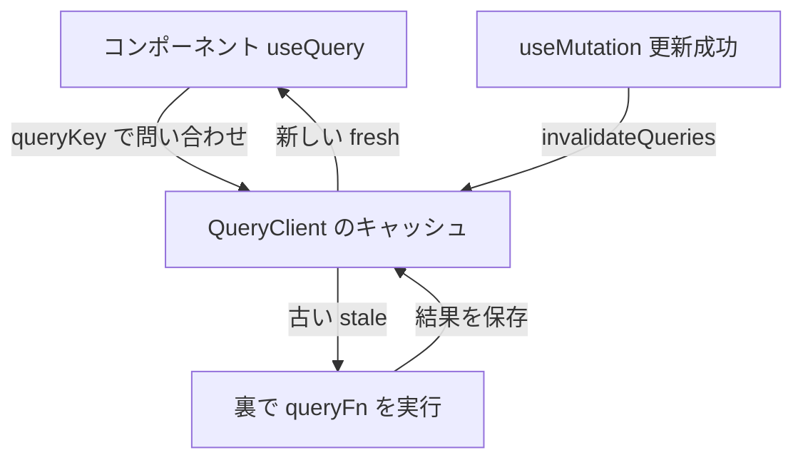

# TanStack Query（タンスタック・クエリ）

> **ひとことで言うと**：API から取ってきたデータ（サーバー状態）の「取得・キャッシュ・再取得・更新後の無効化」を自動で面倒みてくれるライブラリです。旧名は React Query。

**扱う状態の種類**：**サーバー状態**（サーバーにある本物のデータの「手元のコピー」）専用。UI の開閉やフォーム入力など、クライアント側だけの状態は扱いません。
→ 考え方は [[01_サーバー状態とは]] / [[02_キャッシュと再取得]] / [[04_ミューテーションとキャッシュの無効化]] / [[05_楽観的更新]] / [[06_ページングと無限スクロール]]

## たとえ話で理解する

図書館の **貸出カウンター係** のようなものです。
「この本（データ）ください」と頼むと、手元に新しいコピーがあればすぐ渡し、古くなっていれば裏で最新版を取り寄せてくれます。
誰かが本を書き換えたら（更新）、「この本の古いコピーは回収！」と一声かけるだけで、みんなの手元が最新になります。

## なぜ必要？（困りごと）

`useEffect` + `fetch` + `useState` で自作すると、次のような問題が次々に出ます。

- ローディング・エラー状態をコンポーネントごとに毎回書く（[[03_ローディング・エラー・空状態]]）
- 同じデータを複数の画面で取ると、**同じリクエストが何度も飛ぶ**
- 画面を戻るたびに毎回読み込み中になる（キャッシュがない）
- データを更新したあと、一覧画面が **古いまま** になる
- 素早く切り替えると、古いリクエストの結果が後から上書きする（競合状態）

TanStack Query はこれらを「キー（queryKey）ごとのキャッシュ」という仕組みでまとめて解決します。

## 基本の仕組み

### 基本情報

- **開発元**: TanStack（Tanner Linsley ほか）
- **ライセンス**: MIT
- **言語**: TypeScript
- **公式サイト**: https://tanstack.com/query
- **バージョン**: v5 系（2026年時点）。React 以外（Vue / Solid / Svelte / Angular）版もある

### インストール

```bash
npm install @tanstack/react-query
# 開発用のキャッシュ確認ツール（任意）
npm install -D @tanstack/react-query-devtools
```

### キャッシュの流れ



- **queryKey**：データの名札。`['todos']`、`['todo', id]` のような配列
- **fresh / stale**：取得してから `staleTime` の間は「新鮮」、過ぎると「古い（stale）」扱いになり、次に使われたとき裏で再取得
- **gcTime**：どのコンポーネントも使わなくなったキャッシュを捨てるまでの時間（初期値 5分。v4 までの `cacheTime`）

### コアAPI

| API | 役割 |
|---|---|
| `new QueryClient()` / `QueryClientProvider` | キャッシュ本体を作り、アプリに配る |
| `useQuery({ queryKey, queryFn })` | データを読む。`data`, `isPending`, `isError`, `error`, `isFetching` などを返す |
| `useMutation({ mutationFn, onSuccess })` | データを書き換える（POST/PUT/DELETE）。`mutate` で実行 |
| `useQueryClient()` | コンポーネントから QueryClient を取り出す |
| `queryClient.invalidateQueries({ queryKey })` | そのキーのキャッシュを「古い」にして再取得させる |
| `queryClient.setQueryData(key, 値)` | キャッシュを直接書き換える（楽観的更新で使う） |
| `useInfiniteQuery` | 無限スクロール用 |

💡 v5 では「まだデータがない」状態は `isPending`、「通信中（裏の再取得も含む）」は `isFetching` です。最初の読み込み表示には `isPending` を使います。

## コード例

### セットアップ

```tsx
import { QueryClient, QueryClientProvider } from '@tanstack/react-query';

const queryClient = new QueryClient({
  defaultOptions: { queries: { staleTime: 60_000 } }, // 1分間は新鮮とみなす
});

export function App() {
  return (
    <QueryClientProvider client={queryClient}>
      <TodoList />
    </QueryClientProvider>
  );
}
```

### Before：useEffect で自作

```tsx
function TodoList() {
  const [todos, setTodos] = useState<Todo[]>([]);
  const [loading, setLoading] = useState(true);
  const [error, setError] = useState<Error | null>(null);
  useEffect(() => {
    fetch('/api/todos')
      .then((r) => r.json())
      .then(setTodos)
      .catch(setError)
      .finally(() => setLoading(false));
  }, []); // キャッシュなし・重複リクエストあり・更新後は古いまま
  // ...
}
```

### After：useQuery

```tsx
import { useQuery } from '@tanstack/react-query';

type Todo = { id: number; title: string; done: boolean };

const fetchTodos = async (): Promise<Todo[]> => {
  const res = await fetch('/api/todos');
  if (!res.ok) throw new Error('取得に失敗しました'); // fetch は 404 でも throw しない
  return res.json();
};

function TodoList() {
  const { data, isPending, isError, error } = useQuery({
    queryKey: ['todos'],
    queryFn: fetchTodos,
  });

  if (isPending) return <p>読み込み中...</p>;
  if (isError) return <p>エラー: {error.message}</p>;
  if (data.length === 0) return <p>TODO はありません</p>;
  return <ul>{data.map((t) => <li key={t.id}>{t.title}</li>)}</ul>;
}
```

### 更新して一覧を最新にする（ミューテーション＋無効化）

```tsx
import { useMutation, useQueryClient } from '@tanstack/react-query';

function AddTodo() {
  const queryClient = useQueryClient();
  const { mutate, isPending } = useMutation({
    mutationFn: (title: string) =>
      fetch('/api/todos', { method: 'POST', body: JSON.stringify({ title }) }),
    onSuccess: () => {
      // 'todos' で始まるキーのキャッシュを古い扱いにして再取得
      queryClient.invalidateQueries({ queryKey: ['todos'] });
    },
  });
  return (
    <button disabled={isPending} onClick={() => mutate('新しいTODO')}>
      追加
    </button>
  );
}
```

### 楽観的更新（先に画面を変え、失敗したら戻す）

```tsx
const toggle = useMutation({
  mutationFn: (todo: Todo) =>
    fetch(`/api/todos/${todo.id}`, { method: 'PATCH', body: JSON.stringify({ done: !todo.done }) }),
  onMutate: async (todo) => {
    await queryClient.cancelQueries({ queryKey: ['todos'] }); // 進行中の取得を止める
    const previous = queryClient.getQueryData<Todo[]>(['todos']); // 戻す用に保存
    queryClient.setQueryData<Todo[]>(['todos'], (old = []) =>
      old.map((t) => (t.id === todo.id ? { ...t, done: !t.done } : t)),
    );
    return { previous }; // onError の第3引数に渡る
  },
  onError: (_err, _todo, result) => {
    queryClient.setQueryData(['todos'], result?.previous); // ロールバック
  },
  onSettled: () => queryClient.invalidateQueries({ queryKey: ['todos'] }), // 最後に正解と同期
});
```

考え方は [[05_楽観的更新]] を参照。

### 無限スクロール

```tsx
import { useInfiniteQuery } from '@tanstack/react-query';

type Page = { items: Todo[]; nextCursor: number | null };

const { data, fetchNextPage, hasNextPage, isFetchingNextPage } = useInfiniteQuery({
  queryKey: ['todos', 'infinite'],
  queryFn: async ({ pageParam }): Promise<Page> =>
    (await fetch(`/api/todos?cursor=${pageParam}`)).json(),
  initialPageParam: 0, // v5 では必須
  getNextPageParam: (lastPage) => lastPage.nextCursor, // null/undefined で終わり
});
// data.pages は各ページの配列 → data.pages.flatMap((p) => p.items)
```

### よく使うオプション

| オプション | 意味 |
|---|---|
| `staleTime` | 新鮮とみなす時間（初期値 0＝すぐ古くなる） |
| `gcTime` | 未使用キャッシュを捨てるまでの時間（初期値 5分） |
| `enabled` | `false` の間は取得しない（依存する値が揃うまで待つ） |
| `placeholderData: keepPreviousData` | ページ切替中も前のデータを表示し続ける |
| `refetchOnWindowFocus` | タブに戻ったとき再取得（初期値 true） |

## よくある失敗

- ❌ `queryKey` に引数を入れ忘れる（`['todo']` のまま id を変える）→ 別データなのに同じキャッシュになる → ⭕ `queryFn` で使う変数はすべて `queryKey` に入れる（`['todo', id]`）
- ❌ 取得したデータを `useState` や Zustand にコピーして使う → 更新が反映されず二重管理に → ⭕ `useQuery` の `data` をそのまま使う（[[04_派生状態と単一の情報源]]）
- ❌ `fetch` が 404/500 でエラーにならないのを忘れる → ⭕ `res.ok` を確認して `throw` する
- ❌ `staleTime` 0 のまま「リクエストが多すぎる」と悩む → ⭕ データの変わりやすさに合わせて `staleTime` を設定する
- ❌ v4 の書き方（`useQuery(['todos'], fn)`、`cacheTime`、`isLoading` で初回判定）を写す → ⭕ v5 はオブジェクト1つで渡し、`gcTime` / `isPending` を使う

## まとめ

- TanStack Query はサーバー状態を queryKey 単位でキャッシュし、取得・再取得・重複排除を自動化する
- 読むのは `useQuery`、書くのは `useMutation`、更新後は `invalidateQueries` で最新化
- クライアント状態（UI・フォーム）は Jotai / Zustand / React Hook Form などと役割分担する

## 関連ノート

- [[01_サーバー状態とは]] — TanStack Query が扱う状態の種類
- [[02_キャッシュと再取得]] — staleTime / gcTime の背景
- [[03_ローディング・エラー・空状態]] — isPending / isError の使い分け
- [[04_ミューテーションとキャッシュの無効化]] — useMutation と invalidateQueries
- [[05_楽観的更新]] — onMutate でのロールバック
- [[06_ページングと無限スクロール]] — useInfiniteQuery
- [[03_フィルタ・並び替え・ページネーション]] — URL の条件を queryKey に入れる
- [[03_オフライン対応]] — 通信できないときのキャッシュ活用
- [[06_SWR]] — 同じ目的のより軽量なライブラリ
- [[ライブラリ比較]] — 一覧で比較
- 上位: [[MOC_状態管理体系]]
