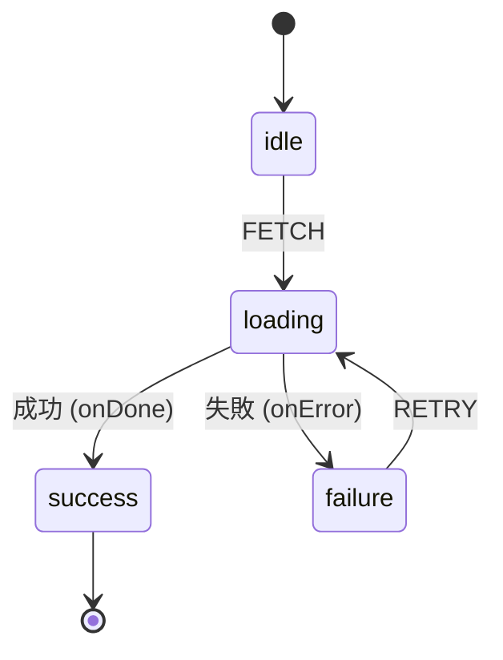

# XState（エックスステート）

> **ひとことで言うと**：「今どの段階にいて、どのイベントでどこへ進めるか」をステートマシン（状態遷移の設計図）として書き、ありえない状態や操作を仕組みで防ぐライブラリです。

**扱う状態の種類**：**複雑なフローの状態**（多段階の手続き・非同期処理の段階・画面モードの切り替えなど）。ローカル状態にもグローバル状態にも使えますが、単純な値の保存には向きません。
→ 考え方は [[01_ステートマシンとは]] / [[02_ウィザード（多段階フォーム）]] / [[04_複雑なローカル状態をreducerで整理する]] / [[04_送信フローの状態]]

## たとえ話で理解する

**信号機** や **自動販売機** です。
自動販売機は「お金を入れる前」に商品ボタンを押しても何も出ません。「お金投入済み」の状態のときだけボタンが効きます。
「どの状態のときに、どのボタン（イベント）が効き、次にどの状態になるか」があらかじめ決まっているので、変な動きをしません。XState はこの決まりをコードで書く道具です。

## なぜ必要？（困りごと）

真偽値（boolean）の組み合わせで状態を表すと、ありえない状態が生まれます。

```ts
// 4つの boolean → 2^4 = 16 通りの組み合わせ
const [isLoading, setIsLoading] = useState(false);
const [isError, setIsError] = useState(false);
const [isSuccess, setIsSuccess] = useState(false);
const [isRetrying, setIsRetrying] = useState(false);
// isLoading と isSuccess が同時に true …？ という矛盾が起きうる
```

- 「送信中にもう一度送信ボタンが押せた」「エラー表示が消えない」などのバグ
- 条件分岐が `if` の山になり、仕様を読み取れない
- 仕様（遷移図）とコードがずれる

XState では「状態は必ずどれか1つ」「定義された遷移しか起きない」ので、これらを防げます。

## 基本の仕組み

### 基本情報

- **開発元**: Stately（David Khourshid ほか）
- **ライセンス**: MIT
- **言語**: TypeScript
- **公式サイト**: https://stately.ai/docs
- **バージョン**: v5 系（2026年時点）。React 連携は `@xstate/react`

### インストール

```bash
npm install xstate @xstate/react
```

### 用語と図



| 用語 | 意味 |
|---|---|
| **状態（state）** | 今いる段階。同時に1つだけ（`idle` / `loading` など） |
| **イベント（event）** | きっかけ。`{ type: 'FETCH' }` のようなオブジェクト |
| **遷移（transition）** | 「この状態でこのイベントが来たらあの状態へ」 |
| **context** | 状態とは別に持つデータ（入力値・取得結果・リトライ回数など） |
| **action** | 遷移時に行う副作用や context の更新（`assign`） |
| **guard** | 遷移してよいかの条件 |
| **actor** | マシンを動かしている実体。非同期処理（Promise）も actor として呼べる |

### コアAPI（v5）

| API | 役割 |
|---|---|
| `setup({ types, actions, guards, actors })` | 型や部品を先に登録する（TypeScript で推奨） |
| `.createMachine({ ... })` | マシン（設計図）を作る |
| `assign({ key: ({ context, event }) => 値 })` | context を更新する action |
| `fromPromise(async ({ input }) => ...)` | Promise を actor にする |
| `createActor(machine).start()` | React の外でマシンを動かす |
| `useMachine(machine)` | React で使う。`[snapshot, send]` を返す |
| `snapshot.matches('loading')` | 今その状態か判定 |
| `snapshot.can({ type: 'SUBMIT' })` | そのイベントが今受け付けられるか |

## コード例

### データ取得のマシン

```ts
import { setup, assign, fromPromise } from 'xstate';

type User = { name: string };

export const userMachine = setup({
  types: {
    context: {} as { user: User | null; error: string | null },
    events: {} as { type: 'FETCH' } | { type: 'RETRY' },
  },
  actors: {
    // 非同期処理を actor として登録
    fetchUser: fromPromise(async () => {
      const res = await fetch('/api/user');
      if (!res.ok) throw new Error('取得失敗');
      return (await res.json()) as User;
    }),
  },
}).createMachine({
  id: 'user',
  initial: 'idle',
  context: { user: null, error: null },
  states: {
    idle: { on: { FETCH: 'loading' } },
    loading: {
      invoke: {
        src: 'fetchUser', // この状態に入ると実行され、出ると自動で止まる
        onDone: { target: 'success', actions: assign({ user: ({ event }) => event.output }) },
        onError: { target: 'failure', actions: assign({ error: () => '読み込みに失敗しました' }) },
      },
    },
    success: {},
    failure: { on: { RETRY: 'loading' } },
  },
});
```

### React で使う

```tsx
import { useMachine } from '@xstate/react';
import { userMachine } from './userMachine';

function UserPanel() {
  const [snapshot, send] = useMachine(userMachine);

  if (snapshot.matches('idle'))
    return <button onClick={() => send({ type: 'FETCH' })}>読み込む</button>;
  if (snapshot.matches('loading')) return <p>読み込み中...</p>;
  if (snapshot.matches('failure'))
    return (
      <p>
        {snapshot.context.error}
        <button onClick={() => send({ type: 'RETRY' })}>再試行</button>
      </p>
    );
  return <p>こんにちは、{snapshot.context.user?.name} さん</p>;
}
```

`loading` 中に `FETCH` を送っても、定義がないので **無視される**（二重送信が起きない）のがポイントです。

### guard 付きのウィザード

```ts
import { setup, assign } from 'xstate';

export const wizardMachine = setup({
  types: {
    context: {} as { name: string },
    events: {} as { type: 'NEXT' } | { type: 'BACK' } | { type: 'SET_NAME'; value: string },
  },
  guards: {
    hasName: ({ context }) => context.name.trim().length > 0, // 名前が入っていれば進める
  },
}).createMachine({
  initial: 'profile',
  context: { name: '' },
  states: {
    profile: {
      on: {
        SET_NAME: { actions: assign({ name: ({ event }) => event.value }) },
        NEXT: { target: 'confirm', guard: 'hasName' },
      },
    },
    confirm: { on: { BACK: 'profile', NEXT: 'done' } },
    done: { type: 'final' },
  },
});
```

画面側で `snapshot.can({ type: 'NEXT' })` を使えば、「次へ」ボタンの有効/無効も設計図から決まります（[[02_ウィザード（多段階フォーム）]]）。

### useReducer との比較

| | `useReducer` | XState |
|---|---|---|
| 状態の表し方 | 自由（ずれやすい） | 有限個の状態に限定 |
| 非同期処理 | `useEffect` で別管理 | `invoke` でマシン内に書ける |
| 可視化 | なし | 図にできる（Stately のエディタ等） |
| 学習コスト | 低い | 高め |

## よくある失敗

- ❌ 単純なトグルやカウンターにまで XState を使う → 記述が重いだけ → ⭕ 段階・分岐・非同期が絡むフローに絞る（それ以外は `useState` / `useReducer`）
- ❌ 状態（`loading`）と同じ意味の boolean を context にも持つ → 二重管理になる → ⭕ 「今どの段階か」は状態で、「データ」は context で持つ
- ❌ v4 の書き方（`interpret`、`services`、`cond`、`state` を返す `useMachine`）を写す → ⭕ v5 は `createActor`、`actors`、`guard`、`setup()` を使う
- ❌ `send('FETCH')` のように文字列だけ送る → ⭕ v5 ではイベントは `send({ type: 'FETCH' })` とオブジェクトで送る
- ❌ `setup()` を使わず型を付けない → イベント名の typo に気づけない → ⭕ `setup({ types })` で context と events の型を宣言する

## まとめ

- XState は状態・イベント・遷移を設計図（ステートマシン）として書き、ありえない状態を防ぐ
- v5 は `setup().createMachine()` で定義し、React では `useMachine` の `[snapshot, send]` を使う
- 非同期処理やウィザードなど「段階のある」フローで力を発揮する

## 関連ノート

- [[01_ステートマシンとは]] — XState の土台になる考え方
- [[02_ウィザード（多段階フォーム）]] — guard を使った段階管理
- [[03_Undo・Redo]] — 複雑なフローの別の例
- [[04_複雑なローカル状態をreducerで整理する]] — XState の手前の選択肢
- [[04_送信フローの状態]] — 送信中・成功・失敗の段階
- [[03_ローディング・エラー・空状態]] — 取得の段階を状態として扱う
- [[05_状態管理ライブラリの選び方]] — 使いどころの判断
- [[ライブラリ比較]] — 一覧で比較
- 上位: [[MOC_状態管理体系]]
