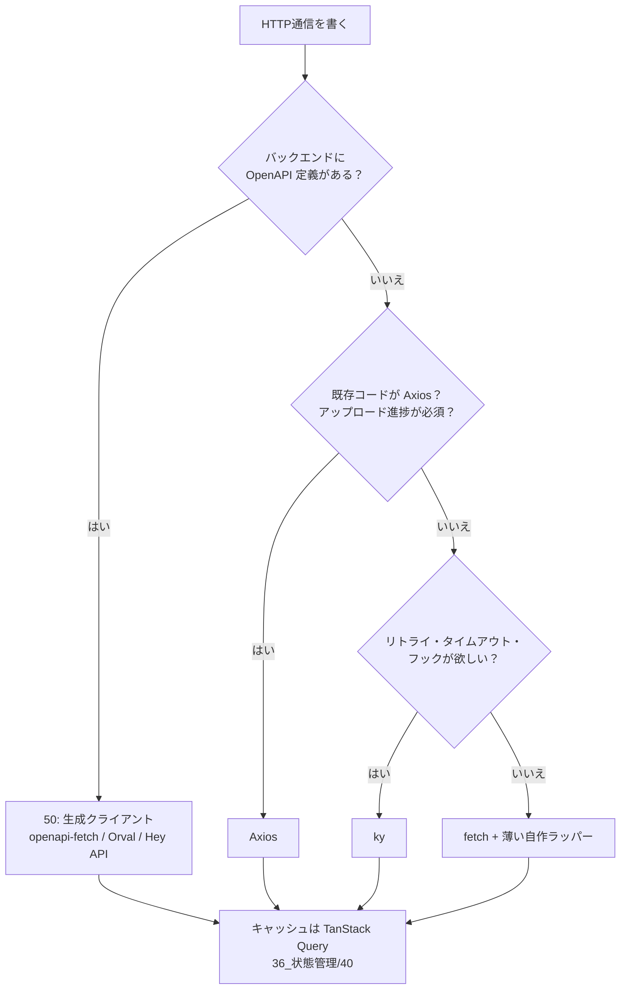

# MOC_HTTPクライアント体系

37_HTTPクライアント・ユーティリティ の入口ノート。**HTTPクライアントが面倒を見る関心事（組み立て・共通化・失敗への備え・認証・型・テスト）ごとに分けて**整理している。2026年時点の主流は「fetch を土台に、ky などの薄いラッパーか OpenAPI 生成クライアントを使い、キャッシュは TanStack Query に任せる」構成。

## フォルダ構成と運用ルール

| フォルダ | 役割 |
|---|---|
| 00_全体像 | 本MOC・道具の選び方 |
| 10_HTTP通信の基礎 | HTTPクライアントの役割、リクエスト/レスポンスの組み立て、ブラウザと Node.js の違い |
| 20_クライアント設計 | 共通クライアント、インターセプター/フック、APIレイヤーのフォルダ構成 |
| 30_エラー・リトライ・タイムアウト | エラーの分類と整形、AbortSignal、リトライと指数バックオフ |
| 40_認証の付与 | トークン付与、401 → リフレッシュ → 再送 |
| 50_型安全・コード生成 | Zod によるランタイム検証、OpenAPI からのクライアント生成 |
| 60_テスト・モック | MSW による通信のモック |
| 70_ユーティリティ | 汎用ユーティリティ（配列・オブジェクト）と日付・時刻の考え方 |
| 90_ライブラリ別リファレンス | ライブラリごとの使い方と比較（[[HTTPクライアント・ユーティリティ比較]]） |

- 10〜70 は **ライブラリに依存しない考え方**を書く。特定ライブラリの書き方は 90 に置き、ここから相互にリンクする
- 他フォルダとの住み分け：
  - HTTP の仕組みそのもの → 11_コンピューターサイエンス/60_ネットワーク・Web
  - API の設計（URL・エラー形式・OpenAPI の書き方） → 45_API設計
  - 取得データのキャッシュ・再取得（TanStack Query / SWR） → 36_状態管理/40_サーバー状態
  - 認証方式そのもの・Cookie・CORS → 73_認証認可 / 74_セッション管理 / 72_Web脆弱性対策
  - サーバーから外部 API を呼ぶ設計 → 34_Backend/60_外部連携
  - Postman などの手動ツール → 57_APIクライアントツール

## 道具の選び方

どれを選んでも、[[01_共通クライアントを1つ作る]] と [[01_HTTPエラーの扱い]] の考え方は同じ。

## おすすめの読む順番
1. [[01_HTTPクライアントとは]] で全体像をつかむ
2. 10_HTTP通信の基礎 → 20_クライアント設計（1回の通信と、その共通化）
3. 30_エラー・リトライ・タイムアウト → 40_認証の付与（失敗と認証への備え）
4. 50_型安全・コード生成 → 60_テスト・モック（品質を上げる）
5. 使うライブラリが決まったら 90 の該当ノート。ユーティリティは 70 から

## 10_HTTP通信の基礎
- [[01_HTTPクライアントとは]] — サーバーに注文書（リクエスト）を送り返事（レスポンス）を受け取る係。fetch の上に「お決まりの処理」を足したのが ky や Axios。
- [[02_リクエストとレスポンスの組み立て]] — URL・メソッド・ヘッダー・ボディの4点セット。ボディは一度しか読めない。ブラウザと Node.js の違い。

## 20_クライアント設計
- [[01_共通クライアントを1つ作る]] — 設定済みのクライアントを1つだけ作り、baseURL・ヘッダー・タイムアウト・エラー処理を1か所にまとめる。
- [[02_インターセプターとフック]] — すべての通信の出発前・到着後に必ず通る検問所。Axios の interceptor、ky の hooks、openapi-fetch の middleware。
- [[03_APIレイヤーのフォルダ構成]] — 共通クライアント → エンドポイントごとの関数 → フック の3段に分ける。技術別／機能別／生成の3パターン。

## 30_エラー・リトライ・タイムアウト
- [[01_HTTPエラーの扱い]] — 失敗は4種類。fetch は 4xx/5xx で例外を投げないので、自前の `ApiError` に揃えて投げ直す。
- [[02_タイムアウトとキャンセル]] — `AbortSignal.timeout` と `AbortSignal.any`。リトライ込みの合計時間にも上限を。
- [[03_リトライと指数バックオフ]] — 冪等なリクエストだけ、間隔を広げつつずらして、回数上限つきで再送。TanStack Query との二重リトライに注意。

## 40_認証の付与
- [[01_トークンの付与と自動更新]] — Cookie 方式と Bearer 方式。401 のときのリフレッシュは1本にまとめ、1回だけ再送する。

## 50_型安全・コード生成
- [[01_レスポンスの型とランタイム検証]] — `as User` は信じるだけ。Zod で実行時に確かめ、型は `z.infer` で作る。
- [[02_OpenAPIからクライアントを生成する]] — openapi-fetch・Orval・Hey API の使い分け。生成物は手で編集しない。

## 60_テスト・モック
- [[01_MSWでAPIをモックする]] — ネットワークの手前で横取りして偽の返事を返す。テスト・開発・Storybook で同じ定義を使い回す。

## 70_ユーティリティ
- [[01_ユーティリティライブラリの選び方]] — まず標準機能で書けないか。足りない分は es-toolkit を第一候補に。
- [[02_日付・時刻の扱い]] — やり取りは UTC の ISO 8601、表示の直前でローカライズ。date-fns と Temporal。

## 90_ライブラリ別リファレンス
- [[HTTPクライアント・ユーティリティ比較]]（HTTPクライアント／ユーティリティの比較表）
- Axios：[[01_Axios]] — インターセプターと豊富な機能を持つ、最も普及した HTTP クライアント。2026年3月のサプライチェーン攻撃に注意。
- Fetch API：[[02_Fetch API]] — ブラウザと Node.js の標準 API。すべての土台。
- ky：[[03_ky]] — fetch に例外・リトライ・タイムアウト・フックを足した約5KBのラッパー。v2 で API が刷新。
- Lodash：[[04_Lodash]] — 配列・オブジェクト・文字列操作の定番ユーティリティ。既存コード向け。
- es-toolkit：[[05_es-toolkit]] — Lodash より速く小さい TypeScript 製の後継候補。`es-toolkit/compat` で移行できる。
- date-fns：[[06_date-fns]] — 関数単位で読み込める日付ライブラリ。v4 でタイムゾーン対応。
