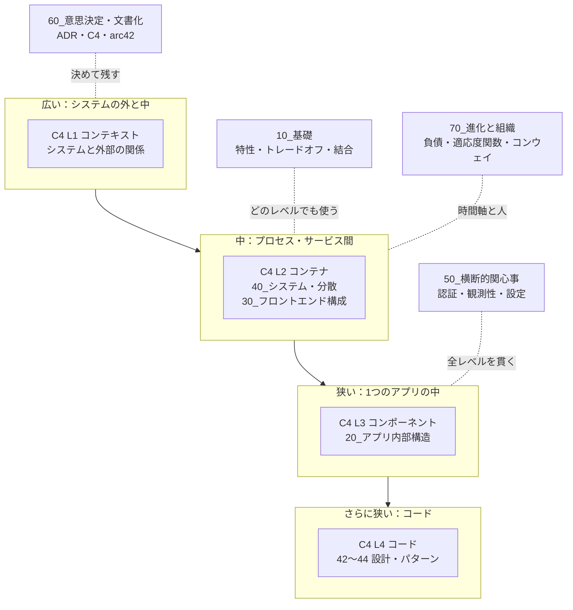
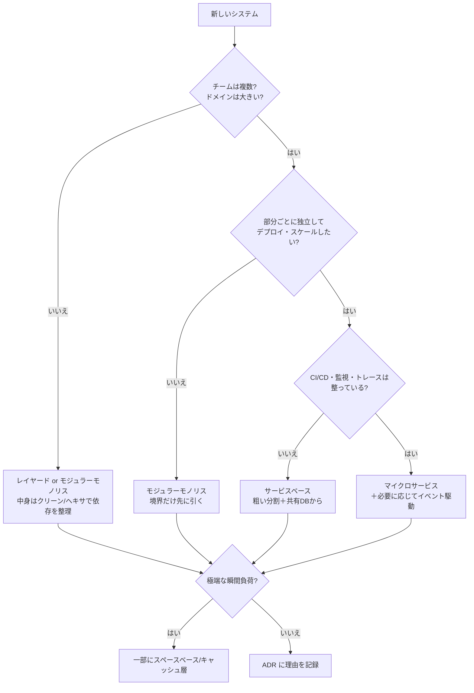
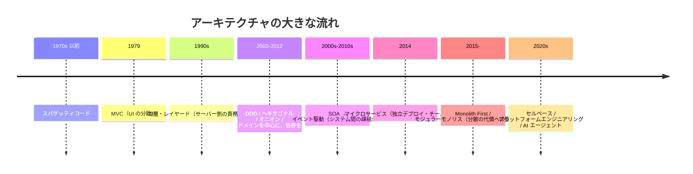
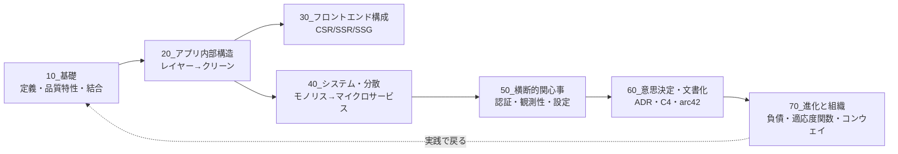

# アーキテクチャ体系（全体の解説）

## このノートの位置づけ

[[MOC_アーキテクチャ体系]] が「どこに何があるか」の地図なら、このノートは **「アーキテクチャという分野全体を、ひとつながりの話として理解する」** ための解説です。各フォルダの `00_解説_*` に入る前に、まずここで全体の筋を通します。

読み終えたときに次の問いに答えられることを目標にします。

1. アーキテクチャとは何か（設計と何が違うのか）
2. 何を基準に良し悪しを判断するのか
3. どんな「型（スタイル）」があり、どう選ぶのか
4. 決めたことをどう残し、どう育てていくのか
5. 2020年代にどんな揺り戻し・新しい論点が出てきたか

---

## 1. アーキテクチャとは何か — 3つの定義

アーキテクチャには「これが唯一の正解」という定義はありません。代表的な3つの見方を押さえると、輪郭がはっきりします。

### 1-1. 規格の定義（ISO/IEC/IEEE 42010）

> システムの環境の中での、そのシステムの**根本的な概念または性質**。それは**要素**・**関係**、そして**設計と進化の原則**に表れる。

- ポイントは「**すべて**ではなく**根本的なもの**」だということ
- 「要素・関係・原則」の3つは [[01_ソフトウェアアーキテクチャとは]] の3要素（コンポーネント・関係性・原則と制約）と同じ構図です
- 42010 はほかに **ステークホルダー（利害関係者）・関心事（Concern）・ビュー・ビューポイント** という言葉を定めています。「誰の、どんな関心に答える図・文書か」を意識せよ、という考え方で、後述の C4 や arc42 の土台になっています

### 1-2. 実務家の定義（Ralph Johnson / Martin Fowler）

> アーキテクチャとは「**重要なもの**、それが何であれ」。
> 言い換えると「**変更が難しいと感じられるもの**」。

- Fowler の論文 *Who Needs an Architect?*（2003）で広まった見方です
- 「後から変えにくいので、早めに正しく決めておきたい判断」の集まりがアーキテクチャ
- そこから **「アーキテクトの重要な仕事は、不可逆性を取り除いてアーキテクチャを減らすこと」** という逆説的な結論が出てきます（例：DB を抽象化して差し替え可能にする＝その判断を「重要でないもの」に変える）

### 1-3. 『ソフトウェアアーキテクチャの基礎』の定義（Richards & Ford）

アーキテクチャを次の **4つの次元** の組み合わせとして捉えます。

| 次元 | 中身 | このVaultでの置き場 |
|---|---|---|
| **構造**（Structure） | どのスタイルで組むか（レイヤード、マイクロサービス…） | 20 / 30 / 40 |
| **アーキテクチャ特性**（Characteristics） | 成功の基準となる品質（スケーラビリティ、可用性…） | 10（12_品質特性） |
| **アーキテクチャ決定**（Decisions） | 守るべきルール（「UI 層から DB を直接呼ばない」など） | 60 |
| **設計原則**（Design Principles） | 守るのが望ましい指針（「サービス間は非同期を優先」など） | 10 / 48_原則 |

「構造の図だけ描いてもアーキテクチャを説明したことにはならない。**なぜその構造なのか（特性）と、どう守らせるのか（決定・原則）**まで含めて初めてアーキテクチャ」という主張です。

### 1-4. 設計との違い

明確な線は引けませんが、目安は次のとおりです（詳しくは [[02_アーキテクチャと設計の違い]]）。

| 観点 | アーキテクチャ | 設計 |
|---|---|---|
| 範囲 | システム全体・複数チーム | 1つのモジュール・クラス |
| 変更コスト | 高い（後から変えにくい） | 比較的低い |
| 主な問い | 「**何で**分けるか」「**なぜ**そうするか」 | 「**どう**書くか」 |
| 失敗したとき | 作り直しに近い | リファクタリングで直せる |

---

## 2. アーキテクチャの法則

Richards & Ford は、この分野の考え方を短い「法則」にまとめています。全ノートに通じる前提なので最初に覚えておきます。

| 法則 | 内容 | 意味 |
|---|---|---|
| **第1法則** | ソフトウェアアーキテクチャのすべてはトレードオフである | 「常に正しいスタイル」はない。何かを得れば何かを失う（[[02トレードオフ]]） |
| **第2法則** | 「どうやって（How）」より「なぜ（Why）」が重要 | 構造そのものより、選んだ理由が後世に価値を持つ → ADR の存在理由 |
| **第3法則**（第2版で追加） | アーキテクチャ上の決定は二択ではなく、両極端の間のスペクトラム上にある | 「モノリスかマイクロサービスか」ではなく「どの程度分けるか」で考える |

「それは状況次第（It depends）」はアーキテクトの逃げ口上ではなく、**何に依存するのかを言語化すること**こそが仕事だ、というのがこの法則群のメッセージです。

---

## 3. 全体マップ — ズームレベルで整理する

このVaultの 41_アーキテクチャ は、**範囲の大きさ（ズームレベル）** でフォルダを分けています。これは C4 モデルの考え方と対応します。

### 3-1. C4 モデルの4レベル

Simon Brown が提唱した、アーキテクチャ図を「地図アプリのズーム」のように描き分ける方法です。

| レベル | 何を描くか | 主な読み手 |
|---|---|---|
| **1. コンテキスト**（System Context） | 対象システムと、利用者・外部システムとの関係 | 非エンジニアを含む全員 |
| **2. コンテナ**（Container） | 動かすために必要な実行単位（Webアプリ、API、DB、キュー、サーバーレス関数…） | 開発者・運用者 |
| **3. コンポーネント**（Component） | 1つのコンテナの中の主要な部品（インターフェースの裏にある実装のまとまり） | そのコンテナの開発者 |
| **4. コード**（Code） | クラス・関数・テーブル | 通常は描かない（コードから自動生成） |

- 「コンテナ」は Docker のコンテナではなく **「動いていないとシステムが成り立たない実行単位」** という意味です
- 実務では **レベル1・2だけ描けば十分**なことが多いとされます。レベル3・4はコミットのたびに古くなるためです

### 3-2. フォルダとの対応



- **縦軸（ズーム）**：20 → 30/40 → コンテキスト
- **横に効くもの**：10（判断の物差し）・50（全体を貫く仕組み）
- **時間と人の軸**：60（決めて残す）・70（育てる・組織と合わせる）

---

## 4. 判断の物差し — アーキテクチャ特性（品質特性）

アーキテクチャを選ぶ基準は「機能（何ができるか）」ではなく、**「どれだけうまくできるか」＝品質特性（非機能要件）** です。機能はどのスタイルでも実現できますが、品質特性はスタイルで大きく変わります。

### 4-1. Richards & Ford の3分類

| 分類 | 例 | 典型的な問い |
|---|---|---|
| **運用特性** | 可用性、性能、スケーラビリティ、弾力性、信頼性、回復性 | 本番で止まらず速く動くか |
| **構造特性** | 保守性、拡張性、テスト容易性、デプロイ容易性、移植性 | 作り続けやすいか |
| **横断特性** | セキュリティ、アクセシビリティ、法規制対応、プライバシー | 全体として守るべき制約を満たすか |

大事なのは **「全部を最大にしようとしない」** ことです。特性同士は衝突します（例：セキュリティを上げると性能が落ちる、スケーラビリティを上げるとシンプルさが落ちる）。書籍では **「重要な特性を3つ程度に絞る」** ことを勧めています（[[01品質属性]] / [[14_非機能要件]]）。

### 4-2. 国際規格 ISO/IEC 25010:2023 の9特性

2023年改訂版の製品品質モデルは次の9特性です。

| 特性 | ざっくり言うと | 2011年版からの変化 |
|---|---|---|
| 機能適合性 | 必要な機能がそろっているか | — |
| 性能効率性 | 資源に対して速いか | — |
| 互換性 | 他システムと共存・連携できるか | — |
| **インタラクション能力** | 使いやすいか（包括性なども含む） | 旧「使用性」を改称・拡張 |
| 信頼性 | 故障せず動き続けるか（無欠陥性を追加） | 一部副特性を追加 |
| セキュリティ | 守られているか（耐性を追加） | — |
| 保守性 | 直しやすいか | — |
| **柔軟性** | 環境変化に適応できるか（スケーラビリティを含む） | 旧「移植性」を改称・拡張 |
| **安全性** | 人や環境に危害を与えないか | **新設** |

Richards & Ford の分類は「アーキテクトが選ぶための実務的な語彙」、ISO 25010 は「品質を漏れなく議論するための共通語彙」と使い分けると便利です。

### 4-3. 特性を「測れる形」にする

「高可用性」のような言葉のままでは判断も検証もできません。次のように **シナリオ・数値** に落とします。

- ✕「速いこと」 → ○「ピーク時 1,000 req/s で 95 パーセンタイル 300ms 以内」
- ✕「止まらないこと」 → ○「月間稼働率 99.9%、障害時 30 分以内に復旧」
- ✕「変更しやすいこと」 → ○「新しい決済手段の追加が 1 チーム・1 スプリントで済む」

この「測れる形」が、後述の **適応度関数** でそのまま自動チェックの対象になります。

---

## 5. 構造の型 — アーキテクチャスタイルの地図

### 5-1. 2本の軸で整理する

すべてのスタイルは、次の2つの軸でおおよそ位置づけられます。

1. **分割の軸**：技術で分けるか（UI / ロジック / DB）、ドメインで分けるか（注文 / 在庫 / 会計）
2. **デプロイ単位**：1つにまとめるか（モノリシック）、複数に分けるか（分散）

| | 技術で分割 | ドメインで分割 |
|---|---|---|
| **1つのデプロイ単位** | レイヤード、パイプライン、マイクロカーネル | モジュラーモノリス |
| **複数のデプロイ単位** | イベント駆動、スペースベース | サービスベース、マイクロサービス |

- **技術で分割**：同じ技術の人が集まりやすく、最初は分かりやすい。ただし1つの業務変更が全層に波及しやすい
- **ドメインで分割**：業務の変更が1か所に閉じやすく、チームとも対応させやすい（→ 70 のコンウェイの法則）

### 5-2. アプリ内部構造（20）とシステム構造（40）は別の話

よく混同されますが、**クリーンアーキテクチャとマイクロサービスは対立する選択肢ではありません**。

- **20_アプリ内部構造**：1つのデプロイ単位の **中身** をどう分けるか（レイヤード、MVC、クリーン・ヘキサゴナル・オニオン）
- **40_システム・分散**：システムを **いくつのデプロイ単位** に分けるか（モノリス〜マイクロサービス）

「マイクロサービスの1つ1つの中身をヘキサゴナルで書く」のように **組み合わせて使う** のが普通です。

### 5-3. ★評価の読み方

MOC の比較表（★1〜5）は『ソフトウェアアーキテクチャの基礎』の評価に基づきます。読むときのコツは次のとおりです。

- **★の合計で比べない**。自分のシステムで重要な3特性の列だけを見る
- 左上（レイヤード・モジュラーモノリス）は **手軽さ・シンプルさ** が高く、右下（イベント駆動・マイクロサービス）は **スケール・耐障害性・進化しやすさ** が高い。これは「第1法則：すべてはトレードオフ」の可視化そのもの
- 迷ったら **★が低くてもシンプルな方から始め、必要になってから右へ移る**（次節）

### 5-4. 選び方のフロー（目安）



これはあくまで出発点です。実際には品質特性の優先順位・予算・組織の成熟度で判断し、その **理由を ADR に残す** ことが本体です。

---

## 6. 決めて残す — 意思決定と文書化（60）

アーキテクチャの価値の多くは「なぜそうしたか」にあります（第2法則）。それを残すための代表的な道具が3つあります。

### 6-1. ADR（Architecture Decision Record）

Michael Nygard が 2011 年に提唱した、**1つの決定を1つの短い文書に残す** 方法です（[[02ADRとArchitecture Decision Record]]）。

```markdown
# ADR-007: 注文サービスと在庫サービスの連携を非同期イベントにする
## ステータス
承認済み（2026-10-01）
## コンテキスト
在庫サービスの応答遅延が注文確定を止める障害が月2回発生している…
## 決定
注文確定時に OrderPlaced イベントを発行し、在庫は非同期に引き当てる。
## 結果
- 良い: 在庫側の障害が注文受付に波及しない
- 悪い: 在庫不足が後から判明するケースの補償処理（SAGA）が必要になる
```

- 動機：新しく来た人が過去の決定を「盲目的に受け入れるか、盲目的に変えるか」の二択になるのを防ぐ
- 長大な設計書は読まれないが、短い ADR はコードと一緒に管理でき、読まれる
- Thoughtworks の Technology Radar でも長く「Adopt（採用推奨）」に置かれている定番の手法です

### 6-2. C4 モデル（図）

3章の4レベルで図を描き分けます。図に **凡例・タイトル・矢印のラベル（何を・どのプロトコルで）** を必ず付けるのが C4 の流儀です。

### 6-3. arc42（文書テンプレート）

2005 年からある、技術に依存しない **12章構成** のアーキテクチャ文書テンプレートです。

| # | 章 | 中身 |
|---|---|---|
| 1 | 導入と目標 | 要求の要点、**品質目標トップ3**、ステークホルダー |
| 2 | 制約 | 守らなければならない技術・組織・法律上の制約 |
| 3 | コンテキストとスコープ | 外部システム・利用者との境界（≒ C4 L1） |
| 4 | 解決戦略 | 中心となるアイデアと方針 |
| 5 | ビルディングブロックビュー | 静的な構造を階層的に分解（≒ C4 L2・L3） |
| 6 | ランタイムビュー | 重要なシナリオでの動き |
| 7 | デプロイメントビュー | インフラと配置 |
| 8 | 横断的コンセプト | 全体に効く仕組み（→ 50_横断的関心事） |
| 9 | アーキテクチャ決定 | 重要な決定（→ ADR を並べる） |
| 10 | 品質要求 | 品質ツリーと品質シナリオ（→ 4-3） |
| 11 | リスクと技術的負債 | 既知の問題（→ 70） |
| 12 | 用語集 | 専門用語 |

**C4 で描き、arc42 の枠に入れ、決定は ADR で残す** という組み合わせが実務でよく使われます。このVaultのフォルダ構成（10 品質 / 50 横断 / 60 決定 / 70 負債）も arc42 の章立てとほぼ対応しています。

### 6-4. 誰が決めるか — 分散型の意思決定

近年は「アーキテクトが全部決める」から、**アーキテクチャ・アドバイス・プロセス**（誰でも決定してよいが、影響を受ける人と専門家に必ず助言を求め、ADR に残す）のような分散型の進め方も注目されています（Thoughtworks Technology Radar）。

---

## 7. 育てる — 進化と組織（70）

アーキテクチャは一度決めて終わりではなく、**時間とともに劣化し、組織とともに変わる** ものです。

### 7-1. 技術的負債

意図的な暫定案（「今は速さを優先し、後で直す」）は正当な判断ですが、**記録と返済計画がないと「ただの劣化」になります**（[[03技術的負債と意図的な暫定案]]）。arc42 の第11章や ADR の「結果」に書いておくのが実務的です。

### 7-2. 進化的アーキテクチャと適応度関数

Neal Ford・Rebecca Parsons・Patrick Kua の『進化的アーキテクチャ』が提唱した考え方です。

> **アーキテクチャ適応度関数**：あるアーキテクチャ特性が保たれているかを、**客観的に評価する仕組み**。

- 例：「ドメイン層はインフラ層に依存しない」を ArchUnit などのテストで CI 上で検査する
- 例：「API の p95 レイテンシ 300ms 以内」を監視で常時チェックする
- 例：「サービス間の循環依存ゼロ」を静的解析で検出する
- 分類：**トリガー型**（CI で実行）と **継続型**（本番監視）、**原子的**（1特性）と **全体的**（複数特性の組み合わせ）など

4-3 で「測れる形」にした品質特性を、**自動で守り続ける** ための仕組みです。ADR が「決定を残す」なら、適応度関数は「決定を守らせる」役割を担います。

### 7-3. コンウェイの法則と Team Topologies

> システムの構造は、それを設計した組織のコミュニケーション構造を写したものになる（コンウェイの法則）

- 逆に、**望むアーキテクチャに合わせてチームを組む** のが「逆コンウェイ戦略」です（[[04進化型アーキテクチャとリバースコンウェイの法則]]）
- 『Team Topologies』（Skelton & Pais）は、これを実践する4つのチーム型を示しました

| チーム型 | 役割 |
|---|---|
| ストリームアラインド | 1つの価値の流れ（業務・顧客体験）を端から端まで担当する主役 |
| プラットフォーム | CI/CD・認証・観測性などをセルフサービスで提供し、他チームの **認知負荷** を下げる |
| イネイブリング | 新しい技術・やり方を他チームに教えて自立させる |
| コンプリケイテッド・サブシステム | 高度な専門知識が必要な部分（数理最適化・映像処理など）を担当 |

「マイクロサービスにしたのにチームが1つ」「チームは分かれたのにモノリスを全員で触っている」は、どちらもコンウェイの法則に逆らっている状態です。

---

## 8. 歴史の流れ — 何が何を解決してきたか

詳しくは年表ノート [[アーキテクチャ]] にまとめています。大きな流れだけを示すと次のとおりです。



一貫しているテーマは **「変更の影響範囲を小さくする」** ことです。分ける単位が「関数 → 層 → ドメイン → サービス → チーム」と大きくなってきた、と捉えると流れがつかめます。

---

## 9. 2020年代の論点

### 9-1. 「マイクロサービス一辺倒」からの揺り戻し

- Fowler は 2015 年の時点で **MonolithFirst**（まずモノリスで作り、中をモジュールに分け、問題になってから切り出す）と **マイクロサービス・プレミアム**（分散そのものが追加のコストとリスクを生む）を指摘していました
- 2023 年には Amazon Prime Video の映像品質監視サービスが、サーバーレス／分散構成を **1プロセスにまとめてインフラコストを約90%削減** した事例が話題になりました
  - ただしこれは **1つのサービス内の構成変更** であり、「マイクロサービスはダメ」という話ではありません。コンポーネント間で大量のデータを受け渡す処理を、ネットワーク越しに分けていたことが問題でした
- 『ソフトウェアアーキテクチャの基礎』第2版（2025）で **モジュラーモノリスが独立した章** として追加されたのも、この流れを反映しています

教訓は「モノリスに戻れ」ではなく **第3法則（決定はスペクトラム）** です。分割の粒度は、データの流れ・チーム・品質特性に合わせて調整するものです。

### 9-2. セルベースアーキテクチャ

システム全体を、**アプリとデータをすべて含んだ独立したコピー（セル）** に分割し、利用者をセルに振り分ける方式です。AWS Well-Architected でも障害の影響範囲（ブラスト半径）を限定する手法として解説されています。

- 船の隔壁（バルクヘッド）と同じ発想で、1セルの障害・不良デプロイが全利用者に広がらない
- 「機能で分ける」マイクロサービスとは直交する、「**利用者（テナント）で分ける**」軸の分割
- 向いている：止まると影響が極めて大きい超大規模システム、厳しい RTO/RPO が求められるもの

### 9-3. プラットフォームエンジニアリング

Team Topologies のプラットフォームチームを具体化したもので、**社内開発者向けプラットフォーム（IDP）** を作り、各チームの認知負荷を下げる取り組みです。分散アーキテクチャの運用コスト（マイクロサービス・プレミアム）を組織的に下げる手段とも言えます。

### 9-4. AI・LLM とアーキテクチャ

2つの方向があります。

**(1) AI を組み込んだシステムのアーキテクチャ**

- Anthropic の *Building effective agents* は、LLM システムを **ワークフロー**（制御の流れをコードで決め、決まった箇所で LLM を呼ぶ）と **エージェント**（次に何をするかを LLM が環境からのフィードバックで決める）に分け、プロンプトチェーン・ルーティング・並列化・オーケストレーター＝ワーカーなどのパターンを示しました
- 原則は **「最もシンプルで確実に解ける構成を選び、本当に必要なときだけ自律性を上げる」**。これはまさに第1法則（トレードオフ）と MonolithFirst と同じ考え方です
- 安全面では、巨大な単一エージェントより **制約された小さなエージェントのパイプライン＋強い監視** が望ましいとされ、ゼロトラスト・最小権限が前提条件になりつつあります（Thoughtworks Technology Radar）

**(2) AI がアーキテクチャを守る・壊す**

- コーディングエージェントが大量にコードを書く時代には、**アーキテクチャの逸脱（ドリフト）** が起きやすくなります
- 対策として、参照実装を MCP サーバー経由でエージェントに見せる、**適応度関数・アーキテクチャテストを CI に入れて自動で検出する**、ADR をエージェントにも読ませる、といった取り組みが出てきています
- 「人が読んで守るルール」から「**機械が検査できるルール**」へ移す価値が、AI によって一段と高まっています

---

## 10. よくある誤解

| 誤解 | 実際 |
|---|---|
| 有名企業が使っているスタイルが正解 | 規模・チーム・品質特性が違えば正解も違う（第1法則） |
| マイクロサービスは「進んだ」モノリス | 別のトレードオフを選んだだけ。分散の代償（プレミアム）を払えるかが問題 |
| クリーンアーキテクチャを入れれば保守性が上がる | 小さなアプリでは層とインターフェースが増えて逆に読みにくくなる（[[クリーンアーキテクチャを入れたら、コードが汚くなった]]） |
| アーキテクチャは最初に全部決めるもの | 変えにくい部分だけ早めに決め、残りは「後で決められる」ようにしておく（Fowler） |
| 図があればアーキテクチャは説明できる | 構造＋特性＋決定＋原則の4次元が必要（Richards & Ford） |
| アーキテクチャは技術だけの問題 | 組織構造と表裏一体（コンウェイの法則） |

---

## 11. 学習ロードマップ



1. **[[00_解説_アーキテクチャの基礎]]** — 物差し（品質特性・トレードオフ・結合）を手に入れる
2. **[[00_解説_アプリ内部構造]]** — 身近な1アプリの中で「依存の向き」を体感する
3. **[[00_解説_フロントエンド構成]]** — 画面側の配信方式という別のズームを知る
4. **[[00_解説_システム・分散]]** — 分けることの利点と代償を学ぶ
5. **[[00_解説_横断的関心事]]** — どのスタイルでも必ず出てくる共通課題
6. **[[00_解説_意思決定・文書化]]** — 判断を残し、伝える
7. **[[00_解説_進化と組織]]** — 時間と人の軸で考える

並行して年表 [[アーキテクチャ]] を読むと、「なぜそのスタイルが生まれたか」の背景がつながります。

### MOC 上の未作成ノート（今後の候補）

この解説で触れた次のテーマは、まだ個別ノートがありません。

- 40：モジュラーモノリス / マイクロカーネル / サービスベース / スペースベース（/ セルベース）
- 60：リスク分析 / C4モデル / arc42
- 70：適応度関数

---

## 参考資料・出典

**書籍**

- Mark Richards, Neal Ford『ソフトウェアアーキテクチャの基礎』（原著 *Fundamentals of Software Architecture*, 2nd Edition, O'Reilly, 2025）
  - [O'Reilly 書籍ページ](https://www.oreilly.com/library/view/fundamentals-of-software/9781098175504/) / [第27章 The Laws of Software Architecture, Revisited](https://www.oreilly.com/library/view/fundamentals-of-software/9781098175504/ch27.html) / [Neal Ford の紹介ページ](https://nealford.com/books/SAF2e.html)
- Neal Ford, Rebecca Parsons, Patrick Kua『進化的アーキテクチャ』（*Building Evolutionary Architectures*）— [nealford.com](https://nealford.com/books/buildingevolutionaryarchitectures.html)
- Matthew Skelton, Manuel Pais『チームトポロジー』（*Team Topologies*）

**定義・規格**

- [ISO/IEC/IEEE 42010 — Defining "architecture"](http://www.iso-architecture.org/ieee-1471/defining-architecture.html) / [Conceptual Model](http://www.iso-architecture.org/42010/cm/)
- [ISO/IEC 25010 — quality.arc42.org](https://quality.arc42.org/standards/iso-25010) / [ISO/IEC 25010 Explained（Sonar）](https://www.sonarsource.com/resources/library/iso-iec-25010-explained/)
- Martin Fowler, [Who Needs an Architect?（IEEE Software, 2003, PDF）](https://martinfowler.com/ieeeSoftware/whoNeedsArchitect.pdf)

**図・文書化**

- [The C4 Model for Software Architecture（InfoQ）](https://www.infoq.com/articles/C4-architecture-model/)
- [arc42 Template Overview](https://arc42.org/overview/)
- [Architectural Decision Records（adr.github.io）](https://adr.github.io/)

**進化・組織**

- [Fitness Functions for Your Architecture（InfoQ）](https://www.infoq.com/articles/fitness-functions-architecture/)
- [Team Topologies（continuous-architecture.org）](https://continuous-architecture.org/practices/team-topologies/)

**2020年代の論点**

- Martin Fowler, [Microservice Premium](https://martinfowler.com/bliki/MicroservicePremium.html) / [Microservices Guide](https://martinfowler.com/microservices/) / [Microservice Trade-Offs](https://martinfowler.com/articles/microservice-trade-offs.html)
- [Prime Video Sparks Serverless Debate by Switching to Monolith（Virtualization Review, 2023）](https://virtualizationreview.com/articles/2023/05/08/serverless-vs-monolith.aspx?m=1)
- [AWS Well-Architected: What is a cell-based architecture?](https://docs.aws.amazon.com/wellarchitected/latest/reducing-scope-of-impact-with-cell-based-architecture/what-is-a-cell-based-architecture.html)
- [Thoughtworks Technology Radar](https://www.thoughtworks.com/radar) / [Architecture advice process](https://www.thoughtworks.com/en-us/radar/techniques/architecture-advice-process) / [Vol.33（2025年11月, PDF）](https://www.thoughtworks.com/content/dam/thoughtworks/documents/radar/2025/11/tr_technology_radar_vol_33_en.pdf)
- [Building Effective AI Agents — Architecture Patterns（Anthropic, PDF）](https://resources.anthropic.com/hubfs/Building%20Effective%20AI%20Agents-%20Architecture%20Patterns%20and%20Implementation%20Frameworks.pdf)
