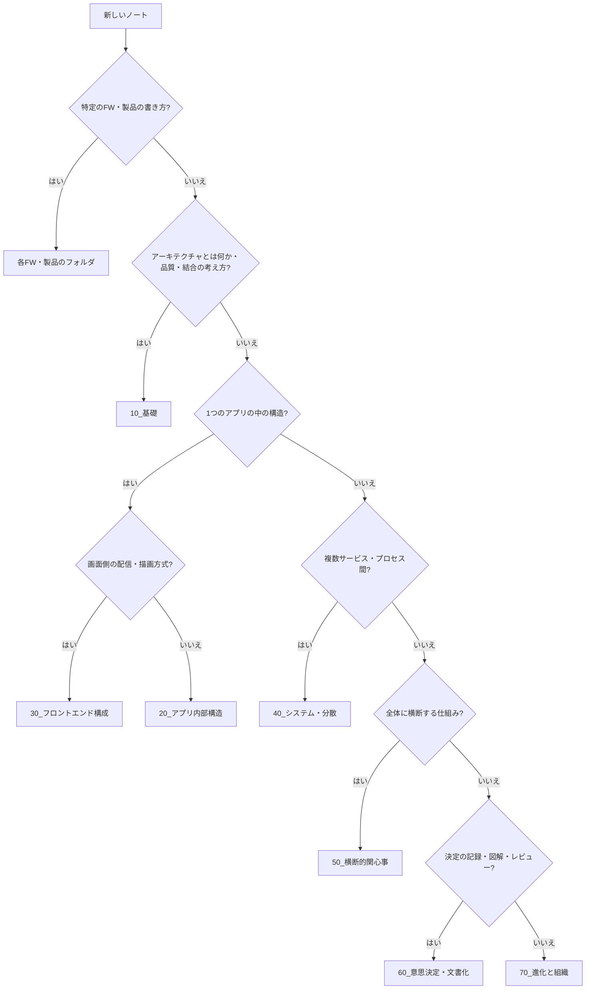

# MOC_アーキテクチャ体系

41_アーキテクチャ の入口ノート。**ソフトウェアを「どう組み立てるか」という大きな構造と、その判断**を扱う。骨格は C4 モデル・arc42 にならった **範囲の大きさ（ズームレベル）別**、スタイルの比較方法は『ソフトウェアアーキテクチャの基礎』（Richards & Ford）の **アーキテクチャ特性★評価** を取り入れた。

## フォルダ構成と運用ルール

| フォルダ | 役割 |
|---|---|
| 00_全体像 | 本MOC・年表（[[アーキテクチャ]]）・旧カリキュラム目次（[[41_アーキテクチャ/00_全体像/目次|目次]]） |
| 10_基礎 | アーキテクチャ思考 / 品質特性・非機能要件・トレードオフ / モジュール性・結合 |
| 20_アプリ内部構造 | 1つのアプリの中の構造：レイヤー / MVC系 / クリーン・ヘキサ・オニオン / 依存性の管理 |
| 30_フロントエンド構成 | レンダリング方式（CSR・SSR・SSG・ISR）/ BFF / マイクロフロントエンド |
| 40_システム・分散 | 複数のプロセス・サービスにまたがる構造：モノリス〜マイクロサービス / イベント駆動 / SAGA / APIゲートウェイ |
| 50_横断的関心事 | 認証認可の境界 / 観測性 / 設定・シークレット・フィーチャーフラグ |
| 60_意思決定・文書化 | ADR / リスク分析 / 図解（C4・arc42）/ レビュー観点 |
| 70_進化と組織 | 技術的負債 / 進化的アーキテクチャ・適応度関数 / コンウェイの法則 |
| 90_参考資料 | 書籍・研修・動画のクリップ |

- 10〜70 は **FW・言語に依存しない設計の考え方と判断**を書く
- 20・40 の「スタイル」ノートは下の **共通テンプレート** で書き、比較表に★を追記する
- 次のテーマは兄弟フォルダが本拠地。41 には「アーキテクチャ上どこに置くか」だけを書く

| テーマ | 本拠地 |
|---|---|
| SOLID・DRY などの設計原則 | 48_原則 |
| DDD（戦略・戦術）・オブジェクト指向 | 42_ソフトウェア設計 |
| パッケージ・モジュール分割の実務 | 43_モジュール設計 |
| GoFデザインパターン | 44_クラス設計・デザインパターン |
| API設計 | 45_API設計 |
| バックエンドの実装構造（Controller/Service/Repository） | 34_Backend |
| React/Next.js 固有の構成 | 32_React / 33_Next.js / 47_フロントエンド設計 |
| DB設計・データモデル | 68_データアーキテクチャ |
| 可観測性の実装 | 65_可観測性 |
| 認証・認可の仕組み | 73_認証認可 / 74_セッション管理 |

## どこに置くか迷ったら



## スタイル比較表（★1〜5）

『ソフトウェアアーキテクチャの基礎』の評価軸。

| スタイル | 置き場 | 分割の軸 | 手軽さ・コスト | シンプルさ | デプロイ容易性 | テスト容易性 | 拡張性（スケール） | 耐障害性 | 進化しやすさ |
|---|---|---|---|---|---|---|---|---|---|
| レイヤード | 20 | 技術 | ★★★★★ | ★★★★★ | ★ | ★★ | ★ | ★ | ★ |
| クリーン・ヘキサ・オニオン | 20 | 技術（依存の向き） | ★★★ | ★★ | ★ | ★★★★ | ★ | ★ | ★★★ |
| モジュラーモノリス | 40 | ドメイン | ★★★★★ | ★★★★ | ★★ | ★★★ | ★ | ★ | ★★★ |
| マイクロカーネル | 40 | 技術 / ドメイン | ★★★★★ | ★★★★ | ★★★ | ★★★ | ★ | ★ | ★★★ |
| サービスベース | 40 | ドメイン | ★★★★ | ★★★ | ★★★★ | ★★★★ | ★★★ | ★★★★ | ★★★ |
| イベント駆動 | 40 | 技術 | ★★★ | ★ | ★★★ | ★★ | ★★★★★ | ★★★★★ | ★★★★★ |
| スペースベース | 40 | 技術 | ★★ | ★ | ★★★ | ★ | ★★★★★ | ★★★ | ★★★ |
| マイクロサービス | 40 | ドメイン | ★ | ★ | ★★★★ | ★★★★ | ★★★★★ | ★★★★ | ★★★★★ |

- ★が多いほどその特性に優れる（手軽さ・コストは★が多いほど安い）
- 出典：『ソフトウェアアーキテクチャの基礎』初版の評価表。クリーン・ヘキサ・オニオンは書籍に評価がないため独自の目安、モジュラーモノリス（第2版の新章）も目安。詳しい根拠は [[00_解説_アプリ内部構造]] / [[00_解説_システム・分散]]

## スタイルノートの共通テンプレート

```markdown
## 生まれた背景（どんな課題があったか）
## 構造（登場する部品と依存の向き・図）
## アーキテクチャ特性の★評価（上の比較表と同じ軸）
## 向いている場面 / 向いていない場面
## 関連（前後のスタイル・原則・実装例）
```

## 00_全体像
- **[[00_解説_アーキテクチャ体系]]** — 分野全体の解説（最初にここから）
- [[アーキテクチャ]] — 有名なアーキテクチャを西暦順でたどる年表
- [[41_アーキテクチャ/00_全体像/目次|目次]] — 旧カリキュラム目次（第0〜8部）

## 10_基礎
- **[[00_解説_アーキテクチャの基礎]]** — この分野の解説（まずここから）
### 11_アーキテクチャ思考
- [[00ソフトウェアアーキテクチャ]]
- [[01_ソフトウェアアーキテクチャとは]]
- [[02_アーキテクチャと設計の違い]]
- [[03_なぜ今ここで扱うか_変更コストとチームと長期保守]]
- [[04_アーキテクトの役割と思考]]
### 12_品質特性・トレードオフ
- [[01品質属性]]
- [[14_非機能要件]]
- [[02トレードオフ]]
- [[03アーキテクチャに効く原則]]
- [[04_アーキテクチャ特性の見つけ方と分類]]
- [[05_品質特性シナリオと計測]]
### 13_モジュール性・結合
- [[01モジュール性]]
- [[02_結合の指標_求心性遠心性と主系列からの距離]]
- [[03_疎結合と高凝集]]
- [[04_コナーセンス]]
- [[05_アーキテクチャ量子と粒度]]
- [[06_論理コンポーネントの見つけ方]]

## 20_アプリ内部構造
- **[[00_解説_アプリ内部構造]]** — この分野の解説（まずここから）
### 21_レイヤー
- [[01層化]]
- [[三層アーキテクチャ]]
- [[レイヤードアーキテクチャ]]
- [[レイヤー構成]]
- [[02_閉じた層と開いた層_隔離層とシンクホール]]
- [[03_垂直スライスアーキテクチャ]]
### 22_UI分離_MVC系
- [[33_MVCアーキテクチャとは]]
- [[01_MVC違反とは]]
- [[02UIとドメイン分離]]
- [[02_MVC_UI分離のまとめ]]
- [[MVCとMVVM]]
- [[03_GUIアーキテクチャの系譜_PassiveView・PresentationModel]]
### 23_クリーン・ヘキサ・オニオン
- [[依存性のルール]]
- [[ヘキサゴナルアーキテクチャ]]
- [[クリーンアーキテクチャの概要]]
- [[オニオンアーキテクチャとの比較]]
- [[CQRS_コマンドとクエリの責務分離]]
### 24_依存性の管理
- [[01依存性逆転]] / [[02_依存関係逆転の原則]] — 内容が重なる。原則そのものは 48_原則/SOLID が本拠地
- [[01_依存性注入]]
- [[03_制御の反転とComposition Root]]
- [[04_インターフェースと抽象化]]

## 30_フロントエンド構成
- **[[00_解説_フロントエンド構成]]** — この分野の解説（まずここから）
- [[Webレンダリング方式_SSG_SSR_CSR_ISR]]
- [[あなたはどのレンダリングパターンを採用しますか？【CSRSSRSSGISRを図解で解説】]]

## 40_システム・分散
- **[[00_解説_システム・分散]]** — この分野の解説（まずここから）
- [[01_分散とスタイル]]
- [[02モノリスと分散モノリスとマイクロサービスといつ分けるか]]
- [[03同期APIとメッセージとイベント駆動の概観]]
- [[010Programming/41_アーキテクチャ/40_システム・分散/イベント駆動アーキテクチャ|イベント駆動アーキテクチャ]]
- [[04データ所有権と分散トランザクションとSAGAと整合性]]
- [[05BFFとAPIゲートウェイとグレースフルデグレーデーション]]
- （未作成）モジュラーモノリス / マイクロカーネル / サービスベース / スペースベース

## 50_横断的関心事
- **[[00_解説_横断的関心事]]** — この分野の解説（まずここから）
- [[01_横断的関心事]]
- [[02認可と認証の置き方と境界とアイデンティティ]]
- [[03観測性とログとメトリクスとトレースとアーキテクチャ上の接点]]
- [[04設定とシークレットとフィーチャーフラグ]]

## 60_意思決定・文書化
- **[[00_解説_意思決定・文書化]]** — この分野の解説（まずここから）
- [[01_意思決定と進化]]
- [[02ADRとArchitecture Decision Record]]
- [[05レビュー観点と図と境界と非機能と運用]]
- （未作成）リスク分析 / C4モデル / arc42

## 70_進化と組織
- **[[00_解説_進化と組織]]** — この分野の解説（まずここから）
- [[03技術的負債と意図的な暫定案]]
- [[04進化型アーキテクチャとリバースコンウェイの法則]]
- （未作成）適応度関数

## 90_参考資料
- [[ソフトウェアアーキテクチャ研修【MIXI 25新卒技術研修】]]
