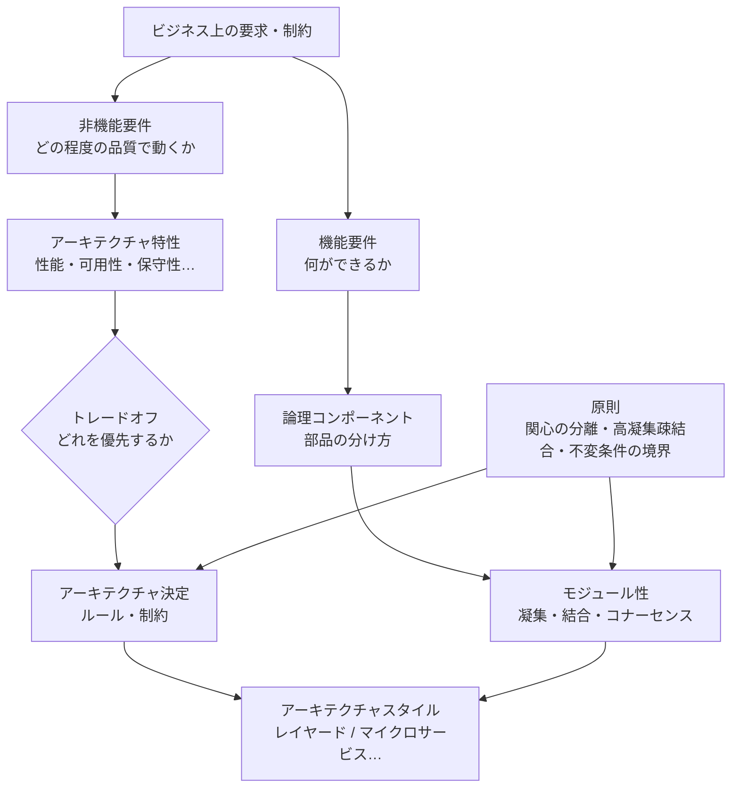

# アーキテクチャの基礎

## このフォルダで扱うこと

10_基礎 は、レイヤードやマイクロサービスといった**個々のスタイルを学ぶ前に持っておきたい「ものさし」**を集めたフォルダです。  
どのスタイルを選ぶにしても、「そもそもアーキテクチャとは何か」「何を良しとするのか（品質）」「部品同士の関係をどう評価するのか（モジュール性）」が分かっていないと、比較も判断もできません。

| サブフォルダ | 答える問い |
|---|---|
| 11_アーキテクチャ思考 | アーキテクチャとは何か？ 設計とどう違うのか？ なぜ早く意識すべきか？ |
| 12_品質特性・トレードオフ | システムに何を求めるのか？ どれを優先し、何を諦めるのか？ |
| 13_モジュール性・結合 | 部品の分け方・つなぎ方が良いかどうかを、どう評価するのか？ |

**扱わないこと（本拠地は別フォルダ）**

| テーマ | 本拠地 |
|---|---|
| SOLID・DRY・KISS など個別の設計原則 | 48_原則 |
| DDD・オブジェクト指向 | 42_ソフトウェア設計 |
| パッケージ・モジュール分割の実務 | 43_モジュール設計 |
| 具体的なスタイル（レイヤード・クリーン・マイクロサービス等） | 41 の 20_アプリ内部構造 / 40_システム・分散 |
| ADR など意思決定の記録方法 | 41 の 60_意思決定・文書化 |

---

## 全体像

アーキテクチャの基礎は、次のような関係でつながっています。

ポイントは 2 つです。

1. **品質の流れ**：ビジネスの要求 → 非機能要件 → アーキテクチャ特性 → トレードオフ → 決定 → スタイル
2. **構造の流れ**：機能 → 論理コンポーネント → モジュール性の評価 → スタイル

スタイルは「最初に選ぶもの」ではなく、**この 2 つの流れの結果として選ばれるもの**です。

---

## 主要概念の解説

### 1. アーキテクチャ思考

#### 1.1 アーキテクチャとは何か

ソフトウェアアーキテクチャとは、**システムをどのような部品（コンポーネント）に分け、どうつなぎ、どんなルールで役割分担させるか**という、システム全体の骨組みのことです。  
建築にたとえると、内装や家具（＝クラスや関数の書き方）より前に決める「部屋割り・廊下・柱の配置」にあたります。

アーキテクチャを構成する要素は、見方によって次の 2 通りで整理されます。

| 見方 | 構成要素 | 出典 |
|---|---|---|
| 構造としての見方 | ①コンポーネント ②関係性（依存・データの流れ） ③原則・制約 | [[01_ソフトウェアアーキテクチャとは]] |
| 『ソフトウェアアーキテクチャの基礎』の見方 | ①アーキテクチャスタイル ②アーキテクチャ特性 ③論理コンポーネント ④アーキテクチャ決定 | [[00ソフトウェアアーキテクチャ]] |

どちらも「**部品と、その関係と、それを縛るルール**」を扱っている点は共通です。後者はそこに「**何を良しとするか（特性）**」を明示的に加えています。

#### 1.2 アーキテクチャと設計の違い

| 観点 | アーキテクチャ | 設計（詳細設計） |
|---|---|---|
| 対象 | システム全体の構造 | モジュール・クラス・関数 |
| 粒度 | 粗い（サービス・レイヤー） | 細かい（クラス・メソッド） |
| 後から変えるコスト | 高い | 比較的低い |

ただし両者の**境界はグラデーション**で、きっぱり分かれるものではありません。  
実務では「**後から変えるのが高くつく判断ほどアーキテクチャ寄り**」と考えると整理しやすくなります。  
→ 詳しくは [[02_アーキテクチャと設計の違い]]

#### 1.3 アーキテクトの考え方

『ソフトウェアアーキテクチャの基礎』では、アーキテクトの思考の特徴として次のような点を挙げています。

- **技術の「幅」を持つ**：1 つの技術を深く知るより、選択肢を広く知っていることが重要
- **トレードオフを分析する**：正解を探すのではなく、何を得て何を失うかを比べる
- **ビジネスの要求を理解する**：技術的に美しいかではなく、事業の成功に効くかで判断する
- **手を動かし続ける**：コードから離れすぎると判断が現実から浮く

同書の「ソフトウェアアーキテクチャの法則」も覚えておくと便利です。

> **第一法則：ソフトウェアアーキテクチャはすべてトレードオフである**  
> **第二法則：「どうやるか（how）」より「なぜそうするか（why）」の方が重要である**

#### 1.4 なぜ早めに意識するのか

アーキテクチャ起因の問題は、後になるほど直すコストが大きくなります。  
意識しないまま開発を続けると、**大泥団子（Big Ball of Mud）**、**散弾銃手術（1 つの変更で多数のファイルを直す状態）**、**神クラス**といった状態に陥りがちです。  
一方で「最初に全部決める」必要もなく、**最初に決めるべきこと**と**後で決めていいこと**を分けるのが現実的です。  
→ 詳しくは [[03_なぜ今ここで扱うか_変更コストとチームと長期保守]]

---

### 2. アーキテクチャ特性（品質属性・非機能要件）

#### 2.1 機能要件と非機能要件

| | 機能要件 | 非機能要件 |
|---|---|---|
| 問い | 何ができるか？ | どのように動くか？ |
| 例 | ログインできる、検索できる | 3 秒以内に応答する、99.9% 稼働する |
| 影響する場所 | 実装する機能 | 設計・アーキテクチャ・運用 |

**非機能要件**は要件定義の言葉、**品質属性**はソフトウェア工学の言葉、**アーキテクチャ特性**は『ソフトウェアアーキテクチャの基礎』の言葉で、指しているものはほぼ同じです。このフォルダでは文脈に応じて使い分けています。  
→ [[14_非機能要件]]、[[01品質属性]]

#### 2.2 代表的な特性

| 分類（『基礎』の分け方） | 代表例 | 意味 |
|---|---|---|
| 運用的特性 | 性能、可用性、スケーラビリティ、信頼性 | 動いているときの振る舞い |
| 構造的特性 | 保守性（修正容易性）、拡張性、テスト容易性、移植性 | コードの構造に関わる性質 |
| 横断的特性 | セキュリティ、ユーザビリティ、法令順守 | 上の 2 つに収まらないもの |

#### 2.3 明示的な特性と暗黙的な特性

- **明示的な特性**：要件書に書かれている特性（例：「ピーク時に 1 万人が同時接続する」）
- **暗黙的な特性**：書かれていないが、当然求められる特性（例：セキュリティ、最低限の可用性）

アーキテクトの仕事は、要件書に書かれた言葉から**書かれていない特性まで読み取る**ことです。  
たとえば「年に 1 回の大規模セール」という一文からは、**弾力性（短時間の急激な負荷増に耐える力）**が必要だと読み取れます。

#### 2.4 特性は「測れる」ように書く

「速いシステム」ではなく「95% のリクエストが 500ms 以内に応答する」のように、**測れる目標値**にします。こう書くと、設計の良し悪しを検証でき、後からテストや監視（適応度関数）にもつなげられます。  
→ [[01品質属性]] の「品質属性は測れるべき」

#### 2.5 すべてはトレードオフ

特性同士はしばしば衝突します。

| トレードオフ | 例 |
|---|---|
| 一貫性 vs 可用性（CAP 定理） | ネットワーク分断時に、正しさと応答のどちらを優先するか |
| 一貫性 vs 遅延 | 全ノードの同期を待つほど応答は遅くなる |
| 冗長性 vs コスト | 多重化するほど落ちにくいが高くつく |
| 性能 vs 保守性 | 最適化したコードは読みにくくなりがち |
| 柔軟性 vs シンプルさ | 拡張ポイントを増やすほど構造は複雑になる |

そのため『基礎』では、**特性は 7 個程度まで絞り、上位 3 つを決める**ことを勧めています。すべてを最大化しようとすると、どれも中途半端になります。  
また「**最高のアーキテクチャ**」ではなく「**最も悪くないアーキテクチャ（least worst）**」を目指す、という考え方も重要です。  
→ [[02トレードオフ]]（選んだ理由は ADR に残す → 60_意思決定・文書化）

#### 2.6 アーキテクチャに効く原則

個別のテクニックより上位にある、判断の軸になる原則です。

| 原則 | 一言で |
|---|---|
| 関心の分離 | 異なる理由で変わるものは分ける |
| 高凝集 | 関係の深いものは同じ場所にまとめる |
| 疎結合 | 部品同士の依存は少なく、弱くする |
| 不変条件の境界 | 「常に成り立つべきルール」を守る範囲を境界にする |

SOLID などの原則は、これらを**クラスやモジュールの単位で具体化したもの**と位置づけられます（本拠地は 48_原則）。  
→ [[03アーキテクチャに効く原則]]

---

### 3. モジュール性

#### 3.1 モジュールとは

モジュールとは、**より大きな構造を組み立てるための、独立した部品の単位**です。オブジェクト指向ならクラスの集まり、関数型や構造化言語なら関数の集まりにあたります。  
アーキテクチャの議論では、パッケージ・名前空間・サービスなども含めた「**まとまりの単位**」として広くとらえます。  
→ [[01モジュール性]]

#### 3.2 凝集度（Cohesion）

**モジュールの中の要素が、どれだけ同じ目的のために集まっているか**を表します。  
「このモジュールは何をするものか」を一文で言えるなら、凝集度は高いといえます。

凝集度の強さは、一般に次の順に並べられます（下ほど望ましい）。

| レベル | 状態 |
|---|---|
| 偶発的凝集 | たまたま同じ場所にあるだけ（Utils の寄せ集め） |
| 論理的凝集 | 「種類が似ている」だけでまとめた |
| 時間的凝集 | 「同じタイミングで動く」だけでまとめた |
| 手続き的凝集 | 実行順序でまとめた |
| 通信的凝集 | 同じデータを扱う処理をまとめた |
| 逐次的凝集 | ある処理の出力が次の入力になる |
| 機能的凝集 | 1 つの機能に必要なものだけがそろっている |

#### 3.3 結合度（Coupling）

**モジュール同士がどれだけ依存し合っているか**を表します。『基礎』では、結合を数える指標として次を紹介しています。

- **求心性結合（Ca）**：外から自分に入ってくる依存の数（どれだけ頼られているか）
- **遠心性結合（Ce）**：自分から外へ出ていく依存の数（どれだけ他に頼っているか）

これをもとに、次の指標も計算できます。

| 指標 | 意味 |
|---|---|
| 不安定度 I = Ce / (Ca + Ce) | 1 に近いほど、他の変更の影響を受けやすい |
| 抽象度 A | 抽象要素（インターフェース等）の割合 |
| 主系列からの距離 D = \|A + I − 1\| | 0 に近いほど、抽象度と安定度のバランスが良い |

「よく頼られる（安定な）モジュールほど抽象的であるべき」という考え方で、依存性逆転の原則（→ 20_アプリ内部構造/24_依存性の管理）の裏付けにもなっています。

#### 3.4 コナーセンス（Connascence）

結合の「数」ではなく「**種類と強さ**」を表す言葉です。  
**2 つの部品のうち一方を変えたとき、もう一方も変えなければ正しく動かない**なら、その 2 つはコナーセントである、といいます。

| 種類 | 名前 | 例 |
|---|---|---|
| 静的（ソースコードで分かる） | 名前 | 関数名を変えると呼び出し側も直す |
| | 型 | 引数の型が一致している必要がある |
| | 意味 | `1` が「有効」を意味する、と双方が知っている |
| | 位置 | 引数の順番に依存している |
| | アルゴリズム | 送信側と受信側が同じハッシュ方式を使う |
| 動的（実行時に分かる） | 実行順序 | `open()` の後に `write()` を呼ぶ必要がある |
| | タイミング | 同時に実行されると壊れる（競合） |
| | 値 | 複数の値が同時に整合している必要がある |
| | 同一性 | 同じインスタンスを参照している必要がある |

表の**上ほど弱く、下ほど強い**結合です。コナーセンスの基本的な指針は次の 3 つです。

1. **強いコナーセンスは弱いものに置き換える**（例：位置 → 名前。引数をオブジェクトにまとめる）
2. **距離が遠いほど弱くする**（同じクラス内なら強くても許容、サービス間なら弱く）
3. **強いコナーセンスはモジュールの内側に閉じ込める**（＝高凝集）

#### 3.5 高凝集 × 疎結合

凝集度と結合度はセットで考えます。

| | 疎結合 | 密結合 |
|---|---|---|
| **高凝集** | 理想。変更が局所化し、テストしやすい | 中身はまとまっているが、変更が波及する |
| **低凝集** | つながりは少ないが、何のモジュールか分からない | 最悪。大泥団子への道 |

「**凝集の単位 = 変更の単位**」と考えるのが実践的な目安です。一緒に変わるものを一緒に置けば、自然と高凝集・疎結合になります。  
→ [[03_疎結合と高凝集]]

---

## 学ぶ順番とノート一覧

おすすめの順番は **11 → 12 → 13** です。13 まで読むと、20 以降のスタイルを「特性」と「結合」の観点で比べられるようになります。

### 11_アーキテクチャ思考
1. [[01_ソフトウェアアーキテクチャとは]] — 定義・建築の比喩・構成要素・重要性
2. [[02_アーキテクチャと設計の違い]] — 粒度と後戻りコストの違い、境界はグラデーション
3. [[03_なぜ今ここで扱うか_変更コストとチームと長期保守]] — 意識しないと何が起きるか
4. [[00ソフトウェアアーキテクチャ]] — 『基礎』の 4 側面とスタイル年表（読書メモ）
5. [[04_アーキテクトの役割と思考]] — アーキテクトへの8つの期待・技術の幅・アーキテクチャの法則・アンチパターン

### 12_品質特性・トレードオフ
1. [[14_非機能要件]] — 機能要件との違い、カテゴリ、SMART な書き方
2. [[01品質属性]] — 代表的な品質属性と「測れる」書き方
3. [[02トレードオフ]] — CAP 定理などの代表例と優先順位の付け方
4. [[03アーキテクチャに効く原則]] — 関心の分離・凝集・結合・不変条件の境界
5. [[04_アーキテクチャ特性の見つけ方と分類]] — 特性の3条件・分類（ISO/IEC 25010:2023）・見つけ方・上位3つへの絞り込み
6. [[05_品質特性シナリオと計測]] — 6要素シナリオ・ユーティリティツリー・運用/構造/プロセスの計測・適応度関数

### 13_モジュール性・結合
1. [[01モジュール性]] — モジュールの定義、求心性・遠心性結合、コナーセンス（読書メモ）
2. [[02_結合の指標_求心性遠心性と主系列からの距離]] — LCOM・Ca/Ce・不安定度・抽象度・主系列からの距離
3. [[03_疎結合と高凝集]] — 凝集・結合のレベルとリファクタリング例
4. [[04_コナーセンス]] — 結合の種類と強さ（静的5種・動的4種）、サービス間での使い方
5. [[05_アーキテクチャ量子と粒度]] — 独立して動かせる単位、静的/動的結合、粒度の分解要因と統合要因
6. [[06_論理コンポーネントの見つけ方]] — 技術/ドメインによる分割、特定の手順と手法、エンティティの罠

---

## 関連フォルダ

| 次に読むもの | 場所 |
|---|---|
| 全体の入口・スタイル比較表 | [[MOC_アーキテクチャ体系]] |
| アーキテクチャの歴史（年表） | [[アーキテクチャ]] |
| 1 つのアプリの中の構造 | 41_アーキテクチャ/20_アプリ内部構造 |
| 複数サービスにまたがる構造 | 41_アーキテクチャ/40_システム・分散 |
| 決定の記録（ADR） | 41_アーキテクチャ/60_意思決定・文書化 |
| SOLID などの設計原則 | 48_原則 |
| モジュール分割の実務 | 43_モジュール設計 |
