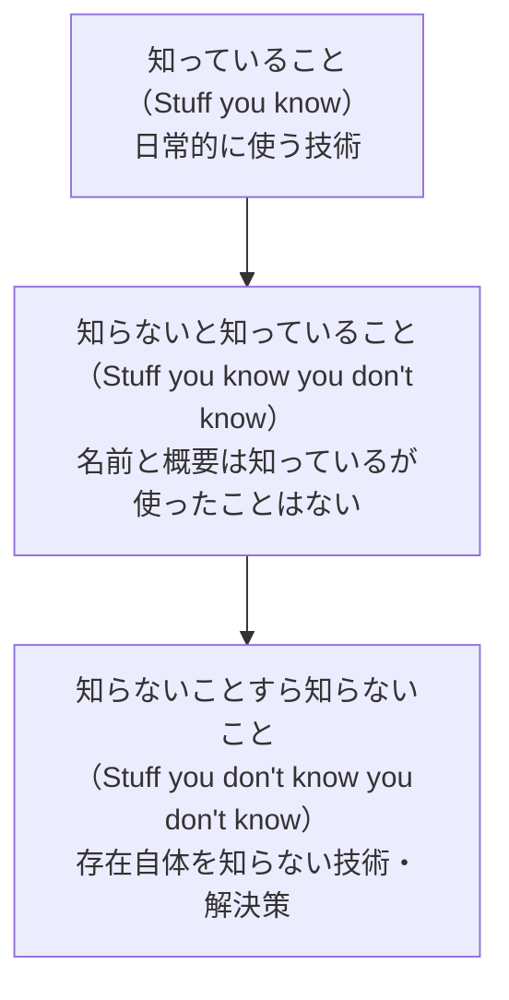

# アーキテクトの役割と思考

## この教材の目的

[[01_ソフトウェアアーキテクチャとは]] では「アーキテクチャとは何か」を、[[02_アーキテクチャと設計の違い]] では「設計とどう違うか」を学びました。
この教材では視点を **人** に移し、

- アーキテクト（アーキテクチャを決める人）に **何が期待されているか**
- 開発者とは **考え方がどう違うか**（アーキテクチャ思考）
- アーキテクトが陥りがちな **アンチパターン**

を、『ソフトウェアアーキテクチャの基礎』（Richards & Ford）を軸に整理します。
肩書きとしての「アーキテクト」でなくても、**チームで構造の判断をする人は誰でもこの役割を部分的に担っている**、という前提で読んでください。

---

## 1. アーキテクトに期待される8つのこと

『ソフトウェアアーキテクチャの基礎』は、肩書きや組織に関係なく、アーキテクトに共通して期待されることを8つ挙げています。

| # | 期待 | 中身 | 関連ノート |
|---|---|---|---|
| 1 | **アーキテクチャ上の決定を下す** | 技術を「指定」するより、**判断の指針**を示す（例：「React を使え」ではなく「リアクティブなフロントエンドの FW を選べ」） | [[02トレードオフ]] |
| 2 | **アーキテクチャを継続的に分析する** | 3年前に決めた構造が、今のビジネスと技術に合っているかを見直し続ける | [[03技術的負債と意図的な暫定案]] |
| 3 | **最新のトレンドを把握する** | 技術・業界の変化を追う。アーキテクトの決定は長く残るため | — |
| 4 | **決定が守られているか確認する** | 決めたルール（例：UI 層から DB を直接呼ばない）が実際に守られているかを検証する | [[02ADRとArchitecture Decision Record]] |
| 5 | **多様な技術に触れ、経験する** | 1つの言語・FW に閉じず、複数の技術の特徴を知る | 本ノート §2 |
| 6 | **ビジネスドメインの知識を持つ** | 業務を理解していないと、適切な品質特性を選べない | [[04_アーキテクチャ特性の見つけ方と分類]] |
| 7 | **対人スキルを持つ** | チームを導き、意見の対立をまとめ、決定を説明する | — |
| 8 | **政治を理解し、乗りこなす** | ほぼすべての決定は誰かの反対に遭う。交渉して合意を得る | — |

ポイントは、**8つのうち技術そのものの話は半分程度**だということです。残りは「分析し続ける」「守らせる」「説明する」「合意を得る」という、**判断を現実に根付かせるための仕事**です。

### 1.1 「決める」と「指定する」の違い

1つ目の「決定を下す」は誤解されがちです。

- ✕ アーキテクトがライブラリやクラス構成まで細かく指定する → 開発チームの裁量を奪い、アーキテクトがボトルネックになる
- ○ アーキテクトは **制約と方針**（境界・依存の向き・品質目標）を決め、その範囲内の具体的な選択はチームに任せる

『基礎』ではこれを、アーキテクトと開発チームの協働の度合いとして説明しています。制約が細かすぎると「コントロールフリーク」、緩すぎると「アームチェア・アーキテクト（口だけ出して手を動かさない）」になります。**チームの経験・規模・プロジェクトの複雑さ**に応じて関わり方を調整するのが現実的です。

---

## 2. 技術の「幅」と「深さ」

### 2.1 知識のピラミッド

『基礎』では、技術知識を3層のピラミッドで説明しています。

- **開発者** はピラミッドの頂点（知っていること）を **深く** することでキャリアを築きます
- **アーキテクト** にとって価値があるのは、真ん中の層（知らないと知っていること）を **広く** することです

理由は、アーキテクトの仕事が「課題に対して、どの選択肢があるかを並べ、トレードオフを比べること」だからです。**選択肢を知らなければ、比較の土俵にすら載りません**。一番下の層（存在すら知らない解決策）が大きいと、「もっと良い方法があったのに知らなかった」という失敗が起きます。

### 2.2 幅を広げるときの注意

- 深い知識を **全部維持しようとしない**。深い知識は維持コストが高く、技術が古くなると価値も下がる
- 代わりに「何が得意で、何が苦手か」を言えるレベルの知識を広く持つ
- 情報源の例：Thoughtworks Technology Radar、技術カンファレンス、他チームのアーキテクチャ事例、社内勉強会

### 2.3 手を動かし続ける

幅を優先するとはいえ、**コードから完全に離れると判断が現実から浮きます**。『基礎』では次のような方法を勧めています。

- クリティカルパス（遅れると全体が遅れる部分）のコードは書かない。アーキテクトがボトルネックになるため
- 代わりに **PoC（概念実証）** を書く、**技術的負債の解消** やバグ修正を担当する、**自動化ツール**（アーキテクチャルールの検査など）を書く
- コードレビューに参加して、決定が守られているかを確かめる（期待4にもつながる）

---

## 3. アーキテクチャ思考 — 開発者との考え方の違い

| 観点 | 開発者の問い | アーキテクトの問い |
|---|---|---|
| 正解 | 「どれが正しい実装か？」 | 「何を得て、何を失うか？」 |
| 時間軸 | 今のスプリント | 数年後の変更・運用 |
| 範囲 | 自分のモジュール | システム全体・他チーム・組織 |
| 根拠 | 技術的な美しさ | ビジネス上の成功に効くか |
| 成果物 | 動くコード | 判断と、その理由の記録 |

### 3.1 トレードオフを分析する

アーキテクチャ思考の中心は **トレードオフ分析** です（[[02トレードオフ]]）。

例：「注文情報を他サービスに伝えるのに、キュー（1対1）を使うか、トピック（1対多のPub/Sub）を使うか」

| 観点 | トピック | キュー |
|---|---|---|
| 拡張性（新しい受け手の追加） | ◎ 受け手を足すだけ | △ 送り手に新しいキューを追加する必要 |
| セキュリティ | △ 誰でも購読できてしまう | ◎ 宛先が限定される |
| 受け手ごとのスケール・監視 | △ 一括でしか見えない | ◎ キューごとに監視・調整できる |
| データ契約 | △ 全受け手に同じ形式 | ◎ 受け手ごとに形式を変えられる |

どちらも「正しい」選択です。**どの特性を優先するか** で答えが変わる、というのがこの表の意味です。

### 3.2 アーキテクチャの法則

『基礎』はこの考え方を「法則」として示しています。

> **第1法則**：ソフトウェアアーキテクチャのすべてはトレードオフである。
> 　系：トレードオフがないと思ったなら、まだトレードオフを見つけていないだけだ。
>
> **第2法則**：「どうやって（How）」より「なぜ（Why）」の方が重要である。
>
> **第3法則**（第2版で追加）：アーキテクチャ上の決定のほとんどは二択ではなく、両極端の間のスペクトラム上にある。

第3法則は「モノリスかマイクロサービスか」ではなく「**どの程度分けるか**」、「同期か非同期か」ではなく「**どこまで非同期にするか**」と考えよ、という意味です。

### 3.3 「最高」ではなく「最も悪くない」を選ぶ

すべての品質特性を同時に最大化することはできないため、アーキテクトが目指すのは **「最も悪くないアーキテクチャ（least worst architecture）」** です。完璧を求めて決定を先延ばしにするより、**今わかっている情報で最も悪くない選択をし、変更しやすくしておく** 方が現実的です。

### 3.4 ビジネスの言葉を技術の言葉に翻訳する

ステークホルダーは「品質特性」という言葉では話しません。「競合より早く新機能を出したい」「年末セールで落ちたら困る」のように話します。これを **「デプロイ容易性・テスト容易性」「弾力性・可用性」** に翻訳するのがアーキテクトの仕事です（詳しくは [[04_アーキテクチャ特性の見つけ方と分類]]）。

---

## 4. アーキテクトが陥りがちなアンチパターン

| アンチパターン | 症状 | 対策 |
|---|---|---|
| **凍った原始人**（Frozen Caveman） | 過去に痛い目を見た特定のリスク（例：「昔データセンターが落ちた」）にこだわり、どのプロジェクトでも同じ対策を強要する | 「そのリスクは **今回の** システムで現実的か？」を毎回問う |
| **象牙の塔のアーキテクト** | 現場から離れた場所で図だけ描き、実装の現実を知らない | 手を動かし続ける（§2.3）、レビューに参加する |
| **コントロールフリーク** | クラス設計やライブラリまで細かく指定する | 制約と方針だけ決め、具体はチームに任せる（§1.1） |
| **アームチェア・アーキテクト** | 方針だけ言って、その後の検証や支援をしない | 決定が守られているか確認する（期待4） |
| **過去の成功体験の押しつけ** | 「前の会社ではマイクロサービスで成功した」をそのまま持ち込む | 規模・チーム・品質特性が違えば正解も違う（第1法則） |
| **決定の記録をしない** | 同じ議論が何度も蒸し返される | ADR に理由を残す（第2法則） |

---

## 5. 誰がアーキテクトなのか

近年は「アーキテクトという肩書きの人が全部決める」形から、**チーム全体でアーキテクチャに責任を持つ** 形が広がっています。

- **アーキテクチャ・アドバイス・プロセス**：誰でもアーキテクチャ上の決定をしてよい。ただし、影響を受ける人と専門知識を持つ人に **必ず助言を求め**、決定を記録する（Thoughtworks Technology Radar でも紹介されている分散型の進め方）
- **適応度関数**：「決定が守られているか確認する」（期待4）を人の目ではなく自動テストで行う（→ 70_進化と組織）

つまり、アーキテクトの8つの期待は **役職ではなく役割** です。開発者であっても、構造の判断に関わる場面ではこの考え方が求められます。

---

## 6. ありがちな誤解

### 6.1 「アーキテクトは一番技術に詳しい人がなるもの」

**半分だけ正しいです。** 深さより **幅** が重要で、さらに技術以外の4つ（ビジネス理解・対人・政治・継続的な分析）が同じくらい重要です。

### 6.2 「アーキテクトはコードを書かなくてよい」

**誤りです。** クリティカルパスのコードは避けるべきですが、PoC・自動化・負債の解消などで **手を動かし続けないと判断が古くなります**。

### 6.3 「アーキテクトの仕事は最初に正しい構造を決めること」

**誤りです。** 「継続的に分析する」「決定が守られているか確認する」が期待に含まれているとおり、**決めた後の仕事の方が長い** のです。

---

## 7. まとめ

- アーキテクトには **8つの期待**（決定・継続的分析・トレンド把握・遵守の確認・多様な経験・ドメイン知識・対人スキル・政治）がある。技術そのものの話は半分程度
- アーキテクトにとって重要なのは技術の **深さより幅**。選択肢を知らなければ比較できない
- アーキテクチャ思考の中心は **トレードオフ分析**。「正解」ではなく「最も悪くない選択」を探す
- **第1法則：すべてはトレードオフ／第2法則：How より Why／第3法則：決定はスペクトラム**
- 凍った原始人・象牙の塔・コントロールフリークなどの **アンチパターン** に注意する
- アーキテクトは **役職ではなく役割**。チームで構造を判断する人は誰でもこの考え方を使う

次は [[14_非機能要件]] と [[01品質属性]] で、アーキテクトが判断の物差しにする「品質」を学びます。

---

## 参考資料

- Mark Richards, Neal Ford『ソフトウェアアーキテクチャの基礎』第1章・第2章（原著 *Fundamentals of Software Architecture*, 2nd Edition, O'Reilly, 2025）
- [8 Essential Expectations of a Software Architect（workingsoftware.dev）](https://www.workingsoftware.dev/what-makes-a-good-software-architect/)
- [Neal Ford — Knowledge Breadth versus Depth](https://nealford.com/memeagora/2015/09/08/knowledge-breadth-versus-depth.html)
- [The Frozen Caveman Antipattern（Kevin Hakanson）](https://kevinhakanson.com/2017-08-08-the-frozen-caveman-antipattern/)
- [Fundamentals of Software Architecture 2nd Ed. 第27章 The Laws of Software Architecture, Revisited](https://www.oreilly.com/library/view/fundamentals-of-software/9781098175504/ch27.html)
- [Thoughtworks Technology Radar — Architecture advice process](https://www.thoughtworks.com/en-us/radar/techniques/architecture-advice-process)
