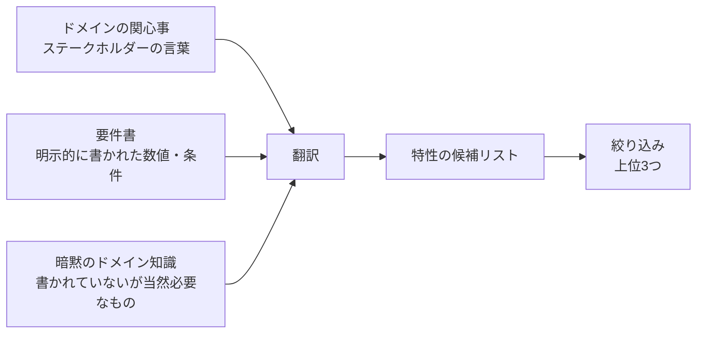

# アーキテクチャ特性の見つけ方と分類

## この教材の目的

[[01品質属性]] と [[14_非機能要件]] では「品質特性とは何か」「代表的な特性」を学びました。
しかし実務で本当に難しいのは、**目の前のシステムにとって、どの特性が重要なのかを見つけること** です。要件書に「スケーラビリティが必要」と書いてあることはまずありません。

この教材では、

- 「アーキテクチャ特性」と呼べるものの **3つの条件**
- 特性の **分類**（『ソフトウェアアーキテクチャの基礎』の分類と ISO/IEC 25010:2023）
- 特性を **見つける3つの方法**（ドメインの関心事・要件・暗黙知）
- 見つけた特性の **絞り込み方**
- 練習方法としての **アーキテクチャ・カタ**

を解説します。

---

## 1. 何が「アーキテクチャ特性」なのか — 3つの条件

『ソフトウェアアーキテクチャの基礎』では、ある品質がアーキテクチャ特性と呼べるのは次の3つを満たすときだとしています。

| 条件 | 意味 | 例 |
|---|---|---|
| **① 非ドメインの設計上の考慮事項を示す** | 「何をするか」ではなく「どう実現するか」の要求 | 「注文できる」は機能、「注文が 1 秒以内に終わる」は特性 |
| **② 設計の構造面に影響する** | その特性のために **構造上の特別な配慮** が必要になる | 決済を外部サービスに任せるなら特別な構造は不要。自前で厳しいセキュリティ要件を満たすなら、決済部分を分離する構造が必要 |
| **③ アプリケーションの成功に不可欠、または重要である** | 欠けるとシステムが失敗する | 社内ツールに 99.999% の可用性は不要 |

②がとくに重要です。**構造に影響しない品質は、設計（コード）レベルで対応できる** ので、アーキテクチャで扱う必要はありません。
たとえば「入力値をバリデーションする」はセキュリティに関わりますが、構造には影響しないため、通常はアーキテクチャ特性とは呼びません。

---

## 2. 特性の分類

### 2.1 『ソフトウェアアーキテクチャの基礎』の分類

| 分類 | 特性の例 | 何に関わるか |
|---|---|---|
| **運用特性** | 可用性、継続性（災害復旧）、性能、回復性、信頼性・安全性、堅牢性、スケーラビリティ、弾力性 | 本番環境で動いているときの振る舞い。運用・DevOps と重なる |
| **構造特性** | 構成容易性、拡張性、インストール容易性、再利用性、ローカライズ、保守性、移植性、アップグレード容易性 | コードの構造・作りやすさ・変えやすさ |
| **クラウド特性** | オンデマンドのスケール、オンデマンドの弾力性、ゾーン・リージョンの可用性 | クラウド前提で出てくる特性 |
| **横断特性** | アクセシビリティ、長期保存性、認証、認可、法令順守、プライバシー、セキュリティ、サポート容易性、ユーザビリティ | 上のどれにも収まらない、全体に効く制約 |

似ているが違う言葉に注意します。

| 混同しやすい組 | 違い |
|---|---|
| **スケーラビリティ** と **弾力性** | スケーラビリティ＝利用者が **徐々に** 増えても性能を保つ／弾力性＝**突発的な** 負荷の急増に耐える（チケット発売の瞬間など） |
| **可用性** と **信頼性** | 可用性＝使える時間の割合（稼働率）／信頼性＝正しく動き続けること（データが壊れない、処理が失われない） |
| **性能** と **スケーラビリティ** | 性能＝1リクエストがどれだけ速いか／スケーラビリティ＝負荷が増えても速さを保てるか |

### 2.2 複合特性 — 1つの言葉が複数の特性を含む

ステークホルダーがよく使う言葉には、**複数の特性を組み合わせたもの** があります。

| ビジネスの言葉 | 実際に必要な特性の組み合わせ |
|---|---|
| **アジリティ**（素早く変えたい） | 保守性 ＋ テスト容易性 ＋ デプロイ容易性 |
| **市場投入までの時間**（早く出したい） | アジリティ ＋ テスト容易性 ＋ デプロイ容易性 |
| **信頼できる**（落ちない・壊れない） | 可用性 ＋ 信頼性 ＋ 回復性 ＋ データ整合性 |

「アジリティが大事」と言われたら、**そのまま特性リストに書くのではなく、分解して測れる特性にする** のがポイントです。

### 2.3 国際規格 ISO/IEC 25010:2023 の製品品質モデル

規格では、製品品質を **9つの特性** と、その下の副特性に分けています（2023年改訂）。

| 特性 | 主な副特性 | 2011年版からの主な変化 |
|---|---|---|
| 機能適合性 | 機能完全性、機能正確性、機能適切性 | — |
| 性能効率性 | 時間効率性、資源効率性、容量満足性 | — |
| 互換性 | 共存性、相互運用性 | — |
| **インタラクション能力** | 適切度認識性、習得性、運用操作性、ユーザーエラー防止性、ユーザーエンゲージメント、包括性、ユーザー支援性、自己記述性 | 旧「使用性」を改称。包括性・自己記述性などを追加 |
| 信頼性 | **無欠陥性**、可用性、障害許容性、回復性 | 旧「成熟性」を「無欠陥性」に |
| セキュリティ | 機密性、インテグリティ、否認防止性、責任追跡性、真正性、**耐性** | 耐性を追加 |
| 保守性 | モジュール性、再利用性、解析性、修正性、試験性 | — |
| **柔軟性** | 適応性、**スケーラビリティ**、設置性、置換性 | 旧「移植性」を改称。スケーラビリティを追加 |
| **安全性** | 運用制約性、リスク識別性、フェールセーフ性、危険警告性、安全統合性 | **新設** |

使い分けの目安：

- **『基礎』の分類** … アーキテクトが「どの特性を優先するか」を議論するための実務的な語彙
- **ISO/IEC 25010** … 品質を **漏れなく** 洗い出すためのチェックリスト。発注者との合意や品質評価に向く

> ⚠️ 副特性の日本語訳は JIS 規格や資料によって表記ゆれがあります。正確な訳語が必要な場合は JIS X 25010 を参照してください。

---

## 3. 特性を見つける3つの方法

『基礎』では、アーキテクトは少なくとも次の3つの方法で特性を見つけるとしています。

### 3.1 ドメインの関心事から翻訳する

ステークホルダーは「〜性」という言葉では話しません。**ビジネスの言葉を特性に翻訳** します。

| ドメインの関心事（ステークホルダーの言葉） | 翻訳したアーキテクチャ特性 |
|---|---|
| 合併・買収が多い | 相互運用性、スケーラビリティ、適応性、拡張性 |
| 市場投入までの時間を短くしたい | アジリティ、テスト容易性、デプロイ容易性 |
| ユーザー満足度を上げたい | 性能、可用性、耐障害性、テスト容易性、デプロイ容易性、アジリティ、セキュリティ |
| 競争優位を得たい | アジリティ、テスト容易性、デプロイ容易性、スケーラビリティ、可用性、耐障害性 |
| 時間と予算が限られている | シンプルさ、実現可能性 |

最後の行は見落とされがちですが重要です。**予算と期限は、それ自体が強力なアーキテクチャ特性** です。「シンプルさ」を最優先にすべきプロジェクトで、高度な分散構成を選ぶのは典型的な失敗です。

### 3.2 要件から読み取る

要件書の **何気ない一文** から特性を読み取ります。

| 要件書の文 | 読み取れる特性 |
|---|---|
| 「年に一度、大規模なセールを行う」 | **弾力性**（短時間に負荷が急増する） |
| 「全国の学生 1,000 人が同時に受講登録する」 | **スケーラビリティ・弾力性**（締切直前に集中する） |
| 「顧客は各国のタイムゾーンで利用する」 | **可用性**（夜間メンテナンスの時間帯がない） |
| 「会計データを扱う」 | **データ整合性・監査性・法令順守** |
| 「将来、他社のシステムとつなぐ予定がある」 | **相互運用性・拡張性** |

### 3.3 暗黙のドメイン知識から補う

要件書には **書かれていないが当然必要な特性** があります。

- **可用性・信頼性・セキュリティ** は、ほぼすべてのシステムで暗黙に求められる
- 業界特有の暗黙知：医療なら個人情報保護、金融なら監査証跡、EC ならカード情報の取り扱い（PCI DSS）

ただし、暗黙の特性を **すべて最高レベルで** 満たそうとしないこと。「セキュリティは当然必要」でも、**構造に影響するほど重要か**（§1 の条件②③）は別に判断します。

---

## 4. 見つけた特性を絞り込む

候補を洗い出すと、ほぼ確実に「全部大事」に見えます。しかし特性同士は衝突し、**サポートする特性が増えるほど設計は複雑になります**（[[02トレードオフ]]）。

### 4.1 『基礎』が勧める絞り込み方

1. 候補の中から **7つ程度** までに減らす
2. その中から **最も重要な3つ** を選ぶ（順位まで付けなくてよい）
3. 残りは「暗黙の特性」や「設計レベルで対応するもの」に回す

順位を厳密に付けようとすると、ステークホルダー間で合意が取れずに議論が止まります。**「上位3つ」に入るかどうか** だけを決める方が合意しやすい、というのが『基礎』の実践的な助言です。

### 4.2 ワークシートの例

| 候補 | 上位3つ | 根拠 | 暗黙／明示 |
|---|---|---|---|
| 弾力性 | ✅ | 年1回のセールで通常の 50 倍のアクセス | 明示（要件から） |
| 可用性 | ✅ | セール中の停止は売上に直結 | 明示 |
| デプロイ容易性 | ✅ | 週次でキャンペーン機能を追加したい | ドメインの関心事から |
| セキュリティ | | 決済は外部サービスに委託するため構造への影響は小さい | 暗黙 |
| 性能 | | 弾力性を満たせば平常時は問題にならない | 暗黙 |
| 拡張性 | | 当面は他システム連携の予定なし | — |

この表の「上位3つ」が、MOC のスタイル比較表（★評価）で **どの列を見るか** を決めます。上の例なら「弾力性・可用性・デプロイ容易性」の列を見て、イベント駆動やマイクロサービスを候補にする、という流れになります。

### 4.3 特性のスコープ — システム全体とは限らない

特性は **システム全体で一律** とは限りません。

- 例：EC サイトで「商品検索」には弾力性が必要だが、「管理画面」には不要
- このように **部分ごとに必要な特性が違う** ことが、システムを分割する（サービスを分ける）大きな理由になります

『基礎』ではこの考え方を **アーキテクチャ量子** という単位で説明しています（→ [[05_アーキテクチャ量子と粒度]]）。

---

## 5. 練習方法 — アーキテクチャ・カタ

特性を見つける力は、**練習** で身につきます。Ted Neward が考案した **アーキテクチャ・カタ**（Architectural Katas）は、そのための演習です。

- 「カタ（型）」は武道の型稽古から取った名前
- ドメインの言葉で書かれた短い課題（例：「地元のサンドイッチ店のオンライン注文システム」）が与えられる
- 少人数のチームで、時間を区切って（例：45分）特性を洗い出し、アーキテクチャを考えて発表する
- 他のチームと比べることで、**同じ課題でも重視する特性で答えが変わる** ことを体感できる

課題は Neal Ford のサイトや書籍の公式サイトで公開されています（参考資料を参照）。

---

## 6. ありがちな誤解

### 6.1 「要件書に書かれた非機能要件がすべて」

**誤りです。** 本当に重要な特性ほど **書かれていない**（暗黙）か、**ビジネスの言葉** で書かれています。翻訳と読み取りが必要です。

### 6.2 「特性は多く挙げるほど丁寧な設計になる」

**誤りです。** 特性を増やすほど設計は複雑になり、どれも中途半端になります。**上位3つに絞る** ことが設計の質を上げます。

### 6.3 「アジリティ」「信頼性」をそのまま特性として書けばよい

**不十分です。** これらは **複合特性** なので、保守性・テスト容易性・デプロイ容易性などに分解し、[[05_品質特性シナリオと計測]] のように **測れる形** にします。

---

## 7. まとめ

- アーキテクチャ特性とは、①非ドメインの考慮事項で、②**構造に影響し**、③成功に不可欠なもの
- 分類は『基礎』の **運用・構造・クラウド・横断** と、規格の **ISO/IEC 25010:2023 の9特性** を使い分ける
- アジリティや市場投入時間は **複合特性**。分解して扱う
- 特性は **ドメインの関心事の翻訳・要件の読み取り・暗黙知** の3つの方法で見つける
- 見つけた候補は **7つ程度 → 上位3つ** に絞る。予算・期限（シンプルさ）も立派な特性
- 必要な特性が部分ごとに違うことが、システムを分割する理由になる
- **アーキテクチャ・カタ** で練習できる

次は [[05_品質特性シナリオと計測]] で、見つけた特性を「測れる形」に書き下す方法を学びます。

---

## 参考資料

- Mark Richards, Neal Ford『ソフトウェアアーキテクチャの基礎』第4章・第5章
- [Chapter 5: Identifying Architectural Characteristics（Medium）](https://medium.com/@mohamedsallam953/chapter-5-identifying-architectural-characteristics-fundamental-of-software-architecture-2787f8de57d9)
- [Notes on Fundamentals of Software Architecture（bagerbach.com）](https://bagerbach.com/books/fundamentals-of-software-architecture/)
- [ISO/IEC 25010（quality.arc42.org）](https://quality.arc42.org/standards/iso-25010)
- [ISO/IEC 25010 Explained: 9 Software Quality Characteristics（Sonar）](https://www.sonarsource.com/resources/library/iso-iec-25010-explained/)
- [Architectural Katas（nealford.com）](https://nealford.com/katas/) / [fundamentalsofsoftwarearchitecture.com/katas](http://fundamentalsofsoftwarearchitecture.com/katas/)
